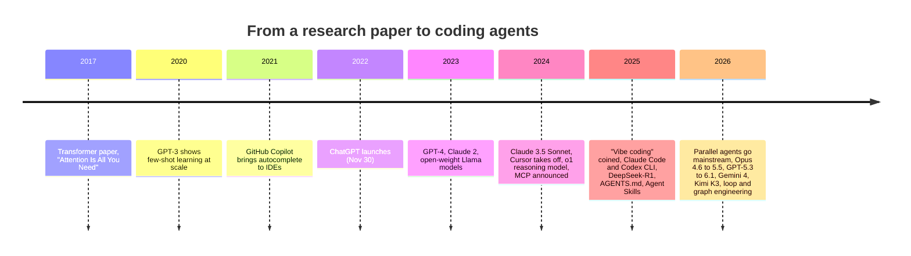
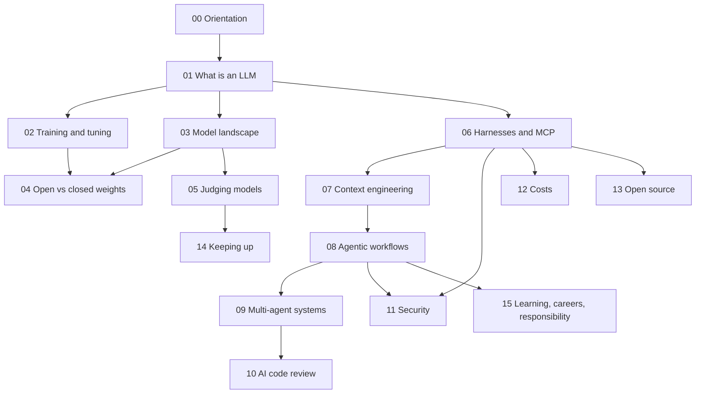

# 00: Orientation: what this is and how to use it

*About a 20-minute read. Last checked November 8, 2026.*

**TL;DR**
- This is a course and knowledge base on **AI-accelerated software engineering**: using language models and coding agents to build real software faster, with a human still in charge.
- "Vibe coding" originally meant *not reading the code at all*. We use the popular phrase but teach the opposite habit: you read it, test it, and answer for what you ship.
- This stuff changes monthly. So the durable ideas (how models work, context, verification, security, cost) come first, and the perishable details (model names, prices, leaderboards) are dated and kept in a few places.
- Every module has three depth levels: Foundations (no background assumed), In practice (what working engineers do), and Going deeper (research and open debates). Pick your path in [`paths/`](../paths/).
- Opinions are labelled **Bryan's take**. Everything else should be sourced. If you find something unsourced or stale, that's a bug.

## Foundations

### Why this exists

AI coding tools have moved beyond autocomplete and chat. Coding agents read a codebase, run commands, write and test changes, and open pull requests. Anthropic reports that Claude wrote more than 80% of its merged code by May 2026 ([module 08](08-agentic-workflows.md)).

That shift leaves two groups behind:

- Students, who may be learning in courses that restrict AI tools while preparing for jobs where they'll use them.
- Working engineers who tried an AI tool in 2024, found it wrong half the time, and reasonably gave up on it. What they tried isn't what exists now.

This is for both groups, plus leads who want their teams to adopt these tools well. It starts at "what is a language model?" and ends with running several agents in parallel, having other agents review their work, and keeping it all secure and affordable.

### What we mean by "vibe coding"

The phrase comes from a February 2, 2025 post by Andrej Karpathy, a founding member of OpenAI and former head of AI at Tesla. He described "a new kind of coding I call 'vibe coding', where you fully give in to the vibes, embrace exponentials, and forget that the code even exists" ([Karpathy](https://twitter.com/karpathy/status/1886192184808149383)). You describe what you want, accept whatever the model writes, paste errors back in, and never read the diff.

That's useful for throwaway projects, personal tools, and prototypes. It's a bad way to build software other people depend on. Simon Willison drew the line a month later: if you review, test, and can explain the code an LLM wrote, that's not vibe coding, it's software development with a powerful assistant ([Willison, "Not all AI-assisted programming is vibe coding"](https://simonwillison.net/2025/Mar/19/vibe-coding/)). In October 2025 he proposed "vibe engineering" for the disciplined version, and by early 2026 he reported that **"agentic engineering"** was winning as the name for it ([Willison, "Vibe engineering"](https://simonwillison.net/2025/Oct/7/vibe-engineering/)).

The popular phrase stuck anyway, so we use it and mean the disciplined version throughout. The title, *A Brief Introduction to Not Writing Code*, is the same joke from the other side: you'll type a lot less code by hand, which makes the engineering around it matter more.

> **Bryan's take:** When I say vibe coding, I mean AI-accelerated coding, not really vibe coding. The AI does most of the typing. A human still decides what to build, reads what matters, makes sure it's tested, and owns the result. That's the only version I'd teach.

We'll return to this spectrum throughout the course:

| Mode | Who writes the code | Who reads it | Good for |
| --- | --- | --- | --- |
| Hand-coding | You | You | Learning, tricky core logic |
| Autocomplete | You, with suggestions | You | Boilerplate, familiar code |
| Chat-assisted | Model writes snippets, you paste | You | Explanations, one-off functions |
| **Supervised agent** | Agent edits the repo | You review every diff | Most professional work today |
| **Parallel supervised agents** | Several agents, separate tasks | You review, agents cross-review | Experienced users with good tests |
| Background / cloud agents | Agent works unattended, opens a PR | You review the PR | Well-specified, well-tested tasks |
| Pure vibe coding | Model | Nobody | Prototypes, personal tools, throwaways |
| Fully autonomous pipeline | Agents | Other agents | Contested; see [module 08](08-agentic-workflows.md) |

Most of this course lives in the bold rows.

### How fast this moves

A few data points, each covered later:

- In 2026 alone, Anthropic shipped eleven generally available models across four tiers (more than a dozen counting the restricted Mythos versions), OpenAI shipped GPT-5.3 through GPT-6.1, and Google cancelled one flagship, launched another, and announced a third that only vetted cyber defenders can use so far ([module 03](03-model-landscape.md), [timeline](../reference/timeline.md)).
- METR, an independent evaluator, measures how long a task (in human time) an AI agent can finish half the time. That "time horizon" has been doubling about every three months since 2024 (89 days, in METR's January 2026 update), much faster than the roughly 7-month doubling its original 2025 paper found ([module 05](05-judging-models.md)).
- The vocabulary churns too: prompt engineering, then context engineering, harness engineering, loop engineering, and graph engineering, all within about eighteen months ([module 07](07-context-engineering.md)).
- Tools come and go fast. Roo Code, a popular open-source agent, shut down in May 2026. SpaceX acquired Cursor in August 2026. Gemini CLI went enterprise-only in June 2026 ([module 06](06-harnesses-and-tools.md), [module 13](13-open-source-ecosystem.md)).

You don't need to memorize the current lineup. Learn mental models that still work when every name here is out of date, and get used to checking what's current ([module 14](14-keeping-up.md)).

### Six ideas that outlast the hype

Every module builds on at least one of these ideas.

1. **A language model predicts the next token.** Everything else (chat, reasoning, coding agents) is built on that one trick plus a lot of training. It has no built-in sense of what's true, so it can be confidently wrong ([module 01](01-what-is-an-llm.md)).
2. **Context is the model's working memory.** Training gives it general knowledge. Context gives it your task: your prompt, the files it read, the tool output it saw. Most of the skill in using agents is controlling that context ([module 07](07-context-engineering.md)).
3. **Verification is your job, and you can delegate the checking but not the responsibility.** An agent stops when *it* thinks it's done. Give it tests, builds, and linters it can run, and ask for the evidence. Then look ([module 08](08-agentic-workflows.md), [module 10](10-ai-code-review.md)).
4. **The harness matters as much as the model.** The same model scores very differently in different tools. "Agent = model + harness" ([module 06](06-harnesses-and-tools.md), [module 05](05-judging-models.md)).
5. **Anything the model reads can give it orders.** A README, a web page, an issue comment, or a tool result can contain instructions, and the model can't reliably tell data from commands. This is prompt injection, and it isn't solved ([module 11](11-security-and-prompt-injection.md)).
6. **Cost depends on the context processed and output generated.** Agents often resend the whole conversation so far on every turn. Caching and context compaction help, but that resending is why heavy agentic work on pay-per-token pricing gets expensive, and why subscriptions changed the economics ([module 12](12-costs-subscriptions-and-apis.md)).

### A two-minute history

The full dated history, with sources, is in the [timeline](../reference/timeline.md).

### How the modules fit together

Roughly, 01–05 are about models (what they are, who makes them, how to judge them), 06–10 are about working with them (tools, context, workflows, multiple agents, review), and 11–15 are about doing it responsibly (security, cost, the ecosystem, staying current, and what it all means for learning and careers).

## In practice

### Pick a path

There's a reading path for each audience. Each one says what to read in full, what to skim, and what to skip the first time through.

| You are | Start with | Time |
| --- | --- | --- |
| A student, or new to AI tools | [Student path](../paths/students.md) | A semester, or ~15 hours self-paced |
| A working engineer | [Engineer path](../paths/engineers.md) | ~6–8 hours, plus a two-week practice plan |
| A lead, manager, or AI champion | [Leads path](../paths/leads.md) | ~3 hours, plus the [workplace playbook](../workplace/ai-first-playbook.md) |

There's also a full [semester course outline](../course/syllabus.md) with [labs](../course/labs/), and a [glossary](../reference/glossary.md) and annotated [reading list of papers](../reference/papers.md).

### Ground rules we assume throughout

These are the habits every exercise in this course expects. They're also a decent starting policy for a team.

1. **You own what you ship.** "The AI wrote it" is never an excuse, in a class or in a postmortem.
2. **Read every diff you merge, or have a check you trust read it for you.** Start by reading everything. Earn the right to read less by building tests and review.
3. **Don't paste secrets, credentials, or other people's private data** into any tool unless your organization has approved that tool for that data ([module 15](15-learning-careers-and-responsibility.md)).
4. **Disclose AI use** where your course, employer, or the open-source project you're contributing to asks you to ([module 13](13-open-source-ecosystem.md), [module 15](15-learning-careers-and-responsibility.md)).
5. **Keep a human approval step before anything irreversible**: deploying, deleting, sending, paying, force-pushing ([module 11](11-security-and-prompt-injection.md)).
6. **When a tool surprises you, write it down.** A short log of "the model did X when I expected Y" is the start of your own evaluation set ([module 05](05-judging-models.md)).

### What you need to follow along

- A computer with a terminal, git, and a code editor.
- Access to at least one frontier coding agent. A $20/month individual plan from Anthropic or OpenAI is a fine place to start, though usage limits may mean spreading exercises over several days. Student and education discounts change often, so check what's current ([module 12](12-costs-subscriptions-and-apis.md)).
- If you can, a second agent from a different lab for the cross-review exercises ([module 10](10-ai-code-review.md)). It's optional.
- No GPU needed. Nothing in the course requires downloading model weights. If you want to try running models locally, [module 04](04-open-vs-closed-weights.md) explains what it takes.

### Reading this material with an AI

Go ahead. Paste a module into whatever assistant you use and ask it to quiz you, explain a section a different way, or argue with one of Bryan's takes. Two cautions:

- Models have training cutoffs. Ask about anything after the cutoff and a model may make up plausible details. Many of the 2026 facts here postdate the models you'll use, so trust the cited sources over the model's memory.
- Ask it to *test* you, not just summarize for you. [Module 15](15-learning-careers-and-responsibility.md) covers the research on why that difference matters for learning.

## Going deeper

### Why "the human stays in charge" isn't just caution

Even if agents improve, there are three reasons to keep a human in charge.

- Accountability doesn't transfer. A model can't be fired, sued, or paged at 3 a.m. Whoever merges the change owns it. That holds in a classroom (academic integrity), at work (on-call), and legally (licensing, security, privacy).
- The evidence on productivity is mixed. Some of the most careful studies found experienced developers were *slower* with AI while believing they were faster. Newer studies show modest gains with wide error bars ([module 05](05-judging-models.md), [module 08](08-agentic-workflows.md)). None of them establish a universal gain, even for careful users.
- Learning takes effort. Studies of students and new developers find that letting AI do the work can reduce what you learn, even when the output is better ([module 15](15-learning-careers-and-responsibility.md)). For a student, the point of an assignment is the skill you build.

You can use AI while continuing to learn and keeping someone accountable for the result.

### What this material doesn't cover

- Building AI products (RAG pipelines, chatbots, evaluating LLM features for end users) gets light treatment. The focus is using AI to *build software*, not building AI features.
- Machine learning theory stays at the level of intuition. [Module 01](01-what-is-an-llm.md) and [module 02](02-training-and-tuning.md) point to the best deeper resources.
- Non-coding AI uses (writing, research, images) appear only where they touch a developer's day.

### How this material was made

This knowledge base was built AI-first too. Bryan supplied the outline and opinions. Coding agents researched each topic in parallel and drafted modules against a shared [style guide](../CONTRIBUTING.md), then other agents cross-checked facts and reviewed the result before a human did. The process illustrates [module 09](09-multi-agent-systems.md), including its limits. The research agents ran out of search budget, disagreed with each other on a few facts, and needed reconciling. Each module's Last checked date tells you when its facts were checked.

## Try it

**On your own (30 minutes).** Pick a small program you wrote a while ago, like a class assignment or a script. Ask an AI assistant to explain it back to you, then to suggest one improvement and write a test for it. Before you run anything, predict what the test will do. Write down one thing it got right and one thing it got wrong or glossed over.

**In a group (45 minutes).** Everyone finishes the sentence "Using AI to code is like…". Compare, then sort the analogies by which of the six ideas they capture or miss. Keep the list and come back to it at the end of the course.

## Discussion questions

1. Karpathy's original "vibe coding" was about *not* reading the code. When is that actually the right call?
2. Which of the six durable ideas is most likely to be wrong in two years? Why?
3. If an AI writes 80% of a team's code, what should the humans on that team spend their time on?
4. Where should the line be between "AI helped me" and "AI did it for me" in a programming course?
5. What would convince you that a fully autonomous coding pipeline is trustworthy?

## Sources and further reading

- Andrej Karpathy, ["vibe coding" post](https://twitter.com/karpathy/status/1886192184808149383) (February 2, 2025).
- Simon Willison, ["Not all AI-assisted programming is vibe coding (but vibe coding rocks)"](https://simonwillison.net/2025/Mar/19/vibe-coding/) (March 19, 2025).
- Simon Willison, ["Vibe engineering"](https://simonwillison.net/2025/Oct/7/vibe-engineering/) (October 7, 2025; updated February 2026 on "agentic engineering").
- The rest of this knowledge base: every claim above links to the module that sources it.

## Terms introduced

- **Vibe coding:** Karpathy's term for building software by prompting an AI and accepting its output without reading the code.
- **Vibe engineering / agentic engineering:** The disciplined counterpart: AI does most of the typing, a human stays accountable for design, review, and testing.
- **Coding agent:** A language model in a loop with tools (read files, run commands, edit code) that works on a task until it decides it's done.
- **Supervised agent:** A coding agent whose every change a human reviews before it's kept.
- **Time horizon:** METR's measure of the length of task (in human working time) an AI can complete with 50% reliability.
