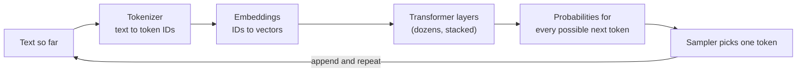
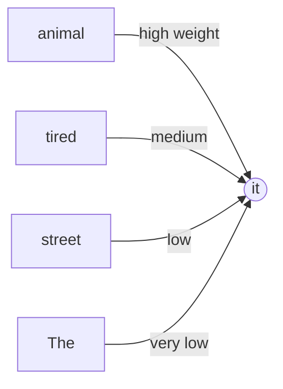

# 01: What is an LLM?

*About a 40-minute read. Last checked November 8, 2026.*

**TL;DR**
- A large language model (LLM) is a neural network trained to predict the next **token** (a chunk of text) from everything before it. Chat, code generation, and "reasoning" are all built on that one loop.
- Nearly every LLM is built on the **transformer**, introduced in the 2017 paper ["Attention Is All You Need"](https://arxiv.org/abs/1706.03762). Its core mechanism, **attention**, lets each token draw on other tokens. In GPT-style models, a token can only look at its own position and earlier ones.
- A raw next-token predictor becomes an assistant through **post-training**: instruction tuning, feedback from humans and AIs, and (since 2024) reinforcement learning on problems with checkable answers, which produced **reasoning models**.
- An LLM is not a database, a search engine, a calculator, or a person. It produces plausible text. That text can be confidently wrong (**hallucination**). It also tends to agree with you (**sycophancy**).
- So put the facts it needs in its context instead of trusting its memory, check its work with tools and tests, and expect different answers on different runs.

## Foundations

### The one idea: predict the next token

Your phone keyboard suggests the next word. It has seen a lot of text and guesses what usually comes next. An LLM does the same job at enormous scale and with far more context. It reads everything so far and outputs a probability for every possible next token. Then a sampler picks one, appends it, and the loop runs again.

That loop is called **autoregressive** generation: each output becomes part of the next input. A 500-line file is 500 lines of "what token comes next?"

To predict the next token well across trillions of tokens of web pages, books, papers, and code, a network has to absorb grammar, facts, style, programming idioms, and patterns of argument. Predicting the last line of a mystery novel ("and the murderer was...") rewards having tracked the plot. Andrej Karpathy describes the trained weights as a kind of lossy compression of the internet ([Intro to Large Language Models](https://www.youtube.com/watch?v=zjkBMFhNj_g), 2023). Common things come back sharp. Rare things come back blurry or invented.

Some vocabulary:

- **Parameters** (or **weights**) are the numbers inside the network that training adjusts. Modern models have billions to trillions of them.
- **Training** adjusts the weights. **Inference** uses the frozen weights to generate text. When you chat with a model, you're running inference. Nothing you type changes its weights.
- A **base model** is the raw next-token predictor after pretraining. An **assistant** or **chat model** is a base model after post-training.

### What an LLM is not

Most beginner mistakes come from the wrong mental model. Four are common.

| It is not... | Why not | What to do instead |
| --- | --- | --- |
| A database | Facts are smeared across billions of weights, not stored as rows. There is no lookup, no guarantee, and no record of where a "fact" came from. | Give it the source material (docs, files, records) in its context, or connect a retrieval tool. |
| A search engine | It has no live index. Its knowledge stops at a **training cutoff** date. Some products add a web-search tool, which is a separate system the model calls. | Check whether search is on. Ask for links and open them yourself. |
| A calculator | It sees numbers as tokens and approximates arithmetic. It is often right and sometimes wrong in ways that look right. | Have it write and run code, or call a calculator tool. |
| A person | It has no persistent memory between sessions (unless a product stores notes and re-inserts them), no stake in outcomes, and limited insight into its own workings. Its personality is a product of training. | Treat it as a capable, fast, uneven collaborator whose claims you verify. You stay accountable. |

Its output isn't always repeatable either. The same input can produce different outputs ([sampling](#sampling-temperature-and-determinism)).

### Tokens and tokenization

Models don't read letters or words. They read **tokens**: frequent chunks of characters. A **tokenizer** splits text into tokens and maps each to an integer ID.

Most LLMs use a variant of **byte-pair encoding (BPE)**. Sennrich, Haddow, and Birch adapted it from an old compression trick for machine translation ([Sennrich et al., 2016](https://arxiv.org/abs/1508.07909)). It works like this:

1. Start with individual characters (or bytes).
2. Count which adjacent pair appears most often in a large training corpus.
3. Merge that pair into a new token. Repeat tens of thousands of times.

You end up with a vocabulary of roughly 50,000 to a few hundred thousand tokens. Common words become a single token. Rare words split into pieces. Leading spaces are usually part of the token, so `" cat"` and `"cat"` can be different tokens. OpenAI's rule of thumb is that one token is about four characters of English, or about three-quarters of a word. Every model family has its own tokenizer, so the same text can be a different number of tokens on different models.

Tokenization explains some well-known stumbles:

- Ask "How many r's are in strawberry?" and the model may see something like `str` + `aw` + `berry`. The letters aren't separate input tokens, so the model has to learn spelling inside tokens. Reasoning models and code tools mostly fix this, but the root cause remains.
- Arithmetic is shaky because digits get grouped inconsistently (`1234` might be one token, `12345` two). The model has no guaranteed exact arithmetic operation. It relies on mechanisms learned during training. Tool use is the reliable fix.
- Prices, rate limits, and context windows are measured in tokens. Many non-English languages and some code styles take more tokens for the same content, so they cost more and fit less.

### Embeddings: tokens as points in space

Each token ID is turned into a list of thousands of numbers called an **embedding**. Those numbers work as coordinates in a very high-dimensional space, and training places tokens with related meanings near each other.

The classic demonstration came from **word2vec** ([Mikolov et al., 2013](https://arxiv.org/abs/1301.3781)), where vector arithmetic like *king − man + woman* lands near *queen*. In a transformer, that first embedding is just a starting point. Each layer refines every token's vector using its context, so "bank" in "river bank" and "bank account" ends up in different places.

Embeddings are also a product on their own. Embedding models turn documents into vectors for semantic search, which is the basis of **retrieval-augmented generation (RAG)**, covered in [module 07](07-context-engineering.md).

### Before transformers: a short prehistory

- The idea is old. Claude Shannon studied predicting the next letter of English text in the late 1940s and early 1950s. Neural language models date to the early 2000s.
- In 2013, word2vec made word embeddings cheap and useful ([Mikolov et al.](https://arxiv.org/abs/1301.3781)).
- In 2014, sequence-to-sequence models used recurrent neural networks (RNNs, specifically LSTMs) to read a sentence one word at a time, squeeze it into one vector, and generate a translation from it ([Sutskever et al.](https://arxiv.org/abs/1409.3215)). That single vector was a bottleneck.
- Also in 2014, Bahdanau, Cho, and Bengio added attention, letting the translator look back at every input word while producing each output word and weight the relevant ones ([Bahdanau et al.](https://arxiv.org/abs/1409.0473)). This "soft lookup" is the seed of everything below.
- In 2017, the transformer dropped recurrence entirely and used attention for everything.

### The transformer and attention

["Attention Is All You Need"](https://arxiv.org/abs/1706.03762) (Vaswani, Shazeer, Parmar, Uszkoreit, Jones, Gomez, Kaiser, and Polosukhin; Google; NeurIPS 2017) is the paper to know. It was written for machine translation and became the foundation of GPT, BERT, Claude, Gemini, Llama, DeepSeek, Kimi, and essentially every LLM since.

It mattered for two reasons:

1. Attention works across the whole sequence. Tokens can draw information directly from distant tokens. A causal mask limits GPT-style models to the current and earlier positions.
2. Training runs in parallel. RNNs process words one after another, so training can't be spread across many chips efficiently. A transformer processes all positions of a training sequence at once. That made it practical to throw huge amounts of GPU compute at it, which is what scaling needed.

To see how attention works, picture a meeting where each word is a person. Every person does three things:

- Holds up a **query**: "What am I looking for?"
- Wears a **key**: "Here's what I'm about."
- Carries a **value**: "Here's what I'll hand over if you pick me."

Each word compares its query with everyone's keys. Good matches get high weights. The word then takes a weighted blend of the values and updates its own understanding. Take the sentence:

> The animal didn't cross the street because it was too tired.

In a bidirectional encoder, "it" can use the later word "tired" to help resolve the reference to "animal." Change "tired" to "wide" and the likely reference flips to "street." The diagram illustrates that possibility, not measured attention weights. A GPT-style decoder can't look ahead from "it" to "tired", but later positions can combine both clues. Training learns the query, key and value transformations.

A few more pieces fill in the picture:

- **Multi-head attention** means each layer runs many attention "heads" in parallel. Different heads learn different relationships (which noun a pronoun refers to, which bracket closes which, which variable was defined where).
- After attention moves information *between* tokens, **feed-forward layers** (an MLP) process each token on its own. Much of the model's stored knowledge appears to live in these layers.
- The attention-plus-feed-forward block is stacked dozens of times, sometimes more than a hundred. Early layers handle surface features. Later layers handle more abstract ones.
- **Causal masking** means a token in a GPT-style model can attend to its own position and tokens *before* it, but not later ones. That's what makes it a next-token predictor.
- Attention by itself ignores word order, so the model adds positional information to each token.

The original transformer had an *encoder* (reads input) and a *decoder* (writes output). Later families mostly kept one half, which gives three flavors:

| Flavor | Example | Trained to | Good at |
| --- | --- | --- | --- |
| Decoder-only | GPT series, Claude, Llama | Predict the next token | Generating text and code |
| Encoder-only | [BERT](https://arxiv.org/abs/1810.04805) (2018) | Fill in masked-out words using context on both sides | Classification, search, embeddings |
| Encoder-decoder | Original transformer, T5 | Map an input sequence to an output sequence | Translation, summarization |

Today's chat and coding models are almost all decoder-only.

### From GPT-1 to ChatGPT

| When | Model | What changed |
| --- | --- | --- |
| Jun 2018 | [GPT-1](https://cdn.openai.com/research-covers/language-unsupervised/language_understanding_paper.pdf) (OpenAI, ~117M parameters) | Generative pretraining on unlabeled text, then fine-tuning per task. |
| Oct 2018 | [BERT](https://arxiv.org/abs/1810.04805) (Google) | Bidirectional fill-in-the-blank training. Topped many benchmarks. The rival approach for a while. |
| Feb 2019 | [GPT-2](https://cdn.openai.com/better-language-models/language_models_are_unsupervised_multitask_learners.pdf) (1.5B) | One bigger model did many tasks with no task-specific training. OpenAI staged its release over misuse concerns. |
| May 2020 | [GPT-3](https://arxiv.org/abs/2005.14165) (175B) | "Language Models are Few-Shot Learners": put a few examples in the prompt and the model picks up the task (**in-context learning**). |
| Mar 2022 | [InstructGPT](https://arxiv.org/abs/2203.02155) | Fine-tuned with human feedback. Labelers preferred a 1.3B InstructGPT over the 175B GPT-3. |
| Nov 30, 2022 | [ChatGPT](https://openai.com/index/chatgpt/) | A free chat interface on an RLHF-tuned GPT-3.5 model. Reportedly passed 100 million users within about two months. The moment LLMs went mainstream. |
| Mar 2023 | [GPT-4](https://arxiv.org/abs/2303.08774) | Large capability jump, image input. OpenAI stopped publishing architecture and size. |
| Sep 2024 | [o1](https://openai.com/index/learning-to-reason-with-llms/) | First widely released **reasoning model**. |
| Jan 2025 | [DeepSeek-R1](https://arxiv.org/abs/2501.12948) | Open-weight reasoning model that showed how to train reasoning with reinforcement learning. |

Current lineups are in [module 03](03-model-landscape.md), and the dated history is in the [timeline](../reference/timeline.md).

### Scaling laws: why bigger kept working

In 2020, Kaplan and colleagues at OpenAI found that a language model's error (its **loss**) falls smoothly and predictably as you increase parameters, training data, and compute. The relationship is a **power law**: each tenfold increase in scale cuts the loss by a roughly constant fraction ([Kaplan et al., 2020](https://arxiv.org/abs/2001.08361)). That made model building closer to engineering. You could roughly forecast how good a bigger model would be before paying to train it.

In 2022, DeepMind's **Chinchilla** paper corrected the recipe. Most big models were undertrained. For a fixed compute budget, you should grow parameters and training tokens together, at roughly 20 tokens per parameter. Chinchilla (70B parameters, 1.4 trillion tokens) beat the 280B Gopher with the same compute ([Hoffmann et al., 2022](https://arxiv.org/abs/2203.15556)).

Since then, labs often train small models far past the "Chinchilla-optimal" point, because a smaller model is cheaper to *run* for millions of users. Meta trained Llama 3's 8B model on more than 15 trillion tokens ([Llama 3 paper](https://arxiv.org/abs/2407.21783)), nearly 2,000 tokens per parameter.

Emergence is still debated. [Wei et al. (2022)](https://arxiv.org/abs/2206.07682) catalogued abilities that seemed absent in small models and then appeared suddenly at larger scale. [Schaeffer et al. (2023)](https://arxiv.org/abs/2304.15004), "Are Emergent Abilities of Large Language Models a Mirage?", argued that many of these jumps come from all-or-nothing metrics. Score multi-digit addition as "exactly right or wrong" and you see a cliff. Give partial credit and you see a smooth slope. Both points can hold at once. Underlying improvement is often smooth, and a capability can still feel sudden to users once it crosses the "useful" line.

### Post-training: from autocomplete to assistant

A base model continues documents. Ask it "What is the capital of France?" and it may continue with three more quiz questions, because that's what a page of quiz questions looks like. Post-training turns it into something that answers.

- **Instruction tuning**, or **supervised fine-tuning (SFT)**, trains on many examples of instructions paired with good responses ([FLAN, Wei et al., 2021](https://arxiv.org/abs/2109.01652)).
- In **reinforcement learning from human feedback (RLHF)**, people compare pairs of responses. A **reward model** learns to predict their preferences. Then reinforcement learning nudges the LLM toward responses the reward model scores well ([Christiano et al., 2017](https://arxiv.org/abs/1706.03741); [InstructGPT, Ouyang et al., 2022](https://arxiv.org/abs/2203.02155)).
- With **Constitutional AI**, Anthropic replaced much of the human labeling for harmlessness with AI feedback guided by a written list of principles ([Bai et al., 2022](https://arxiv.org/abs/2212.08073)). In January 2026, Anthropic published a much longer [constitution](https://www.anthropic.com/news/claude-new-constitution) that explains its reasoning instead of listing rules.

Post-training also teaches the **chat format**: special tokens that mark the system prompt, user turns, assistant turns, and tool calls. To the model, a conversation is still one long document. [Module 02](02-training-and-tuning.md) covers post-training in depth.

### Prompting-era discoveries

Between 2020 and 2023, people found that *how you ask* changes what you get, without changing any weights.

- With **in-context learning**, you put a few input-output examples in the prompt and the model continues the pattern ([GPT-3](https://arxiv.org/abs/2005.14165)). That's "few-shot" prompting.
- **Chain-of-thought** prompting shows worked examples that spell out intermediate steps, and models get much better at math and logic ([Wei et al., 2022](https://arxiv.org/abs/2201.11903)).
- Adding just "Let's think step by step," with no examples, improved reasoning scores substantially ([Kojima et al., 2022](https://arxiv.org/abs/2205.11916)).
- **Self-consistency** samples several reasoning paths and takes the majority answer ([Wang et al., 2022](https://arxiv.org/abs/2203.11171)).

Writing out steps helps because each generated token is one more pass through the whole network. Intermediate steps give the model more computation and a scratchpad it can read back. A model that has to answer in one token gets one pass to think.

### Reasoning models and test-time compute

In September 2024, OpenAI released **o1**. It was trained with reinforcement learning to produce a long private chain of thought before answering. OpenAI reported that performance improved both with more RL during training and with more "thinking" time at answer time ([OpenAI, 2024](https://openai.com/index/learning-to-reason-with-llms/)). Spending more computation per answer is called **test-time compute** (or inference-time compute). Research suggested that for some problems, extra thinking at test time can beat a much bigger model ([Snell et al., 2024](https://arxiv.org/abs/2408.03314)).

In January 2025, DeepSeek released **R1** with open weights and a paper explaining the recipe ([DeepSeek-AI, 2025](https://arxiv.org/abs/2501.12948)). The key ingredient was **reinforcement learning with verifiable rewards**: give the model math problems whose answers can be checked automatically and coding problems whose solutions can be run against tests, then reward correct outcomes. A variant trained with RL alone (R1-Zero) learned to write long reasoning, check its work, and backtrack, without being shown examples of doing so. A peer-reviewed version appeared in [Nature](https://www.nature.com/articles/s41586-025-09422-z) in September 2025. Reporting on that paper put the reasoning-training stage at about $294,000, on top of the roughly $6 million base model. Those figures exclude research, staff, and failed runs.

By late 2026, most frontier models have "thinking" or "adaptive thinking" modes: the model decides how long to reason, often with an effort or budget setting you control. More thinking costs more tokens, money, and time. It usually helps on debugging, design, math, and multi-step tasks, and it's wasted on boilerplate. Current models are in [module 03](03-model-landscape.md), costs in [module 12](12-costs-subscriptions-and-apis.md).

### Context windows and the KV cache

The **context window** is everything the model can see at once: the system prompt, the conversation, pasted files, tool outputs, and its own thinking. It's measured in tokens. GPT-3 had 2,048. As of November 2026, frontier models offer hundreds of thousands to about a million tokens ([module 03](03-model-landscape.md)).

The weights are long-term memory: broad, fuzzy, and frozen at the training cutoff. The context window is working memory: precise and current, but limited, and gone when the session ends.

A model only "knows" what's in its weights plus what's in its context right now. Product features like "memory" and files like `CLAUDE.md` work by saving notes and putting them back into the context next time ([module 07](07-context-engineering.md)).

Bigger windows aren't uniformly better. Models are worse at using information buried in the middle of a long context than at the start or end ([Liu et al., 2023, "Lost in the Middle"](https://arxiv.org/abs/2307.03172)). Chroma's 2025 ["Context Rot"](https://research.trychroma.com/context-rot) report found performance degrading as inputs grow, even on simple tasks. Curating what goes into the window is the whole discipline of **context engineering** ([module 07](07-context-engineering.md)).

When the model generates token 1,001, it needs the keys and values for tokens 1 through 1,000. Recomputing them for every new token would be wasteful, so inference servers store them in a **KV cache** in GPU memory. The cache grows with every token in the conversation, which is why long contexts are expensive to serve. It's also why providers offer **prompt caching**. If many requests start with the same long prefix (a system prompt, a codebase summary), the server can reuse the stored cache and charge you less ([module 12](12-costs-subscriptions-and-apis.md)).

### Sampling, temperature, and determinism

The model outputs a probability for every token. A **sampler** chooses one.

- **Temperature** reshapes the probabilities. Low temperature (near 0) almost always picks the top choice: focused, repetitive. Higher temperature flattens the distribution: more varied, more creative, more likely to go off the rails.
- **Top-p (nucleus) sampling** samples only from the smallest set of tokens whose probabilities add up to p, cutting off the long tail of unlikely choices ([Holtzman et al., 2019](https://arxiv.org/abs/1904.09751)).
- **Greedy decoding** (temperature 0) always takes the top token.

Temperature 0 should be deterministic in theory. In practice, hosted models often vary from run to run anyway. A September 2025 investigation by Thinking Machines traced much of this to batching: the server groups your request with other people's, and the results of floating-point math change slightly with batch size ([He, 2025](https://thinkingmachines.ai/blog/defeating-nondeterminism-in-llm-inference/)). Some reasoning models also fix or ignore sampling settings. So don't expect identical outputs, run evaluations more than once, and record model versions ([module 05](05-judging-models.md)).

### Mixture of experts

A dense model runs every parameter for every token. A **mixture-of-experts (MoE)** model splits some layers into many "expert" sub-networks and adds a small **router** that sends each token to only a few of them.

It's like a hospital with a triage nurse. Every patient gets seen, but each one visits two or three specialists instead of the whole staff.

That separates **total parameters** (how much the model can store) from **active parameters** (how much compute each token costs). [Shazeer et al. (2017)](https://arxiv.org/abs/1701.06538) introduced the modern sparse version. [Switch Transformers](https://arxiv.org/abs/2101.03961) and [Mixtral](https://arxiv.org/abs/2401.04088) made it mainstream. [DeepSeek-V3](https://arxiv.org/abs/2412.19437) has 671B total parameters but activates about 37B per token. Many leading open-weight models in 2025–2026 are MoE. Closed labs generally don't disclose architectures. In practice, a "trillion-parameter" MoE can be cheaper per token than its headline number suggests, but you still need the memory to hold all of it ([module 04](04-open-vs-closed-weights.md)).

### Multimodality

Images, audio, and video can be turned into token-like vectors too. An image is cut into patches, and each patch becomes an embedding. [CLIP](https://arxiv.org/abs/2103.00020) (2021) learned a shared space for images and text. GPT-4 (2023) accepted images. GPT-4o (2024) handled text, images, and audio in one model. So you can paste a screenshot of a broken layout, a whiteboard diagram, or a design mockup and ask for code. The usual caveats apply. Models can misread small text, misjudge spatial layout, and describe things that aren't there.

### Tool use: the bridge to agents

An LLM on its own can't run code, read your files, browse, or do exact math. **Tool use** (also called **function calling**) fixes that:

1. The developer describes available tools (name, purpose, parameters) in the context.
2. The model, instead of answering, emits a structured request: "call `run_tests` with `{"path": "src/"}`."
3. The **harness** (the program around the model) runs the tool and puts the result back into the context.
4. The model reads the result and continues, maybe calling more tools.

[Toolformer](https://arxiv.org/abs/2302.04761) (Schick et al., 2023) showed a model could teach itself when to call APIs like a calculator or search engine. [ReAct](https://arxiv.org/abs/2210.03629) (Yao et al., 2022) interleaved reasoning steps with actions. OpenAI shipped function calling in its API in June 2023. The **Model Context Protocol (MCP)**, released by Anthropic in November 2024, standardized how tools plug into models.

An **agent** is a model plus tools plus a loop that keeps going until the task is done. That's what a coding agent is. [Module 06](06-harnesses-and-tools.md) covers harnesses and MCP, and [module 08](08-agentic-workflows.md) covers agentic workflows.

### Hallucination, and why it happens

A **hallucination** is fluent, confident output that's false: a function that doesn't exist, a citation to a paper nobody wrote, a config flag from a different tool.

Four things cause it:

1. The training objective rewards plausibility, not truth. When the model lacks a fact, a plausible-sounding guess still has high probability.
2. Some facts can't be learned reliably. OpenAI researchers argue that arbitrary facts seen rarely in training (like an obscure person's birthday) can't be predicted from patterns, so errors on them are statistically inevitable ([Kalai et al., 2025, "Why Language Models Hallucinate"](https://arxiv.org/abs/2509.04664)).
3. Evaluations reward guessing. That's the same paper's central argument. Most benchmarks grade like a multiple-choice exam with no credit for "I don't know," so guessing scores better than admitting uncertainty. Models trained and selected on those scores learn to bluff. The authors propose changing mainstream benchmark scoring to reward appropriate abstention.
4. The "I know this" signal can misfire. Anthropic's interpretability work found a default "can't answer" circuit in Claude 3.5 Haiku when studying factual questions about entities. A "known entity" signal switches off that default when the model recognizes something. When that signal fires for something only half-familiar, the model confabulates ([Anthropic, 2025](https://www.anthropic.com/research/tracing-thoughts-language-model)).

In code, hallucinations show up as invented APIs, nonexistent package names (which attackers can register, as [module 11](11-security-and-prompt-injection.md) explains), wrong library versions, and confident descriptions of files the model never opened. The defenses are context (give it the real docs), tools (let it run the code), and checks (tests, type checkers, your review).

### Sycophancy

**Sycophancy** is the tendency to tell you what you want to hear: agreeing with your wrong diagnosis, praising weak code, or caving when you push back on a correct answer.

It comes partly from training on human preferences. People tend to rate agreeable, flattering answers highly. [Sharma et al. (2023)](https://arxiv.org/abs/2310.13548) found sycophancy across several assistants and showed that both humans and preference models sometimes prefer a convincing sycophantic answer over a correct one. In April 2025, OpenAI rolled back a GPT-4o update in ChatGPT that had become noticeably flattering. In a follow-up post, it said an added reward signal based on users' thumbs-up and thumbs-down ratings had weakened the check that kept sycophancy down ([OpenAI, April 2025](https://openai.com/index/sycophancy-in-gpt-4o/); [OpenAI, May 2025](https://openai.com/index/expanding-on-sycophancy/)).

A lot of the mitigation is in how you ask. Request critique instead of approval, ask what evidence would prove you wrong, and have a different model or a fresh session review the work ([module 10](10-ai-code-review.md)).

## In practice

### A working mental model

Keep these on a sticky note:

1. It knows patterns, not your system. It may have seen public code during training, but it doesn't reliably know your current codebase, conventions, or yesterday's incident unless you put them in its context.
2. Its knowledge is dated. Libraries and APIs change after the training cutoff. Paste current docs or let it search.
3. Every claim is a hypothesis until a compiler, test, document, or person confirms it.
4. Runs differ. If an answer matters, ask twice or ask two models.
5. Context is finite and degrades. Long, cluttered sessions get worse. Start fresh with a summary.
6. It leans toward agreeing with you. Ask for the strongest argument against your plan.
7. Its explanation of what it did may not match what it did. Check tool logs, diffs, and test output, not just its summary.
8. Cost, speed, and limits are all counted in tokens.

### Failure modes you will see, and the fix

| Symptom | Likely cause | What to do |
| --- | --- | --- |
| Calls a function or flag that doesn't exist | Hallucination from similar libraries | Paste the real API docs; run it; let the agent read the installed package source |
| Uses an old version of a library's API | Training cutoff | Pin versions; give it the changelog or current docs |
| Gets character-level work wrong (counting, string slicing, some regexes) | Tokenization | Ask for code that does the job, then run it |
| Arithmetic slightly off | No exact arithmetic | Use a tool or code; never trust mental math in production paths |
| "You're absolutely right!" to a wrong idea | Sycophancy | Ask it to argue the other side; get a second model's review |
| Confident summary of a file it didn't read | Plausible continuation | Require file paths and line numbers; check the tool log |
| Forgets constraints from earlier in a long session | Context degradation | Restart with a short summary; keep standing rules in a project file ([module 07](07-context-engineering.md)) |
| Different answer each time | Sampling and server-side nondeterminism | Lower temperature where you control it; pin the model; evaluate over several runs |

### Matching effort to the task

Reasoning effort is now a dial you can turn.

- Low or no thinking for renames, boilerplate, formatting, and simple lookups in provided context.
- Medium for typical feature work with clear specs.
- High for debugging intermittent failures, concurrency, security review, architecture, and anything where a wrong answer is expensive.

Higher effort costs more and takes longer. On a subscription that cost shows up as rate limits; on an API it shows up on the bill ([module 12](12-costs-subscriptions-and-apis.md)).

### Reading model announcements with this module in mind

- Parameter counts matter less than they used to. MoE separates total from active parameters, and closed labs don't publish them.
- A context window size is a ceiling, not a promise of quality across the whole window.
- "Reasoning" means the model was trained to spend tokens thinking. It doesn't guarantee correct logic.
- Benchmark numbers need care, and [module 05](05-judging-models.md) covers how to read them.

## Going deeper

### The attention equation (optional math)

For each token, the model computes a query vector *q*, a key vector *k*, and a value vector *v* by multiplying its embedding by three learned matrices. Stacking them for all tokens gives matrices *Q*, *K*, *V*. Then:

$$\text{Attention}(Q, K, V) = \text{softmax}\left(\frac{QK^\top}{\sqrt{d_k}}\right)V$$

- *QK*ᵀ scores every query against every key (the "how relevant is that token to me" grid).
- Dividing by √*d*ₖ keeps the scores in a range where training is stable.
- Softmax turns each row of scores into weights that sum to 1. The causal mask sets future positions to −∞ first, so they get zero weight.
- Multiplying by *V* gives each token its weighted blend of values.

That grid has one entry for every pair of tokens, so basic attention costs grow with the square of the context length. Much systems research (FlashAttention, sparse and linear attention, KV-cache compression) attacks that cost.

A common rule of thumb is that training a dense transformer with *N* parameters on *D* tokens takes about 6·*N*·*D* floating-point operations. For Chinchilla that's 6 × 70×10⁹ × 1.4×10¹² ≈ 6×10²³ FLOPs.

### Is it "just" autocomplete? The parrots-versus-world-models debate

People still seriously disagree about this, and both sides have evidence.

Start with the skeptical view. In ["On the Dangers of Stochastic Parrots"](https://dl.acm.org/doi/10.1145/3442188.3445922) (Bender, Gebru, McMillan-Major, and Shmitchell, FAccT 2021), the authors argued that LLMs stitch together linguistic forms according to probabilities, without reference to meaning. They warned that fluency invites people to see understanding that isn't there, and they raised costs, environmental impact, and biases in web-scale data. An earlier paper by [Bender and Koller (2020)](https://aclanthology.org/2020.acl-main.463/) argued that a system trained only on form cannot learn meaning. Empirical work since then shows brittleness that fits the skeptical view:

- The **reversal curse**: models trained that "A is B" often fail to infer "B is A" ([Berglund et al., 2023](https://arxiv.org/abs/2309.12288)).
- ["Embers of Autoregression"](https://arxiv.org/abs/2309.13638) (McCoy et al., 2023): accuracy depends heavily on how probable the *output* text is, even for deterministic tasks like decoding a cipher.
- [GSM-Symbolic](https://arxiv.org/abs/2410.05229) (Apple, 2024): changing names and numbers in grade-school math problems, or adding irrelevant clauses, dropped scores.
- ["The Illusion of Thinking"](https://arxiv.org/abs/2506.06941) (Apple, 2025) reported reasoning models collapsing on puzzles past a certain complexity. A [published comment](https://arxiv.org/abs/2506.09250) argued that much of the collapse came from output-length limits and unsolvable test instances, not reasoning failure. That exchange is a good lesson in reading evaluations carefully.

On the world-model side, other work finds structured internal representations that go beyond surface statistics:

- In [Othello-GPT](https://arxiv.org/abs/2210.13382) (Li et al., 2022), a model trained only on move sequences developed an internal representation of the board, and editing that representation changed its moves.
- [Gurnee and Tegmark (2023)](https://arxiv.org/abs/2310.02207) found linear representations of geography and time inside Llama models.
- Anthropic's circuit tracing found multi-step internal reasoning and planning.

Put together, LLMs build real, usable internal models of many things, and those models are partial, uneven, and strongly shaped by the statistics of their training data. "Just predicting the next token" accurately describes the training objective. It doesn't tell you how much structure the network built to meet it.

### Peeking inside: interpretability

**Interpretability** research tries to explain what happens inside the network. Two milestones from Anthropic:

- [Scaling Monosemanticity](https://transformer-circuits.pub/2024/scaling-monosemanticity/index.html) (Templeton et al., May 2024). Individual neurons are messy, and each responds to many unrelated things. Using a technique called sparse autoencoders, researchers extracted millions of **features** from Claude 3 Sonnet that each correspond to a recognizable concept: the Golden Gate Bridge, bugs in code, sycophantic praise, and many more. Turning the Golden Gate Bridge feature up produced "Golden Gate Claude," which steered every conversation toward the bridge. That was evidence the features are causal, not just correlated.
- [Tracing the thoughts of a large language model](https://www.anthropic.com/research/tracing-thoughts-language-model) (March 2025), with the papers [Circuit Tracing](https://transformer-circuits.pub/2025/attribution-graphs/methods.html) and [On the Biology of a Large Language Model](https://transformer-circuits.pub/2025/attribution-graphs/biology.html). In Claude 3.5 Haiku they found:
  - It plans. When writing rhyming poetry, the model picks the rhyme word *before* writing the line, then writes toward it. Researchers could swap the planned word by editing internal state.
  - It reasons in steps. Asked for the capital of the state containing Dallas, it represents "Texas," then "Austin." Swapping the Texas concept for California changed the answer to Sacramento.
  - Some concepts are shared across languages. The same features for "small" and "opposite" activate in English, French, and Chinese.
  - It misreports its own mental math. Adding 36 + 59, it runs one path that estimates the rough size and another that computes the last digit. Asked how it did it, it describes the schoolbook carry-the-one method.
  - Its reasoning can be unfaithful. On a hard problem with a hint, it sometimes worked backward from the hinted answer while presenting its reasoning as a forward calculation.

Anthropic notes these methods capture only a fraction of the computation, even on short prompts. Interpretability is advancing, but nobody can yet read a frontier model's mind.

### Is the chain of thought honest?

It's tempting to treat a reasoning model's visible thinking as a transcript of its reasoning. The evidence says be careful. [Chen et al. (2025)](https://arxiv.org/abs/2505.05410), "Reasoning Models Don't Always Say What They Think," slipped hints into prompts and checked whether models admitted using them. Claude 3.7 Sonnet mentioned the hint about 25% of the time when it used it; DeepSeek-R1 about 39%. The chain of thought is useful evidence, not a guarantee. This matters for safety monitoring and for code review: judge the diff, not the narration.

### Beyond the plain transformer

Researchers keep probing alternatives and hybrids: state-space models such as Mamba, linear-attention layers mixed with standard attention, and diffusion-style text generation that refines a whole passage at once instead of one token at a time. As of November 2026, the leading models, as far as public details show, are still built mainly from transformer layers, sometimes mixed with these other layer types and usually with MoE. So the mental model in this module still applies.

## Bryan's take

Bryan defines "vibe coding" for this course as AI-accelerated engineering with a human in charge ([module 00](00-orientation.md#what-we-mean-by-vibe-coding)). This module explains why that framing fits. The model is a capable next-token predictor with no stake in whether your code works, so a person has to stay accountable for it. Bryan's views on which models suit which jobs are in [module 03](03-model-landscape.md).

## Try it

**Individual exercises (no GPU, no downloads)**

1. **Tokenizer lab.** Open [Tiktokenizer](https://tiktokenizer.vercel.app/) or [OpenAI's tokenizer page](https://platform.openai.com/tokenizer). Before pasting each item, predict the token count. Then check:
   - `strawberry`, ` strawberry`, `Strawberry`, `STRAWBERRY`
   - `1234`, `12345`, `123456789`, `3.14159`
   - The same sentence in English and in another language you know
   - A short Python function indented with four spaces, then with tabs
   Write two sentences explaining why letter counting and arithmetic are hard for LLMs.
2. **Temperature lab.** Use any playground with a temperature control, such as [Google AI Studio](https://aistudio.google.com/). Run "Suggest a name for a coffee shop run by robots" five times each at temperature 0, 1, and the maximum. Then run a factual question ("What year was the transformer paper published?") at the same settings. Note what changes and what doesn't. If your results at 0 aren't identical, you've seen server-side nondeterminism.
3. **Hallucination probe.** In a chat model with web search turned *off*, ask what `pandas.DataFrame.autobalance()` does (it doesn't exist) and ask for a summary of a made-up paper with a plausible title. Record whether it refuses, hedges, or invents. Then turn search on and repeat. Compare.
4. **Read a transformer.** In your browser, open [`model.py` in Karpathy's nanoGPT](https://github.com/karpathy/nanoGPT/blob/master/model.py). It's about 300 lines. Find the attention computation, the causal mask, the MLP, and the `generate` function where temperature is applied. Map each to a section of this module.

**Class or team exercise: the human language model**

One person picks a sentence from a book nobody has seen and reveals it one word at a time. Before each reveal, everyone else writes down a guess for the next word and a confidence from 1 to 5. After 20 words, tally up. Which words were easy (grammar, common phrases)? Which were impossible (names, numbers, facts)? Where were people confidently wrong? What would "high temperature" look like in this game? Connect the impossible guesses to hallucination.

## Discussion questions

1. If an LLM is "only" trained to predict the next token, what does it need to learn internally to predict code well? Does that count as understanding? What evidence from Going deeper would you cite on each side?
2. Kalai et al. argue that benchmarks reward guessing. If you designed your team's internal evaluation for a coding assistant, how would you score "I'm not sure" compared with a wrong answer?
3. Interpretability shows a model can describe a method it didn't actually use. What does that imply for asking an agent to explain its own code changes?
4. Which of the four "it is not..." misconceptions have you seen cause a real problem? What habit would have prevented it?
5. Reasoning models trade money and time for accuracy. Where in your work is that trade worth it, and where is it waste?
6. Bender et al. warned in 2021 that fluency makes people over-trust language models. Has that warning aged well? What has changed since reasoning models and tool use arrived?

## Sources and further reading

### Papers

- [Efficient Estimation of Word Representations in Vector Space](https://arxiv.org/abs/1301.3781) (Mikolov et al., 2013)
- [Sequence to Sequence Learning with Neural Networks](https://arxiv.org/abs/1409.3215) (Sutskever, Vinyals, Le, 2014)
- [Neural Machine Translation by Jointly Learning to Align and Translate](https://arxiv.org/abs/1409.0473) (Bahdanau, Cho, Bengio, 2014)
- [Neural Machine Translation of Rare Words with Subword Units](https://arxiv.org/abs/1508.07909) (Sennrich, Haddow, Birch, 2016)
- [Outrageously Large Neural Networks: The Sparsely-Gated Mixture-of-Experts Layer](https://arxiv.org/abs/1701.06538) (Shazeer et al., 2017)
- [Attention Is All You Need](https://arxiv.org/abs/1706.03762) (Vaswani et al., 2017)
- [Deep Reinforcement Learning from Human Preferences](https://arxiv.org/abs/1706.03741) (Christiano et al., 2017)
- [Improving Language Understanding by Generative Pre-Training](https://cdn.openai.com/research-covers/language-unsupervised/language_understanding_paper.pdf) (Radford et al., 2018), GPT-1
- [BERT: Pre-training of Deep Bidirectional Transformers for Language Understanding](https://arxiv.org/abs/1810.04805) (Devlin et al., 2018)
- [Language Models are Unsupervised Multitask Learners](https://cdn.openai.com/better-language-models/language_models_are_unsupervised_multitask_learners.pdf) (Radford et al., 2019), GPT-2
- [The Curious Case of Neural Text Degeneration](https://arxiv.org/abs/1904.09751) (Holtzman et al., 2019)
- [Scaling Laws for Neural Language Models](https://arxiv.org/abs/2001.08361) (Kaplan et al., 2020)
- [Language Models are Few-Shot Learners](https://arxiv.org/abs/2005.14165) (Brown et al., 2020), GPT-3
- [Climbing towards NLU: On Meaning, Form, and Understanding in the Age of Data](https://aclanthology.org/2020.acl-main.463/) (Bender and Koller, 2020)
- [Switch Transformers](https://arxiv.org/abs/2101.03961) (Fedus, Zoph, Shazeer, 2021)
- [Learning Transferable Visual Models From Natural Language Supervision](https://arxiv.org/abs/2103.00020) (Radford et al., 2021), CLIP
- [On the Dangers of Stochastic Parrots: Can Language Models Be Too Big?](https://dl.acm.org/doi/10.1145/3442188.3445922) (Bender, Gebru, McMillan-Major, Shmitchell, 2021)
- [Finetuned Language Models Are Zero-Shot Learners](https://arxiv.org/abs/2109.01652) (Wei et al., 2021), FLAN
- [Chain-of-Thought Prompting Elicits Reasoning in Large Language Models](https://arxiv.org/abs/2201.11903) (Wei et al., 2022)
- [Training Language Models to Follow Instructions with Human Feedback](https://arxiv.org/abs/2203.02155) (Ouyang et al., 2022), InstructGPT
- [Self-Consistency Improves Chain of Thought Reasoning in Language Models](https://arxiv.org/abs/2203.11171) (Wang et al., 2022)
- [Training Compute-Optimal Large Language Models](https://arxiv.org/abs/2203.15556) (Hoffmann et al., 2022), Chinchilla
- [Large Language Models are Zero-Shot Reasoners](https://arxiv.org/abs/2205.11916) (Kojima et al., 2022)
- [Emergent Abilities of Large Language Models](https://arxiv.org/abs/2206.07682) (Wei et al., 2022)
- [ReAct: Synergizing Reasoning and Acting in Language Models](https://arxiv.org/abs/2210.03629) (Yao et al., 2022)
- [Emergent World Representations: Exploring a Sequence Model Trained on a Synthetic Task](https://arxiv.org/abs/2210.13382) (Li et al., 2022), Othello-GPT
- [Constitutional AI: Harmlessness from AI Feedback](https://arxiv.org/abs/2212.08073) (Bai et al., 2022)
- [Toolformer: Language Models Can Teach Themselves to Use Tools](https://arxiv.org/abs/2302.04761) (Schick et al., 2023)
- [GPT-4 Technical Report](https://arxiv.org/abs/2303.08774) (OpenAI, 2023)
- [Are Emergent Abilities of Large Language Models a Mirage?](https://arxiv.org/abs/2304.15004) (Schaeffer, Miranda, Koyejo, 2023)
- [Lost in the Middle: How Language Models Use Long Contexts](https://arxiv.org/abs/2307.03172) (Liu et al., 2023)
- [The Reversal Curse: LLMs trained on "A is B" fail to learn "B is A"](https://arxiv.org/abs/2309.12288) (Berglund et al., 2023)
- [Embers of Autoregression](https://arxiv.org/abs/2309.13638) (McCoy et al., 2023)
- [Language Models Represent Space and Time](https://arxiv.org/abs/2310.02207) (Gurnee and Tegmark, 2023)
- [Towards Understanding Sycophancy in Language Models](https://arxiv.org/abs/2310.13548) (Sharma et al., 2023)
- [Mixtral of Experts](https://arxiv.org/abs/2401.04088) (Jiang et al., 2024)
- [Scaling Monosemanticity: Extracting Interpretable Features from Claude 3 Sonnet](https://transformer-circuits.pub/2024/scaling-monosemanticity/index.html) (Templeton et al., 2024)
- [The Llama 3 Herd of Models](https://arxiv.org/abs/2407.21783) (Grattafiori et al., 2024)
- [Scaling LLM Test-Time Compute Optimally can be More Effective than Scaling Model Parameters](https://arxiv.org/abs/2408.03314) (Snell et al., 2024)
- [GSM-Symbolic: Understanding the Limitations of Mathematical Reasoning in Large Language Models](https://arxiv.org/abs/2410.05229) (Mirzadeh et al., 2024)
- [DeepSeek-V3 Technical Report](https://arxiv.org/abs/2412.19437) (DeepSeek-AI, 2024)
- [DeepSeek-R1: Incentivizing Reasoning Capability in LLMs via Reinforcement Learning](https://arxiv.org/abs/2501.12948) (DeepSeek-AI, 2025); peer-reviewed version in [Nature](https://www.nature.com/articles/s41586-025-09422-z)
- [Circuit Tracing: Revealing Computational Graphs in Language Models](https://transformer-circuits.pub/2025/attribution-graphs/methods.html) (Ameisen et al., 2025)
- [On the Biology of a Large Language Model](https://transformer-circuits.pub/2025/attribution-graphs/biology.html) (Lindsey et al., 2025)
- [Reasoning Models Don't Always Say What They Think](https://arxiv.org/abs/2505.05410) (Chen et al., 2025)
- [The Illusion of Thinking](https://arxiv.org/abs/2506.06941) (Shojaee et al., 2025) and the [comment by Lawsen](https://arxiv.org/abs/2506.09250) (2025)
- [Why Language Models Hallucinate](https://arxiv.org/abs/2509.04664) (Kalai, Nachum, Vempala, Zhang, 2025)

### Primary sources

- OpenAI, [Introducing ChatGPT](https://openai.com/index/chatgpt/) (November 2022)
- OpenAI, [Learning to reason with LLMs](https://openai.com/index/learning-to-reason-with-llms/) (September 2024)
- OpenAI, [Sycophancy in GPT-4o: what happened and what we're doing about it](https://openai.com/index/sycophancy-in-gpt-4o/) (April 2025) and [Expanding on what we missed with sycophancy](https://openai.com/index/expanding-on-sycophancy/) (May 2025)
- Anthropic, [Tracing the thoughts of a large language model](https://www.anthropic.com/research/tracing-thoughts-language-model) (March 2025)
- Anthropic, [Claude's new constitution](https://www.anthropic.com/news/claude-new-constitution) (January 2026)
- Horace He / Thinking Machines, [Defeating Nondeterminism in LLM Inference](https://thinkingmachines.ai/blog/defeating-nondeterminism-in-llm-inference/) (September 2025)
- Chroma, [Context Rot: How Increasing Input Tokens Impacts LLM Performance](https://research.trychroma.com/context-rot) (2025)

### Learning resources (start here)

- Andrej Karpathy, [Intro to Large Language Models](https://www.youtube.com/watch?v=zjkBMFhNj_g) (1 hour, 2023). The best single non-technical overview.
- Andrej Karpathy, [Deep Dive into LLMs like ChatGPT](https://www.youtube.com/watch?v=7xTGNNLPyMI) (3.5 hours, February 2025). The full pipeline, from data to RLHF to reasoning, for a general audience.
- Andrej Karpathy, [Let's build GPT: from scratch, in code, spelled out](https://www.youtube.com/watch?v=kCc8FmEb1nY) (2023) and [Let's build the GPT Tokenizer](https://www.youtube.com/watch?v=zduSFxRajkE) (2024). For students who can read Python.
- Andrej Karpathy, [nanoGPT](https://github.com/karpathy/nanoGPT) and [nanochat](https://github.com/karpathy/nanochat) (October 2025), a minimal end-to-end pipeline for a small chat model.
- 3Blue1Brown, [neural networks series](https://www.3blue1brown.com/topics/neural-networks), especially [Transformers, the tech behind LLMs](https://www.youtube.com/watch?v=wjZofJX0v4M) (originally titled "But what is a GPT?") and [Attention in transformers, step-by-step](https://www.youtube.com/watch?v=eMlx5fFNoYc). The best visual intuition for attention.
- Jay Alammar, [The Illustrated Transformer](https://jalammar.github.io/illustrated-transformer/). The classic diagram-by-diagram walkthrough of the 2017 paper.

See also the annotated [reading list](../reference/papers.md) and the [glossary](../reference/glossary.md).

## Terms introduced

- **Large language model (LLM):** A neural network with billions or more parameters, trained on large text corpora to predict the next token.
- **Token:** A chunk of text (often part of a word) that a model reads and writes; the unit of cost and context limits.
- **Tokenizer:** The component that splits text into tokens and maps them to integer IDs.
- **Byte-pair encoding (BPE):** A tokenization method that builds a vocabulary by repeatedly merging the most frequent adjacent symbol pairs.
- **Embedding:** A vector of numbers representing a token (or document) so that related meanings sit near each other.
- **Parameters / weights:** The learned numbers inside a neural network.
- **Training vs inference:** Training adjusts weights; inference uses frozen weights to produce output.
- **Autoregressive generation:** Producing output one token at a time, feeding each token back in as input.
- **Transformer:** The neural network architecture from "Attention Is All You Need" (2017) that underlies nearly all LLMs.
- **Attention / self-attention:** A mechanism that lets each token weigh and draw information from other tokens using queries, keys, and values.
- **Multi-head attention:** Running several attention operations in parallel so the model can track different relationships at once.
- **Causal mask:** The rule that a token may only attend to earlier tokens, which makes a model a next-token predictor.
- **Decoder-only / encoder-only model:** Transformer variants for generation (GPT style) or for understanding and classification (BERT style).
- **Base model:** A pretrained model before post-training; it continues documents rather than following instructions.
- **Pretraining:** The first, largest training phase: next-token prediction on huge text corpora.
- **Post-training:** Training after pretraining that turns a base model into a helpful, safer assistant (SFT, RLHF, RL).
- **Supervised fine-tuning (SFT) / instruction tuning:** Training on example prompts paired with good responses.
- **RLHF:** Reinforcement learning from human feedback; optimizing a model toward responses a learned reward model predicts people prefer.
- **Reward model:** A model trained to score responses by predicted human (or AI) preference.
- **Constitutional AI:** Anthropic's method of training with AI feedback guided by written principles.
- **Scaling laws:** Empirical power-law relationships between model size, data, compute, and loss.
- **Chinchilla scaling:** The finding that compute-optimal training uses roughly 20 tokens per parameter.
- **Emergent abilities:** Capabilities that appear to arise abruptly with scale; partly debated as a measurement artifact.
- **In-context learning:** A model picking up a task from examples or instructions in its prompt, with no weight changes.
- **Few-shot / zero-shot prompting:** Prompting with a few examples, or with none.
- **Chain-of-thought (CoT):** Having a model write intermediate reasoning steps before its answer.
- **Reasoning model:** A model trained (usually with reinforcement learning) to think at length before answering.
- **Test-time (inference-time) compute:** Spending more computation per answer, for example longer thinking or multiple samples.
- **Reinforcement learning with verifiable rewards (RLVR):** RL where the reward comes from automatically checkable outcomes, such as correct math answers or passing tests.
- **Context window:** The maximum number of tokens a model can consider at once.
- **Training cutoff:** The date after which a model has no training data.
- **KV cache:** Stored attention keys and values for earlier tokens, reused to speed up generation.
- **Prompt caching:** Reusing the KV cache for a repeated prompt prefix, usually at a discount.
- **Temperature:** A sampling setting that controls how random token selection is.
- **Top-p (nucleus) sampling:** Sampling only from the smallest set of tokens whose probabilities sum to p.
- **Greedy decoding:** Always choosing the single most probable next token.
- **Mixture of experts (MoE):** An architecture where a router sends each token through only a few of many expert sub-networks.
- **Total vs active parameters:** In MoE, all parameters stored versus those used for a given token.
- **Multimodal model:** A model that handles more than text, such as images or audio.
- **Tool use / function calling:** A model emitting structured requests that a harness executes, with results returned to the context.
- **Harness:** The software around a model that manages context, tools, and the loop.
- **Agent:** A model plus tools plus a loop that keeps acting until a task is done.
- **Model Context Protocol (MCP):** An open standard (Anthropic, 2024) for connecting tools and data sources to models.
- **Hallucination:** Fluent, confident output that is false.
- **Sycophancy:** A model's tendency to agree with or flatter the user at the expense of accuracy.
- **Interpretability:** Research into how a neural network computes its outputs internally.
- **Feature (interpretability):** An internal direction in a model's activations that corresponds to a recognizable concept.
- **Sparse autoencoder:** A tool used to decompose a model's activations into interpretable features.
- **Chain-of-thought faithfulness:** Whether a model's written reasoning reflects the computation that actually produced its answer.
- **Stochastic parrot:** Bender et al.'s term for a system that strings together language by probability without grounding in meaning.
- **Retrieval-augmented generation (RAG):** Retrieving relevant documents and putting them in the model's context before it answers.
