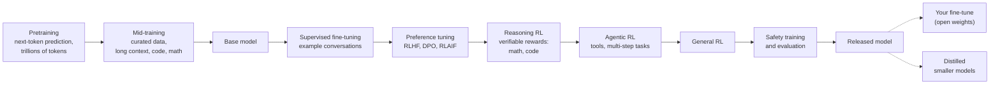

# 02: How a model is made: data, compute, and pretraining

*About a 25-minute read. Last checked November 16, 2026.*

**TL;DR**
- Models are made in stages. **Pretraining** (next-token prediction on trillions of tokens) produces a base model.
- **Post-training** (supervised examples, preference tuning, and several rounds of reinforcement learning on checkable tasks) turns it into an assistant and a reasoner.
- Models run on **accelerators** (GPUs, TPUs, Trainium) built for matrix math. Training is compute-bound. Generating text is bound by **memory bandwidth**, because each new token rereads every weight. That gap, the **memory wall**, explains a lot of how models are built and served.
- A frontier training run takes thousands of chips for months: Llama 3 405B took about 3.8×10²⁵ FLOPs, roughly 67 days on 16,000 H100s. Clusters are now planned in gigawatts.
- **Distillation** trains a smaller model on a bigger model's outputs, or, in on-policy distillation, grades the smaller model's own outputs. It's a standard technique, and it's also at the center of a public fight, with closed labs accusing rivals of copying them through their APIs.

## Foundations

### The pipeline at a glance

The whole process works a lot like an education: read the entire library, study the best books closely, apprentice with worked examples, get coached on what people prefer, drill practice exams that have an answer key, take a professional-conduct course, and then, optionally, do a specialty residency.

Treat the diagram as a mental model. Real pipelines are messier: stages repeat, overlap, and run in different orders at different labs. Recent open recipes run several RL stages, not one. GLM-5 runs "Reasoning RL, followed by Agentic RL, and finishing with General RL," with on-policy distillation (below) between stages ([GLM-5 Team, 2026](https://arxiv.org/abs/2602.15763)). DeepSeek-R1 alternated RL and supervised fine-tuning, and DeepSeek-V4 trains separate RL specialists and then merges them into one model ([model card](https://huggingface.co/deepseek-ai/DeepSeek-V4-Pro)).

### Pretraining: reading the library

The goal is a base model that predicts the next token well across almost everything people write ([module 01](01-what-is-an-llm.md)).

Most of the data comes from web crawls such as Common Crawl, filtered hard: duplicates, spam, and boilerplate come out, classifiers score quality, and some personal data gets stripped. Hugging Face's open [FineWeb](https://arxiv.org/abs/2406.17557) project documents the process; it got about 15 trillion tokens out of Common Crawl. Labs add code from public repositories, books, scientific papers, math, many languages, and more and more **synthetic data** generated by other models. Data quality matters as much as quantity. Training data is also the subject of copyright lawsuits and consent debates ([module 18](18-learning-careers-and-responsibility.md)).

Published token counts give a sense of the scale:

| Model | Pretraining tokens |
| --- | --- |
| Llama 3 (Meta, 2024) | more than 15 trillion ([paper](https://arxiv.org/abs/2407.21783)) |
| DeepSeek-V3 (2024) | 14.8 trillion ([paper](https://arxiv.org/abs/2412.19437)) |
| Qwen3 (Alibaba, 2025) | about 36 trillion ([paper](https://arxiv.org/abs/2505.09388)) |

Closed labs mostly don't publish these numbers.

Labs rarely disclose full costs, so treat these as rough orders of magnitude:

| Scale | Rough compute cost | Example |
| --- | --- | --- |
| Teaching toy | about $100 | Karpathy's [nanochat](https://github.com/karpathy/nanochat) (2025) trains a small, very limited chat model in about 4 hours on one 8-GPU node. |
| Small open model (~8B) from scratch | a few million dollars | Meta's model cards report roughly 1.3–1.5 million H100 GPU-hours for its Llama 3 and 3.1 8B models. |
| Large efficient open model | about $5–6 million for the final run | DeepSeek reported 2.788 million H800 GPU-hours (about $5.6 million at $2/GPU-hour) for DeepSeek-V3's official training run. The paper excludes "prior research and ablation experiments," and the dollar figure is a rental price, not the cost of owning the cluster. |
| Frontier closed model | hundreds of millions of dollars and rising | Epoch AI estimates frontier training costs have grown 2–3× per year and projected the largest runs passing $1 billion by 2027 ([Cottier et al., 2024](https://arxiv.org/abs/2405.21015)). |

The headline number for one run understates the real bill, which includes years of experiments, data work, and people.

The output is a base model. It completes documents but doesn't yet follow instructions reliably or refuse harmful requests.

### Mid-training: studying the best books

"Mid-training" is a loose name for a phase between bulk pretraining and post-training, and labs use it differently. It usually means higher-quality, more specialized data (math, code, reasoning traces, long documents), stretching the context window to longer sequences, and slowly lowering the learning rate (how far each training step moves the weights) while training on the best data. It's late pretraining focused on quality and specific skills.

### The hardware: what it takes to train and run a model

Pretraining a frontier model keeps thousands of chips busy for months. A few hardware ideas explain a lot of what you'll see as a user: why generating text is slower than reading it, why labs like mixture-of-experts models, and why AI companies now announce power deals. This section teaches the ideas first and uses specific chips as examples, because the chips change every year.

#### Why GPUs: a model is mostly matrix multiplies

A transformer layer is mostly matrix multiplication: token vectors times large weight matrices, over and over ([module 01](01-what-is-an-llm.md#the-transformer-and-attention)). The unit of work is the **FLOP**, one floating-point multiply or add. A forward pass costs about 2 FLOPs per parameter per token, one multiply and one add. Training adds a backward pass that costs about twice as much, so training costs about 6 FLOPs per parameter per token ([Kaplan et al., 2020](https://arxiv.org/abs/2001.08361)). That's where module 01's [6·N·D rule](01-what-is-an-llm.md#the-attention-equation-optional-math) comes from.

A CPU has a few dozen powerful cores built for branchy, unpredictable code. A GPU has thousands of simpler cores plus dedicated matrix-multiply units, which NVIDIA calls Tensor Cores. An NVIDIA H100 does about 67 TFLOPS (trillion FLOPs per second) of general FP32 math and 989 TFLOPS of BF16 matrix math on its Tensor Cores ([NVIDIA](https://www.nvidia.com/en-us/data-center/h100/)). Google's TPUs, AWS's Trainium and AMD's Instinct chips make the same bet; together they're called **accelerators**. Read spec sheets carefully. NVIDIA's headline numbers usually assume 2:4 sparsity, which doubles them, so the H100's 1,979 BF16 TFLOPS is 989 dense.

A chip can only compute on numbers it has fetched from memory, and fetching takes time. **Arithmetic intensity**, the FLOPs done per byte moved, tells you which one limits you. One example with 16-bit (2-byte) numbers:

- Multiply two 4,096 × 4,096 matrices. The work is 2 × 4,096³ ≈ 137 billion FLOPs. The data is two matrices in and one out, 3 × 4,096² × 2 bytes ≈ 100 MB. That's about 1,400 FLOPs per byte: every number fetched gets used thousands of times.
- Multiply one of those matrices by a single vector. The work is 2 × 4,096² ≈ 34 million FLOPs. The matrix alone is 4,096² × 2 bytes ≈ 34 MB. That's about 1 FLOP per byte: every weight is fetched, used once, and dropped.

Similar math, very different behavior on the chip. The second case is what a model does when it writes text for one user.

#### The memory wall

Chips have gained compute much faster than memory bandwidth. In server hardware, peak FLOPs grew about 3.0× every two years, DRAM bandwidth about 1.6×, and interconnect bandwidth about 1.4× ([Gholami et al., 2024](https://arxiv.org/abs/2403.14123)). The widening gap is called the **memory wall**.

You can see it in one ratio. An H100's dense BF16 compute divided by its memory bandwidth is 989 TFLOPS ÷ 3.35 TB/s ≈ 295 FLOPs per byte. A computation with lower arithmetic intensity than that waits on memory; one with higher intensity waits on math. The **roofline model** draws this as a sloped bandwidth line meeting a flat compute ceiling ([Austin et al., *How to Scale Your Model*](https://jax-ml.github.io/scaling-book/)).

Now generate text with Llama 3 8B for one user on one H100. In BF16 its weights are 16 GB, and each new token reads all of them once:

- Reading 16 GB at 3.35 TB/s takes about 4.8 ms, so this one sequence tops out near **210 tokens per second**.
- The math for one token, 2 × 8 billion = 16 billion FLOPs, would take about 16 µs at 989 TFLOPS. If math were the limit, you'd get about **60,000 tokens per second**.

The chip spends more than 99% of that time waiting on memory. [Module 06](06-open-vs-closed-weights.md#step-4-speed-is-mostly-memory-bandwidth) uses the same bound to estimate speed on a laptop.

The fix is batching. Serve B users at once and each weight fetched gets used B times, so intensity rises to about B FLOPs per byte. On an H100 you'd need a batch of roughly 300 before decoding stops being bandwidth-bound. Each user's KV cache is separate, so those reads don't get shared. That's why serving at scale is mostly a batching and memory-management problem.

The ratio has barely moved on newer chips. From vendor specs, BF16 FLOPs per byte is about 280 for NVIDIA's B200, 210 for Rubin, 215 for AMD's MI455X, and 310 for Google's Ironwood. To place any new chip, divide its FLOPs by its bandwidth.

#### HBM, and why training and inference hit different limits

Accelerators keep weights in **HBM** (high-bandwidth memory): stacks of DRAM chips mounted in the same package as the processor and wired to it with a very wide bus. An H100 has 80 GB of HBM3 at 3.35 TB/s. AMD's MI455X has 432 GB across 12 HBM4 stacks at 23.3 TB/s. **Memory bandwidth**, the bytes per second a chip can read from its memory, bounds decode speed. Capacity bounds what fits.

Training and inference sit on opposite sides of the roofline.

**Training is compute-bound.** It runs huge batches: Llama 3 405B used 16 million tokens per step ([Llama 3 paper](https://arxiv.org/abs/2407.21783)). Each weight fetched is reused across millions of tokens, so the math units stay busy. The measure people use is **MFU** (model FLOPs utilization), the share of the chip's peak FLOPs spent on the model's own math. Llama 3 reached 38–43% MFU in BF16.

Training's memory problem is capacity. Mixed-precision training with the Adam optimizer keeps about 16 bytes per parameter: 16-bit weights and gradients, plus a 32-bit copy of the weights and two 32-bit optimizer values ([Rajbhandari et al., 2019](https://arxiv.org/abs/1910.02054)). For a 405B model that's about 6.5 TB, at least 81 H100s just to hold it.

**Inference is mostly bandwidth-bound.** **Prefill** reads your whole prompt at once, pushing many tokens through the same weights, so it's compute-heavy like training. **Decode** writes one token per sequence per step, the bandwidth-bound case above. Running both phases on the same GPUs makes them interfere; DistServe served up to 7.4× more requests by splitting them onto separate GPUs ([Zhong et al., 2024](https://arxiv.org/abs/2401.09670)).

#### Low precision: BF16, FP8 and FP4

Fewer bits per number helps three ways at once. Weights take less memory, each token moves fewer bytes, and chips do more low-precision math per second.

- **FP32** (32-bit floating point) was the old default. **Mixed-precision training** (2017) moved most of the work to 16 bits and kept a 32-bit copy of the weights, nearly halving memory ([Micikevicius et al., 2017](https://arxiv.org/abs/1710.03740)).
- **BF16** ("brain float") is a 16-bit format that keeps FP32's exponent range and gives up precision. It's the usual format for training and for released weights.
- **FP8** comes in two 8-bit encodings, E4M3 and E5M2, one favoring precision and one favoring range. FP8 training matched 16-bit quality on models up to 175B parameters ([Micikevicius et al., 2022](https://arxiv.org/abs/2209.05433)), and DeepSeek-V3 used FP8 mixed precision for its full training run.
- **FP4** has only 16 possible bit patterns, so it needs help. Block-scaled formats give each small block of numbers a shared scale factor. **MXFP4**, from an industry spec written by AMD, Arm, Intel, Meta, Microsoft, NVIDIA and Qualcomm, uses blocks of 32 with a power-of-two scale ([OCP MX v1.0](https://www.opencompute.org/documents/ocp-microscaling-formats-mx-v1-0-spec-final-pdf)). NVIDIA's **NVFP4** uses blocks of 16 with an FP8 scale, about 4.5 bits per value in all ([NVIDIA](https://developer.nvidia.com/blog/introducing-nvfp4-for-efficient-and-accurate-low-precision-inference/)).

Chips are moving this way. Rubin's dense NVFP4 training rate is about 9× its BF16 rate, and Blackwell Ultra gave up most of its INT8 and FP64 throughput for more FP4. Google built native FP4 into TPU 8t "to overcome memory bandwidth bottlenecks" ([Google Cloud](https://cloud.google.com/blog/products/compute/tpu-8t-and-tpu-8i-technical-deep-dive)). gpt-oss was post-trained with its MoE weights in MXFP4, which lets the 120B model run on one 80 GB GPU ([model card](https://huggingface.co/openai/gpt-oss-120b)). Lower precision costs some quality; [quantization basics](#quantization-basics) below covers that trade.

#### Interconnect: why one model needs thousands of chips

Llama 3 405B would have taken one H100 about 3,000 years (worked out below), and its 6.5 TB of training state is more than 80 times one H100's memory. So the work gets split across thousands of chips that talk constantly, over two tiers of wiring:

- **Scale-up** links join a small group of accelerators so tightly they can read each other's memory. NVIDIA's is **NVLink**; Google's TPUs use ICI (inter-chip interconnect). In an 8-GPU HGX B300 server, each GPU gets 1.8 TB/s of NVLink, while the whole server gets 1.6 TB/s to the network, about 9× less per GPU. NVIDIA's NVL72 racks put 72 GPUs in one NVLink domain. Google's Ironwood pods link up to 9,216 TPUs.
- **Scale-out** is the datacenter network between those groups, usually InfiniBand or Ethernet. Meta's Llama 3 cluster used 400 Gbps Ethernet (RoCE) across 24,000 GPUs, eight per server on NVLink.

That gap shapes the software. DeepSeek's H800s, an H100 variant with cut-down NVLink sold in China under U.S. export rules, got 160 GB/s over NVLink and 50 GB/s over InfiniBand, so DeepSeek limited how many servers each token's experts could span ([DeepSeek-V3 report](https://arxiv.org/abs/2412.19437)).

There are four main ways to split the work:

- **Data parallelism:** every GPU runs the whole model on a different slice of the batch, and gradients are averaged each step. ZeRO (and PyTorch's FSDP) shards weights, gradients and optimizer state so each GPU doesn't keep a full copy ([Rajbhandari et al., 2019](https://arxiv.org/abs/1910.02054)).
- **Tensor parallelism:** split individual weight matrices across GPUs, so each computes part of every layer. It needs the fastest links, so it stays inside one NVLink domain ([Shoeybi et al., 2019](https://arxiv.org/abs/1909.08053)).
- **Pipeline parallelism:** put consecutive groups of layers on different GPUs and stream micro-batches through them like an assembly line ([Huang et al., 2018](https://arxiv.org/abs/1811.06965)).
- **Expert parallelism:** in a mixture-of-experts model, put different experts on different GPUs and send each token to its experts with all-to-all communication ([Lepikhin et al., 2020](https://arxiv.org/abs/2006.16668)).

Real runs combine them. Llama 3 405B used tensor parallelism across the 8 GPUs of a server, 16 pipeline stages, and data parallelism up to 128 ways. The pattern is to put the most talkative split on the fastest wire.

#### Training compute: a worked example

Take module 01's [6·N·D rule](01-what-is-an-llm.md#the-attention-equation-optional-math) and run it on Llama 3 405B, where Meta published enough to check each step ([Llama 3 paper](https://arxiv.org/abs/2407.21783)):

1. **FLOPs.** 6 × 405×10⁹ parameters × 15.6×10¹² tokens ≈ 3.8×10²⁵ FLOPs. The paper reports 3.8×10²⁵.
2. **GPU-hours.** Don't divide by the spec sheet's 989 TFLOPS. Meta measured about 400 TFLOPS per H100 in practice. 3.8×10²⁵ ÷ 4×10¹⁴ FLOPs per second ≈ 9.5×10¹⁰ GPU-seconds, about 26 million GPU-hours.
3. **Days.** Spread over 16,384 H100s, that's about 1,600 hours, or 67 days of pure compute. On one GPU it would take about 3,000 years.
4. **Check it.** Meta's model card reports 30.84 million H100-hours for Llama 3.1 405B, about 17% more than the estimate ([model card](https://github.com/meta-llama/llama-models/blob/main/models/llama3_1/MODEL_CARD.md)). The card doesn't say where the extra went.

At this scale, hardware fails all the time. In a 54-day stretch of the 405B run, Meta logged 466 job interruptions, 47 planned and 419 unexpected: about one every three hours. Roughly 78% of the unexpected ones were confirmed or suspected hardware problems, and GPU issues alone were 58.7%. Automation handled nearly all of them. Only three needed significant manual work, and effective training time stayed above 90%. Throughput even varied 1–2% with the time of day, because heat made the GPUs lower their clock speeds.

#### DeepSeek-V3's GPU-hours, with the paper's caveats

DeepSeek-V3's report gives 2.788 million H800 GPU-hours, or $5.576 million assuming a rental price of $2 per GPU-hour ([DeepSeek-V3 report](https://arxiv.org/abs/2412.19437)). That's 2.664 million hours of pretraining, 119,000 for context extension and 5,000 for post-training, on a 2,048-GPU cluster. Pretraining took less than two months.

The paper is clear about its limits. The costs "include only the official training of DeepSeek-V3, excluding the costs associated with prior research and ablation experiments on architectures, algorithms, or data." And the dollar figure is a rental price, not the cost of buying, housing and powering 2,048 GPUs. Two more facts put it in context:

- **It builds on earlier models.** Post-training distilled reasoning from DeepSeek's R1 series, and the compute behind R1 isn't in the total.
- **It's an MoE.** V3 has 671B parameters but uses only 37B per token. Run 6·N·D on the active parameters: 6 × 37×10⁹ × 14.8×10¹² ≈ 3.3×10²⁴ FLOPs, about 11.5× less than Llama 3 405B. The GPU-hour ratio is about the same, 30.84M ÷ 2.788M ≈ 11×. So most of the gap comes from doing fewer FLOPs, not from doing each FLOP more cheaply.

#### Power: from one chip to the grid

One H100 draws up to 700 W, and AMD's MI355X is rated at 1,400 W. A datacenter also powers CPUs, networking and cooling. NVIDIA's Vera Rubin spec sheet plans for 40,000 GPUs per 100 MW, about 2.5 kW of facility power per GPU. That gives a rule of thumb: **one gigawatt runs roughly 400,000 Rubin-class GPUs.**

For Llama 3.1 405B, 30.84 million H100-hours at 700 W is about 21.6 GWh for the GPUs alone. Big runs also strain the grid in a less obvious way. When tens of thousands of GPUs pause together, for example while saving a checkpoint, Meta saw power draw swing "on the order of tens of megawatts, stretching the limits of the power grid."

At grid scale, the IEA estimates data centers used about 415 TWh in 2024 (about 1.5% of the world's electricity) and 485 TWh in 2025, and projects about 950 TWh by 2030 ([IEA 2025](https://www.iea.org/reports/energy-and-ai/executive-summary), [IEA 2026](https://www.iea.org/reports/key-questions-on-energy-and-ai/executive-summary)). Lawrence Berkeley National Laboratory, reporting for the U.S. Department of Energy, found U.S. data centers used 192 TWh in 2024, 4.7% of U.S. electricity, with a 2030 reference case of 649 TWh, or 11.8% ([LBNL](https://www.energy.gov/documents/united-states-data-center-energy-usage-report-2025-update)). One gigawatt running all year is 8.76 TWh, so a 5 GW campus at full load would use about 44 TWh a year, close to a quarter of all U.S. data center electricity in 2024. Announced capacity isn't average draw, so treat that as a ceiling.

Keep what's built separate from what's announced:

| Status | Examples, as the companies describe them |
| --- | --- |
| Built and running | AWS's Project Rainier for Anthropic: "nearly half a million" Trainium2 chips across several U.S. data centers (October 2025, [Amazon](https://www.aboutamazon.com/news/aws/aws-project-rainier-ai-trainium-chips-compute-cluster)). Oracle's Stargate site in Abilene, Texas, for OpenAI: 75% of capacity delivered ([Oracle](https://www.oracle.com/data-centers/)). |
| Announced, not built | OpenAI and NVIDIA: a letter of intent for at least 10 GW (September 2025, [NVIDIA](https://nvidianews.nvidia.com/news/openai-and-nvidia-announce-strategic-partnership-to-deploy-10gw-of-nvidia-systems)). OpenAI and AMD: 6 GW over several chip generations (October 2025, [AMD](https://ir.amd.com/news-events/press-releases/detail/1260/amd-and-openai-announce-strategic-partnership-to-deploy-6-gigawatts-of-amd-gpus)). Anthropic: up to 5 GW with Amazon plus 5 GW of TPU capacity with Google and Broadcom (May 2026, [Anthropic](https://www.anthropic.com/news/series-h)). Meta: expanding its Richland Parish, Louisiana site to 5 GW (July 2026, [Meta](https://about.fb.com/news/2026/07/teachers-local-businesses-win-as-meta-expands-louisiana-data-center/)). |

#### Training hardware vs inference hardware

Training wants low-precision FLOPs, memory for optimizer state, and fast links across thousands of chips working in lockstep for weeks or months. Inference wants memory bandwidth, memory capacity for weights and KV caches, and fast answers for each user. Vendors now build separate chips for each job. Google's TPU 8t (training) and TPU 8i (inference), announced in April 2026, show the split. The 8t has more FP4 compute (12.6 vs 10.1 PF). The 8i has more HBM (288 vs 216 GB), more bandwidth (8.6 vs 6.5 TB/s) and three times the on-chip SRAM (384 vs 128 MB) ([Google Cloud](https://cloud.google.com/blog/products/compute/tpu-8t-and-tpu-8i-technical-deep-dive)).

Serving a big model is its own engineering problem. Llama 3 405B in BF16 "does not fit in the GPU memory of a single machine with 8 Nvidia H100 GPUs," so Meta served it across 16 GPUs on two machines. [Module 01](01-what-is-an-llm.md#context-windows-and-the-kv-cache) explains the KV cache, and [module 06](06-open-vs-closed-weights.md#running-open-models-the-hardware-math) walks through the weight and KV-cache memory math for running a model yourself.

#### The chips, as of November 2026

Specs come from vendor pages, checked November 16, 2026. NVIDIA and AMD figures are dense (no sparsity); Google and AWS don't say. A dash means no primary-source figure was found.

| Chip | Status | HBM per chip | Bandwidth | Dense BF16 | Low-precision peak |
| --- | --- | --- | --- | --- | --- |
| NVIDIA H100 SXM | The 2023–24 workhorse | 80 GB | 3.35 TB/s | 989 TFLOPS | — |
| NVIDIA B200 | Shipping | ~180 GB | ~8 TB/s | ~2.25 PFLOPS | ~9 PFLOPS FP4 |
| NVIDIA Rubin | Ramping; racks running at partners as of August 2026 | 288 GB | 19.2 TB/s | 4 PFLOPS | 35 PFLOPS NVFP4 (training) |
| AMD MI355X | Shipping since mid-2025 | 288 GB | 8 TB/s | 2.5 PFLOPS | 5 PFLOPS FP8 |
| AMD MI455X | Volume shipments began Q3 2026 | 432 GB | 23.3 TB/s | 5 PFLOPS | — |
| Google Ironwood (TPU7x) | Generally available | 192 GiB | 7.38 TB/s | 2.3 PFLOPS | 4.6 PFLOPS FP8 |
| Google TPU 8t | Announced April 2026, "coming soon" | 216 GB | 6.5 TB/s | — | 12.6 PFLOPS FP4 |
| Google TPU 8i | Announced April 2026, "coming soon" | 288 GB | 8.6 TB/s | — | 10.1 PFLOPS FP4 |
| AWS Trainium3 | Generally available since December 2025 | 144 GB | 4.9 TB/s | — | 2.52 PFLOPS FP8 |

B200 figures are NVIDIA's 8-GPU system specs divided by eight. Sources disagree on two Rubin numbers. NVIDIA lists 19.2 TB/s of HBM4 bandwidth, while AMD's comparison chart lists 22.0 TB/s. For NVLink 6, NVIDIA's product page says 3 TB/s per GPU and its January 2026 press release says 3.6 TB/s, so the table leaves NVLink out. The vendor pages are listed under [primary sources](#primary-sources), and [Epoch AI's hardware data](https://epoch.ai/data) tracks newer chips.

### Post-training

The base model then goes through **post-training**: supervised fine-tuning (SFT) on example conversations, preference tuning on pairs of better and worse responses, and several rounds of reinforcement learning on tasks a program can check. [Module 03](03-post-training-and-rl.md) covers each stage, along with fine-tuning open-weight models yourself.

### Distillation and synthetic data

**Distillation** means training a smaller **student** model to imitate a larger **teacher**. [Hinton, Vinyals, and Dean (2015)](https://arxiv.org/abs/1503.02531) showed that the teacher's full probability distribution (it thinks "cat" 70%, "lynx" 20%, "dog" 5%) carries more information than the single right answer.

With LLMs there are three flavors:

- **Logit distillation:** the student learns from the teacher's token probabilities. This needs access to the teacher's internals, so it mostly happens inside a lab (for example, a big model teaching its smaller siblings).
- **Output distillation:** generate lots of teacher responses and fine-tune the student on the text. This works through any API that returns text.
- **On-policy distillation:** the student writes its own answers and a stronger teacher grades every token of them, so the student learns from its own mistakes instead of copying the teacher's text. In one Thinking Machines comparison it used about a tenth of RL's GPU-hours (1,800 vs 17,920) ([Thinking Machines](https://thinkingmachines.ai/blog/on-policy-distillation/)). It's now a core post-training step. DeepSeek-V4 uses it to merge separately trained expert models into one ([model card](https://huggingface.co/deepseek-ai/DeepSeek-V4-Pro)), and GLM-5 uses it between RL stages so the model doesn't forget earlier skills ([GLM-5 Team, 2026](https://arxiv.org/abs/2602.15763)). [Module 03](03-post-training-and-rl.md#rl-for-coding-agents) covers the RL stages it connects.

Some established uses of distillation and synthetic data:

- **Stanford Alpaca** (March 2023) fine-tuned Meta's LLaMA 7B on 52,000 instruction examples generated with OpenAI's text-davinci-003, for under $600 total. Stanford restricted it to research, citing among other things OpenAI's terms against building competing models ([Stanford CRFM](https://crfm.stanford.edu/2023/03/13/alpaca.html)).
- **DeepSeek's R1-Distill models** (January 2025) were Qwen and Llama models fine-tuned on reasoning traces from DeepSeek's own R1 ([paper](https://arxiv.org/abs/2501.12948)).
- **Synthetic data** in general: [Self-Instruct](https://arxiv.org/abs/2212.10560) (2022) had a model write its own training instructions. Microsoft's first Phi model trained on "textbook-quality" filtered web data plus synthetic textbooks and exercises generated by GPT-3.5 ([Gunasekar et al., 2023](https://arxiv.org/abs/2306.11644)). Labs generate math problems with checked answers, code with tests, and reasoning traces, keeping only the outputs that verify.

The major closed labs' terms of service prohibit using their outputs to build competing models, and that's led to some public fights:

- After DeepSeek-R1's release in January 2025, OpenAI said (as widely reported at the time) that it had seen evidence of distillation by DeepSeek. On February 12, 2026, OpenAI told the U.S. House Select Committee on China in a memo that DeepSeek used distillation to "free-ride" on U.S. labs' capabilities ([Bloomberg](https://www.bloomberg.com/news/articles/2026-02-12/openai-accuses-deepseek-of-distilling-us-models-to-gain-an-edge)).
- In August 2025, Anthropic cut off OpenAI's access to Claude, saying OpenAI's use violated terms against building competing products. OpenAI said it was benchmarking ([TechCrunch](https://techcrunch.com/2025/08/02/anthropic-cuts-off-openais-access-to-its-claude-models/)).
- On February 23, 2026, Anthropic said three labs, DeepSeek, Moonshot, and MiniMax, had run distillation campaigns against Claude: more than 16 million exchanges through about 24,000 fraudulent accounts (DeepSeek more than 150,000, Moonshot more than 3.4 million, MiniMax more than 13 million). Anthropic called distillation "a widely used and legitimate training method" in general and objected to its illicit use ([Anthropic](https://www.anthropic.com/news/detecting-and-preventing-distillation-attacks)).
- When Claude Fable 5 launched on June 9, 2026, Anthropic said requests its classifiers flag as distillation attempts would be answered by the older Claude Opus 4.8 instead, and that users would be told when this happens ([Anthropic](https://www.anthropic.com/news/claude-fable-5-mythos-5)). Within days, after reporting that one safeguard aimed at frontier-model development had been changing answers without telling users, Anthropic apologized and said it would make that safeguard visible ([Gizmodo](https://gizmodo.com/anthropic-apologizes-for-one-of-the-guardrails-on-its-fable-5-model-and-will-change-it-2000770365)).
- On October 12, 2026, Anthropic described further defenses (a classifier it says has a false-positive rate under 0.1%, limits on editing Claude's earlier reasoning for new API accounts, stricter limits for repeat offenders) and claimed they cut the data harvested by distillers by about 90–99% ([Anthropic](https://www.anthropic.com/news/distillation-defenses)).

There's another side to this. Critics point out that frontier labs trained on web content without asking permission, which makes complaints about copying sound selective. Outsiders can't independently verify the account-level evidence. And the accusations land in a policy fight over export controls, where every party has an interest. What's clear is that distilling a strong model works, frontier labs are now actively defending against it, and those defenses sometimes affect legitimate users.

## In practice

### Quantization basics

**Quantization** stores weights with fewer bits, which means less memory and usually faster inference, at some cost in quality.

| Precision | Bytes per parameter | 8B model weights | Typical quality |
| --- | --- | --- | --- |
| 16-bit (bf16/fp16) | 2 | ~16 GB | Reference |
| 8-bit | 1 | ~8 GB | Usually close to reference |
| 4-bit | ~0.5 | ~4.5–5 GB | Often a small loss; more noticeable in small models and on code and math |

Common methods and formats:

- **GPTQ** ([Frantar et al., 2022](https://arxiv.org/abs/2210.17323)) quantizes layer by layer, adjusting remaining weights to compensate for rounding errors.
- **AWQ** ([Lin et al., 2023](https://arxiv.org/abs/2306.00978)) protects the small fraction of weights that matter most, judged by activation sizes.
- **GGUF** is the single-file format used by [llama.cpp](https://github.com/ggml-org/llama.cpp) and tools built on it, such as Ollama and LM Studio. Files come in levels like `Q4_K_M` (about 4-bit) and `Q8_0` (8-bit) ([Hugging Face docs](https://huggingface.co/docs/hub/gguf)).
- **MLX** has its own quantized formats for Apple Silicon.

You can quantize a finished model to *serve* it cheaply, or quantize the base to *train* adapters cheaply ([QLoRA](03-post-training-and-rl.md#full-fine-tuning-vs-parameter-efficient-fine-tuning)). Either way, re-run your evaluation afterward.

### Risks

**Model collapse.** Train each generation of a model on the previous generation's outputs and quality degrades. Rare information (the "tails") vanishes first, then outputs converge on bland averages ([Shumailov et al., Nature 2024](https://www.nature.com/articles/s41586-024-07566-y)). But in follow-up experiments, keeping real data alongside synthetic data, instead of replacing it, avoided collapse ([Gerstgrasser et al., 2024](https://arxiv.org/abs/2404.01413)). Labs use huge amounts of synthetic data with filtering and verification. Careless loops risk collapse, but it isn't inevitable.

## Try it

**Individual exercises (no GPU, no downloads)**

1. **Memory math by hand.** For a 3B, an 8B, and a 70B model, work out inference memory at 16-bit and 4-bit. Check your numbers against the tables in this module.
2. **Read a model card.** On [Hugging Face](https://huggingface.co/models), open a popular fine-tune of an open-weight model. Find the base model, the method (full, LoRA, DPO, merged), the training data, the license, and the evaluation claims. Write down what's missing. Then open a GGUF repository's "Files" tab and compare the listed sizes of `Q4_K_M`, `Q8_0`, and `F16` files.
3. **Estimate a training run.** Pick an open model whose paper or card gives its parameter count and training tokens (Qwen3, DeepSeek-V3, or a Llama 3 size other than 405B). Compute 6·N·D, using active parameters for an MoE. Pick a chip from [the table](#the-chips-as-of-november-2026), assume 40% of its dense BF16 peak, and work out GPU-hours, then days on 2,048 and on 16,384 chips. If the model card reports GPU-hours, compare and list what your estimate leaves out. Then do the [memory-wall](#the-memory-wall) calculation for the same model on the same chip: the most tokens per second one user could get, and the batch size where decoding stops being bandwidth-bound.

## Discussion questions

1. Anthropic calls distillation "a widely used and legitimate training method," and labs also call some distillation an attack. Where's the line? Does it matter that frontier labs trained on web content without permission?
2. DeepSeek-V3's "$5.6 million" was widely reported as the cost of the model. Using the paper's own exclusions and the 6·N·D comparison with Llama 3 405B, what does that number tell you and what doesn't it? What would you need to compare two labs' costs fairly?

## Sources and further reading

### Papers

- [Distilling the Knowledge in a Neural Network](https://arxiv.org/abs/1503.02531) (Hinton, Vinyals, Dean, 2015)
- [Mixed Precision Training](https://arxiv.org/abs/1710.03740) (Micikevicius et al., 2017)
- [GPipe: Efficient Training of Giant Neural Networks using Pipeline Parallelism](https://arxiv.org/abs/1811.06965) (Huang et al., 2018)
- [Megatron-LM: Training Multi-Billion Parameter Language Models Using Model Parallelism](https://arxiv.org/abs/1909.08053) (Shoeybi et al., 2019)
- [ZeRO: Memory Optimizations Toward Training Trillion Parameter Models](https://arxiv.org/abs/1910.02054) (Rajbhandari et al., 2019)
- [Scaling Laws for Neural Language Models](https://arxiv.org/abs/2001.08361) (Kaplan et al., 2020)
- [GShard: Scaling Giant Models with Conditional Computation and Automatic Sharding](https://arxiv.org/abs/2006.16668) (Lepikhin et al., 2020)
- [FP8 Formats for Deep Learning](https://arxiv.org/abs/2209.05433) (Micikevicius et al., 2022)
- [GPTQ: Accurate Post-Training Quantization for Generative Pre-trained Transformers](https://arxiv.org/abs/2210.17323) (Frantar et al., 2022)
- [Self-Instruct: Aligning Language Models with Self-Generated Instructions](https://arxiv.org/abs/2212.10560) (Wang et al., 2022)
- [The Curse of Recursion: Training on Generated Data Makes Models Forget](https://arxiv.org/abs/2305.17493) (Shumailov et al., 2023); published as [AI models collapse when trained on recursively generated data](https://www.nature.com/articles/s41586-024-07566-y) (Nature, 2024)
- [AWQ: Activation-aware Weight Quantization for LLM Compression and Acceleration](https://arxiv.org/abs/2306.00978) (Lin et al., 2023)
- [Textbooks Are All You Need](https://arxiv.org/abs/2306.11644) (Gunasekar et al., 2023)
- [Is Model Collapse Inevitable? Breaking the Curse of Recursion by Accumulating Real and Synthetic Data](https://arxiv.org/abs/2404.01413) (Gerstgrasser et al., 2024)
- [DistServe: Disaggregating Prefill and Decoding for Goodput-optimized Large Language Model Serving](https://arxiv.org/abs/2401.09670) (Zhong et al., 2024)
- [AI and Memory Wall](https://arxiv.org/abs/2403.14123) (Gholami et al., IEEE Micro 2024)
- [The Rising Costs of Training Frontier AI Models](https://arxiv.org/abs/2405.21015) (Cottier et al., 2024)
- [The FineWeb Datasets: Decanting the Web for the Finest Text Data at Scale](https://arxiv.org/abs/2406.17557) (Penedo et al., 2024)
- [The Llama 3 Herd of Models](https://arxiv.org/abs/2407.21783) (Grattafiori et al., 2024)
- [DeepSeek-V3 Technical Report](https://arxiv.org/abs/2412.19437) (DeepSeek-AI, 2024)
- [DeepSeek-R1: Incentivizing Reasoning Capability in LLMs via Reinforcement Learning](https://arxiv.org/abs/2501.12948) (DeepSeek-AI, 2025)
- [Qwen3 Technical Report](https://arxiv.org/abs/2505.09388) (Yang et al., 2025)
- [GLM-5: from Vibe Coding to Agentic Engineering](https://arxiv.org/abs/2602.15763) (GLM-5 Team, 2026)

### Primary sources

- Anthropic, [Detecting and preventing distillation attacks](https://www.anthropic.com/news/detecting-and-preventing-distillation-attacks) (February 23, 2026)
- Anthropic, [Claude Fable 5 and Claude Mythos 5](https://www.anthropic.com/news/claude-fable-5-mythos-5) (June 9, 2026)
- Anthropic, [Strengthening our defenses against distillation attacks](https://www.anthropic.com/news/distillation-defenses) (October 12, 2026)
- Stanford CRFM, [Alpaca: A Strong, Replicable Instruction-Following Model](https://crfm.stanford.edu/2023/03/13/alpaca.html) (March 2023)
- Tool docs: [llama.cpp](https://github.com/ggml-org/llama.cpp), [GGUF on Hugging Face](https://huggingface.co/docs/hub/gguf)
- Model cards: [Llama 3.1](https://github.com/meta-llama/llama-models/blob/main/models/llama3_1/MODEL_CARD.md) (GPU-hours and emissions), [gpt-oss-120b](https://huggingface.co/openai/gpt-oss-120b), [DeepSeek-V4-Pro](https://huggingface.co/deepseek-ai/DeepSeek-V4-Pro)
- Thinking Machines Lab, [On-Policy Distillation](https://thinkingmachines.ai/blog/on-policy-distillation/) (October 2025)
- Chip specs (checked November 16, 2026): NVIDIA [H100](https://www.nvidia.com/en-us/data-center/h100/), [HGX B200/B300](https://www.nvidia.com/en-us/data-center/hgx/), [DGX B200](https://www.nvidia.com/en-us/data-center/dgx-b200/), [GB200 NVL72](https://www.nvidia.com/en-us/data-center/gb200-nvl72/), [Vera Rubin NVL72](https://www.nvidia.com/en-us/data-center/vera-rubin-nvl72/); AMD [MI355X](https://www.amd.com/en/products/accelerators/instinct/mi350/mi355x.html), [MI455X](https://www.amd.com/en/products/accelerators/instinct/mi400/mi455x.html); Google [Cloud TPU docs (TPU7x)](https://docs.cloud.google.com/tpu/docs/tpu7x), [Cloud TPU](https://cloud.google.com/tpu), [TPU 8t and 8i deep dive](https://cloud.google.com/blog/products/compute/tpu-8t-and-tpu-8i-technical-deep-dive); AWS [Trn3 UltraServers](https://aws.amazon.com/about-aws/whats-new/2025/12/amazon-ec2-trn3-ultraservers)
- Shipping status: NVIDIA, [Q2 fiscal 2027 results](https://nvidianews.nvidia.com/news/nvidia-announces-financial-results-for-second-quarter-fiscal-2027) (August 26, 2026); AMD, [Q3 2026 prepared remarks](https://newsroom.amd.com/documents/2026/11/84f4476b-f064-4f0f-957c-fe484853e178.pdf) (November 3, 2026)
- Number formats: Open Compute Project, [OCP Microscaling Formats (MX) v1.0](https://www.opencompute.org/documents/ocp-microscaling-formats-mx-v1-0-spec-final-pdf) (September 2023); NVIDIA, [Introducing NVFP4](https://developer.nvidia.com/blog/introducing-nvfp4-for-efficient-and-accurate-low-precision-inference/) (June 2025)
- Energy: IEA, [Energy and AI](https://www.iea.org/reports/energy-and-ai/executive-summary) (2025) and [Key Questions on Energy and AI](https://www.iea.org/reports/key-questions-on-energy-and-ai/executive-summary) (2026); LBNL for the U.S. Department of Energy, [United States Data Center Energy Usage Report, 2025 Update](https://www.energy.gov/documents/united-states-data-center-energy-usage-report-2025-update) (June 2026)
- Datacenter announcements: [Amazon on Project Rainier](https://www.aboutamazon.com/news/aws/aws-project-rainier-ai-trainium-chips-compute-cluster), [Oracle Data Centers](https://www.oracle.com/data-centers/), [NVIDIA and OpenAI](https://nvidianews.nvidia.com/news/openai-and-nvidia-announce-strategic-partnership-to-deploy-10gw-of-nvidia-systems), [AMD and OpenAI](https://ir.amd.com/news-events/press-releases/detail/1260/amd-and-openai-announce-strategic-partnership-to-deploy-6-gigawatts-of-amd-gpus), [Anthropic Series H](https://www.anthropic.com/news/series-h), [Meta in Louisiana](https://about.fb.com/news/2026/07/teachers-local-businesses-win-as-meta-expands-louisiana-data-center/)

### Commentary and reporting

- Bloomberg, [OpenAI Claims DeepSeek Distilled US Models to Gain an Edge](https://www.bloomberg.com/news/articles/2026-02-12/openai-accuses-deepseek-of-distilling-us-models-to-gain-an-edge) (February 12, 2026)
- TechCrunch, [Anthropic cuts off OpenAI's access to its Claude models](https://techcrunch.com/2025/08/02/anthropic-cuts-off-openais-access-to-its-claude-models/) (August 2025)
- Gizmodo, [Anthropic apologizes for one of the guardrails on its Fable 5 model](https://gizmodo.com/anthropic-apologizes-for-one-of-the-guardrails-on-its-fable-5-model-and-will-change-it-2000770365) (June 2026)
- Andrej Karpathy, [Deep Dive into LLMs like ChatGPT](https://www.youtube.com/watch?v=7xTGNNLPyMI) (February 2025), the best long-form walkthrough of the training pipeline

### Learning resources for the hardware

- Austin, Douglas, Frostig, Levskaya et al. (Google DeepMind), [How to Scale Your Model](https://jax-ml.github.io/scaling-book/) (2025). A free book on rooflines, TPUs and GPUs, sharding, training parallelism and inference, with worked Llama 3 examples.
- Horace He, [Making Deep Learning Go Brrrr From First Principles](https://horace.io/brrr_intro.html) (2022). A short read on compute-bound vs memory-bound vs overhead-bound work, and on operator fusion.
- Hugging Face, [The Ultra-Scale Playbook: Training LLMs on GPU Clusters](https://huggingface.co/spaces/nanotron/ultrascale-playbook) (2025). A hands-on guide to data, tensor, pipeline, context and expert parallelism and ZeRO.
- Epoch AI, [data hubs](https://epoch.ai/data): machine-learning hardware, GPU clusters, AI data centers and AI models, updated as new ones appear.
- The Llama 3 paper, [sections 3.3 and 6](https://arxiv.org/abs/2407.21783): a first-hand account of a 16,000-GPU run, including the network, parallelism, failures and power swings, and of serving the 405B model.

See also [module 01](01-what-is-an-llm.md) for the basics, the [reading list](../reference/papers.md), and the [glossary](../reference/glossary.md).

## Terms introduced

- **Mid-training:** A loosely defined phase between bulk pretraining and post-training, focused on high-quality or specialized data and longer context.
- **Synthetic data:** Training data generated by models rather than written by people.
- **Distillation:** Training a smaller student model to imitate a larger teacher model.
- **Logit distillation vs output distillation:** Learning from the teacher's token probabilities versus from its generated text.
- **On-policy distillation:** The student generates its own answers and a stronger teacher grades each token, so the student learns from its own mistakes.
- **Distillation attack:** Illicit large-scale querying of a model to train a competing one, in breach of terms of service.
- **Quantization:** Storing model weights with fewer bits to save memory and speed up inference.
- **GPTQ / AWQ:** Two widely used post-training quantization methods.
- **GGUF:** The single-file model format used by llama.cpp and tools built on it.
- **Model collapse:** Quality degradation when models are trained recursively on model-generated data.
- **FLOP:** One floating-point operation, such as a multiply or an add. FLOPS (FLOPs per second) measures a chip's speed.
- **Accelerator:** A chip built for the matrix math of neural networks, such as a GPU, TPU or Trainium.
- **HBM (high-bandwidth memory):** Stacks of DRAM packaged next to an accelerator's processor, giving it terabytes per second of bandwidth.
- **Memory bandwidth:** How many bytes per second a chip can read from its memory. It sets the speed limit for generating tokens.
- **Arithmetic intensity:** FLOPs done per byte moved from memory. Low intensity means the chip waits on memory; high means it waits on math.
- **Memory wall:** The growing gap between how fast chips compute and how fast they can fetch data from memory.
- **Roofline model:** A chart of a chip's performance limits: bandwidth-bound below a threshold arithmetic intensity, compute-bound above it.
- **MFU (model FLOPs utilization):** The share of a chip's peak FLOPs that goes into the model's own math during training.
- **Prefill vs decode:** The two phases of inference: processing the prompt in parallel (compute-heavy) and generating one token at a time (bandwidth-bound).
- **Mixed-precision training:** Training with most math in 16 or 8 bits while keeping a higher-precision copy of the weights.
- **BF16 / FP8 / FP4:** 16-, 8- and 4-bit floating-point formats. Fewer bits mean less memory, less data movement and more FLOPs per second, at some cost in accuracy.
- **MXFP4 / NVFP4:** Block-scaled 4-bit formats in which small blocks of values share a scale factor (32 values for MXFP4, 16 for NVFP4).
- **NVLink:** NVIDIA's fast GPU-to-GPU link inside a server or rack, much faster than the datacenter network.
- **Scale-up vs scale-out:** Tight, fast links within a group of accelerators (NVLink, TPU ICI) versus the network between groups (InfiniBand, Ethernet).
- **Data parallelism:** Every GPU runs the whole model on a different slice of the batch, and gradients are averaged.
- **Tensor parallelism:** Splitting individual weight matrices across GPUs so each computes part of every layer.
- **Pipeline parallelism:** Putting consecutive layers on different GPUs and streaming micro-batches through them.
- **Expert parallelism:** Putting a mixture-of-experts model's experts on different GPUs and routing each token to its experts.
- **GPU-hour:** One GPU running for one hour, the usual unit for reporting training compute.
