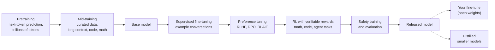

# 02: How a model is made: data, compute, and pretraining

*About a 10-minute read. Last checked November 8, 2026.*

**TL;DR**
- Models are made in stages. **Pretraining** (next-token prediction on trillions of tokens) produces a base model.
- **Post-training** (supervised examples, preference tuning, and reinforcement learning on checkable tasks) turns it into an assistant and a reasoner.
- **Distillation** trains a smaller model on a bigger model's outputs. It's a standard technique, and it's also at the center of a public fight, with closed labs accusing rivals of copying them through their APIs.

## Foundations

### The pipeline at a glance

The whole process works a lot like an education: read the entire library, study the best books closely, apprentice with worked examples, get coached on what people prefer, drill practice exams that have an answer key, take a professional-conduct course, and then, optionally, do a specialty residency.

Treat the diagram as a mental model. Real pipelines are messier: stages repeat, overlap, and run in different orders at different labs.

### Pretraining: reading the library

The goal is a base model that predicts the next token well across almost everything people write ([module 01](01-what-is-an-llm.md)).

Most of the data comes from web crawls such as Common Crawl, filtered hard: duplicates, spam, and boilerplate come out, classifiers score quality, and some personal data gets stripped. Hugging Face's open [FineWeb](https://arxiv.org/abs/2406.17557) project documents the process; it got about 15 trillion tokens out of Common Crawl. Labs add code from public repositories, books, scientific papers, math, many languages, and more and more **synthetic data** generated by other models. Data quality matters as much as quantity. Training data is also the subject of copyright lawsuits and consent debates ([module 15](15-learning-careers-and-responsibility.md)).

Published token counts give a sense of the scale:

| Model | Pretraining tokens |
| --- | --- |
| Llama 3 (Meta, 2024) | more than 15 trillion ([paper](https://arxiv.org/abs/2407.21783)) |
| DeepSeek-V3 (2024) | 14.8 trillion ([paper](https://arxiv.org/abs/2412.19437)) |
| Qwen3 (Alibaba, 2025) | about 36 trillion ([paper](https://arxiv.org/abs/2505.09388)) |

Closed labs mostly don't publish these numbers.

Labs rarely disclose full costs, so treat these as rough orders of magnitude:

| Scale | Rough compute cost | Example |
| --- | --- | --- |
| Teaching toy | about $100 | Karpathy's [nanochat](https://github.com/karpathy/nanochat) (2025) trains a small, very limited chat model in about 4 hours on one 8-GPU node. |
| Small open model (~8B) from scratch | a few million dollars | Meta's model cards report roughly 1.3–1.5 million H100 GPU-hours for its Llama 3 and 3.1 8B models. |
| Large efficient open model | about $5–6 million for the final run | DeepSeek reported 2.788 million H800 GPU-hours (about $5.6 million at $2/GPU-hour) for DeepSeek-V3's final training run, excluding research, failed runs, and staff. |
| Frontier closed model | hundreds of millions of dollars and rising | Epoch AI estimates frontier training costs have grown 2–3× per year and projected the largest runs passing $1 billion by 2027 ([Cottier et al., 2024](https://arxiv.org/abs/2405.21015)). |

The headline number for one run understates the real bill, which includes years of experiments, data work, and people.

The output is a base model. It completes documents but doesn't yet follow instructions reliably or refuse harmful requests.

### Mid-training: studying the best books

"Mid-training" is a loose name for a phase between bulk pretraining and post-training, and labs use it differently. It usually means higher-quality, more specialized data (math, code, reasoning traces, long documents), stretching the context window to longer sequences, and slowly lowering the learning rate (how far each training step moves the weights) while training on the best data. It's late pretraining focused on quality and specific skills.

### Post-training

The base model then goes through **post-training**: supervised fine-tuning (SFT) on example conversations, preference tuning on pairs of better and worse responses, and reinforcement learning on tasks a program can check. [Module 03](03-post-training-and-rl.md) covers each stage, along with fine-tuning open-weight models yourself.

### Distillation and synthetic data

**Distillation** means training a smaller **student** model to imitate a larger **teacher**. [Hinton, Vinyals, and Dean (2015)](https://arxiv.org/abs/1503.02531) showed that the teacher's full probability distribution (it thinks "cat" 70%, "lynx" 20%, "dog" 5%) carries more information than the single right answer.

With LLMs there are two flavors:

- **Logit distillation:** the student learns from the teacher's token probabilities. This needs access to the teacher's internals, so it mostly happens inside a lab (for example, a big model teaching its smaller siblings).
- **Output distillation:** generate lots of teacher responses and fine-tune the student on the text. This works through any API that returns text.

Some established uses of distillation and synthetic data:

- **Stanford Alpaca** (March 2023) fine-tuned Meta's LLaMA 7B on 52,000 instruction examples generated with OpenAI's text-davinci-003, for under $600 total. Stanford restricted it to research, citing among other things OpenAI's terms against building competing models ([Stanford CRFM](https://crfm.stanford.edu/2023/03/13/alpaca.html)).
- **DeepSeek's R1-Distill models** (January 2025) were Qwen and Llama models fine-tuned on reasoning traces from DeepSeek's own R1 ([paper](https://arxiv.org/abs/2501.12948)).
- **Synthetic data** in general: [Self-Instruct](https://arxiv.org/abs/2212.10560) (2022) had a model write its own training instructions. Microsoft's first Phi model trained on "textbook-quality" filtered web data plus synthetic textbooks and exercises generated by GPT-3.5 ([Gunasekar et al., 2023](https://arxiv.org/abs/2306.11644)). Labs generate math problems with checked answers, code with tests, and reasoning traces, keeping only the outputs that verify.

The major closed labs' terms of service prohibit using their outputs to build competing models, and that's led to some public fights:

- After DeepSeek-R1's release in January 2025, OpenAI said (as widely reported at the time) that it had seen evidence of distillation by DeepSeek. On February 12, 2026, OpenAI told the U.S. House Select Committee on China in a memo that DeepSeek used distillation to "free-ride" on U.S. labs' capabilities ([Bloomberg](https://www.bloomberg.com/news/articles/2026-02-12/openai-accuses-deepseek-of-distilling-us-models-to-gain-an-edge)).
- In August 2025, Anthropic cut off OpenAI's access to Claude, saying OpenAI's use violated terms against building competing products. OpenAI said it was benchmarking ([TechCrunch](https://techcrunch.com/2025/08/02/anthropic-cuts-off-openais-access-to-its-claude-models/)).
- On February 23, 2026, Anthropic said three labs, DeepSeek, Moonshot, and MiniMax, had run distillation campaigns against Claude: more than 16 million exchanges through about 24,000 fraudulent accounts (DeepSeek more than 150,000, Moonshot more than 3.4 million, MiniMax more than 13 million). Anthropic called distillation "a widely used and legitimate training method" in general and objected to its illicit use ([Anthropic](https://www.anthropic.com/news/detecting-and-preventing-distillation-attacks)).
- When Claude Fable 5 launched on June 9, 2026, Anthropic said requests its classifiers flag as distillation attempts would be answered by the older Claude Opus 4.8 instead, and that users would be told when this happens ([Anthropic](https://www.anthropic.com/news/claude-fable-5-mythos-5)). Within days, after reporting that one safeguard aimed at frontier-model development had been changing answers without telling users, Anthropic apologized and said it would make that safeguard visible ([Gizmodo](https://gizmodo.com/anthropic-apologizes-for-one-of-the-guardrails-on-its-fable-5-model-and-will-change-it-2000770365)).
- On October 12, 2026, Anthropic described further defenses (a classifier it says has a false-positive rate under 0.1%, limits on editing Claude's earlier reasoning for new API accounts, stricter limits for repeat offenders) and claimed they cut the data harvested by distillers by about 90–99% ([Anthropic](https://www.anthropic.com/news/distillation-defenses)).

There's another side to this. Critics point out that frontier labs trained on web content without asking permission, which makes complaints about copying sound selective. Outsiders can't independently verify the account-level evidence. And the accusations land in a policy fight over export controls, where every party has an interest. What's clear is that distilling a strong model works, frontier labs are now actively defending against it, and those defenses sometimes affect legitimate users.

## In practice

### Quantization basics

**Quantization** stores weights with fewer bits, which means less memory and usually faster inference, at some cost in quality.

| Precision | Bytes per parameter | 8B model weights | Typical quality |
| --- | --- | --- | --- |
| 16-bit (bf16/fp16) | 2 | ~16 GB | Reference |
| 8-bit | 1 | ~8 GB | Usually close to reference |
| 4-bit | ~0.5 | ~4.5–5 GB | Often a small loss; more noticeable in small models and on code and math |

Common methods and formats:

- **GPTQ** ([Frantar et al., 2022](https://arxiv.org/abs/2210.17323)) quantizes layer by layer, adjusting remaining weights to compensate for rounding errors.
- **AWQ** ([Lin et al., 2023](https://arxiv.org/abs/2306.00978)) protects the small fraction of weights that matter most, judged by activation sizes.
- **GGUF** is the single-file format used by [llama.cpp](https://github.com/ggml-org/llama.cpp) and tools built on it, such as Ollama and LM Studio. Files come in levels like `Q4_K_M` (about 4-bit) and `Q8_0` (8-bit) ([Hugging Face docs](https://huggingface.co/docs/hub/gguf)).
- **MLX** has its own quantized formats for Apple Silicon.

You can quantize a finished model to *serve* it cheaply, or quantize the base to *train* adapters cheaply (QLoRA). Either way, re-run your evaluation afterward.

### Risks

**Model collapse.** Train each generation of a model on the previous generation's outputs and quality degrades. Rare information (the "tails") vanishes first, then outputs converge on bland averages ([Shumailov et al., Nature 2024](https://www.nature.com/articles/s41586-024-07566-y)). But in follow-up experiments, keeping real data alongside synthetic data, instead of replacing it, avoided collapse ([Gerstgrasser et al., 2024](https://arxiv.org/abs/2404.01413)). Labs use huge amounts of synthetic data with filtering and verification. Careless loops risk collapse, but it isn't inevitable.

## Try it

**Individual exercises (no GPU, no downloads)**

1. **Memory math by hand.** For a 3B, an 8B, and a 70B model, work out inference memory at 16-bit and 4-bit. Check your numbers against the tables in this module.
2. **Read a model card.** On [Hugging Face](https://huggingface.co/models), open a popular fine-tune of an open-weight model. Find the base model, the method (full, LoRA, DPO, merged), the training data, the license, and the evaluation claims. Write down what's missing. Then open a GGUF repository's "Files" tab and compare the listed sizes of `Q4_K_M`, `Q8_0`, and `F16` files.

## Discussion questions

1. Anthropic calls distillation "a widely used and legitimate training method," and labs also call some distillation an attack. Where's the line? Does it matter that frontier labs trained on web content without permission?

## Sources and further reading

### Papers

- [Distilling the Knowledge in a Neural Network](https://arxiv.org/abs/1503.02531) (Hinton, Vinyals, Dean, 2015)
- [GPTQ: Accurate Post-Training Quantization for Generative Pre-trained Transformers](https://arxiv.org/abs/2210.17323) (Frantar et al., 2022)
- [Self-Instruct: Aligning Language Models with Self-Generated Instructions](https://arxiv.org/abs/2212.10560) (Wang et al., 2022)
- [The Curse of Recursion: Training on Generated Data Makes Models Forget](https://arxiv.org/abs/2305.17493) (Shumailov et al., 2023); published as [AI models collapse when trained on recursively generated data](https://www.nature.com/articles/s41586-024-07566-y) (Nature, 2024)
- [AWQ: Activation-aware Weight Quantization for LLM Compression and Acceleration](https://arxiv.org/abs/2306.00978) (Lin et al., 2023)
- [Textbooks Are All You Need](https://arxiv.org/abs/2306.11644) (Gunasekar et al., 2023)
- [Is Model Collapse Inevitable? Breaking the Curse of Recursion by Accumulating Real and Synthetic Data](https://arxiv.org/abs/2404.01413) (Gerstgrasser et al., 2024)
- [The Rising Costs of Training Frontier AI Models](https://arxiv.org/abs/2405.21015) (Cottier et al., 2024)
- [The FineWeb Datasets: Decanting the Web for the Finest Text Data at Scale](https://arxiv.org/abs/2406.17557) (Penedo et al., 2024)
- [The Llama 3 Herd of Models](https://arxiv.org/abs/2407.21783) (Grattafiori et al., 2024)
- [DeepSeek-V3 Technical Report](https://arxiv.org/abs/2412.19437) (DeepSeek-AI, 2024)
- [DeepSeek-R1: Incentivizing Reasoning Capability in LLMs via Reinforcement Learning](https://arxiv.org/abs/2501.12948) (DeepSeek-AI, 2025)
- [Qwen3 Technical Report](https://arxiv.org/abs/2505.09388) (Yang et al., 2025)

### Primary sources

- Anthropic, [Detecting and preventing distillation attacks](https://www.anthropic.com/news/detecting-and-preventing-distillation-attacks) (February 23, 2026)
- Anthropic, [Claude Fable 5 and Claude Mythos 5](https://www.anthropic.com/news/claude-fable-5-mythos-5) (June 9, 2026)
- Anthropic, [Strengthening our defenses against distillation attacks](https://www.anthropic.com/news/distillation-defenses) (October 12, 2026)
- Stanford CRFM, [Alpaca: A Strong, Replicable Instruction-Following Model](https://crfm.stanford.edu/2023/03/13/alpaca.html) (March 2023)
- Tool docs: [llama.cpp](https://github.com/ggml-org/llama.cpp), [GGUF on Hugging Face](https://huggingface.co/docs/hub/gguf)

### Commentary and reporting

- Bloomberg, [OpenAI Claims DeepSeek Distilled US Models to Gain an Edge](https://www.bloomberg.com/news/articles/2026-02-12/openai-accuses-deepseek-of-distilling-us-models-to-gain-an-edge) (February 12, 2026)
- TechCrunch, [Anthropic cuts off OpenAI's access to its Claude models](https://techcrunch.com/2025/08/02/anthropic-cuts-off-openais-access-to-its-claude-models/) (August 2025)
- Gizmodo, [Anthropic apologizes for one of the guardrails on its Fable 5 model](https://gizmodo.com/anthropic-apologizes-for-one-of-the-guardrails-on-its-fable-5-model-and-will-change-it-2000770365) (June 2026)
- Andrej Karpathy, [Deep Dive into LLMs like ChatGPT](https://www.youtube.com/watch?v=7xTGNNLPyMI) (February 2025), the best long-form walkthrough of the training pipeline

See also [module 01](01-what-is-an-llm.md) for the basics, the [reading list](../reference/papers.md), and the [glossary](../reference/glossary.md).

## Terms introduced

- **Mid-training:** A loosely defined phase between bulk pretraining and post-training, focused on high-quality or specialized data and longer context.
- **Synthetic data:** Training data generated by models rather than written by people.
- **Distillation:** Training a smaller student model to imitate a larger teacher model.
- **Logit distillation vs output distillation:** Learning from the teacher's token probabilities versus from its generated text.
- **Distillation attack:** Illicit large-scale querying of a model to train a competing one, in breach of terms of service.
- **Quantization:** Storing model weights with fewer bits to save memory and speed up inference.
- **GPTQ / AWQ:** Two widely used post-training quantization methods.
- **GGUF:** The single-file model format used by llama.cpp and tools built on it.
- **Model collapse:** Quality degradation when models are trained recursively on model-generated data.
