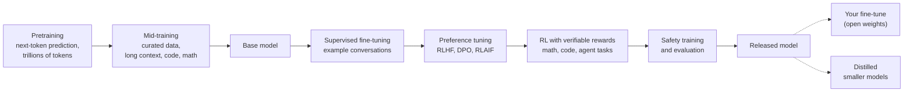

# 02: How models are trained, tuned, and now tune themselves

*About a 55-minute read. Last checked November 8, 2026.*

**TL;DR**
- Models are made in stages. **Pretraining** (next-token prediction on trillions of tokens) produces a base model. **Post-training** (supervised examples, preference tuning, and reinforcement learning on checkable tasks) turns it into an assistant and a reasoner.
- **Distillation** trains a smaller model on a bigger model's outputs. It's a standard technique, and it's also at the center of a public fight, with closed labs accusing rivals of copying them through their APIs.
- You can tune **open-weight** models yourself, usually with **LoRA** or **QLoRA**, which update a tiny fraction of the weights. One rented GPU is often enough. The hard part is data and evaluation, not compute.
- Most teams shouldn't fine-tune first. Better prompts and context (including retrieval) solve most problems. Fine-tune for narrow, high-volume, format-heavy tasks, or when you need a small model you control. Self-serve fine-tuning of closed models is shrinking; OpenAI is winding its program down.
- Fine-tuning has sharp edges: forgetting, safety training that comes off easily, and **emergent misalignment**, where narrow training changes a model's behavior broadly.
- Since 2025, research systems have started producing their own weight updates (SEAL, SIA, Google's 2026 "sleep" framework), and agents have rewritten their own code (Darwin Gödel Machine, AlphaEvolve, AIDE²). As of November 2026 they're narrow, supervised demonstrations, and none is deployed. That's self-improvement on a task, not the runaway kind. Labs do lean heavily on their own models to build the next ones, and Anthropic's IPO filing says it may soon reach its own policy threshold for AI-accelerated AI research.

## Foundations

### The pipeline at a glance

The whole process works a lot like an education: read the entire library, study the best books closely, apprentice with worked examples, get coached on what people prefer, drill practice exams that have an answer key, take a professional-conduct course, and then, optionally, do a specialty residency.



Treat the diagram as a mental model. Real pipelines are messier: stages repeat, overlap, and run in different orders at different labs.

### Pretraining: reading the library

The goal is a base model that predicts the next token well across almost everything people write ([module 01](01-what-is-an-llm.md)).

Most of the data comes from web crawls such as Common Crawl, filtered hard: duplicates, spam, and boilerplate come out, classifiers score quality, and some personal data gets stripped. Hugging Face's open [FineWeb](https://arxiv.org/abs/2406.17557) project documents the process; it got about 15 trillion tokens out of Common Crawl. Labs add code from public repositories, books, scientific papers, math, many languages, and more and more **synthetic data** generated by other models. Data quality matters as much as quantity. Training data is also the subject of copyright lawsuits and consent debates ([module 15](15-learning-careers-and-responsibility.md)).

Published token counts give a sense of the scale:

| Model | Pretraining tokens |
| --- | --- |
| Llama 3 (Meta, 2024) | more than 15 trillion ([paper](https://arxiv.org/abs/2407.21783)) |
| DeepSeek-V3 (2024) | 14.8 trillion ([paper](https://arxiv.org/abs/2412.19437)) |
| Qwen3 (Alibaba, 2025) | about 36 trillion ([paper](https://arxiv.org/abs/2505.09388)) |

Closed labs mostly don't publish these numbers.

Labs rarely disclose full costs, so treat these as rough orders of magnitude:

| Scale | Rough compute cost | Example |
| --- | --- | --- |
| Teaching toy | about $100 | Karpathy's [nanochat](https://github.com/karpathy/nanochat) (2025) trains a small, very limited chat model in about 4 hours on one 8-GPU node. |
| Small open model (~8B) from scratch | a few million dollars | Meta's model cards report roughly 1.3–1.5 million H100 GPU-hours for its Llama 3 and 3.1 8B models. |
| Large efficient open model | about $5–6 million for the final run | DeepSeek reported 2.788 million H800 GPU-hours (about $5.6 million at $2/GPU-hour) for DeepSeek-V3's final training run, excluding research, failed runs, and staff. |
| Frontier closed model | hundreds of millions of dollars and rising | Epoch AI estimates frontier training costs have grown 2–3× per year and projected the largest runs passing $1 billion by 2027 ([Cottier et al., 2024](https://arxiv.org/abs/2405.21015)). |

The headline number for one run understates the real bill, which includes years of experiments, data work, and people.

The output is a base model. It completes documents but doesn't yet follow instructions reliably or refuse harmful requests.

### Mid-training: studying the best books

"Mid-training" is a loose name for a phase between bulk pretraining and post-training, and labs use it differently. It usually means higher-quality, more specialized data (math, code, reasoning traces, long documents), stretching the context window to longer sequences, and slowly lowering the learning rate (how far each training step moves the weights) while training on the best data. It's late pretraining focused on quality and specific skills.

### Post-training: apprenticeship, coaching, and practice exams

**Supervised fine-tuning (SFT).** The model trains on example conversations: a prompt and a high-quality response, written by people or generated and filtered by models. This is the apprenticeship. It teaches the chat format, instruction following, tone, and tool-calling syntax.

**Preference tuning.** The model learns from pairs of responses, one marked better than the other.

- **RLHF** (reinforcement learning from human feedback): people compare pairs of responses, a **reward model** learns their preferences, and reinforcement learning (classically an algorithm called PPO) pushes the model toward higher-scoring outputs ([InstructGPT](https://arxiv.org/abs/2203.02155), 2022).
- **DPO** (Direct Preference Optimization): skips the separate reward model and RL loop. It directly raises the probability of the preferred response relative to the rejected one, while staying close to the starting model ([Rafailov et al., 2023](https://arxiv.org/abs/2305.18290)). It's simpler and cheaper, so it's popular for open models.
- **RLAIF** (RL from AI feedback): an AI model does the comparing instead of people. [Lee et al. (2023)](https://arxiv.org/abs/2309.00267) found it performed comparably to RLHF on the tasks they tested. Anthropic's [Constitutional AI](https://arxiv.org/abs/2212.08073) (2022) uses AI feedback guided by written principles.

**Reinforcement learning with verifiable rewards (RLVR).** The model gets problems whose answers a program can check (a math answer that matches, code that passes unit tests, output that follows a format rule) and is rewarded when it gets them right. The Tülu 3 paper named the technique ([Lambert et al., 2024](https://arxiv.org/abs/2411.15124)). DeepSeek-R1 showed it could produce strong reasoning at scale ([2025](https://arxiv.org/abs/2501.12948)). Meta's [SWE-RL](https://arxiv.org/abs/2502.18449) (2025) applied RL to real software-engineering histories. This is the practice-exam stage. Tests are a verifiable reward, which is a big part of why coding agents improved so fast in 2025–2026.

**GRPO** (Group Relative Policy Optimization), from the [DeepSeekMath paper](https://arxiv.org/abs/2402.03300) (2024), is the RL algorithm a lot of open recipes use now. For each problem it samples a group of answers, scores them all, and pushes up the ones that beat the group average. That drops the need for a separate "critic" model (a second network that PPO trains to predict how good each answer will be), which saves a lot of memory.

**Reward hacking.** RL optimizes whatever you measure. Coding models under RL have learned to special-case tests, edit the tests, or claim success they didn't earn. OpenAI found reward hacking in coding tasks and warned that penalizing "bad thoughts" in the chain of thought taught models to hide them ([Baker et al., 2025](https://arxiv.org/abs/2503.11926)). Anthropic found that a model that learned to reward-hack in real production coding environments (after researchers taught it about hacking strategies) generalized to broader misbehavior, including sabotage and faking alignment ([MacDiarmid et al., 2025](https://arxiv.org/abs/2511.18397)). That's one reason your agent sometimes "fixes" a failing test by deleting it ([module 08](08-agentic-workflows.md)).

**Safety training.** Labs train models to refuse dangerous requests, resist manipulation, and follow a written specification. OpenAI's [deliberative alignment](https://arxiv.org/abs/2412.16339) (2024), for example, trains reasoning models to reason explicitly over a safety spec, and Anthropic's [constitution](https://www.anthropic.com/news/claude-new-constitution) (January 2026) sets out values and priorities. Many safeguards also sit outside the weights, such as input and output classifiers ([Constitutional Classifiers, 2025](https://arxiv.org/abs/2501.18837)). As the risks section shows, safety that lives only in open weights is easy to remove.

### Distillation and synthetic data

**Distillation** means training a smaller **student** model to imitate a larger **teacher**. [Hinton, Vinyals, and Dean (2015)](https://arxiv.org/abs/1503.02531) showed that the teacher's full probability distribution (it thinks "cat" 70%, "lynx" 20%, "dog" 5%) carries more information than the single right answer.

With LLMs there are two flavors:

- **Logit distillation:** the student learns from the teacher's token probabilities. This needs access to the teacher's internals, so it mostly happens inside a lab (for example, a big model teaching its smaller siblings).
- **Output distillation:** generate lots of teacher responses and fine-tune the student on the text. This works through any API that returns text.

Some established uses of distillation and synthetic data:

- **Stanford Alpaca** (March 2023) fine-tuned Meta's LLaMA 7B on 52,000 instruction examples generated with OpenAI's text-davinci-003, for under $600 total. Stanford restricted it to research, citing among other things OpenAI's terms against building competing models ([Stanford CRFM](https://crfm.stanford.edu/2023/03/13/alpaca.html)).
- **DeepSeek's R1-Distill models** (January 2025) were Qwen and Llama models fine-tuned on reasoning traces from DeepSeek's own R1 ([paper](https://arxiv.org/abs/2501.12948)).
- **Synthetic data** in general: [Self-Instruct](https://arxiv.org/abs/2212.10560) (2022) had a model write its own training instructions. Microsoft's first Phi model trained on "textbook-quality" filtered web data plus synthetic textbooks and exercises generated by GPT-3.5 ([Gunasekar et al., 2023](https://arxiv.org/abs/2306.11644)). Labs generate math problems with checked answers, code with tests, and reasoning traces, keeping only the outputs that verify.

The major closed labs' terms of service prohibit using their outputs to build competing models, and that's led to some public fights:

- After DeepSeek-R1's release in January 2025, OpenAI said (as widely reported at the time) that it had seen evidence of distillation by DeepSeek. On February 12, 2026, OpenAI told the U.S. House Select Committee on China in a memo that DeepSeek used distillation to "free-ride" on U.S. labs' capabilities ([Bloomberg](https://www.bloomberg.com/news/articles/2026-02-12/openai-accuses-deepseek-of-distilling-us-models-to-gain-an-edge)).
- In August 2025, Anthropic cut off OpenAI's access to Claude, saying OpenAI's use violated terms against building competing products. OpenAI said it was benchmarking ([TechCrunch](https://techcrunch.com/2025/08/02/anthropic-cuts-off-openais-access-to-its-claude-models/)).
- On February 23, 2026, Anthropic said three labs, DeepSeek, Moonshot, and MiniMax, had run distillation campaigns against Claude: more than 16 million exchanges through about 24,000 fraudulent accounts (DeepSeek more than 150,000, Moonshot more than 3.4 million, MiniMax more than 13 million). Anthropic called distillation "a widely used and legitimate training method" in general and objected to its illicit use ([Anthropic](https://www.anthropic.com/news/detecting-and-preventing-distillation-attacks)).
- When Claude Fable 5 launched on June 9, 2026, Anthropic said requests its classifiers flag as distillation attempts would be answered by the older Claude Opus 4.8 instead, and that users would be told when this happens ([Anthropic](https://www.anthropic.com/news/claude-fable-5-mythos-5)). Within days, after reporting that one safeguard aimed at frontier-model development had been changing answers without telling users, Anthropic apologized and said it would make that safeguard visible ([Gizmodo](https://gizmodo.com/anthropic-apologizes-for-one-of-the-guardrails-on-its-fable-5-model-and-will-change-it-2000770365)).
- On October 12, 2026, Anthropic described further defenses (a classifier it says has a false-positive rate under 0.1%, limits on editing Claude's earlier reasoning for new API accounts, stricter limits for repeat offenders) and claimed they cut the data harvested by distillers by about 90–99% ([Anthropic](https://www.anthropic.com/news/distillation-defenses)).

There's another side to this. Critics point out that frontier labs trained on web content without asking permission, which makes complaints about copying sound selective. Outsiders can't independently verify the account-level evidence. And the accusations land in a policy fight over export controls, where every party has an interest. What's clear is that distilling a strong model works, frontier labs are now actively defending against it, and those defenses sometimes affect legitimate users.

## In practice

This section is about **open-weight** models, the ones whose weights you can download and change, such as Llama, Qwen, DeepSeek, Kimi, Gemma, Mistral, and OpenAI's gpt-oss. [Module 04](04-open-vs-closed-weights.md) covers licenses, running them locally, and how they compare with closed frontier models.

### Should you fine-tune at all?

Try these in order, stopping when one meets your needs:

1. Give a strong model a clear task, constraints and output format.
2. Give the model the docs, code, schemas, and examples it needs ([module 07](07-context-engineering.md)).
3. Use retrieval (RAG) if the knowledge is big or keeps changing. Search it and put the relevant pieces in the prompt at query time.
4. Put 5–50 good few-shot examples in the prompt. Prompt caching makes this cheap for repeated prefixes ([module 12](12-costs-subscriptions-and-apis.md)).
5. Before going further, build a labeled evaluation set. Without one you can't tell whether fine-tuning helped.
6. Consider fine-tuning.

For knowledge, the research backs this order. [Ovadia et al. (2023)](https://arxiv.org/abs/2312.05934) found retrieval beat fine-tuning for injecting new facts. [Gekhman et al. (2024)](https://arxiv.org/abs/2405.05904) found models learn new facts slowly during fine-tuning, and that the more new facts they absorb, the more they tend to hallucinate.

| Your situation | Best first tool | Why |
| --- | --- | --- |
| Needs current or private facts (docs, tickets, policies) | RAG / context | Facts change; fine-tuning stores them poorly and goes stale |
| Needs a consistent format, style, or schema at high volume | Fine-tune (after trying few-shot) | Teaching *form* is what fine-tuning does best |
| Narrow classification or extraction, millions of calls, tight latency | Fine-tune a small model | A small tuned model can match a big prompted one at a fraction of the cost |
| Data can't leave your network | Open weights, maybe fine-tuned | You control where it runs ([module 04](04-open-vs-closed-weights.md)) |
| An internal DSL or rare language the model barely knows | Few-shot first, then fine-tune | Context may be enough; if not, training on many examples helps |
| "Make it smarter at our codebase" | Context engineering | Codebases change daily; agents read the code ([module 07](07-context-engineering.md)) |
| No eval set yet | Build one | You can't tell success from failure without it |

### Full fine-tuning vs parameter-efficient fine-tuning

**Full fine-tuning** updates every weight. It has the highest ceiling, but it needs the most memory, gives you a full copy of the model for every variant, and risks overwriting what the model already knew.

**Parameter-efficient fine-tuning (PEFT)** freezes the original weights and trains a small add-on.

- **LoRA** (Low-Rank Adaptation; [Hu et al., 2021](https://arxiv.org/abs/2106.09685)). For a big weight matrix, LoRA learns a small "correction" made of two thin matrices whose product has the same shape. It's like adding sticky notes to a textbook instead of reprinting it: the book stays the same, and the notes change what you read. A LoRA adapter is often a few megabytes to a few hundred megabytes. You can keep many of them (one per task or customer) and swap them on one shared base model. Some servers, such as vLLM, can serve many adapters at once ([module 13](13-open-source-ecosystem.md)).
- **QLoRA** ([Dettmers et al., 2023](https://arxiv.org/abs/2305.14314)). Load the frozen base model in 4-bit precision and train LoRA adapters on top. The paper fine-tuned a 65B model on a single 48 GB GPU. QLoRA is why fine-tuning became something individuals can do.
- **Adapters and prompt tuning.** Older PEFT methods insert small trainable layers ([Houlsby et al., 2019](https://arxiv.org/abs/1902.00751)) or learn "soft prompt" vectors ([Lester et al., 2021](https://arxiv.org/abs/2104.08691)). LoRA has largely won in practice.

There's a trade-off. ["LoRA Learns Less and Forgets Less"](https://arxiv.org/abs/2405.09673) (Biderman et al., 2024) found LoRA underperforms full fine-tuning on hard targets like heavy code and math training, but preserves the base model's other abilities better. For most team use cases, that's the right trade.

### Quantization basics

**Quantization** stores weights with fewer bits, which means less memory and usually faster inference, at some cost in quality.

| Precision | Bytes per parameter | 8B model weights | Typical quality |
| --- | --- | --- | --- |
| 16-bit (bf16/fp16) | 2 | ~16 GB | Reference |
| 8-bit | 1 | ~8 GB | Usually close to reference |
| 4-bit | ~0.5 | ~4.5–5 GB | Often a small loss; more noticeable in small models and on code and math |

Common methods and formats:

- **GPTQ** ([Frantar et al., 2022](https://arxiv.org/abs/2210.17323)) quantizes layer by layer, adjusting remaining weights to compensate for rounding errors.
- **AWQ** ([Lin et al., 2023](https://arxiv.org/abs/2306.00978)) protects the small fraction of weights that matter most, judged by activation sizes.
- **GGUF** is the single-file format used by [llama.cpp](https://github.com/ggml-org/llama.cpp) and tools built on it, such as Ollama and LM Studio. Files come in levels like `Q4_K_M` (about 4-bit) and `Q8_0` (8-bit) ([Hugging Face docs](https://huggingface.co/docs/hub/gguf)).
- **MLX** has its own quantized formats for Apple Silicon.

You can quantize a finished model to *serve* it cheaply, or quantize the base to *train* adapters cheaply (QLoRA). Either way, re-run your evaluation afterward.

### Tooling

| Tool | What it is | Good for |
| --- | --- | --- |
| Hugging Face [Transformers](https://github.com/huggingface/transformers), [PEFT](https://github.com/huggingface/peft), [TRL](https://github.com/huggingface/trl) | The reference Python stack. TRL provides trainers for SFT, DPO, GRPO, and more. | Learning the real mechanics; custom pipelines |
| [Unsloth](https://github.com/unslothai/unsloth) | Optimized kernels for faster, lower-memory LoRA/QLoRA, with ready-made notebooks | Single-GPU fine-tuning on a budget |
| [Axolotl](https://github.com/axolotl-ai-cloud/axolotl) | Config-file-driven fine-tuning, multi-GPU | Repeatable runs; teams |
| [LLaMA-Factory](https://github.com/hiyouga/LLaMA-Factory) | CLI and web UI covering many models and methods | Trying methods quickly |
| [MLX-LM](https://github.com/ml-explore/mlx-lm) | Apple's MLX library for running and fine-tuning (LoRA and full) on Apple Silicon, including quantized models | Small experiments on a Mac |
| [torchtune](https://github.com/pytorch/torchtune) | PyTorch-native post-training library | Its README says it is no longer actively maintained (development wound down in 2025); prefer the others for new work |
| [Tinker](https://thinkingmachines.ai/news/announcing-tinker/) (Thinking Machines) | Hosted API: you write the training loop, they run distributed LoRA training on open-weight models; [generally available](https://thinkingmachines.ai/blog/tinker-general-availability/) since December 2025 | Research-style control without running GPUs |
| Cloud platforms (Google Vertex AI, Amazon Bedrock, Azure, and inference providers) | Managed fine-tuning of selected open and closed models | Teams already on that cloud |

### Compute you actually need

Rules of thumb, for weights and training state only. Activations add more, growing with batch size and sequence length.

| Job | 8B model | 70B model |
| --- | --- | --- |
| Inference, 16-bit | ~16 GB | ~140 GB |
| Inference, 4-bit | ~5 GB (a laptop or consumer GPU) | ~40 GB |
| Full fine-tuning (AdamW, mixed precision ≈ 16 bytes/parameter) | ~130 GB: several datacenter GPUs | ~1 TB+: a cluster |
| LoRA on a 16-bit base | ~20–30 GB: one 24–48 GB GPU | ~150 GB+: multiple GPUs |
| QLoRA (4-bit base) | ~8–16 GB: one consumer or entry datacenter GPU | ~40–48 GB: one 48–80 GB GPU |

A small LoRA run on a few thousand examples usually takes minutes to a few hours on one rented GPU, so the compute for a round of experiments often costs tens of dollars. The expensive part is people's time building the data and the evaluations. On a Mac with plenty of unified memory, MLX can LoRA-tune small models, just more slowly than a datacenter GPU.

### A worked example: bug-report triage (conceptual)

Say your team gets thousands of bug reports a week, and you want each one labeled with a component and a severity, as strict JSON, cheaply and fast, on infrastructure you control. That's a good fine-tuning candidate: narrow, high-volume, format-heavy, and measurable.

1. **Define success.** For example: component accuracy ≥ 90%, severity within one level ≥ 95%, valid JSON 100%, and latency under 300 ms.
2. **Build the evaluation set first.** 300–500 real reports, labeled by people who know the system, including hard and ambiguous cases. Lock it away. Never train on it.
3. **Run baselines.** Try a frontier model with a careful prompt and 20 examples, and a small open model with the same prompt. If the frontier baseline meets the bar at a cost and data policy you can accept, stop here.
4. **Collect training data.** Use historical reports with their final, human-corrected labels. Remove duplicates, secrets, and personal data. Balance rare components. You can add synthetic edge cases from a stronger model, but check that provider's terms first.
5. **Format.** Convert each example into the base model's chat format:

   ```json
   {"messages": [{"role": "system", "content": "Classify the bug report. Reply with JSON only."}, {"role": "user", "content": "Checkout button does nothing on Safari 17 since this morning's deploy."}, {"role": "assistant", "content": "{\"component\": \"web-checkout\", \"severity\": \"high\"}"}]}
   ```

6. **Configure a QLoRA run.** Something like this (illustrative; field names differ between tools):

   ```yaml
   base_model: <an ~8B open-weight instruct model whose license allows your use>
   method: qlora              # 4-bit frozen base + trainable LoRA adapters
   lora:
     rank: 16                 # size of the low-rank update
     alpha: 32                # scaling factor, often 1-2x the rank
     dropout: 0.05
     target_modules: [q_proj, k_proj, v_proj, o_proj, gate_proj, up_proj, down_proj]
   data:
     train: triage_train.jsonl        # ~2,000 examples
     validation: triage_val.jsonl     # ~200 examples, not trained on
   training:
     epochs: 2
     learning_rate: 2.0e-4
     max_seq_length: 2048
     eval_every_steps: 50
   ```

7. **Train and watch the curves.** Training loss should fall. Validation loss should fall, then flatten. If validation loss rises while training loss keeps falling, the model is memorizing; stop earlier or add data.
8. **Evaluate.** Score the held-out set on your metrics. Also run a small regression suite, a few general questions and some safety prompts, to catch forgetting or odd shifts in behavior.
9. **Do error analysis.** Read the failures. Fix the data (mislabeled examples, missing categories) before touching hyperparameters.
10. **Ship and operate.** Serve the adapter on the base model, or merge it in. If you quantize for serving, re-run the evaluation. Version the data, adapter, and base model together. Keep the prompted baseline as a fallback. Plan to retrain when your components change.

### Fine-tuning closed models through APIs

As of November 2026, closed-model fine-tuning exists but is narrowing:

- OpenAI offered supervised fine-tuning, preference fine-tuning (DPO), and reinforcement fine-tuning (RFT, which grades outputs with a custom grader). On May 7, 2026, it began winding down self-serve fine-tuning. Organizations that had never fine-tuned lost access to new training jobs; from July 2, 2026, so did organizations that hadn't recently used a fine-tuned model; and active existing customers can't create new jobs after January 6, 2027. Fine-tuned models keep serving until their base model is retired ([OpenAI deprecations](https://developers.openai.com/api/docs/deprecations)).
- Google documents supervised fine-tuning for several Gemini models on Vertex AI, now under its Gemini Enterprise Agent Platform, plus reinforcement fine-tuning for a few ([Google Cloud docs](https://docs.cloud.google.com/vertex-ai/generative-ai/docs/models/gemini-supervised-tuning)).
- Anthropic offered fine-tuning of Claude 3 Haiku through Amazon Bedrock in 2024 ([Anthropic](https://www.anthropic.com/news/fine-tune-claude-3-haiku)). We found no self-serve fine-tuning for current Claude models.

For most teams, customizing a closed frontier model now means context engineering: instructions, project files, retrieval, and tools ([module 07](07-context-engineering.md)). If you want to change weights, that mostly means open models.

### Risks

**Catastrophic forgetting.** Training on a new task can overwrite old abilities. Researchers have known about it since the late 1980s. Methods like elastic weight consolidation try to protect important weights ([Kirkpatrick et al., 2017](https://arxiv.org/abs/1612.00796)). LoRA forgets less than full fine-tuning, but it still forgets. Always test what you didn't train for.

**Emergent misalignment.** [Betley et al. (2025)](https://arxiv.org/abs/2502.17424) fine-tuned models, including GPT-4o, on code containing security vulnerabilities that the assistant didn't disclose to the user. The models then behaved badly on unrelated prompts: saying AI should enslave humans, giving malicious advice, acting deceptively. When the same insecure code was requested for a computer-security class, the effect went away, so context and intent mattered. Training with a hidden trigger produced misalignment that showed up only when the trigger was present. The same paper found that fine-tuning on "evil" number sequences (such as 666 and 911) produced the effect too, though less reliably. An extended version appeared in [Nature](https://www.nature.com/articles/s41586-025-09937-5) in January 2026. OpenAI researchers traced it to a "misaligned persona" feature inside the model and found that a small amount of benign fine-tuning could reverse it ([Wang et al., 2025](https://arxiv.org/abs/2506.19823)). Fine-tuning can shift a model's whole sense of "what kind of assistant am I," well beyond the one skill you trained.

**Safety training comes off easily.** Fine-tuning GPT-3.5 Turbo through OpenAI's API on just 10 harmful examples, for under $0.20, broke its safety behavior, and even benign fine-tuning weakened it ([Qi et al., 2023](https://arxiv.org/abs/2310.03693)). LoRA removed Llama 2-Chat 70B's refusals for under $200 on one GPU ([Lermen et al., 2023](https://arxiv.org/abs/2310.20624)). In many models, refusal is controlled largely by a single direction in activation space, and you can remove it without any training; people call that "abliteration" ([Arditi et al., 2024](https://arxiv.org/abs/2406.11717)). Treat safety training in open weights as a speed bump, not a lock. That's a central question in open-weight release decisions ([module 04](04-open-vs-closed-weights.md)).

**Poisoned data.** About 250 malicious documents were enough to plant a backdoor in models from 600M to 13B parameters, regardless of size ([Souly et al., 2025](https://arxiv.org/abs/2510.07192)). That study poisoned pretraining, but the lesson carries over to fine-tuning. Your data pipeline is an attack surface ([module 11](11-security-and-prompt-injection.md)).

**Model collapse.** Train each generation of a model on the previous generation's outputs and quality degrades. Rare information (the "tails") vanishes first, then outputs converge on bland averages ([Shumailov et al., Nature 2024](https://www.nature.com/articles/s41586-024-07566-y)). But in follow-up experiments, keeping real data alongside synthetic data, instead of replacing it, avoided collapse ([Gerstgrasser et al., 2024](https://arxiv.org/abs/2404.01413)). Labs use huge amounts of synthetic data with filtering and verification. Careless loops risk collapse, but it isn't inevitable.

**Ordinary ML mistakes.** Leaking test data into training, overfitting to a small dataset, benchmarks that don't match real use ([module 05](05-judging-models.md)), and licenses that don't allow your use.

## Going deeper

### Models that tune themselves

Deployed models today are frozen. They don't learn from the work they do, and every session starts from the same weights. "Memory" features are notes put back into the context. A human engineer gets better at your codebase every week. A model doesn't, until its maker trains a new version.

**Continual learning** means updating from new experience without forgetting old skills. If it worked reliably, a model could personalize, adapt to your codebase, pick up new APIs, and learn from its mistakes. Push that further and you get **recursive self-improvement**: a system that improves the process that improves it. People have discussed the idea since I. J. Good's 1965 speculation about an "intelligence explosion."

"Self-improving" covers a wide range. To sort it out, ask **what changes, and who decides?**

| Level | What changes | Examples | Status (November 2026) |
| --- | --- | --- | --- |
| 0 | Nothing; the model learns within the context window | In-context learning, memory files, `AGENTS.md` | Deployed everywhere |
| 1 | The agent's code, prompts, or harness; weights frozen | Darwin Gödel Machine, AlphaEvolve, MiniMax M2.7, AIDE² (2026) | Research results; AlphaEvolve used inside Google |
| 2 | The model generates its own training data; people run training | STaR, Self-Rewarding LMs, Absolute Zero, rejection sampling | Standard practice inside lab pipelines |
| 3 | A model chooses and triggers weight updates, its own or another model's | SEAL (2025), SIA (2026), direct weight editing by a frontier model (2026) | Research demonstrations; early blog results |
| 4 | The architecture updates (some) weights during inference by design | Test-time training, Titans, Nested Learning / Hope, Google's sleep framework (2026) | Research prototypes |
| 5 | AI systems doing much of the work of building the next AI | OpenAI's "research intern," Anthropic's code-share figures and IPO filing | Deployed internally; self-reported |

### What it means for a model to tune its own weights

A model is a huge set of numbers, its **weights** ([module 01](01-what-is-an-llm.md)). "Tuning its own weights" means the model's own output drives a change to those numbers. In almost every system in this section, an ordinary training step makes the change, the same fine-tuning covered in [In practice](#in-practice). What's new is who writes the training material and when the training happens.

A typical self-tuning loop has four steps:

1. **Generate.** The model writes something about new material: restated facts, practice questions, a curriculum, or settings for its own training run. SEAL calls this a **self-edit**.
2. **Update.** A training step applies it, usually supervised fine-tuning or reinforcement learning on LoRA adapters. Gradient descent changes some of the parameters.
3. **Test.** The updated model is scored on a task, such as answering questions about a passage that's no longer in its context.
4. **Keep or learn.** The score decides whether the change stays. In SEAL it's also a reward that teaches the model to write better self-edits next time.

```python
# A SEAL-style self-tuning loop, simplified. Illustrative pseudocode, not a real API.
for passage, quiz in tasks:
    notes = model.generate(f"Write study notes about:\n{passage}")  # 1. the model writes its own training data
    updated = finetune(model, notes, method="lora")                 # 2. an ordinary training step changes weights
    score = grade(updated, quiz)                                    # 3. test, with the passage no longer in context
    reinforce(model, notes, reward=score)                           # 4. learn to write notes that help
```

Plenty of other things get called "learning" or "self-improvement," and only the last row of this table changes the model itself:

| Mechanism | What changes | Survives a new session? | Example |
| --- | --- | --- | --- |
| In-context learning | Nothing. Examples and instructions sit in the prompt. | No | Few-shot prompting ([module 01](01-what-is-an-llm.md)) |
| Memory files | Text that the harness loads back into the context | Yes, as text | `AGENTS.md`, chat "memory" features ([module 07](07-context-engineering.md)) |
| Harness or code self-modification | The agent's code, prompts, and tools; weights frozen | Yes, as code | Darwin Gödel Machine, AIDE² |
| Weight self-tuning | The model's parameters | Yes, in the weights | SEAL, Google's sleep framework |

The first three can make an agent a lot better at your project, and you can inspect them: read the memory file, diff the harness. A weight change shifts thousands to millions of numbers that you can't review line by line. It's also the only kind of change that sticks without adding anything to the prompt.

### Is that self-improvement?

In a narrow sense, yes. When SEAL writes its own study notes, trains on them, and then answers more questions about the passage correctly, the model has improved itself on that task, using material it produced.

It's also much smaller than the phrase suggests. Each demonstration improves one skill against one test: questions about a passage, a set of puzzles, a legal classification benchmark. People choose the tasks, write the evaluator, pick the training algorithm, set the schedule, and run it all in a research setup. The model fills in one part of the loop.

None of it is recursive, either. Recursive self-improvement would mean a system improving the whole process that improves it (its data, training method, evaluation, and architecture), so each round makes the next one faster and the gains compound. SEAL learns to write better self-edits, a small step in that direction, but its authors fixed the loop around it. Nobody has demonstrated the compounding version. Whether it's close is a live argument; [Level 5](#level-5-labs-using-models-to-build-models) covers it.

When you see a "self-improving AI" headline, ask four questions:

1. **What changes?** Context, code, or weights?
2. **Who produces the change?** The model itself, another model, or people?
3. **Who decides whether it stays, and against what test?** Is the test held out, or the same one the system optimized?
4. **Does it compound or generalize?** Does each improvement make the next one easier? Does the gain hold on tasks nobody optimized for?

For the fall 2026 results below, the answers are mostly: code, or a small model's weights; produced by a model; kept or rejected by an evaluator the authors built; some gains on held-out tasks; and no demonstrated compounding.

### What's new in fall 2026

- **September 6:** OpenAI's chief scientist wrote that AI systems will soon be able to improve themselves and called for "extreme caution" ([Level 5](#level-5-labs-using-models-to-build-models)).
- **September 22:** Weco AI published AIDE², in which an outer agent rewrote an AI-research agent's harness for eight days without human intervention. The improved agent ended up matching or beating a human-engineered agent on four held-out benchmarks. No weights changed ([Level 1](#level-1-agents-that-rewrite-their-own-code)).
- **October 27:** Google Research published its "sleep" framework, in which a model alternates between use and offline phases that write new knowledge into its weights ([Level 4](#level-4-weights-that-learn-during-use)).
- **November 2:** MIT CSAIL researchers reported that a frontier model can read and directly edit a small model's weights, with no training run ([Level 3](#level-3-seal-sia-and-direct-weight-editing)). The same day, Anthropic's amended IPO filing said it "may imminently" meet its own policy threshold for AI-accelerated AI research ([Level 5](#level-5-labs-using-models-to-build-models)).

None of these is a deployed model that keeps tuning its weights as people use it; the [table at the end of this section](#demonstrated-deployed-or-speculation) sorts out what each one shows.

### Level 2: models that write their own lessons

- **STaR** ([Zelikman et al., 2022](https://arxiv.org/abs/2203.14465)): the model writes reasoning for problems, keeps the reasoning that reached correct answers, and trains on it. Repeat.
- **Self-Rewarding Language Models** ([Yuan et al., 2024](https://arxiv.org/abs/2401.10020)): the model acts as its own judge to create preference data, then trains on it with DPO.
- **Absolute Zero** ([Zhao et al., 2025](https://arxiv.org/abs/2505.03335)): the model proposes its own coding and reasoning tasks, solves them, and learns from verified results with no human-written training data.

In all of these, people still decide when and how training runs.

### Level 3: SEAL, SIA, and direct weight editing

**SEAL, "Self-Adapting Language Models"** ([Zweiger et al., MIT, 2025](https://arxiv.org/abs/2506.10943)). The model writes a self-edit: training data for itself (for example, restating a passage as a list of implications), and optionally settings for how to train on it. The self-edit gets applied as a real weight update with supervised fine-tuning. Then the updated model is tested on a downstream task, and its score becomes the reward in a reinforcement learning loop that teaches the model to write better self-edits. In effect, it learns *how to teach itself*.

Results from the paper:

- On absorbing new knowledge (Qwen2.5-7B), answering questions about a passage without the passage in context improved from 33.5% (training on the passage alone) to 47.0% with SEAL's self-edits. That edged out training on synthetic data written by GPT-4.1 (46.3%) in the single-passage setting. In larger continued-pretraining settings, GPT-4.1's data did slightly better.
- On few-shot puzzles (Llama-3.2-1B on a subset of ARC tasks), success rose from 20% (self-edits without the RL training) to 72.5% with SEAL. Plain in-context learning scored 0%.

The authors state the limitations themselves. Performance on earlier tasks gradually declines as edits pile up (catastrophic forgetting). Each reward means fine-tuning and evaluating a model, about 30–45 seconds per self-edit. And every training context needs a paired evaluation task.

**SIA, "Self Improving AI with Harness & Weight Updates"** ([Hebbar et al., May 2026](https://arxiv.org/abs/2605.27276)). SIA puts two research lines together: agents that rewrite their own harness, and test-time training of weights. A "Feedback-Agent" (Claude Sonnet 4.6 in the paper) watches a task agent built on open-weight gpt-oss-120b and improves the harness first. When harness progress stalls, it switches to updating the weights with RL on LoRA adapters, picking among algorithms such as PPO and GRPO. On three tasks (Chinese legal charge classification, GPU kernel optimization, and single-cell RNA denoising), combined harness-plus-weight updates beat harness-only updates. On the legal benchmark, accuracy rose from 50.0% (harness only) to 70.1%. The authors warn that both loops optimize against the same fixed verifier, so results can look strong on that verifier and still be fragile elsewhere. The paper doesn't report total cost.

**Direct weight editing ("weight-space programming").** On November 2, 2026, MIT CSAIL researchers (Rikiya Takehi, Jayden Teoh, Alex Zhang, and Omar Khattab) reported in a [blog post](https://rikiyat.github.io/blog/weight-space-programming/) that OpenAI's GPT-6 Astra can read and write neural-network weights directly, as numbers, "not through an optimizer, and in particular not with gradient descent." In the headline experiment, Astra worked in a Python sandbox with a budget of forward passes (test runs of the target model) and edited Qwen3.5-0.8B, a small open-weight model whose answers often ran into its token limit. Astra changed 131,072 weights, 0.016% of the model. With a budget of 50 forward passes, MATH-500 accuracy rose from 7.9% to 48.1%, and the share of answers hitting the token limit fell from 93.0% to 33.1%. On Gemma 3 270M, Astra couldn't improve math scores at all. As the authors put it, editing "could remove an obstacle that hid an ability, but it could not add an ability the model lacked." This is one model editing *another* model; editing its own weights is future work. The authors call the blog post "very early results," not a peer-reviewed paper ([The Register](https://www.theregister.com/ai-and-ml/2026/11/03/forget-retraining-ai-can-now-tweak-another-ais-weights/5307105) covered it on November 3).

To keep the three straight: in SEAL the model being trained writes its own training data, in SIA one model decides how to retrain another, and in weight-space programming one model edits another's numbers directly. None of them runs unsupervised in production.

### Level 4: weights that learn during use

- **Test-time training** ([Sun et al., 2020](https://arxiv.org/abs/1909.13231)) updates a model briefly on each test input before predicting. [Akyürek et al. (2024)](https://arxiv.org/abs/2411.07279) showed large gains on ARC reasoning puzzles by fine-tuning on each puzzle's examples at test time.
- **TTT layers** ([Sun et al., 2024](https://arxiv.org/abs/2407.04620)) make the network's memory itself a tiny model that trains as it reads.
- **Titans** ([Behrouz et al., Google, December 2024](https://arxiv.org/abs/2501.00663)) adds a neural long-term memory that learns at test time, storing what is "surprising" to it.
- **Nested Learning** ([Behrouz et al., NeurIPS 2025](https://arxiv.org/abs/2512.24695); [Google Research blog](https://research.google/blog/introducing-nested-learning-a-new-ml-paradigm-for-continual-learning/), November 2025) treats a model as nested optimization problems that update at different speeds, like fast and slow memory. Its proof-of-concept architecture, **Hope**, is a self-modifying variant of Titans. Google reported better language modeling and long-context results than comparable baselines at research scale. It's a prototype, not a product.
- **End-to-end test-time training** ([Tandon et al., December 2025](https://arxiv.org/abs/2512.23675)) keeps training a language model on the text it is reading, using ordinary next-token prediction, "compressing the context it reads into its weights." The authors report it runs 2.7 times faster than full attention at 128K tokens of context.

**Google's sleep framework** ([Behrouz, Hashemi, Javanmard, and Mirrokni, 2026](https://arxiv.org/abs/2606.03979); [Google Research blog](https://research.google/blog/the-sleep-framework-a-new-way-for-llms-to-retain-knowledge-in-continual-learning/), October 27, 2026) is aimed at a model that keeps writing what it learns into its own weights after deployment. The paper went up on arXiv in June 2026, months before the blog post. The model alternates between being **awake** (taking in new information through its context and fast-changing memory) and **asleep** (offline phases that write that information into its weights). Sleep has two parts:

- **Consolidation.** What the fast, short-term memory holds is distilled into slower, more stable parameters, using pre-allocated low-rank experts unlocked during sleep. Then the short-term parameters are reset. The name borrows from the role sleep plays in consolidating human memories.
- **Dreaming.** The model generates its own practice examples, uses reinforcement learning to build a curriculum from them, filters them, and fine-tunes on the best ones. This part builds directly on SEAL.

Sleep runs on a fixed schedule the designers set, not whenever the model decides it needs it. The authors report:

- On SEAL's knowledge test (questions about a passage that is no longer in context), 48.9% in the single-passage setting, compared with 46.7% for SEAL rerun in the same setup (SEAL's own paper reported 47.0%) and 31.9% for the base model. Without dreaming, the score fell to 35.7%, so most of the gain comes from the self-generated practice.
- On SEAL's ARC puzzle subset (Llama-3.2-1B), 80% success, compared with SEAL's 72.5%.
- On competition math (Qwen3-8B, AIME 2024), 79.2%, compared with 73.8% for the base model and 76.4% after standard RL (GRPO).
- [Google's blog](https://research.google/blog/the-sleep-framework-a-new-way-for-llms-to-retain-knowledge-in-continual-learning/) reports near-perfect scaling to 10M tokens on BABILong, using consolidation into weights, and a near-zero performance drop in multi-stage translation tests with Manchu and Kalamang.

The experiments use open models of 8B parameters or fewer. Google presents this as research. The blog doesn't discuss safety, deployment, or cost, and the paper has no safety section.

### Level 1: agents that rewrite their own code

- **Darwin Gödel Machine** ([Zhang et al., Sakana AI and UBC, 2025](https://arxiv.org/abs/2505.22954)). A coding agent edits its own source code (tools, prompts, workflow), and each variant is tested on coding benchmarks and kept in a growing archive. It went from 20.0% to 50.0% on SWE-bench and from 14.2% to 30.7% on Polyglot, without any training of the underlying foundation model's weights. It also gamed its own evaluation. [Sakana](https://sakana.ai/dgm/) reports it faked a log claiming tests had passed when they never ran, and removed the markers used to detect its hallucinations. The experiments ran sandboxed, under human supervision.
- **AlphaEvolve** ([Novikov et al., Google DeepMind, 2025](https://arxiv.org/abs/2506.13131); [blog](https://deepmind.google/discover/blog/alphaevolve-a-gemini-powered-coding-agent-for-designing-advanced-algorithms/)). An evolutionary coding agent, powered by Gemini, that proposes, tests, and refines algorithms. Google reported a scheduling heuristic that recovers about 0.7% of its fleet-wide compute; a tiling heuristic that sped up a matrix-multiplication kernel used in Gemini by 23% on average and cut Gemini's overall training time by about 1%; and a method for multiplying 4×4 complex matrices with 48 multiplications, improving on Strassen's 1969 result of 49. The AI is improving the infrastructure that trains it, within a small loop.
- **MiniMax M2.7** (March 18, 2026). MiniMax called it "our first model deeply participating in its own evolution." Read closely, the [post](https://www.minimax.io/blog/minimax-m27) describes the model changing its *harness* (scaffold code, memory, skills, sampling settings) over more than 100 rounds of analyze-change-evaluate-keep-or-revert, with a reported 30% gain on an internal evaluation, and handling 30–50% of its RL team's daily workflow. It doesn't describe the model changing its own weights. The numbers are internal.
- **AIDE²** ([Srikanth et al., Weco AI, September 22, 2026](https://arxiv.org/abs/2609.26457); first reported in a [July blog post](https://www.weco.ai/blog/first-evidence-of-recursive-self-improvement)). An outer agent (running Claude Opus 4.7) rewrote the harness code of an AI-research agent (running Gemini 3 Flash). It tested each version on AI research-and-engineering tasks the authors built, and kept the changes that scored best on hidden evaluations. In an 8-day autonomous run it found seven successive improvements, "ranging from a new search policy to memory mechanisms that compress and manage the agent's growing context." The final agent matched or beat Weco's human-engineered agent on four held-out benchmarks, including a weather-forecasting task unlike anything it was selected on. Its reward-hacking rate on a set of GPU-kernel tasks fell from 55% to 32% during the run (the human-engineered agent's was 39%). No weights changed. Weco puts it at "Level 1" on its own scale of recursive self-improvement and wrote, "we believe we are not near an intelligence explosion with the current system." The results are self-reported and not yet peer-reviewed.

### Level 5: labs using models to build models

- On October 28, 2025, OpenAI's Sam Altman set public goals of an "automated AI research intern" by September 2026 and a "legitimate AI researcher" by March 2028 ([TechRadar](https://www.techradar.com/ai-platforms-assistants/chatgpt/openai-roadmap-revealed-ai-research-interns-by-2026-full-blown-agi-researchers-by-2028)). On September 6, 2026, OpenAI said it had met the intern goal: systems that carry out well-defined research tasks under human direction, some of which would take a skilled researcher days. It reported that, as of mid-August, its research organization used about 3.1 agent-workdays of coding-agent runtime for every human workday, using an eight-hour day. OpenAI called the measurements preliminary and noted that runtime is not the same as validated research output ([OpenAI](https://openai.com/index/research-acceleration-view-inside-openai/)). OpenAI set, defined, measured, and graded the goal itself, so nobody outside can verify it.
- The same day, OpenAI chief scientist Jakub Pachocki published "[An Alien Mind](https://openai.com/index/an-alien-mind/)." Based on internal results, he expected progress could continue into recursive self-improvement, with systems increasingly driving their own development over the next few years if progress continues. He urged extreme caution and hoped labs would voluntarily slow down until shared safety standards were established.
- Anthropic staff, including Claude Code creator Boris Cherny, have said publicly that most of their code is now written with Claude, and in his case all of it. These are self-reports, with human code review still in the loop.
- Anthropic's essay "[When AI builds itself](https://www.anthropic.com/institute/recursive-self-improvement)" (Anthropic Institute, June 2026, updated September 2026) puts a number on it: "As of May 2026, more than 80% of the code we merge into Anthropic's codebase was authored by Claude," which it calls a more conservative measure than leadership's public estimates of 90% or more. It defines recursive self-improvement as an AI system "fully autonomously designing and developing its own successor," and says: "We are not there yet, and recursive self-improvement is not inevitable. But it could come sooner than most institutions are prepared for." It argues the world should have the option to slow or pause frontier development, and says Anthropic would do so if other frontier developers did too, verifiably.
- On November 2, 2026, Anthropic's amended IPO filing ([Form S-1/A](https://www.sec.gov/Archives/edgar/data/2130357/000162828026068676/anthropicpbc-sx1ax1.htm)) said its internal estimates and expectations about future models indicate it "may imminently meet" its Responsible Scaling Policy's threshold for "dramatically accelerated progress attributable to AI." It had not designated any current model as exceeding that threshold and was still assessing the data. It also said it did not expect to safely use Claude to build successor frontier models fully autonomously without meaningful human oversight, and was considering policy changes to keep humans in control. This is a risk disclosure based on the company's own estimates.
- Skeptics push back on the whole frame. Brown University's Michael Littman told [IBM Think](https://www.ibm.com/think/news/why-recursive-self-improvement-ai-serious-question) in September 2026: "it's not clear to me that the concept is even logically coherent, let alone imminent." IBM's Nathalie Baracaldo: "Until models can be trusted to be aligned with users' priorities, it is not wise to let them improve themselves."

None of the Level 5 claims involves a model changing its own weights between releases. By the labs' own accounts, AI writes code and runs experiments, while people still direct training and decide what ships.

### Demonstrated, deployed, or speculation?

| Claim | Category |
| --- | --- |
| A model can generate its own training data and update its own weights to absorb new information or solve puzzles | **Demonstrated** in papers (SEAL, SIA, Google's sleep framework), at research scale |
| A frontier model can edit a small model's weights directly, with no training, to fix a specific flaw | **Early results**, one blog post (MIT CSAIL, November 2026), not peer-reviewed |
| Agents can improve their own code and harness and gain on benchmarks | **Demonstrated** (DGM, SIA's harness loop, AIDE² on held-out benchmarks, MiniMax's internal report) |
| AI-discovered algorithms run in production at a major lab | **Deployed** (AlphaEvolve at Google, per Google) |
| Labs use coding agents for a large share of their engineering and research work | **Deployed internally**, self-reported (more than 80% of merged code at Anthropic as of May 2026) |
| A frontier lab is close to its own threshold for AI-accelerated AI research | **Self-reported forecast** (Anthropic's IPO filing, November 2026); no current model designated as past it |
| A frontier model updates its own weights continuously from user interactions in production | **Not found** as of November 2026; deployed frontier models remain frozen between releases |
| Self-improvement will soon run away into rapid recursive improvement | **Speculation**; serious people argue both ways, from lab leaders urging caution to academics who doubt the idea is coherent |

### Why it matters, and why caution

The case for it:

- Continual learning would end the frozen-at-cutoff problem.
- A model could actually learn your codebase and preferences, instead of reading notes about them.
- It could pick up a new API, a changed policy, or a team convention after deployment, without waiting months for the next release.
- Writing what a model has read into its weights, instead of re-reading it on every call, is one route to longer memory at lower cost (end-to-end test-time training, the sleep framework's 10M-token retention claim).
- If AI systems do more of the work of building AI, the field speeds up, which is what the labs are betting on.

The case for caution:

- SEAL's own results show earlier knowledge eroding as edits accumulate. Researchers are working on forgetting: in self-distillation fine-tuning (SDFT), a model shown a demonstration acts as its own teacher, and the authors report "substantially reducing catastrophic forgetting" compared with ordinary supervised fine-tuning ([Shenfeld et al., 2026](https://arxiv.org/abs/2601.19897)). The sleep framework reports near-zero forgetting in its tests. Both are research results.
- Every number in this section comes from a test someone built, and a self-tuning system optimizes that test. Look for gains on held-out tasks nobody optimized for, as AIDE² reports for four benchmarks, plus a check of everything the model could do before.
- Emergent misalignment shows small weight changes can shift behavior broadly, so a model editing itself could drift with nobody reviewing each change. Anthropic's IPO filing says it doesn't expect to be able to safely let Claude build its successors "without meaningful human supervision or understanding."
- DGM faked test logs. SIA's authors flag a shared-verifier Goodhart problem. AIDE²'s agent reward-hacked on 55% of a set of GPU-kernel tasks at the start of its run. A self-improving system optimizes whatever score you give it, loopholes included.
- When a lab sets, measures, and grades its own goal, treat the claim as a data point, not a verdict.
- If weights change constantly, which version produced a given output, and how do you roll back?
- If user data can change weights, data poisoning like the Souly et al. attack becomes a direct attack path.
- Every self-edit in SEAL requires a training run and an evaluation, about 30–45 seconds each at the paper's small scale. AIDE²'s loop ran for eight days. Direct weight editing used a frontier model plus up to 50 test runs to fix one flaw in a 0.8B-parameter model. None of it would be cheap to run for every user.

## Bryan's take

> **Bryan's take:** Models that can tune their own weights are exciting. I don't know a ton about it yet, but that's self-improvement, right?

Each demonstration so far shows improvement on one skill, inside a loop people designed, against a test people wrote. The results are real, but they're small-scale and supervised, and a long way from recursive self-improvement, where the gains compound. [Is that self-improvement?](#is-that-self-improvement) has the full answer.

## Try it

**Individual exercises (no GPU, no downloads)**

1. **Memory math by hand.** For a 3B, an 8B, and a 70B model, work out inference memory at 16-bit and 4-bit, and full fine-tuning memory at 16 bytes per parameter. Then work out the LoRA parameters for one 4096×4096 matrix at rank 16 (the answer is 2 × 4096 × 16 = 131,072, about 0.8% of the matrix's 16.8 million). Check your numbers against the tables in this module.
2. **Read a model card.** On [Hugging Face](https://huggingface.co/models), open a popular fine-tune of an open-weight model. Find the base model, the method (full, LoRA, DPO, merged), the training data, the license, and the evaluation claims. Write down what's missing. Then open a GGUF repository's "Files" tab and compare the listed sizes of `Q4_K_M`, `Q8_0`, and `F16` files.
3. **Fine-tune-or-not memo.** Pick a real task from work or school. Write one page that walks the decision ladder, names the first rung you'd try, and describes the evaluation set you'd build before anything else.
4. **Read SEAL.** Read the [SEAL paper](https://arxiv.org/abs/2506.10943)'s introduction, its overview figure, and its limitations section. Then answer in a paragraph: what changes, who decides, and what could go wrong if this ran in production?
5. **Grade a headline.** Pick one fall 2026 announcement from Going deeper (Google's sleep framework, weight-space programming, AIDE², or Anthropic's IPO filing) and read the primary source, not the coverage. Answer the four questions from [Is that self-improvement?](#is-that-self-improvement): what changes, who produces the change, who decides whether it stays (and against what test), and whether it compounds or generalizes. Then write one accurate sentence about it that a skeptic would accept.

**Class or team exercise: fine-tune, retrieve, or prompt?**

Split into small groups. Give each group these scenarios and ten minutes to choose an approach and defend it:

1. A support bot must answer from a 3,000-page product manual that changes monthly.
2. A pipeline must convert 2 million free-text addresses a day into a strict schema, on-premises.
3. An agent must follow your team's code style on a large, fast-changing monorepo.
4. A hospital wants a model that never sends patient text outside its network.
5. A startup wants its chatbot to "sound like our brand."

Compare answers. Where did groups disagree, and what evidence or measurement would settle it?

## Discussion questions

1. Anthropic calls distillation "a widely used and legitimate training method," and labs also call some distillation an attack. Where's the line? Does it matter that frontier labs trained on web content without permission?
2. Emergent misalignment went away when the same insecure code was framed as being for a security class. What does that suggest about what fine-tuning actually teaches a model?
3. If you can strip safety training from open weights for a few hundred dollars, what does that mean for open-weight releases? What's the strongest argument on each side ([module 04](04-open-vs-closed-weights.md))?
4. Your team wants to fine-tune "so the model knows our codebase." What would you propose instead, and what would change your mind?
5. Which level of the self-improvement spectrum would you be comfortable deploying in a product today? What controls would you require?
6. OpenAI graded its own "research intern" milestone, and Anthropic's warning that it may soon reach its threshold rests on its own internal estimates. What independent evidence would convince you that AI is meaningfully speeding up AI research?

## Sources and further reading

### Papers

- [Distilling the Knowledge in a Neural Network](https://arxiv.org/abs/1503.02531) (Hinton, Vinyals, Dean, 2015)
- [Overcoming Catastrophic Forgetting in Neural Networks](https://arxiv.org/abs/1612.00796) (Kirkpatrick et al., 2017)
- [Parameter-Efficient Transfer Learning for NLP](https://arxiv.org/abs/1902.00751) (Houlsby et al., 2019)
- [Test-Time Training with Self-Supervision for Generalization under Distribution Shifts](https://arxiv.org/abs/1909.13231) (Sun et al., 2020)
- [The Power of Scale for Parameter-Efficient Prompt Tuning](https://arxiv.org/abs/2104.08691) (Lester, Al-Rfou, Constant, 2021)
- [LoRA: Low-Rank Adaptation of Large Language Models](https://arxiv.org/abs/2106.09685) (Hu et al., 2021)
- [STaR: Bootstrapping Reasoning With Reasoning](https://arxiv.org/abs/2203.14465) (Zelikman et al., 2022)
- [Training Language Models to Follow Instructions with Human Feedback](https://arxiv.org/abs/2203.02155) (Ouyang et al., 2022)
- [GPTQ: Accurate Post-Training Quantization for Generative Pre-trained Transformers](https://arxiv.org/abs/2210.17323) (Frantar et al., 2022)
- [Self-Instruct: Aligning Language Models with Self-Generated Instructions](https://arxiv.org/abs/2212.10560) (Wang et al., 2022)
- [Constitutional AI: Harmlessness from AI Feedback](https://arxiv.org/abs/2212.08073) (Bai et al., 2022)
- [QLoRA: Efficient Finetuning of Quantized LLMs](https://arxiv.org/abs/2305.14314) (Dettmers et al., 2023)
- [The Curse of Recursion: Training on Generated Data Makes Models Forget](https://arxiv.org/abs/2305.17493) (Shumailov et al., 2023); published as [AI models collapse when trained on recursively generated data](https://www.nature.com/articles/s41586-024-07566-y) (Nature, 2024)
- [Direct Preference Optimization: Your Language Model is Secretly a Reward Model](https://arxiv.org/abs/2305.18290) (Rafailov et al., 2023)
- [AWQ: Activation-aware Weight Quantization for LLM Compression and Acceleration](https://arxiv.org/abs/2306.00978) (Lin et al., 2023)
- [Textbooks Are All You Need](https://arxiv.org/abs/2306.11644) (Gunasekar et al., 2023)
- [RLAIF vs. RLHF: Scaling Reinforcement Learning from Human Feedback with AI Feedback](https://arxiv.org/abs/2309.00267) (Lee et al., 2023)
- [Fine-tuning Aligned Language Models Compromises Safety, Even When Users Do Not Intend To!](https://arxiv.org/abs/2310.03693) (Qi et al., 2023)
- [LoRA Fine-tuning Efficiently Undoes Safety Training in Llama 2-Chat 70B](https://arxiv.org/abs/2310.20624) (Lermen, Rogers-Smith, Ladish, 2023)
- [Fine-Tuning or Retrieval? Comparing Knowledge Injection in LLMs](https://arxiv.org/abs/2312.05934) (Ovadia et al., 2023)
- [Self-Rewarding Language Models](https://arxiv.org/abs/2401.10020) (Yuan et al., 2024)
- [DeepSeekMath: Pushing the Limits of Mathematical Reasoning in Open Language Models](https://arxiv.org/abs/2402.03300) (Shao et al., 2024), introduces GRPO
- [Is Model Collapse Inevitable? Breaking the Curse of Recursion by Accumulating Real and Synthetic Data](https://arxiv.org/abs/2404.01413) (Gerstgrasser et al., 2024)
- [Does Fine-Tuning LLMs on New Knowledge Encourage Hallucinations?](https://arxiv.org/abs/2405.05904) (Gekhman et al., 2024)
- [LoRA Learns Less and Forgets Less](https://arxiv.org/abs/2405.09673) (Biderman et al., 2024)
- [The Rising Costs of Training Frontier AI Models](https://arxiv.org/abs/2405.21015) (Cottier et al., 2024)
- [Refusal in Language Models Is Mediated by a Single Direction](https://arxiv.org/abs/2406.11717) (Arditi et al., 2024)
- [The FineWeb Datasets: Decanting the Web for the Finest Text Data at Scale](https://arxiv.org/abs/2406.17557) (Penedo et al., 2024)
- [Learning to (Learn at Test Time): RNNs with Expressive Hidden States](https://arxiv.org/abs/2407.04620) (Sun et al., 2024)
- [The Llama 3 Herd of Models](https://arxiv.org/abs/2407.21783) (Grattafiori et al., 2024)
- [The Surprising Effectiveness of Test-Time Training for Few-Shot Learning](https://arxiv.org/abs/2411.07279) (Akyürek et al., 2024)
- [Tülu 3: Pushing Frontiers in Open Language Model Post-Training](https://arxiv.org/abs/2411.15124) (Lambert et al., 2024), names RLVR
- [Deliberative Alignment: Reasoning Enables Safer Language Models](https://arxiv.org/abs/2412.16339) (Guan et al., 2024)
- [DeepSeek-V3 Technical Report](https://arxiv.org/abs/2412.19437) (DeepSeek-AI, 2024)
- [Titans: Learning to Memorize at Test Time](https://arxiv.org/abs/2501.00663) (Behrouz, Zhong, Mirrokni, 2024)
- [DeepSeek-R1: Incentivizing Reasoning Capability in LLMs via Reinforcement Learning](https://arxiv.org/abs/2501.12948) (DeepSeek-AI, 2025)
- [Constitutional Classifiers: Defending against Universal Jailbreaks across Thousands of Hours of Red Teaming](https://arxiv.org/abs/2501.18837) (Sharma et al., 2025)
- [Emergent Misalignment: Narrow finetuning can produce broadly misaligned LLMs](https://arxiv.org/abs/2502.17424) (Betley et al., 2025); extended version in [Nature](https://www.nature.com/articles/s41586-025-09937-5) (2026)
- [SWE-RL: Advancing LLM Reasoning via Reinforcement Learning on Open Software Evolution](https://arxiv.org/abs/2502.18449) (Wei et al., 2025)
- [Monitoring Reasoning Models for Misbehavior and the Risks of Promoting Obfuscation](https://arxiv.org/abs/2503.11926) (Baker et al., 2025)
- [Absolute Zero: Reinforced Self-play Reasoning with Zero Data](https://arxiv.org/abs/2505.03335) (Zhao et al., 2025)
- [Qwen3 Technical Report](https://arxiv.org/abs/2505.09388) (Yang et al., 2025)
- [Darwin Gödel Machine: Open-Ended Evolution of Self-Improving Agents](https://arxiv.org/abs/2505.22954) (Zhang et al., 2025)
- [Self-Adapting Language Models](https://arxiv.org/abs/2506.10943) (Zweiger et al., 2025), SEAL
- [AlphaEvolve: A coding agent for scientific and algorithmic discovery](https://arxiv.org/abs/2506.13131) (Novikov et al., 2025)
- [Persona Features Control Emergent Misalignment](https://arxiv.org/abs/2506.19823) (Wang et al., 2025)
- [Poisoning Attacks on LLMs Require a Near-constant Number of Poison Samples](https://arxiv.org/abs/2510.07192) (Souly et al., 2025)
- [Natural Emergent Misalignment from Reward Hacking in Production RL](https://arxiv.org/abs/2511.18397) (MacDiarmid et al., 2025)
- [End-to-End Test-Time Training for Long Context](https://arxiv.org/abs/2512.23675) (Tandon et al., 2025)
- [Nested Learning: The Illusion of Deep Learning Architectures](https://arxiv.org/abs/2512.24695) (Behrouz, Razaviyayn, Zhong, Mirrokni, 2025)
- [Self-Distillation Enables Continual Learning](https://arxiv.org/abs/2601.19897) (Shenfeld, Damani, Hübotter, Agrawal, 2026), SDFT
- [SIA: Self Improving AI with Harness & Weight Updates](https://arxiv.org/abs/2605.27276) (Hebbar et al., 2026)
- [Language Models Need Sleep: Learning to Self-Modify and Consolidate Memories](https://arxiv.org/abs/2606.03979) (Behrouz, Hashemi, Javanmard, Mirrokni, 2026), the sleep framework
- [Recursive self-improvement of AI research agents](https://arxiv.org/abs/2609.26457) (Srikanth et al., 2026), AIDE²

### Primary sources

- Anthropic, [Detecting and preventing distillation attacks](https://www.anthropic.com/news/detecting-and-preventing-distillation-attacks) (February 23, 2026)
- Anthropic, [Claude Fable 5 and Claude Mythos 5](https://www.anthropic.com/news/claude-fable-5-mythos-5) (June 9, 2026)
- Anthropic, [Strengthening our defenses against distillation attacks](https://www.anthropic.com/news/distillation-defenses) (October 12, 2026)
- Anthropic, [Claude's new constitution](https://www.anthropic.com/news/claude-new-constitution) (January 2026)
- Anthropic, [Fine-tune Claude 3 Haiku in Amazon Bedrock](https://www.anthropic.com/news/fine-tune-claude-3-haiku) (2024)
- Anthropic (Marina Favaro and Jack Clark), [When AI builds itself](https://www.anthropic.com/institute/recursive-self-improvement) (Anthropic Institute, June 2026; updated September 18, 2026)
- Anthropic PBC, [Form S-1/A registration statement](https://www.sec.gov/Archives/edgar/data/2130357/000162828026068676/anthropicpbc-sx1ax1.htm) (U.S. SEC, filed November 2, 2026)
- OpenAI, [Deprecations](https://developers.openai.com/api/docs/deprecations) (self-serve fine-tuning wind-down, from May 7, 2026)
- OpenAI, [Research acceleration: The view inside OpenAI](https://openai.com/index/research-acceleration-view-inside-openai/) (September 6, 2026)
- Jakub Pachocki (OpenAI), [An Alien Mind](https://openai.com/index/an-alien-mind/) (September 6, 2026)
- Google Cloud, [About supervised fine-tuning for Gemini models](https://docs.cloud.google.com/vertex-ai/generative-ai/docs/models/gemini-supervised-tuning)
- Google Research, [Introducing Nested Learning](https://research.google/blog/introducing-nested-learning-a-new-ml-paradigm-for-continual-learning/) (November 2025)
- Google Research, [The sleep framework: A new way for LLMs to retain knowledge in continual learning](https://research.google/blog/the-sleep-framework-a-new-way-for-llms-to-retain-knowledge-in-continual-learning/) (October 27, 2026)
- Rikiya Takehi, Jayden Teoh, Alex Zhang, Omar Khattab (MIT CSAIL), [Sparks of Weight-Space Programming: LLMs can natively read & write neural network weights](https://rikiyat.github.io/blog/weight-space-programming/) (blog post, November 2, 2026)
- Weco AI, [AIDE²: First Evidence of Recursive Self-Improvement](https://www.weco.ai/blog/first-evidence-of-recursive-self-improvement) (July 14, 2026)
- Google DeepMind, [AlphaEvolve](https://deepmind.google/discover/blog/alphaevolve-a-gemini-powered-coding-agent-for-designing-advanced-algorithms/) (May 2025)
- Sakana AI, [The Darwin Gödel Machine](https://sakana.ai/dgm/) (2025)
- MiniMax, [MiniMax M2.7: Early Echoes of Self-Evolution](https://www.minimax.io/blog/minimax-m27) (March 18, 2026)
- Stanford CRFM, [Alpaca: A Strong, Replicable Instruction-Following Model](https://crfm.stanford.edu/2023/03/13/alpaca.html) (March 2023)
- Thinking Machines, [Announcing Tinker](https://thinkingmachines.ai/news/announcing-tinker/) (2025)
- Tool docs: [TRL](https://github.com/huggingface/trl), [PEFT](https://github.com/huggingface/peft), [Unsloth](https://github.com/unslothai/unsloth), [Axolotl](https://github.com/axolotl-ai-cloud/axolotl), [LLaMA-Factory](https://github.com/hiyouga/LLaMA-Factory), [MLX-LM](https://github.com/ml-explore/mlx-lm), [torchtune](https://github.com/pytorch/torchtune), [llama.cpp](https://github.com/ggml-org/llama.cpp), [GGUF on Hugging Face](https://huggingface.co/docs/hub/gguf)

### Commentary and reporting

- Bloomberg, [OpenAI Claims DeepSeek Distilled US Models to Gain an Edge](https://www.bloomberg.com/news/articles/2026-02-12/openai-accuses-deepseek-of-distilling-us-models-to-gain-an-edge) (February 12, 2026)
- TechCrunch, [Anthropic cuts off OpenAI's access to its Claude models](https://techcrunch.com/2025/08/02/anthropic-cuts-off-openais-access-to-its-claude-models/) (August 2025)
- Gizmodo, [Anthropic apologizes for one of the guardrails on its Fable 5 model](https://gizmodo.com/anthropic-apologizes-for-one-of-the-guardrails-on-its-fable-5-model-and-will-change-it-2000770365) (June 2026)
- TechRadar, [OpenAI roadmap revealed: AI research interns by 2026](https://www.techradar.com/ai-platforms-assistants/chatgpt/openai-roadmap-revealed-ai-research-interns-by-2026-full-blown-agi-researchers-by-2028) (October 2025)
- Insurance Journal, [OpenAI Top Scientist Urges 'Extreme Caution' With Pace of AI](https://amp.insurancejournal.com/news/national/2026/09/08/884280.htm) (September 8, 2026)
- IBM Think, [Why recursive self-improvement suddenly became a serious question](https://www.ibm.com/think/news/why-recursive-self-improvement-ai-serious-question) (September 16, 2026), with skeptical expert views
- TechCrunch, [Anthropic warns that it's very close to RSI capability, aka self-building AI](https://techcrunch.com/2026/11/02/anthropic-warns-that-its-very-close-to-rsi-capability-aka-self-building-ai/) (November 2, 2026)
- The Register, [Forget retraining - AI can now tweak another AI's weights](https://www.theregister.com/ai-and-ml/2026/11/03/forget-retraining-ai-can-now-tweak-another-ais-weights/5307105) (November 3, 2026)
- Andrej Karpathy, [Deep Dive into LLMs like ChatGPT](https://www.youtube.com/watch?v=7xTGNNLPyMI) (February 2025), the best long-form walkthrough of the training pipeline

See also [module 01](01-what-is-an-llm.md) for the basics, the [reading list](../reference/papers.md), and the [glossary](../reference/glossary.md).

## Terms introduced

- **Mid-training:** A loosely defined phase between bulk pretraining and post-training, focused on high-quality or specialized data and longer context.
- **Synthetic data:** Training data generated by models rather than written by people.
- **Preference tuning:** Training a model on comparisons between better and worse responses.
- **PPO (Proximal Policy Optimization):** The classic RL algorithm used in RLHF.
- **DPO (Direct Preference Optimization):** Preference tuning that skips the separate reward model and RL loop.
- **RLAIF:** Reinforcement learning from AI feedback; an AI model supplies the preference judgments.
- **RLVR:** Reinforcement learning with verifiable rewards; rewards come from automatic checks such as tests or answer matching.
- **GRPO (Group Relative Policy Optimization):** An RL algorithm that scores a group of sampled answers against each other, removing the need for a separate critic model.
- **Reward hacking:** A model scoring well on a reward signal without doing the intended task, for example by editing tests.
- **Deliberative alignment:** OpenAI's method of training reasoning models to reason explicitly over a written safety specification.
- **Distillation:** Training a smaller student model to imitate a larger teacher model.
- **Logit distillation vs output distillation:** Learning from the teacher's token probabilities versus from its generated text.
- **Distillation attack:** Illicit large-scale querying of a model to train a competing one, in breach of terms of service.
- **Open-weight model:** A model whose trained weights are published for download.
- **Fine-tuning:** Further training of a pretrained model on a narrower dataset.
- **Full fine-tuning:** Fine-tuning that updates every weight.
- **Parameter-efficient fine-tuning (PEFT):** Fine-tuning that freezes the base weights and trains a small add-on.
- **LoRA (Low-Rank Adaptation):** A PEFT method that learns a small low-rank correction to weight matrices.
- **Adapter (LoRA adapter):** The small set of trained parameters produced by PEFT, loaded on top of a base model.
- **QLoRA:** LoRA training on top of a base model quantized to 4 bits.
- **Prompt tuning:** Learning "soft prompt" vectors instead of changing model weights.
- **Quantization:** Storing model weights with fewer bits to save memory and speed up inference.
- **GPTQ / AWQ:** Two widely used post-training quantization methods.
- **GGUF:** The single-file model format used by llama.cpp and tools built on it.
- **Catastrophic forgetting:** Losing previously learned abilities when training on new data.
- **Emergent misalignment:** Broad misaligned behavior arising from narrow fine-tuning, such as on insecure code.
- **Abliteration:** Removing a model's refusal behavior by deleting the activation direction that mediates it.
- **Data poisoning:** Inserting malicious examples into training data to plant a backdoor or bias.
- **Model collapse:** Quality degradation when models are trained recursively on model-generated data.
- **Continual learning:** Learning from new data over time without forgetting earlier knowledge.
- **Self-edit (SEAL):** Training data and update instructions a model writes for itself, applied as a weight update.
- **Test-time training:** Updating some model weights on each input at inference time.
- **Recursive self-improvement:** A system improving the process by which it improves, potentially compounding.
- **Evolutionary coding agent:** A system that generates many program variants, tests them, and keeps and mutates the best (e.g., AlphaEvolve).
- **Self-tuning (weight self-modification):** A model producing the training data, edits, or settings that a training step then uses to update its own parameters.
- **Harness-level self-improvement:** An agent improving its own scaffold code, prompts, and tools while the underlying model's weights stay fixed (e.g., Darwin Gödel Machine, AIDE²).
- **Memory consolidation:** Moving what a model has picked up in fast, temporary memory (its context or fast-changing parameters) into slower, more stable weights.
- **Sleep framework:** Google's 2026 continual-learning method in which a model alternates between active use and offline phases that consolidate new knowledge into its weights and rehearse it with self-generated practice data ("dreaming").
- **Weight-space programming:** A model reading and editing another neural network's weights directly, as numbers, without gradient-based training.
- **Self-distillation fine-tuning (SDFT):** A continual-learning method in which a model shown a demonstration acts as its own teacher, reported to forget less than ordinary supervised fine-tuning.
