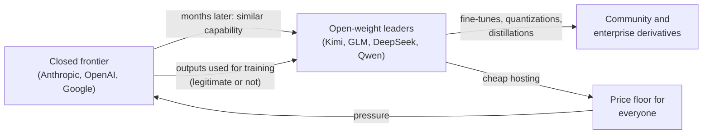

# 03: The model landscape

*About a 35-minute read. Last checked November 8, 2026.*

**TL;DR**
- A handful of labs train frontier models. Anthropic, OpenAI and Google DeepMind lead, xAI and Meta follow, and Chinese labs (DeepSeek, Moonshot, Alibaba Qwen, Zhipu/Z.ai, MiniMax) lead open-weight models.
- Many labs offer a **tier ladder** with a top model, a workhorse, and a fast, cheap model. The names change often but the ladder doesn't, so learn to read the ladder.
- As of November 2026, Anthropic's current models are Claude Opus 5.5, Sonnet 5.5 and Haiku 5.5, with Fable 5.1 as a tier above Opus. OpenAI's are GPT-6 Astra (top) and GPT-6.1 Sol (workhorse). Google shipped Gemini 4 Argon in October after cancelling Gemini 3.5 Pro, then announced the stronger Gemini 4 Carbon (October 28), which so far only vetted cyber defenders can use. Measured open–closed gaps vary by task, and the estimates below aren't a universal ranking of today's models.
- Meta's Muse family (from Meta Superintelligence Labs, April 2026 onward) is mostly closed. Two members have open weights, Muse Glimmer 30B and the 816B-parameter Muse Spark Open.
- Benchmarks and daily use often disagree. Opus 5 (July 2026) topped leaderboards, and its communication style was one of the most common complaints. Pick models by testing your own tasks, not by launch charts.
- Everything in the tables below will be stale within months. The checklist at the end is built to outlast it.

## Foundations

### What a "lab" is, and why there are so few at the top

A **frontier lab** is an organization that trains its own large models from scratch at the edge of what's possible. Training a frontier model takes tens of thousands of GPUs, a large dataset, and months of work after the main training run ([module 02](02-training-and-tuning.md)). Only a few organizations can pay for that, so only a few sit at the frontier.

A **model** is the trained network. A **product** is what you use: ChatGPT, the Claude apps, Gemini, Claude Code, Codex. One model can power many products, and one product can switch models under you. When someone says "ChatGPT got worse," they could mean the model, the product's system prompt, the router that picks a model for you, or the harness around it. [Module 06](06-harnesses-and-tools.md) covers harnesses.

Labs release models in two ways:

- With **closed-weight** (API-only) models, you send text to the lab's servers and get text back. You never see the model's parameters. Anthropic's Claude, OpenAI's GPT-6 family, Google's Gemini and xAI's Grok work this way.
- With **open-weight** models, the lab publishes the parameters so anyone can download and run the model. DeepSeek, Moonshot (Kimi), Qwen, Z.ai (GLM) and Mistral work this way, as do OpenAI's gpt-oss, Google's Gemma and a few of Meta's Muse models.

[Module 04](04-open-vs-closed-weights.md) explains the difference. "Open" models usually come from different labs than the very top closed ones, and they arrive some months behind.

### How to read model names and tiers

A model name packs several separate things together:

| Part | Example | What it tells you |
| --- | --- | --- |
| **Family** | Claude, GPT, Gemini, Grok, Kimi, Qwen | Which lab, which product line |
| **Generation** | 5, 5.5, 6, 6.1, 4 | Release generation. A higher number usually means a newer release, not a disclosed training date. |
| **Tier** | Haiku / Sonnet / Opus; Luna / Terra / Sol / Astra; Flash-Lite / Flash / Pro | Size, price and speed within that generation |
| **Variant** | Pro, Code, Flash, Cyber, Open, -Instruct, -Thinking | A specialization or a different serving mode |
| **Snapshot / ID** | `claude-opus-5-5`, `gpt-6.1-sol`, `gemini-4-argon` | The exact string you put in an API call |

The **tier** matters most. Almost every lab offers three or four of them:

| Tier | What it is for | Typical list price per million tokens (input / output), Nov 2026 |
| --- | --- | --- |
| **Top / flagship** | Hardest reasoning, long autonomous work | $2–$10 / $6–$50 (most at $4–$10 / $20–$50) |
| **Workhorse** | Most coding and knowledge work | $1–$2 / $5–$10 |
| **Fast / cheap** | Bulk processing, classification, sub-agents | $0.10–$0.30 / $0.50–$2.50 |

Two more settings change what you get from the same model:

- Most current models let you set **reasoning effort**, how long the model thinks before it answers (`low` to `max`). Higher effort costs more tokens and time. It often helps on hard problems and wastes money on easy ones.
- Some labs charge more for faster output from the same model. Anthropic's Opus 5.5 fast mode costs twice the standard rate ([Anthropic](https://www.anthropic.com/news/claude-opus-5-5)).

A cheaper tier can beat a pricier one. On Anthropic's own published numbers, Sonnet 5.5 scores 70.6% on Terminal-Bench 4.0 against 66.4% for Opus 5.5, at half the price ([Anthropic](https://www.anthropic.com/news/claude-sonnet-5-5)). Opus 5.5 in turn beats the pricier Fable 5.1 on several benchmarks ([Anthropic](https://www.anthropic.com/news/claude-opus-5-5)). Don't assume the most expensive model is the best one for your job.

### Anthropic's names, explained for newcomers

Anthropic's tier names, from smallest to largest:

1. Haiku: small, fast, cheap.
2. Sonnet: the middle tier.
3. Opus: the large tier.
4. Mythos-class (new in 2026): a tier *above* Opus. Anthropic's footnote says "Mythos-class models are a tier of Claude models that sit above our Opus class in capability" ([Anthropic](https://www.anthropic.com/news/claude-fable-5-mythos-5)).

The Mythos class comes in two versions of the same underlying model:

- **Claude Fable** is the general release. It has safety classifiers for cybersecurity, biology and chemistry, and distillation. Flagged requests are handed to an Opus model instead, and users are told when this happens. The name comes from Latin *fabula*, a counterpart to Greek *mythos*.
- **Claude Mythos** has some safeguards lifted. Only vetted organizations get it, through Project Glasswing (cyber defenders, from April 2026) and verification programs for security and life-sciences researchers ([Anthropic](https://www.anthropic.com/glasswing); [Anthropic](https://www.anthropic.com/claude-fable-and-mythos-5-1)).

Version numbers are shared across tiers but don't move in lockstep. In 2026 Anthropic shipped Opus 4.6, 4.7 and 4.8, then Fable 5 and Sonnet 5, then Opus 5, then Fable 5.1, then the "5.5 family" (Opus, Sonnet, Haiku). So "Claude 5.5" names a family. Fable 5.1 is still the top tier, even though 5.1 is a smaller number than 5.5.

### OpenAI's names, explained

OpenAI moved from numbers plus suffixes (GPT-5, GPT-5-mini, GPT-5-Codex) to named tiers in July 2026. GPT-5.6 introduced **Sol**, **Terra** and **Luna** ([OpenAI changelog](https://developers.openai.com/api/docs/changelog)). GPT-6 then added **Astra** on top. From largest to smallest:

- Astra: top tier (GPT-6 Astra, September 3, 2026).
- Sol: the workhorse, available in ChatGPT and Codex on paid plans.
- Terra: a cheaper mid-tier aimed at computer use and everyday work.
- Luna: small and cheap.

Point releases (GPT-6.1 Sol, GPT-6.1 Terra) update one tier at a time. "Pro" variants (such as GPT-5.5 Pro) spend more compute per answer, usually at a higher price.

### Google's names, explained

Google uses **Pro** (large), **Flash** (workhorse) and **Flash-Lite** (cheap). Flash moves fast, with 3.5 Flash in May 2026, 3.6 in July, 3.7 in August and 3.8 in September. The Pro line stalled. Google promised Gemini 3.5 Pro for June 2026, then dropped it. Gemini 4's first model got a codename-style name instead of a tier name, Gemini 4 Argon ([Reuters via Khaleej Times](https://www.khaleejtimes.com/business/google-announces-gemini-4-flagship-ai-model-after-months-of-delays-2); [Google](https://blog.google/innovation-and-ai/models-and-research/gemini-models/introducing-gemini-4-argon/)).

### The durable lesson

You don't need to memorize names. When a new model appears, ask:

1. Which lab, and which tier?
2. Is it closed or open weight?
3. What does it cost per **task** (not per token) at the effort level you'd actually use?
4. What harness was it tested in, and does that match yours?

[Module 05](05-judging-models.md) covers the third and fourth questions in depth.

## In practice

### The labs and what they're known for

| Lab | Known for (as of Nov 2026) | Weights |
| --- | --- | --- |
| **Anthropic** | Claude; coding and agentic work; Claude Code; MCP and Agent Skills (both donated to the Agentic AI Foundation); safety-gated Mythos tier | Closed |
| **OpenAI** | ChatGPT (largest consumer AI product); GPT-6 family; Codex; image and realtime voice models; AGENTS.md | Closed, plus gpt-oss (open, Aug 2025) |
| **Google DeepMind** | Gemini; long-context and video understanding; Nano Banana image models; Veo video; Antigravity IDE; Gemma open models | Closed, plus Gemma (open) |
| **xAI** | Grok; integration with X (formerly Twitter) posts; low list prices | Closed (older Grok 1 and 2 weights released) |
| **Meta (Superintelligence Labs)** | Llama (2023–2025); the Muse family since April 2026; Meta AI in WhatsApp, Instagram, Facebook | Mostly closed now; two open Muse models |
| **Mistral (France)** | European open-weight models; "AI sovereignty" deployments; Mistral Large 4 | Open and closed |
| **DeepSeek** | Very cheap, strong open models (R1 in Jan 2025, V4 in Apr 2026); MIT licenses | Open |
| **Moonshot AI (Kimi)** | Huge open MoE models (Kimi K2, K3, K3.1 Pro at 2.8T parameters); agentic coding | Open (custom license) |
| **Alibaba (Qwen)** | The broadest open family, from tiny to 2.4T parameters; the most fine-tuned base on Hugging Face by 2025 counts | Open and closed |
| **Zhipu / Z.ai (GLM)** | GLM-5.x coding models; GLM Coding Plan that works inside Claude Code | Open |
| **MiniMax** | MiniMax M-series agentic models; audio and music models | Open (restrictive license) |
| **ByteDance Seed** | Seed and Doubao models, mostly API-only in the West | Mostly closed |

Others worth one line each:

- Microsoft AI (MAI) has in-house models such as MAI-1-preview (August 2025), though Microsoft mostly resells OpenAI and Anthropic models through Foundry ([Microsoft AI](https://microsoft.ai/news/two-new-in-house-models/)).
- Amazon Nova is AWS's own model line (Nova 2, December 2025), mainly used inside Bedrock ([AWS](https://aws.amazon.com/nova/)).
- Cohere makes enterprise-focused Command models (Command A+, May 2026) ([Cohere](https://cohere.com/command)).
- AI2 (Allen Institute) makes OLMo, a "fully open" family that publishes training data and code, not just weights ([AI2](https://allenai.org/olmo)).
- NVIDIA's open Nemotron models are tuned for NVIDIA hardware, up to the 550B-parameter Nemotron 3 Ultra (June 2026) ([NVIDIA](https://developer.nvidia.com/nemotron)).
- Thinking Machines Lab and Reflection AI are new US labs that released large open-weight models in 2026 (Inkling, July; Beam 1.0, October).

### Current lineups (as of November 2026)

Prices are list prices per million tokens (input / output) for standard API use. Batch APIs are usually half price. "Released" means first public availability. Check the linked pages before you rely on any number here.

#### Anthropic

| Model | API ID | Released | Tier | Context | Price |
| --- | --- | --- | --- | --- | --- |
| Claude Fable 5.1 | `claude-fable-5-1` | Sep 1, 2026 | Mythos-class (top), general release | 1M | $10 / $50 |
| Claude Mythos 5.1 | `claude-mythos-5-1` | Sep 1, 2026 | Same model, fewer safeguards; vetted programs only | 1M | $10 / $50 |
| Claude Opus 5.5 | `claude-opus-5-5` | Sep 22, 2026 | Opus | 1M | $4 / $20 |
| Claude Sonnet 5.5 | `claude-sonnet-5-5` | Sep 28, 2026 | Sonnet | 1M | $2 / $10 |
| Claude Haiku 5.5 | `claude-haiku-5-5` | Oct 7, 2026 | Haiku | 1M | $0.10 / $0.50 (prompts ≤100K tokens; $0.50 / $2.50 above) |

Anthropic still serves Fable 5 (June 9), Opus 5 (July 24), Opus 4.8 (May 28), Opus 4.7 (April 16), Opus 4.6, Sonnet 5 (June 30), Sonnet 4.6 and Haiku 4.5. Opus 5.5 can't turn thinking off. Its default effort is `medium`, one step below Opus 5's default. Fable models require 30-day data retention, so zero-data-retention customers can't use them without special authorization. Opus 5.5 is available with zero data retention.

Sources: [Opus 5.5](https://www.anthropic.com/news/claude-opus-5-5), [Sonnet 5.5](https://www.anthropic.com/news/claude-sonnet-5-5), [Haiku 5.5](https://www.anthropic.com/news/claude-haiku-5-5), [Fable 5.1 and Mythos 5.1](https://www.anthropic.com/claude-fable-and-mythos-5-1), [Fable 5](https://www.anthropic.com/news/claude-fable-5-mythos-5), [SD Times on the Sep 1 release date](https://sdtimes.com/tag/mythos-5-1/).

#### OpenAI

| Model | API ID | Released | Tier | Context | Price |
| --- | --- | --- | --- | --- | --- |
| GPT-6 Astra | `gpt-6-astra` | Sep 3, 2026 | Top | 1.05M | $10 / $50 |
| GPT-6.1 Sol | `gpt-6.1-sol` | Sep 29, 2026 | Workhorse | 1.05M | $2 / $10 |
| GPT-6.1 Terra | `gpt-6.1-terra` | Oct 26, 2026 | Mid / computer use | 1.05M | $1 / $5 |
| GPT-6 Luna | `gpt-6-luna` | Sep 22, 2026 | Small | 1.05M | $0.10 / $0.50 |

The prices above are short-context rates. GPT-6.1 Sol's $2 / $10 rate applies to prompts up to 272K input tokens, and longer prompts cost more. Check [OpenAI pricing](https://developers.openai.com/api/docs/pricing) for the model and context length you'll use.

OpenAI also offers GPT-6-Cyber (restricted), GPT-Image-2.6 (Nov 4, 2026), GPT-Realtime-2.1 and GPT-Live 1 for voice, and open-weight gpt-oss-120b and gpt-oss-20b (August 2025). GPT-6 reached ChatGPT on October 7, 2026, with "Intelligent UI" (interactive charts, forms and small tools inside answers). Paid tiers get Sol and free tiers get Luna.

Sources: [OpenAI models page](https://developers.openai.com/api/docs/models), [OpenAI changelog](https://developers.openai.com/api/docs/changelog), [TechCrunch on Sol and Luna](https://techcrunch.com/2026/09/22/openai-launches-gpt-6-sol-and-luna/), [9to5Mac on GPT-6 in ChatGPT](https://9to5mac.com/2026/10/07/openai-brings-gpt-6-to-chatgpt-and-debuts-intelligent-ui/).

#### Google DeepMind

| Model | API ID | Released | Tier | Context | Price |
| --- | --- | --- | --- | --- | --- |
| Gemini 4 Carbon | not public yet | Announced Oct 28, 2026 | Top (restricted) | — | Announced at $2 / $10 introductory, then $4 / $20 |
| Gemini 4 Argon | `gemini-4-argon` | Announced Sep 30; GA Oct 13, 2026 | Top (generally available) | 1M | $2 / $10 introductory through Nov 30, 2026; then $4 / $20 |
| Gemini 3.8 Flash | `gemini-3.8-flash` | Sep 2, 2026 | Workhorse | 1M | $0.75 / $3.75 introductory through Dec 31, 2026; then $1.50 / $7.50 |
| Gemini 3.5 Flash-Lite | `gemini-3.5-flash-lite` | Jul 21, 2026 | Cheap | 1M | $0.30 / $2.50 |
| Gemini 3.1 Pro (preview) | `gemini-3.1-pro-preview` | Feb 19, 2026 | Previous Pro | 1M | $2 / $12 (≤200K prompt) |

Google also offers the Nano Banana 2.1 image model (Oct 6, 2026), Nano Banana Pro, Gemini 3.8 Live (voice), Gemini Omni Flash (video), and the open-weight Gemma 4 family (April 2, 2026, Apache 2.0). Argon rolled out first to cybersecurity partners in Google's Fairwind Program, then to API customers and Google AI Ultra and Pro subscribers. Gemini 4 Carbon follows the same pattern as Anthropic's Mythos: Google calls it "our strongest model with state-of-the-art cybersecurity and long horizon capabilities," and is giving it first to a subset of cyber defenders through Fairwind, with developers and consumers to follow "as soon as possible" ([Google](https://blog.google/innovation-and-ai/models-and-research/gemini-models/introducing-gemini-4-carbon/)). Google's own results table reports Carbon at 65.2% on Terminal-Bench 4.0 (run by Artificial Analysis) ([Google DeepMind](https://deepmind.google/models/gemini/)), and Google says it ranks first on the Artificial Analysis Intelligence Index. That's a self-reported number for a model almost nobody can use yet.

Sources: [AI Studio models](https://aistudio.google.com/docs/models), [AI Studio changelog](https://aistudio.google.com/docs/changelog), [AI Studio pricing](https://aistudio.google.com/docs/pricing), [Gemini 4 Argon announcement](https://blog.google/innovation-and-ai/models-and-research/gemini-models/introducing-gemini-4-argon/).

#### xAI

| Model | API ID | Released | Tier | Context | Price (prompts under 200K tokens) |
| --- | --- | --- | --- | --- | --- |
| Grok 4.7 | `grok-4.7` | Sep 2026 | Flagship | 500K | $2 / $6 |
| Grok 4.3 | `grok-4.3` | Available by May 15, 2026 | Cheaper long-context | 1M | $1.25 / $2.50 |
| Grok Build 0.1 | `grok-build-0.1` | May 2026 (early access) | Coding | 256K | $1 / $2 |

Prices double for prompts of 200K tokens or more. Grok also has image and video (Grok Imagine) and speech-to-speech voice models. The API docs don't mention Grok 5 as of this writing. Sources: [xAI models and pricing](https://docs.x.ai/docs/models), [xAI release notes](https://docs.x.ai/docs/release-notes), [May 15 migration guide](https://docs.x.ai/developers/migration/may-15-retirement).

#### Meta, Mistral and the leading open-weight labs

| Model | Released | Weights and license | Size (total / active) | Context | Hosted price |
| --- | --- | --- | --- | --- | --- |
| Meta Muse Wonder | Oct 12, 2026 | Closed | Not disclosed | 1M | $4 / $20 |
| Meta Muse Spark 1.3 | Sep 2, 2026 | Closed | Not disclosed | 1M | $1.25 / $4.25 |
| Meta Muse Spark Open | Oct 15, 2026 | Open; Muse Model License | 816B / 42B | 1M | Third-party hosts |
| Meta Muse Glimmer 30B | Aug 10, 2026 | Open; Apache 2.0 | 30B dense | 131K | Third-party hosts |
| Mistral Large 4 | Preview Oct 6; weights Oct 29, 2026 | Open; Mistral Ecosystem Open-Weight License | ~1T / ~49–52B | 1M | $0.70 / $2.10 |
| Moonshot Kimi K3.1 Pro | Announced Oct 24; weight upload Nov 2, 2026 | Open; Kimi K3.1 Pro License | 2.8T / 104B | 1M | $2 / $10 |
| Moonshot Kimi K3 | API Jul 16; weights Jul 27, 2026 | Open; Kimi K3 License | 2.8T / 104B | 1M | $3 / $15 |
| DeepSeek V4-Pro | Preview Apr 24; GA Aug 13, 2026 | Open; MIT | 1.6T / 49B | 1M | See DeepSeek pricing |
| DeepSeek V4.1-Flash | Sep 10 (update Oct 17), 2026 | Open; MIT | 552B MoE | 1M | See DeepSeek pricing |
| Alibaba Qwen3.8-Max | API Aug 3; weight upload Aug 9, 2026 | Open; Qwen3.8-Max License | 2.4T / 95B | 1M hosted | $2 / $6 (US deployment) |
| Alibaba Qwen3.8-27B | Aug 2026 | Open; Apache 2.0 | 27B dense | 262K | Cheap |
| Z.ai GLM-5.3 | API Aug 18; weights Aug 25, 2026 | Open; GLM-5.3 License | 753B MoE | 1M | Varies |
| MiniMax M3 | Jun 2026 | Open; MiniMax Community License | 428B / 23B | 1M | $0.30 / $1.20 |

Weight-upload dates come from repository history; they don't establish when public access began.

Sources: [Muse Spark Open model card](https://huggingface.co/meta-models/Muse-Spark-Open-816B-A42B), [Muse Glimmer model card](https://huggingface.co/meta-models/Muse-Glimmer-30B), [Meta release index](https://ai.meta.com/research/), [Meta API pricing](https://dev.meta.ai/docs/pricing-rate-limits), [Mistral Large 4](https://mistral.ai/news/mistral-large-4), [Mistral Large 4 model card](https://huggingface.co/mistralai/Mistral-Large-4-1T-A52B), [Kimi K3 model card](https://huggingface.co/moonshotai/Kimi-K3), [Kimi K3.1 Pro model card](https://huggingface.co/moonshotai/Kimi-K3.1-Pro), [Simon Willison on Kimi K3](https://simonwillison.net/2026/Jul/27/kimi-k3/), [DeepSeek changelog](https://api-docs.deepseek.com/updates), [DeepSeek V4 release](https://api-docs.deepseek.com/news/news260424), [Qwen3.8 model card](https://huggingface.co/Qwen/Qwen3.8-2.4T-A95B), [Qwen launch](https://qwen.ai/blog?id=qwen3.8), [Alibaba pricing](https://www.alibabacloud.com/help/en/model-studio/model-pricing), [Qwen upload history](https://huggingface.co/Qwen/Qwen3.8-2.4T-A95B/commits/main), [Moonshot announcement](https://www.moonshot.ai/), [Kimi API pricing](https://platform.kimi.ai/), [Kimi upload history](https://huggingface.co/moonshotai/Kimi-K3.1-Pro/commits/main), [GLM-5.3 model card](https://huggingface.co/zai-org/GLM-5.3), [MiniMax M3 model card](https://huggingface.co/MiniMaxAI/MiniMax-M3).

Parameter counts for open models come from their model cards, so treat them as approximate. DeepSeek lists V4.1-Flash at 552B, while the Hugging Face file metadata reports a larger number. File counts can include extra components such as vision encoders and multi-token-prediction heads.

### Where is Meta's Muse? A clear answer

As of November 8, 2026:

- Muse is Meta's model family from Meta Superintelligence Labs (MSL), led by chief AI officer Alexandr Wang. It replaced Llama as Meta's main line. Meta hasn't released a new Llama model since Llama 4 in April 2025.
- Muse Spark (April 8, 2026) was the first MSL model. It was closed, with no weights. It was available in the Meta AI app and meta.ai, with only a private API preview. Meta's own benchmarks put it near Claude Opus 4.6, Gemini 3.1 Pro and GPT-5.4. Meta admitted gaps in long-horizon agents and coding ([Simon Willison](https://simonwillison.net/2026/Apr/8/muse-spark/); [eWeek](https://www.eweek.com/news/meta-muse-spark-ai-launch-multimodal-reasoning/)).
- Muse Spark 1.1 (July 9, 2026) came with the Meta Model API in public preview, the first way for developers to build on a Muse model ([Meta](https://ai.meta.com/blog/introducing-muse-spark-meta-model-api/)). Muse Image and a preview of Muse Video came out on July 7 ([Meta](https://ai.meta.com/blog/introducing-muse-image-muse-video-msl/)). Spark 1.2 followed on August 5 and 1.3 on September 2 ([Meta release index](https://ai.meta.com/research/)).
- Muse Glimmer 30B (August 10, 2026) is open weight under Apache 2.0. It's a dense 30B model that handles images and is built to run locally ([model card](https://huggingface.co/meta-models/Muse-Glimmer-30B)).
- Muse Wonder (listed October 12, 2026) is a closed, hosted frontier reasoning model at $4 / $20 per million tokens on OpenRouter. Meta is its only host ([OpenRouter](https://openrouter.ai/meta/muse-wonder)).
- Muse Spark Open (October 15, 2026) is an 816B-parameter open-weight MoE under a custom Muse Model License. The license requires "Built with Muse Spark Open" attribution. Any service with more than $20M in revenue that offers the model to others needs a separate agreement with Meta. On Meta's own model card it scores 39 on the Artificial Analysis Intelligence Index, below Kimi K3 (44) and GLM-5.3 (45) ([model card](https://huggingface.co/meta-models/Muse-Spark-Open-816B-A42B)).

So Meta's top Muse tiers are closed, and its open releases are useful but don't lead the open-weight field. For coding, Meta's own card shows Muse Spark Open trailing several compared models on Terminal-Bench 2.1.

### Different places in the chain

Bryan describes models at "different places in the chain." They roughly follow this pipeline:

#### Closed labs lead; open models trail by months

- Epoch AI's 2024 study found open models matched closed frontier capability after about one year, with a 90% range of 5 to 22 months on benchmarks ([Epoch AI, Nov 2024](https://epoch.ai/blog/open-models-report)).
- In October 2026, Epoch measured a 6–7 month gap on cyber capabilities. The top open-weight model (GLM-5.3) sat where the closed frontier stood 6–7 months earlier. Opus 5.5 and GPT-6 Astra had moved further ahead ([Epoch AI, Oct 2026](https://epoch.ai/data-insights/open-closed-cyber-eci-gap)).
- Simon Willison judged Mistral Large 4 "maybe about 6 months behind the frontier" when it launched in October 2026 ([Simon Willison](https://simonwillison.net/2026/Oct/6/le-chonk/)).
- Epoch also warns that open models may tune for benchmarks more aggressively, so benchmark-based gaps could understate the real one ([Epoch ECI FAQ](https://epoch.ai/benchmarks/eci)).

These estimates cover different dates and task sets. **The cited October 2026 estimate is about cyber capabilities**, not a six-month-to-one-year lag on every coding or reasoning task. Compare current models on the work you need.

#### Distillation and fast-follow

**Distillation** means training a model on another model's outputs ([module 02](02-training-and-tuning.md)). Labs do it legitimately to make their own small models. It becomes a dispute when a competitor does it through someone else's API. In February 2026 Anthropic said it had found about 24,000 fraudulent accounts behind more than 16 million exchanges. It attributed them to DeepSeek, Moonshot and MiniMax, which the companies haven't confirmed ([Anthropic](https://www.anthropic.com/research/detecting-and-preventing-distillation-attacks)). Fable's classifiers now check for distillation attempts. New API accounts also can't edit earlier turns while keeping Claude's prior reasoning, which makes reasoning harder to harvest ([Anthropic](https://www.anthropic.com/claude-fable-and-mythos-5-1)).

Open models catch up partly through their own research and partly by learning from frontier outputs. Either way, a capability that's frontier-only today tends to show up in open weights within months.

#### Open models set the price floor

When an open model is good enough, anyone can host it, and hosting companies compete on price. That adds to the pressure on closed labs' prices. The September 2026 releases started what Simon Willison called "a new price war" ([Simon Willison](https://simonwillison.net/2026/Sep/22/opus-and-sol-and-luna/)):

- OpenAI's GPT-6 Sol and Luna cost half the price of the GPT-5.6 models they replaced.
- Anthropic cut Opus from $5 / $25 to $4 / $20.
- Haiku 5.5 launched at $0.10 / $0.50, a tenth of Haiku 4.5's list price.
- Kimi K3.1 Pro costs $2 / $10, half the price of Opus 5.5, with open weights ([Moonshot pricing](https://platform.kimi.ai/)).

#### Chinese labs lead open weights

Since DeepSeek-R1 in January 2025, Chinese labs have led open-weight models. By August 2025, Nathan Lambert's ATOM Project reported that the top ten open models on LMArena were all Chinese. Qwen derivatives made up over 40% of new models on Hugging Face, against about 15% for Llama ([Interconnects](https://www.interconnects.ai/p/atom-project)). In 2026, Kimi K3, GLM-5.3, DeepSeek V4 and Qwen3.8 led the comparisons cited in this module: Epoch's cyber index, and the Artificial Analysis scores on Meta's and Mistral's own model cards. Mistral's own model card calls Large 4 the highest-scoring *Western* open-weight model and notes that Chinese ones score higher ([model card](https://huggingface.co/mistralai/Mistral-Large-4-1T-A52B)).

#### US and European open-weight efforts

| Model | Lab | Date | License |
| --- | --- | --- | --- |
| gpt-oss-120b / 20b | OpenAI | Aug 5, 2025 | Apache 2.0 |
| OLMo 3 | AI2 | Nov 2025 | Apache 2.0, with data and code |
| Gemma 4 (E2B to 31B) | Google | Apr 2, 2026 | Apache 2.0 (earlier Gemma used custom terms) |
| Nemotron 3 Ultra (550B) | NVIDIA | Jun 2026 | OpenMDW 1.1 (permissive) |
| Inkling (~975B MoE) | Thinking Machines Lab | Jul 2026 | Apache 2.0 |
| Muse Glimmer 30B | Meta | Aug 10, 2026 | Apache 2.0 |
| Mistral Large 4 (~1T) | Mistral (France) | Oct 2026 | Mistral Ecosystem Open-Weight License |
| Muse Spark Open (816B) | Meta | Oct 15, 2026 | Muse Model License |
| Beam 1.0 (501B MoE) | Reflection AI | Oct 2026 | Apache 2.0 |

Sources: [gpt-oss](https://huggingface.co/openai/gpt-oss-120b), [OLMo](https://allenai.org/olmo), [Gemma 4](https://huggingface.co/google/gemma-4-31B-it), [Nemotron 3 Ultra](https://huggingface.co/nvidia/NVIDIA-Nemotron-3-Ultra-550B-A55B-BF16), [Inkling](https://huggingface.co/thinkingmachines/Inkling), [Beam](https://huggingface.co/reflection/Beam-1.0-501B-A23B). The US government's July 2025 AI Action Plan explicitly encouraged open models ([White House](https://www.whitehouse.gov/wp-content/uploads/2025/07/Americas-AI-Action-Plan.pdf)).

#### A new pattern: gated tiers for dangerous capability

In 2026 every top lab started holding back its most cyber-capable model, or a less-restricted version of it:

- Anthropic: Mythos Preview, then Mythos 5 and 5.1, through Project Glasswing and verification programs.
- OpenAI: GPT-6-Cyber.
- Google: an Argon rollout that started with cyber defenders in its Fairwind Program, then Gemini 4 Carbon, so far only for a subset of cyber defenders.

The public version of each model routes or refuses some security and biology requests. If you do security work, expect the general-release model to hand some requests to a weaker model or decline them. Check each lab's verification program.

### Best model for the job

This table mixes verifiable facts with judgment, and the Basis column says which is which. "Opinion" means a judgment call that reflects common practitioner choices, not a measurement. Bryan's own picks are in the callouts after the table. Re-test before you rely on any cell.

| Job | Good choices (Nov 2026) | Why | Basis |
| --- | --- | --- | --- |
| **Agentic coding** (multi-file changes in a harness) | Claude Opus 5.5 or Sonnet 5.5 in Claude Code; GPT-6.1 Sol or GPT-6 Astra in Codex | Top results on vendor coding benchmarks; harness and model are tuned together | Opinion, backed by vendor benchmarks |
| **Code review** | A *different* model from the one that wrote the code (for example, GPT in Codex reviewing Claude's work) | Different models make different mistakes ([module 10](10-ai-code-review.md)) | Opinion |
| **Long documents and video** | Gemini 4 Argon or Gemini 3.8 Flash | Native video input, 1M context, strong video benchmarks since Gemini 3 (87.6% Video-MMMU at launch) ([Google](https://blog.google/products/gemini/gemini-3/)) | Fact (capability) + opinion (ranking) |
| **Real-time social data** | Grok | Built-in access to X posts | Fact (feature) |
| **Cheap bulk processing** (classify, extract, summarize) | Claude Haiku 5.5, GPT-6 Luna (both $0.10 / $0.50), Gemini 3.5 Flash-Lite, DeepSeek V4.1-Flash; use batch APIs | Lowest list prices among capable models | Fact (price) |
| **Local and private** | Qwen3.8-27B, Gemma 4, gpt-oss-20b, Muse Glimmer 30B, depending on hardware | Permissive licenses and sizes that fit one machine ([module 04](04-open-vs-closed-weights.md)) | Fact (license and size) + opinion |
| **Image generation** | GPT-Image-2.6, Nano Banana 2.1 / Pro, Muse Image | Each leads on different styles and editing tasks | Opinion |
| **Voice** (speech to speech) | GPT-Realtime-2.1 / GPT-Live 1, Gemini 3.8 Live, Grok Voice 3.0 | Dedicated low-latency audio models | Opinion |
| **Research and deep research** | ChatGPT deep research, Gemini Deep Research, Claude Research; Kimi K3.1 Pro (open) | All search, read and cite. Kimi reports a leading BrowseComp score (vendor-reported) | Opinion |
| **Security research** | Mythos 5.1 or GPT-6-Cyber through verification programs | General releases route or refuse this work | Fact (access rules) |

> **Bryan's take:** For coding, Claude and Codex are the best. For certain other tasks you might use Grok or Gemini for very specific cases, but not for coding, because they fall far behind there. Different models are better for different use cases.

### Reception stories: launches don't always land

Launch-day numbers missed parts of these releases. [Module 05](05-judging-models.md) covers the benchmark mechanics and [module 14](14-keeping-up.md) covers tracking regressions.

When OpenAI launched GPT-5 on August 7, 2025, it replaced its older models in ChatGPT with GPT-5 and an automatic router. The router was down for much of launch day, so GPT-5 seemed weaker than it was. A chart in the live presentation drew a lower score with a taller bar, which people mocked as "chart crime." Users who preferred GPT-4o pushed back hard. Within a day Sam Altman promised to bring 4o back for Plus users, show which model answered, and double rate limits ([TechCrunch](https://techcrunch.com/2025/08/08/sam-altman-addresses-bumpy-gpt-5-rollout-bringing-4o-back-and-the-chart-crime/)). A model change is also a product change, and people get attached to a model's personality.

With Llama 4 (April 5, 2025), Meta's top LMArena result came from an "experimental chat version" of Llama 4 Maverick. The released model ranked much lower ([TechCrunch](https://techcrunch.com/2025/04/11/metas-vanilla-maverick-ai-model-ranks-below-rivals-on-a-popular-chat-benchmark/)). Meta denied training on test sets ([TechCrunch](https://techcrunch.com/2025/04/07/meta-exec-denies-the-company-artificially-boosted-llama-4s-benchmark-scores/)). The "Leaderboard Illusion" paper later counted 27 private variants Meta tested on the Arena before launch ([Singh et al., 2025](https://arxiv.org/abs/2504.20879)). Coverage at the time described the reception as disappointing, and Meta later rebuilt its AI effort as MSL.

Claude Opus 5 (July 24, 2026) was a big step on benchmarks. It led the Artificial Analysis leaderboard at launch, ahead of Fable 5 ([Simon Willison](https://simonwillison.net/2026/Jul/24/introducing-claude-opus-5/)). Early hands-on reviews were positive. Simon Willison called it "a good new default for Claude Code if you don't want to burn through your Fable allowance too fast" ([July newsletter](https://simonwillison.net/newsletters/monthly-2026-07-july/)). Daily use surfaced complaints. When Anthropic shipped Opus 5.5, it called communication "one of the most common areas of feedback we heard about Opus 5." It said 5.5 is "less likely to use jargon or idiosyncratic phrases" and "puts the most important information up front." A tester quoted in the announcement found Opus 5 "used 2.5x as many tokens" on a large code audit ([Anthropic](https://www.anthropic.com/news/claude-opus-5-5)). Willison wrote that Opus 5.5 "looks like it addresses the biggest complaints people had about Opus in terms of its communication style" ([Simon Willison](https://simonwillison.net/2026/Sep/22/opus-and-sol-and-luna/)).

Claude Opus 5.5 (September 22, 2026) came with a lower price, and Anthropic said it writes more clearly and uses fewer tokens per task. Willison made it his default in Claude Code. He also found that `max` effort could run until it hit the 128K output limit without answering, which made him suspect that `max` is "effectively useless" ([Simon Willison](https://simonwillison.net/2026/Sep/22/opus-and-sol-and-luna/)).

Claude Fable 5 was suspended from June 12 to July 1, 2026. Three days after launch, the US government applied export controls to Fable 5 and Mythos 5. Anthropic suspended access for *all* users because "the order took effect immediately and we had no reliable way to verify nationality in real-time." The controls were lifted June 30 and Fable 5 returned July 1 ([Anthropic](https://www.anthropic.com/news/redeploying-fable-5)). Export controls can cut off access to a frontier model overnight, regardless of its quality or how you use it.

Gemini 3.5 Pro never shipped. At I/O on May 19, 2026, Google released Gemini 3.5 Flash and said 3.5 Pro would follow in June. By October, Reuters reported Google "no longer plans to release Gemini 3.5 Pro." Its next flagship, Gemini 4 Argon, came "after months of delays." Google also reshuffled DeepMind's leadership in August: Demis Hassabis stepped back from the CEO role to become chief scientist ([Reuters via Khaleej Times](https://www.khaleejtimes.com/business/google-announces-gemini-4-flagship-ai-model-after-months-of-delays-2); [Fortune](https://fortune.com/2026/08/05/demis-hassabis-steps-down-google-deepmind-ai-shakeup/)).

In August and September 2025, users suspected Anthropic had quietly "nerfed" Claude. Anthropic's postmortem traced the problems to three infrastructure bugs: a context-window routing error, output corruption on some servers, and a compiler bug in token selection. It stated: "We never reduce model quality due to demand, time of day, or server load" ([Anthropic](https://www.anthropic.com/engineering/a-postmortem-of-three-recent-issues)). OpenAI had its own rollback in April 2025, when a GPT-4o update became sycophantic ([OpenAI](https://openai.com/index/sycophancy-in-gpt-4o/)).

> **Bryan's take:** Opus 5 felt benchmark-maxed. Great numbers, and it kind of sucked in daily use. People didn't like it. Opus 5.5, people really liked.

> **Bryan's take:** I don't trust some labs much. Google in particular tends to overhype its models, and they underperform in my use.

There is evidence against that second take:

- Gemini 3 Pro launched at the top of LMArena (1501 Elo) in November 2025 ([Google](https://blog.google/products/gemini/gemini-3/)).
- Gemini has been strong on video understanding and native multimodal input. Gemini 3 Pro launched with 87.6% on Video-MMMU. Its Flash models are among the cheapest capable models.
- Google ships a broad media stack (Nano Banana images, Veo video, Live voice) that few rivals match.
- Gemini 4 Argon ranks first on the Vals Index of finance, legal, tax and coding work, by Google's account ([Google](https://blog.google/innovation-and-ai/models-and-research/gemini-models/introducing-gemini-4-argon/)).

On the evidence above, the hype-versus-delivery critique fits Google's 2026 Pro line best, since a promised model never shipped. It fits multimodal and price-per-token work worst.

### How to pick a model next month, when all of this is stale

When a new model launches or your current one starts to feel off:

1. Define the job. Agentic coding, review, bulk extraction, chat, research? Different jobs have different winners.
2. Pick two or three candidates from different labs. Include your current default and one cheaper tier.
3. Check access rules: data retention and zero-data-retention terms, region, safety routing (Fable hands some requests to Opus), and your company's approved-vendor list ([module 15](15-learning-careers-and-responsibility.md)).
4. Read the launch post skeptically. Note the harness, effort level and who ran the competitor numbers ([module 05](05-judging-models.md)).
5. Run five to ten of your own real tasks, in your own repo and your own harness. Score the result, the tokens used and the time taken.
6. Compare cost per finished task, not per token. New tokenizers can change token counts by up to 35% for the same text ([Anthropic](https://www.anthropic.com/news/claude-opus-4-7)).
7. Try the effort settings. Lower effort on a newer model can match higher effort on an older one. Max can waste money. Simon Willison saw Opus 5.5 at `max` use its whole output budget without answering.
8. Wait a week if you can. Early bugs, tight rate limits and even suspensions happen in launch week, like Fable 5's.
9. Check the subscription math. In agentic coding, a flat-rate plan can change which model is affordable ([module 12](12-costs-subscriptions-and-apis.md)).
10. Write down your decision and the date, and revisit it monthly ([module 14](14-keeping-up.md)).

## Going deeper

### Release cadence is now monthly

Between February 5 and October 7, 2026, Anthropic shipped eleven models: Opus 4.6, Sonnet 4.6, Opus 4.7, Opus 4.8, Fable 5, Sonnet 5, Opus 5, Fable 5.1, Opus 5.5, Sonnet 5.5 and Haiku 5.5. That doesn't count the restricted Mythos versions. OpenAI shipped GPT-5.3-Codex, GPT-5.4, GPT-5.5, GPT-5.6 (three tiers), GPT-6 Astra, Sol and Luna, GPT-6.1 Sol and GPT-6.1 Terra. Google shipped a new Flash roughly every six weeks. A model you chose in spring was three generations old by autumn ([timeline](../reference/timeline.md)).

### Everyone converged on the same shape

Several late-2026 product lines share these features, though the tables above show exceptions:

- About 1M tokens of context on most current models.
- Prices clustered at about $10 / $50 for top tiers, $2 / $10 for workhorses and $0.10 / $0.50 for small models.
- Reasoning on by default. Opus 5.5 can't turn it off at all.
- A restricted cyber variant behind a verification program.

When products look alike on paper, the differences that matter are behavior over long tasks, honesty about failures, communication style, harness integration and reliability. Launch tables don't measure these well. That's one reason reception and benchmarks diverge.

### Price per token vs price per task

A cheaper model can cost more per finished task once you include retries. Anthropic says Opus 5.5 costs "40% less to run than Opus 5" on typical workloads, though its per-token price fell only 20%. Lower cache-read prices and fewer tokens per task also contribute ([Anthropic](https://www.anthropic.com/news/claude-opus-5-5)). Tokenizer changes cut the other way. Opus 4.7's new tokenizer could map the same text to 1.0–1.35 times as many tokens ([Anthropic](https://www.anthropic.com/news/claude-opus-4-7)).

### Safety routing changes what "the model" means

With Fable, a classifier decides whether your request goes to Fable or to an Opus model. Anthropic says this happens in fewer than 5% of sessions on average ([Anthropic](https://www.anthropic.com/news/claude-fable-5-mythos-5)). For most coding, that's invisible. For security tooling, dependency audits or bioinformatics, the same prompt can reach a different model on different days. Log which model actually answered. Anthropic says users are told whenever a fallback happens.

### Corporate shifts can matter as much as models

Google reorganized DeepMind's leadership in August 2026. Meta replaced Llama with MSL and Muse. Anthropic filed for an IPO in October 2026 ([Anthropic](https://www.anthropic.com/news/s1-sec)). OpenAI hired OpenClaw's creator in February 2026, and the Agentic AI Foundation took over MCP, AGENTS.md and Agent Skills. Both reshaped the tool ecosystem ([module 13](13-open-source-ecosystem.md)). These changes can affect pricing, openness and roadmaps as much as a benchmark result.

## Bryan's take

Bryan's views on coding models, Opus 5 and Google appear above, next to the evidence they respond to. His take on Claude's and Codex's ups and downs is in [module 14](14-keeping-up.md), and his take on subscription pricing is in [module 12](12-costs-subscriptions-and-apis.md).

## Try it

**Individual exercise: run your own mini-bakeoff (60–90 minutes).**
1. Pick three small, real tasks from a repo you know: one bug fix, one refactor, one "explain this module."
2. Run each task with two models from different labs in the same harness. Many harnesses can switch models. OpenCode can use most providers ([module 04](04-open-vs-closed-weights.md)).
3. Record pass/fail, tokens or cost, wall-clock time, and how readable each final message was.
4. Write one paragraph: which would you choose and why? Did the benchmark ranking predict your result?

**Class or team exercise: build a living "model card" page.**
1. Split into groups. Each group owns one lab.
2. Each group fills in the lab's current tiers, IDs, prices, context windows, data-retention terms and one reception story, all with primary-source links.
3. Present in five minutes. Then run one shared task across all labs' workhorse tiers and compare.
4. Put a review date on the page. Re-verify it in a month and note what changed.

## Discussion questions

1. Opus 5 led leaderboards but drew complaints about communication. What does a benchmark measure that daily use doesn't, and the reverse?
2. If an open model trails the closed frontier on your tasks, how much of a capability gap can you accept for greater control or lower cost?
3. Should a lab route your request to a different model without asking you first, as Fable does for some topics? What disclosure would you want?
4. Chinese labs lead open weights. What would change your organization's willingness to use their models: self-hosting, a US host, or neither?
5. Google cancelled a promised model (Gemini 3.5 Pro). How much weight should announcements of future models carry when you plan tooling?
6. Which "best model for the job" cell would you change today, and what evidence would you bring?

## Sources and further reading

**Papers and research**
- [How far behind are open models?](https://epoch.ai/blog/open-models-report) (Cottier, You, Martemianova, Owen; Epoch AI, 2024)
- [Open-weight models trail closed models in cyber capabilities by 6–7 months](https://epoch.ai/data-insights/open-closed-cyber-eci-gap) (Epoch AI, 2026)
- [The Leaderboard Illusion](https://arxiv.org/abs/2504.20879) (Singh et al., 2025)
- [Detecting and preventing distillation attacks](https://www.anthropic.com/research/detecting-and-preventing-distillation-attacks) (Anthropic, 2026)

**Primary sources: labs**
- Anthropic: [Opus 5.5](https://www.anthropic.com/news/claude-opus-5-5), [Sonnet 5.5](https://www.anthropic.com/news/claude-sonnet-5-5), [Haiku 5.5](https://www.anthropic.com/news/claude-haiku-5-5), [Fable 5.1 and Mythos 5.1](https://www.anthropic.com/claude-fable-and-mythos-5-1), [Opus 5](https://www.anthropic.com/news/claude-opus-5), [Fable 5 and Mythos 5](https://www.anthropic.com/news/claude-fable-5-mythos-5), [Sonnet 5](https://www.anthropic.com/news/claude-sonnet-5), [Opus 4.8](https://www.anthropic.com/news/claude-opus-4-8), [Opus 4.7](https://www.anthropic.com/news/claude-opus-4-7), [Project Glasswing](https://www.anthropic.com/glasswing), [September 2025 postmortem](https://www.anthropic.com/engineering/a-postmortem-of-three-recent-issues)
- OpenAI: [Models](https://developers.openai.com/api/docs/models), [API changelog](https://developers.openai.com/api/docs/changelog), [Sycophancy in GPT-4o](https://openai.com/index/sycophancy-in-gpt-4o/)
- Google: [Gemini 4 Argon](https://blog.google/innovation-and-ai/models-and-research/gemini-models/introducing-gemini-4-argon/), [Gemini 3](https://blog.google/products/gemini/gemini-3/), [AI Studio models](https://aistudio.google.com/docs/models), [changelog](https://aistudio.google.com/docs/changelog), [pricing](https://aistudio.google.com/docs/pricing)
- xAI: [Models and pricing](https://docs.x.ai/docs/models), [Release notes](https://docs.x.ai/docs/release-notes)
- Meta: [Muse Spark 1.1 and Meta Model API](https://ai.meta.com/blog/introducing-muse-spark-meta-model-api/), [Muse Image and Video](https://ai.meta.com/blog/introducing-muse-image-muse-video-msl/), [Muse Spark Open card](https://huggingface.co/meta-models/Muse-Spark-Open-816B-A42B), [Muse Glimmer card](https://huggingface.co/meta-models/Muse-Glimmer-30B)
- Mistral: [Mistral Large 4](https://mistral.ai/news/mistral-large-4)
- DeepSeek: [Change log](https://api-docs.deepseek.com/updates), [V4 release](https://api-docs.deepseek.com/news/news260424), [V4.1-Flash release](https://api-docs.deepseek.com/news/news260910)
- Moonshot: [Kimi K3 card](https://huggingface.co/moonshotai/Kimi-K3), [Kimi K3.1 Pro card](https://huggingface.co/moonshotai/Kimi-K3.1-Pro)
- Qwen: [Qwen3.8-2.4T-A95B card](https://huggingface.co/Qwen/Qwen3.8-2.4T-A95B)
- Z.ai: [GLM-5.3 card](https://huggingface.co/zai-org/GLM-5.3)
- MiniMax: [MiniMax M3 card](https://huggingface.co/MiniMaxAI/MiniMax-M3)
- Model catalog with dates and prices across providers: [OpenRouter models](https://openrouter.ai/models)

**Commentary and journalism**
- Simon Willison: [Opus 5](https://simonwillison.net/2026/Jul/24/introducing-claude-opus-5/), [Opus 5.5, GPT-6 Sol, GPT-6 Luna and a new price war](https://simonwillison.net/2026/Sep/22/opus-and-sol-and-luna/), [Kimi K3](https://simonwillison.net/2026/Jul/27/kimi-k3/), [Muse Spark](https://simonwillison.net/2026/Apr/8/muse-spark/), [Mistral Large 4](https://simonwillison.net/2026/Oct/6/le-chonk/)
- [TechCrunch: GPT-5 rollout](https://techcrunch.com/2025/08/08/sam-altman-addresses-bumpy-gpt-5-rollout-bringing-4o-back-and-the-chart-crime/)
- [TechCrunch: vanilla Llama 4 Maverick ranks below rivals](https://techcrunch.com/2025/04/11/metas-vanilla-maverick-ai-model-ranks-below-rivals-on-a-popular-chat-benchmark/)
- [TechCrunch: GPT-6 Sol and Luna](https://techcrunch.com/2026/09/22/openai-launches-gpt-6-sol-and-luna/)
- [Reuters via Khaleej Times: Gemini 4 after months of delays](https://www.khaleejtimes.com/business/google-announces-gemini-4-flagship-ai-model-after-months-of-delays-2)
- [Fortune: Hassabis steps back as DeepMind CEO](https://fortune.com/2026/08/05/demis-hassabis-steps-down-google-deepmind-ai-shakeup/)
- [Interconnects: The ATOM Project](https://www.interconnects.ai/p/atom-project) (Lambert, 2025)

## Terms introduced

- **Frontier lab:** an organization that trains its own models at the edge of current capability.
- **Tier:** a size and price level within a model generation (for example Haiku, Sonnet, Opus; Luna, Terra, Sol, Astra; Flash-Lite, Flash, Pro).
- **Mythos-class:** Anthropic's tier above Opus, previewed to vetted partners in April 2026 (Project Glasswing) and released in June 2026 as Fable (general) and Mythos (vetted access).
- **Fable / Mythos:** two releases of the same Anthropic top-tier model with different safeguards.
- **Astra / Sol / Terra / Luna:** OpenAI's tier names, from largest to smallest (Sol, Terra and Luna since GPT-5.6; Astra since GPT-6).
- **Argon:** the name of Google's first Gemini 4 model (October 2026).
- **Muse:** Meta Superintelligence Labs' model family (from April 2026), mostly closed, with two open-weight members.
- **Model ID / snapshot:** the exact string you send to an API to pick a model.
- **Reasoning effort:** a setting that controls how long a model thinks before answering.
- **Safety routing (fallback):** sending a flagged request to a different, more restricted model.
- **Distillation:** training one model on another model's outputs.
- **Fast-follow:** catching up to a frontier capability months later, often helped by public research and distillation.
- **Price floor:** the lowest price the market will bear, often set by cheaply hosted open models.
- **Cost per task:** the full cost of finishing a job, including retries and extra tokens. Compare this, not the price per token.
- **Gated tier:** a model or variant available only to vetted users because of misuse risk.
