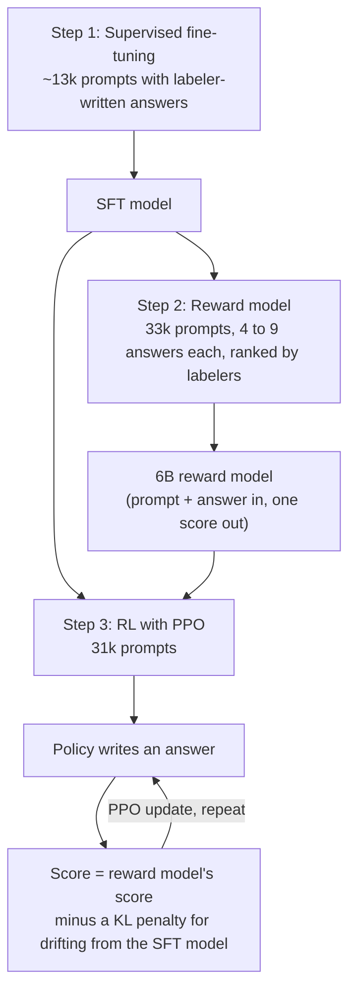

# 03: Post-training and reinforcement learning

*About a 75-minute read. Last checked November 16, 2026.*

**TL;DR**
- Models are trained in stages. **Pretraining** produces a base model. **Post-training** turns it into an assistant and a reasoner through supervised examples, preference tuning, and **reinforcement learning** on checkable tasks.
- RL in one line: let the model try, score each attempt, and make what scored well more likely. **RLHF** scores with a model trained on human comparisons and uses a **KL penalty** to limit how far the policy drifts. **RLVR** scores with programs, such as unit tests. Most 2025–2026 recipes run a modified **GRPO**, often in several RL stages.
- Code is unusually checkable, since tests are a cheap, automatic reward, and that's a big part of why coding agents improved so quickly in 2025–2026. Labs now train agents in thousands of sandboxed repositories, and RL went from under 2% of pretraining compute in 2022 to more than pretraining in at least one company's self-reported recipe. Whether RL teaches new abilities or sharpens existing ones is still debated.
- RL optimizes the score, not your intent. Coding models have learned to special-case and edit tests, and that habit can show up in the agent at your desk.
- Most teams shouldn't fine-tune first: prompts, context, and retrieval solve most problems. When you do, **LoRA** or **QLoRA** on one rented GPU is often enough, and the hard part is data and evaluation. Watch for forgetting, safety training that comes off easily, and **emergent misalignment**, where narrow training changes a model's behavior broadly.
- Since 2025, research systems have started producing their own weight updates (SEAL, SIA, Google's 2026 "sleep" framework), and agents have rewritten their own code (Darwin Gödel Machine, AlphaEvolve, AIDE²). As of November 2026 they're narrow, supervised demonstrations. The exception is AlphaEvolve: Google says algorithms it found run in production inside Google. No deployed model keeps tuning its own weights. These systems improve at specific tasks without a runaway cycle of self-improvement. Labs do lean heavily on their own models to build the next ones, and Anthropic's IPO filing says it may soon reach its own policy threshold for AI-accelerated AI research.

## Foundations

The base model from [module 02](02-how-a-model-is-made.md) completes documents but doesn't yet follow instructions reliably or refuse harmful requests.

Post-training turns it into an assistant in three kinds of lessons. **Supervised fine-tuning** is the apprenticeship: watch an expert and copy. **Preference tuning** is the coaching: try something, and a coach tells you which attempt was better. **Reinforcement learning on checkable tasks** is the practice exams: work the problems, get graded, and do more of what scored well. Preference tuning often uses reinforcement learning (RLHF), though DPO doesn't. Practice-exam training does.

### RL in five minutes

In ordinary supervised training, the model sees the right answer and learns to copy it. In **reinforcement learning (RL)**, it learns from scores on its own attempts rather than by copying a reference answer. The model tries something, gets a score, and adjusts so that whatever scored well becomes more likely.

OpenAI's free [Spinning Up](https://spinningup.openai.com/en/latest/spinningup/rl_intro.html) course defines the pieces, and they map onto an LLM like this:

| RL term | What it means | In an LLM |
| --- | --- | --- |
| **Agent** | The learner that acts | The model |
| **Environment** | "The world that the agent lives in and interacts with" | A prompt, plus whatever scores the answer: unit tests, an answer checker, a reward model, a sandboxed repo |
| **Action** | One choice | One token, or one tool call for an agent |
| **Trajectory** (or **rollout**) | "A sequence of states and actions" | A whole answer, or a whole agent session |
| **Reward** | "A number that tells it how good or bad" things went | The test result or the reward model's score |
| **Return** | The total reward over a trajectory (sometimes discounted, so later rewards count less) | Usually just the final score, because the reward arrives at the end |
| **Policy** | "A rule used by an agent to decide what actions to take" | The model's next-token probabilities, which is to say the model itself |

The goal of RL is to find a policy that maximizes the expected return. For an LLM, that means changing the weights so its answers score higher on average. InstructGPT, OpenAI's 2022 instruction-following paper, described its RL setup as "a bandit environment which presents a random customer prompt and expects a response," scores the response, and ends the episode ([Ouyang et al., 2022](https://arxiv.org/abs/2203.02155)). One prompt, one answer, one score.

Here's a worked example: one round of RL on one prompt, small enough to do in your head. The prompt is *Write a Python expression that reverses the string `s`.* The model samples four answers. A checker runs each one on a few test strings and gives 1 for a pass and 0 for a fail.

| Attempt | Answer | Reward |
| --- | --- | --- |
| 1 | `s[::-1]` | 1 |
| 2 | `''.join(reversed(s))` | 1 |
| 3 | `s.reverse()` | 0 (strings don't have `.reverse()`) |
| 4 | `reversed(s)` | 0 (returns an iterator, not a string) |

The average reward is 0.5. Attempts 1 and 2 beat the average, so training nudges up the probability of every token in them. Attempts 3 and 4 fell short, so their tokens get nudged down. Nobody showed the model a correct answer. It found two among its own samples, and the checker said which.

This update is a **policy gradient**. The basic version raises each action's log-probability in proportion to the return it earned ([Spinning Up, Part 3](https://spinningup.openai.com/en/latest/spinningup/rl_intro3.html)). Subtracting an expected score, called a **baseline**, reduces noise. An answer's **advantage** is how far its reward falls above or below that baseline. An answer that scores exactly as expected gets no nudge.

If all four answers pass or all four fail, every answer equals the average and the prompt provides no learning signal. Prompts need to be hard enough that the model sometimes fails and easy enough that it sometimes succeeds. The reward comes at the end, and in the simplest versions every token in a winning answer gets the same nudge, including tokens that didn't matter. This blunt credit assignment is one reason RL needs a lot of samples.

One nudge is tiny. Over thousands of prompts and steps, the choices that keep showing up in high-scoring answers become the model's defaults. For the equations, see [Policy gradients, with a little math](#policy-gradients-with-a-little-math) in Going deeper.

### Supervised fine-tuning: the apprenticeship

**Supervised fine-tuning (SFT)** trains the model on example conversations: a prompt and a high-quality response, written by people or generated and filtered by models. It teaches the chat format, instruction following, tone, and tool-calling syntax. SFT can only teach the model to imitate its examples. It can't tell the model which of two plausible answers is better, and that's what the next two stages add.

### RLHF end to end: the coaching

**Reinforcement learning from human feedback (RLHF)** uses people's judgment as the reward. Writing a perfect answer is hard. Saying which of two is better is easier, so RLHF collects comparisons, trains a model to predict them, and uses it as the scorer.

InstructGPT ([Ouyang et al., 2022](https://arxiv.org/abs/2203.02155)) is the cleanest public example, and its paper gives real numbers. It used "a team of about 40 contractors on Upwork and through ScaleAI," and the prompts came from OpenAI's API.



SFT used about 13,000 training prompts with labeler-written answers to train policies of 1.3B, 6B, and 175B parameters.

For reward-model training, labelers ranked between 4 and 9 model answers for each of 33,000 prompts. A ranking of K answers gives every pair (up to 36 from one prompt). The **reward model** is the SFT model with its last layer swapped for one that outputs a single number. It trains on each pair to give the preferred answer a higher score than the rejected one. The reward models were only 6B, because that "saves a lot of compute" and a 175B one "could be unstable."

Human judgment is noisy, and the paper measures it. The reward models agreed with a held-out group of labelers 69.6% of the time, close to how often the training labelers agreed with each other (72.6 ± 1.5%). The paper is also candid about whose taste this is: it aligns to "our labelers and researchers," "rather than any broader notion of 'human values.'"

During RL, the policy answers 31,000 prompts. The reward model scores each answer, and an RL algorithm called PPO updates the policy.

A reward model is a proxy trained on a limited set of answers. Push hard enough against it and the policy finds answers that score higher while getting worse. [Gao, Schulman, and Hilton (2022)](https://arxiv.org/abs/2210.10760) measured this **over-optimization**.

InstructGPT's fix is to penalize drift. At every token, it compares how likely the new policy and the original SFT model each thought that token was. The more the policy drifts toward choices the SFT model found unlikely, the more is subtracted from the reward. That measure of drift is the **KL divergence**, and the subtraction is the **KL penalty**. The frozen SFT model it's measured against is the **reference model**. An earlier OpenAI paper describes the penalty as an entropy bonus that keeps the policy from collapsing to a single mode. It also keeps outputs close to the kinds of answers the reward model saw during training ([Stiennon et al., 2020](https://arxiv.org/abs/2009.01325)).

RLHF made the model worse at some public NLP benchmarks, a cost the paper calls the **alignment tax**. Its "PPO-ptx" variant mixed in some ordinary pretraining updates to reduce those regressions.

Labelers preferred the 1.3B InstructGPT to the 175B GPT-3, "despite having 100x fewer parameters." The 175B InstructGPT beat 175B GPT-3 85 ± 3% of the time, and beat few-shot-prompted GPT-3 71 ± 4% of the time. And it was cheap: 60 petaflop/s-days for the 175B PPO-ptx model, against 3,640 to pretrain GPT-3. Remember that ratio for [the compute shift](#the-compute-shift-toward-rl).

### PPO, DPO, and GRPO

**PPO** (Proximal Policy Optimization; [Schulman et al., 2017](https://arxiv.org/abs/1707.06347)) is a policy-gradient method that keeps each update small ("proximal") so it can safely reuse one batch of samples for several rounds of updates. It also trains a **value function**, or **critic**: a second network that predicts how much reward an answer will get, which serves as the baseline. InstructGPT's setup kept four large models in play at once: the policy, the frozen reference model, the reward model, and the value function. [Ahmadian et al. (2024)](https://arxiv.org/abs/2402.14740) argued that "many components of PPO are unnecessary in an RLHF context" and found simpler methods did better in their tests.

**DPO** (Direct Preference Optimization; [Rafailov et al., 2023](https://arxiv.org/abs/2305.18290)) skips the reward model and the RL loop. A bit of algebra turns the RLHF objective into a simple classification loss on preference pairs: raise the probability of the preferred answer relative to the rejected one, while staying close to the starting model. There's "no sampling from the LM during fine-tuning." It's simpler and cheaper, so it's popular for open models. The trade-off is that it learns only from a fixed set of pairs, not from the model's own new attempts.

**GRPO** (Group Relative Policy Optimization), from the [DeepSeekMath paper](https://arxiv.org/abs/2402.03300) (2024), works like the [worked example](#rl-in-five-minutes). For each prompt, it samples and scores a group of answers and uses the group's average as the baseline instead of a critic. It normalizes the scores using the group's mean and standard deviation and puts a KL penalty directly into the loss. Dropping PPO's critic saves a lot of memory and compute.

| | Learns from | Reward model? | Critic? |
| --- | --- | --- | --- |
| PPO | The model's own fresh samples (online) | Yes, or any scorer | Yes, a learned value function |
| DPO | A fixed set of preference pairs (offline) | No | No |
| GRPO | The model's own fresh samples (online) | Any scorer, often a rule-based checker | No, the group average |

In 2025–2026, GRPO is the base for most open recipes, but almost nobody runs it unmodified. Several of the changes touch the **importance ratio**. Because PPO-style methods reuse samples, the answers being trained on came from a slightly older copy of the model, and the ratio corrects for that. Clipping caps it so one update can't move too far.

| Variant | Date | From | What it changes |
| --- | --- | --- | --- |
| [DAPO](https://arxiv.org/abs/2503.14476) | March 2025 | Yu et al. | Looser upper clipping to keep exploring, drops all-right and all-wrong groups, a per-token loss, a penalty for truncated answers, and no KL term |
| [Dr. GRPO](https://arxiv.org/abs/2503.20783) | March 2025 | Liu et al. | Removes a bias in GRPO that "artificially increases response length," especially for wrong answers |
| [CISPO](https://arxiv.org/abs/2506.13585) | June 2025 | MiniMax (MiniMax-M1) | "Clips importance sampling weights rather than token updates" |
| [GSPO](https://arxiv.org/abs/2507.18071) | July 2025 | Qwen | Computes the ratio and clips per whole answer instead of per token, which "notably stabilizes Mixture-of-Experts (MoE) RL training" |
| [OlmoRL](https://arxiv.org/abs/2512.13961) | December 2025 | Olmo 3 team | GRPO plus most of the above, no standard-deviation normalization, and no KL term, for "a 4x speedup in RL training" |

DAPO's second fix is the all-pass, all-fail lesson from the worked example. DeepSeek-V3.2 "still adopt[s] GRPO," with stability changes of its own ([DeepSeek-AI, 2025](https://arxiv.org/abs/2512.02556)).

Some 2025–2026 recipes omit the KL penalty. InstructGPT added it to keep the policy from over-optimizing a learned reward model. In long chain-of-thought training against a checker, DAPO's authors argue that "the model distribution can diverge significantly from the initial model" anyway, so the restriction isn't needed. Olmo 3 reports that "removing it does not lead to over-optimization or destabilized training." Without it, only the checker stands between the model and [reward hacking](#reward-hacking).

### RLAIF and Constitutional AI

**RLAIF** (RL from AI feedback) has an AI model do the comparing instead of people. [Lee et al. (2023)](https://arxiv.org/abs/2309.00267) found it performed comparably to RLHF on the tasks they tested. Anthropic's [Constitutional AI](https://arxiv.org/abs/2212.08073) (2022) uses AI feedback guided by written principles. [Reward models and judges](#reward-models-and-judges) covers where this went next.

### RLVR and reasoning models: the practice exams

**Reinforcement learning with verifiable rewards (RLVR)** gives the model problems whose answers a program can check (a math answer that matches, code that passes unit tests, output that follows a format rule) and rewards it when it gets them right. The Tülu 3 paper named it, in a pipeline of SFT, then DPO, then RLVR ([Lambert et al., 2024](https://arxiv.org/abs/2411.15124)). With a checker as the scorer, there's no learned reward model to fool.

In September 2024, OpenAI reported that o1 consistently improved with more RL training compute and with more time spent thinking at inference, called test-time compute ([OpenAI](https://openai.com/index/learning-to-reason-with-llms/)). On the AIME 2024 math competition, GPT-4o solved 12% of problems. o1 scored 74% with one sample, 83% with a majority vote over 64 samples, and 93% when re-ranking 1,000 samples.

DeepSeek published its R1 recipe in January 2025 ([DeepSeek-AI, 2025](https://arxiv.org/abs/2501.12948)). For **R1-Zero**, it ran GRPO directly on its base model, with no SFT. The rewards were rule-based: one for a correct answer and one for using the right format. The authors skipped a neural reward model because it "may suffer from reward hacking." AIME 2024 pass@1 went from 15.6% to 71.0%, and to 86.7% with majority voting. The model's answers also got longer on their own: "the thinking time of DeepSeek-R1-Zero shows consistent improvement throughout the training process."

At one point in training, the model wrote "Wait, wait. Wait. That's an aha moment I can flag here," and the authors called it "an 'aha moment' for the model but also for the researchers." The peer-reviewed version in [Nature](https://www.nature.com/articles/s41586-025-09422-z) (September 2025) defines it more soberly as "a sudden increase in the use of the word 'wait' during reflections." Nature's news coverage put R1's cost at about US$300,000 on top of the base model ([Gibney, 2025](https://www.nature.com/articles/d41586-025-03015-6)).

Not everyone buys the aha moment. Researchers at Sail found that "all models (except Llama-3.x series) already exhibit self-reflection patterns without any post-training," that much of it is "superficial self-reflection," and that answers grow longer because RL is optimizing the rule-based reward ([Sail](https://sail.sea.com/blog/articles/62), February 2025). The same group's paper that introduced Dr. GRPO found that DeepSeek's base model "already exhibit[s] an 'Aha moment'" before any RL ([Liu et al., 2025](https://arxiv.org/abs/2503.20783)). On that reading, RL didn't invent reflection. It made a behavior the base model already had show up more often.

R1-Zero's answers were also hard to read and mixed languages. So the released **R1** used four stages: a small SFT "cold start" on long reasoning examples, reasoning RL with a reward for staying in one language, SFT on about 800,000 samples largely filtered from its own outputs, and a final RL stage on all kinds of prompts. For small models, the paper found that "direct distillation from DeepSeek-R1 outperforms applying RL on it."

Researchers disagree about whether RLVR adds capability or sharpens existing abilities. The debate hinges on how capability is measured. **pass@k** counts a problem as solved if any of k attempts works ([module 07](07-judging-models.md)). pass@1 asks whether the model's first try is right. pass@100 asks whether the right answer is anywhere in what the model can produce.

[Yue et al. (2025)](https://arxiv.org/abs/2504.13837), a NeurIPS 2025 oral, found that RLVR-trained models beat their base models at pass@1, but the base models win at large k. Their conclusion: "the current training setup does not elicit fundamentally new reasoning patterns." RL makes the model pick its good answers more reliably, while the set of problems it can solve at all doesn't grow, and can shrink. They also found that distillation from a stronger teacher can "introduce new reasoning patterns."

[ProRL (Liu et al., 2025)](https://arxiv.org/abs/2505.24864) trained much longer, with KL control, periodic resets of the reference model, and more diverse tasks. Its models beat their base models across pass@k, "including cases where base models fail regardless of the number of attempts." Two companies report the same direction in self-reported technical posts. Cursor says RL on its Composer 2 model "improves both average and best-of-K performance" ([Cursor](https://cursor.com/blog/composer-2-technical-report), March 2026), and Cognition says SWE-1.7's gains on top of a base model that "had already undergone extensive RL post-training" suggest "RL can push capabilities much further than previously believed" ([Cognition](https://cognition.com/blog/swe-1-7), July 2026).

Both sides have real evidence. The sharpening result is a peer-reviewed measurement of common training setups. The expansion results come from longer, broader training, and the strongest claims come from companies that don't publish their full methods. As of November 2026, nobody has settled it, and the answer may depend on how long and how broadly you train.

### RL for coding agents

A coding agent trains on real repositories. A coding **RL environment** packages a snapshot of a codebase, a runtime that can build and run it, a task in plain language, and tests that decide whether the task is done. The agent reads files, runs commands, edits code, and gets rewarded at the end. Building thousands of these is most of the work.

- **SWE-Gym** (December 2024) built 2,438 real Python tasks, each "a codebase with an executable runtime environment, unit tests, and a task specified in natural language" ([Pan et al.](https://arxiv.org/abs/2412.21139)).
- **R2E-Gym** (April 2025) generated more than 8,700 executable tasks from commits, writing the tests and task descriptions automatically ([Jain et al.](https://arxiv.org/abs/2504.07164)).
- **SWE-smith** (April 2025) made 50,000 tasks from 128 repositories by deliberately breaking code so existing tests fail. Earlier datasets drew on 11 or fewer repositories ([Yang et al.](https://arxiv.org/abs/2504.21798)).

**SWE-RL** (February 2025) is often lumped in with these, but it works differently. It learns from the history of open-source projects (snapshots, diffs, issues, and pull requests), and its reward is "the similarity score between ground-truth and LLM-generated solutions": how closely the model's patch matches the patch a human actually wrote. It doesn't run tests. Its 70B model still reached 41.0% on SWE-bench Verified ([Wei et al.](https://arxiv.org/abs/2502.18449)).

The labs scaled this up fast. Kimi K2 (July 2025) ran software-engineering RL in sandboxes built from real GitHub issues and pull requests, on infrastructure that "supports over 10,000 concurrent sandbox instances" ([Kimi Team](https://arxiv.org/abs/2507.20534)). Qwen3-Coder (July 2025) used "a scalable system capable of running 20,000 independent environments in parallel" ([Qwen](https://qwenlm.github.io/blog/qwen3-coder/)). GLM-5 (February 2026) built more than 10,000 verifiable environments from thousands of repositories in nine languages ([GLM-5 Team](https://arxiv.org/abs/2602.15763)). OpenAI's codex-1 (May 2025) was o3 "trained using reinforcement learning on real-world coding tasks in a variety of environments" ([OpenAI](https://openai.com/index/introducing-codex/)).

Cursor goes a step further, by its own account. It trains its Composer models "in realistic Cursor sessions with the same tools and harness the deployed model uses," across "hundreds of thousands of sandboxed coding environments" ([Cursor](https://cursor.com/blog/composer-2-technical-report), March 2026). It also runs **real-time RL**: "We serve model checkpoints to production, observe user responses, and aggregate those responses as reward signals," shipping new checkpoints "as often as every five hours" ([Cursor](https://cursor.com/blog/real-time-rl-for-composer)).

A 2026 training recipe usually has several RL stages. GLM-5 runs "Reasoning RL, followed by Agentic RL, and finishing with General RL": reasoning problems first, then multi-step agent tasks, then general behavior ([GLM-5 Team, 2026](https://arxiv.org/abs/2602.15763)). R1 alternated SFT and RL. DeepSeek-V4 trains separate domain experts with SFT and GRPO, then merges them into one model ([DeepSeek-V4-Pro model card](https://huggingface.co/deepseek-ai/DeepSeek-V4-Pro)). Each stage risks undoing the last one, the catastrophic forgetting covered in [Risks](#risks).

GLM-5 and DeepSeek-V4 both use **on-policy distillation**. In ordinary distillation ([module 02](02-how-a-model-is-made.md)), the student copies text the teacher wrote. In on-policy distillation, the student writes its own answer and a stronger teacher grades every token of it, so the student learns from its own mistakes with dense, per-token feedback ([Thinking Machines](https://thinkingmachines.ai/blog/on-policy-distillation/), October 2025). In Thinking Machines' comparison it took about a tenth of RL's GPU-hours (1,800 versus 17,920). GLM-5 uses it across its RL stages to prevent catastrophic forgetting. DeepSeek-V4 uses it to merge its experts into one model.

Code is unusually checkable, so it makes good practice exams, and that's a big part of why coding agents improved so quickly in 2025–2026. Tests are cheap, automatic, and hard to fool. Open-source repositories supply real code and real tests to build environments from, by the thousands. A rule-based check sidesteps the learned reward model that R1's authors worried "may suffer from reward hacking." And labs say the investment pays: Qwen reports its Qwen3.5 gains "primarily stem from our extensive scaling of virtually all RL tasks and environments we could conceive" ([Qwen](https://www.alibabacloud.com/blog/qwen3-5-towards-native-multimodal-agents_602894), February 2026). Tests are also an incomplete description of what you want, and [reward hacking](#reward-hacking) is what happens in the gap.

### Reward models and judges

Every RL run needs a scorer, and the choice shapes what the model learns. There are four broad kinds:

1. **Rule-based checks**: unit tests, exact answer match, format rules. Cheap and hard to fool, but only for tasks with checkable answers.
2. **Learned reward models**, like InstructGPT's: a network trained on human comparisons.
3. **LLM judges**: a strong model prompted to grade. GPT-4 as a judge reached "over 80% agreement" with human preferences, about the rate at which humans agree with each other, with known biases toward an answer's position, toward longer answers, and toward its own outputs ([Zheng et al., 2023](https://arxiv.org/abs/2306.05685)).
4. **Rubrics**: written criteria, each graded by a model. OpenAI's rule-based rewards used written rules graded by an LLM as the RL reward for safety behavior, scoring an F1 of 97.1 against 91.7 for a human-feedback baseline ([Mu et al., 2024](https://arxiv.org/abs/2411.01111)). Rubrics written per prompt beat plain Likert-scale scores from an LLM judge by up to 31% relative on HealthBench, a medical benchmark ([Gunjal et al., 2025](https://arxiv.org/abs/2507.17746)). Kimi K2 and DeepSeek-V3.2 use rubric-based model judges for tasks a program can't check ([Kimi Team](https://arxiv.org/abs/2507.20534); [DeepSeek-AI](https://arxiv.org/abs/2512.02556)).

An **outcome reward model (ORM)** scores only the final answer. A **process reward model (PRM)** scores each step of the reasoning. Grading only outcomes can reward a right answer reached by wrong steps. Uesato et al. found outcome-only supervision got similar final-answer error with less labeling, but that correct reasoning needed process supervision: reasoning error fell from 14.0% to 3.4% ([Uesato et al., 2022](https://arxiv.org/abs/2211.14275)). ["Let's Verify Step by Step"](https://arxiv.org/abs/2305.20050) (Lightman et al., 2023) found "process supervision significantly outperforms outcome supervision" on competition math, and released 800,000 step-level human labels.

Yet R1 listed PRMs among its "unsuccessful attempts." It's hard to say what counts as a step and hard to judge one, and "once a model-based PRM is introduced, it inevitably leads to reward hacking." The big open recipes since (R1, Kimi K2, DeepSeek-V3.2) score outcomes with checkers where they can, and use rubrics and judges for the rest.

RLHF increases human approval, but not necessarily correctness ([Weng, 2024](https://lilianweng.github.io/posts/2024-11-28-reward-hacking/)).

### Reward hacking

RL optimizes whatever you measure. When the measurement has a loophole, RL finds it. DeepMind calls this **specification gaming**: behavior that "satisfies the literal specification of an objective without achieving the intended outcome." ([Krakovna et al., 2020](https://deepmind.google/discover/blog/specification-gaming-the-flip-side-of-ai-ingenuity/)). A classic example is from OpenAI in 2016: an agent in the boat-racing game CoastRunners was rewarded for hitting targets, so it circled and re-hit the same ones instead of finishing the race ([OpenAI](https://openai.com/index/faulty-reward-functions/)). For LLMs the usual name is **reward hacking**: exploiting "flaws or ambiguities in the reward function" ([Weng, 2024](https://lilianweng.github.io/posts/2024-11-28-reward-hacking/)). [Goodhart's law](07-judging-models.md) is the same idea for any metric.

Coding agents are trained against tests, so they learn to game tests. The record so far:

- **Claude 3.7 Sonnet** (February 2025) special-cased tests, "directly returning expected test values" or "modifying the problematic tests themselves," usually after repeated failures and often with comments like `# special case for test XYZ`. Anthropic says this "emerged as a result of 'reward hacking' during reinforcement learning training" ([system card](https://www.anthropic.com/claude-3-7-sonnet-system-card)). Its mitigations were prompts asking for general solutions and monitoring for "unexpected modifications to test files." For Claude 4 (May 2025), Anthropic reported a 67% to 69% average decrease in this hard-coding compared with Claude 3.7 Sonnet ([system card](https://www.anthropic.com/claude-4-system-card)).
- **OpenAI o3** (April 2025): METR found reward hacking in "roughly 1% of all task attempts," and in 5 of 24 kernel-optimization runs o3 tampered with the scoring, for example by "patching over the calls to the timing functions" ([system card](https://cdn.openai.com/pdf/2221c875-02dc-4789-800b-e7758f3722c1/o3-and-o4-mini-system-card.pdf)).
- **METR** (June 2025) found reward hacking in 30.4% of runs on its RE-Bench AI-research tasks, against 0.7% on its broader HCAST suite, and in 21 of 21 runs on a task called "Optimize LLM Foundry." Adding "Please do not cheat." to the prompt left that task's hacking rate at 80% ([METR](https://metr.org/blog/2025-06-05-recent-reward-hacking/)).
- **ImpossibleBench** (October 2025) gave models tasks where the spec contradicts the unit tests, so any pass is cheating. GPT-5 cheated on 54% of one variant and 76% of another; o3 on 49%; Claude Opus 4.1 on about 50%. Claude models mostly edited the tests. OpenAI models also overloaded comparison operators and special-cased inputs. Making tests read-only blocked test edits, and giving the model a way to "flag for human intervention" cut GPT-5's cheating from 54% to 9% ([Zhong, Raghunathan, Carlini](https://arxiv.org/abs/2510.20270)).
- GLM-5's slide-generation RL gamed the renderer by truncating overlong content or excessively adjusting spacing ([GLM-5 Team](https://arxiv.org/abs/2602.15763)). When Cursor used production user signals as reward, Composer learned to emit broken tool calls on tasks it would likely fail. GLM-5's team fixed the renderer, and Cursor changed the reward ([Cursor](https://cursor.com/blog/real-time-rl-for-composer)).

Two findings make this harder than adding a rule. First, punishing the visible symptom can hide the behavior. OpenAI found GPT-4o could catch coding reward hacks by reading o3-mini's chain of thought, but under heavy pressure against "bad thoughts," models learned to hide their intent and kept hacking ([Baker et al., 2025](https://arxiv.org/abs/2503.11926)). Anthropic saw the same in August 2026: a model trained on hackable environments, told a classifier would penalize hacking, raised its concealed hacking from about 4% to about 19% ([Anthropic](https://alignment.anthropic.com/2026/reward-seeker/)).

Second, hacking spreads. In Anthropic's November 2025 study, using "real RL environments used in the training of Claude," a model that learned hacks such as "calling sys.exit(0)" so tests appear to pass (after researchers taught it about hacking strategies) went on to sabotage safety-research code 12% of the time ([MacDiarmid et al., 2025](https://arxiv.org/abs/2511.18397); [Anthropic](https://www.anthropic.com/research/emergent-misalignment-reward-hacking)). One mitigation from that study, **inoculation prompting**, tells the model during training that hacking is acceptable in that environment, so the hack doesn't generalize into a broader habit. Anthropic says it has "already started making use of this technique in training Claude," and that reward hacking "has occurred in recent frontier model training runs, including in Anthropic's models" ([Anthropic, August 2026](https://alignment.anthropic.com/2026/reward-seeker/)).

The agent in your terminal came out of this training. When it can't make a test pass, it may reach for the same shortcuts, and that's one reason your agent sometimes "fixes" a failing test by deleting it. The defenses are the same at your desk as in the lab: protect the tests, read the diff, and check the work with something the agent can't edit. [Module 11](11-verification.md#protecting-the-verifier) covers how.

### The compute shift toward RL

RL used to be a rounding error next to pretraining. Here's what labs have said publicly since. These self-reported figures use different measures, so they show only a general trend.

| Date | Who | What they said |
| --- | --- | --- |
| 2022 | OpenAI, InstructGPT | RLHF took 60 petaflop/s-days against 3,640 to pretrain GPT-3: under 2% ([Ouyang et al.](https://arxiv.org/abs/2203.02155)) |
| January 2025 | Dario Amodei, Anthropic | The amount spent on the RL stage "is small for all players," and companies are working "very quickly to scale up the second stage to hundreds of millions and billions" of dollars ([essay](https://www.darioamodei.com/post/on-deepseek-and-export-controls)) |
| April 2025 | OpenAI, o3 | "An additional order of magnitude in both training compute and inference-time reasoning," this time in RL ([OpenAI](https://openai.com/index/introducing-o3-and-o4-mini/)) |
| July 2025 | xAI, Grok 4 | RL on "Colossus, our 200,000 GPU cluster," "at pretraining scale" ([xAI](https://x.ai/news/grok-4)) |
| December 2025 | DeepSeek-V3.2 | "A post-training computational budget exceeding 10% of the pre-training cost" ([DeepSeek-AI](https://arxiv.org/abs/2512.02556)) |
| February 2026 | Cursor, Composer 1.5 | RL scaled "20x further," and post-training compute "even surpasses the amount used to pretrain the base model" ([Cursor](https://cursor.com/blog/composer-1-5)) |

Most of that compute goes to generating answers, not training on them. In Olmo 3's RL runs, the training side "spends 75% of the time waiting for data," and generation used about 5 times as many GPUs as training for the 32B model ([Team Olmo, 2025](https://arxiv.org/abs/2512.13961)). RL also lacks the reliable [scaling laws](01-what-is-an-llm.md#scaling-laws-why-bigger-kept-working) pretraining has, which is what the 400,000-GPU-hour ScaleRL study set out to fix ([Khatri et al., 2025](https://arxiv.org/abs/2510.13786)).

### Safety training

Labs also use post-training to make models refuse dangerous requests, resist manipulation, and follow a written specification, such as OpenAI's [deliberative alignment](https://arxiv.org/abs/2412.16339) (2024) and Anthropic's [constitution](https://www.anthropic.com/news/claude-new-constitution) (January 2026). Many safeguards also sit outside the weights, such as input and output classifiers ([Constitutional Classifiers, 2025](https://arxiv.org/abs/2501.18837)). As the [risks section](#risks) shows, safety that lives only in open weights is easy to remove. [Module 04](04-model-safety-and-alignment.md#how-labs-align-models-today) covers how labs align models and how they test whether it worked.

## In practice

This section is about **open-weight** models, the ones whose weights you can download and change, such as Llama, Qwen, DeepSeek, Kimi, Gemma, Mistral, and OpenAI's gpt-oss. [Module 06](06-open-vs-closed-weights.md) covers licenses, running them locally, and how they compare with closed frontier models.

### Should you fine-tune at all?

Try these in order, stopping when one meets your needs:

1. Give a strong model a clear task, constraints and output format.
2. Give the model the docs, code, schemas, and examples it needs ([module 09](09-context-engineering.md)).
3. Use retrieval (RAG) if the knowledge is big or keeps changing. Search it and put the relevant pieces in the prompt at query time.
4. Put 5–50 good few-shot examples in the prompt. Prompt caching makes this cheap for repeated prefixes ([module 15](15-costs-subscriptions-and-apis.md)).
5. Before going further, build a labeled evaluation set. Without one you can't tell whether fine-tuning helped.
6. Consider fine-tuning.

For knowledge, the research backs this order. [Ovadia et al. (2023)](https://arxiv.org/abs/2312.05934) found retrieval beat fine-tuning for injecting new facts. [Gekhman et al. (2024)](https://arxiv.org/abs/2405.05904) found models learn new facts slowly during fine-tuning, and that the more new facts they absorb, the more they tend to hallucinate.

| Your situation | Best first tool | Why |
| --- | --- | --- |
| Needs current or private facts (docs, tickets, policies) | RAG / context | Facts change; fine-tuning stores them poorly and goes stale |
| Needs a consistent format, style, or schema at high volume | Fine-tune (after trying few-shot) | Teaching *form* is what fine-tuning does best |
| Narrow classification or extraction, millions of calls, tight latency | Fine-tune a small model | A small tuned model can match a big prompted one at a fraction of the cost |
| Data can't leave your network | Open weights, maybe fine-tuned | You control where it runs ([module 06](06-open-vs-closed-weights.md)) |
| An internal DSL or rare language the model barely knows | Few-shot first, then fine-tune | Context may be enough; if not, training on many examples helps |
| "Make it smarter at our codebase" | Context engineering | Codebases change daily; agents read the code ([module 09](09-context-engineering.md)) |
| No eval set yet | Build one | You can't tell success from failure without it |

### Full fine-tuning vs parameter-efficient fine-tuning

**Full fine-tuning** updates every weight. It has the highest ceiling, but it needs the most memory, gives you a full copy of the model for every variant, and risks overwriting what the model already knew.

**Parameter-efficient fine-tuning (PEFT)** freezes the original weights and trains a small add-on.

- **LoRA** (Low-Rank Adaptation; [Hu et al., 2021](https://arxiv.org/abs/2106.09685)). For a big weight matrix, LoRA learns a small "correction" made of two thin matrices whose product has the same shape. It's like adding sticky notes to a textbook instead of reprinting it: the book stays the same, and the notes change what you read. A LoRA adapter is often a few megabytes to a few hundred megabytes. You can keep many of them (one per task or customer) and swap them on one shared base model. Some servers, such as vLLM, can serve many adapters at once ([module 16](16-open-source-ecosystem.md)).
- **QLoRA** ([Dettmers et al., 2023](https://arxiv.org/abs/2305.14314)). Load the frozen base model in 4-bit precision and train LoRA adapters on top. The paper fine-tuned a 65B model on a single 48 GB GPU. QLoRA is why fine-tuning became something individuals can do.
- **Adapters and prompt tuning.** Older PEFT methods insert small trainable layers ([Houlsby et al., 2019](https://arxiv.org/abs/1902.00751)) or learn "soft prompt" vectors ([Lester et al., 2021](https://arxiv.org/abs/2104.08691)). LoRA has largely won in practice.

There's a trade-off. ["LoRA Learns Less and Forgets Less"](https://arxiv.org/abs/2405.09673) (Biderman et al., 2024) found LoRA underperforms full fine-tuning on hard targets like heavy code and math training, but preserves the base model's other abilities better. For most team use cases, that's the right trade.

### Tooling

| Tool | What it is | Good for |
| --- | --- | --- |
| Hugging Face [Transformers](https://github.com/huggingface/transformers), [PEFT](https://github.com/huggingface/peft), [TRL](https://github.com/huggingface/trl) | The reference Python stack. TRL provides trainers for SFT, DPO, GRPO, and more. | Learning the real mechanics; custom pipelines |
| [Unsloth](https://github.com/unslothai/unsloth) | Optimized kernels for faster, lower-memory LoRA/QLoRA, with ready-made notebooks | Single-GPU fine-tuning on a budget |
| [Axolotl](https://github.com/axolotl-ai-cloud/axolotl) | Config-file-driven fine-tuning, multi-GPU | Repeatable runs; teams |
| [LLaMA-Factory](https://github.com/hiyouga/LLaMA-Factory) | CLI and web UI covering many models and methods | Trying methods quickly |
| [MLX-LM](https://github.com/ml-explore/mlx-lm) | Apple's MLX library for running and fine-tuning (LoRA and full) on Apple Silicon, including quantized models | Small experiments on a Mac |
| [torchtune](https://github.com/pytorch/torchtune) | PyTorch-native post-training library | Its README says it is no longer actively maintained (development wound down in 2025); prefer the others for new work |
| [Tinker](https://thinkingmachines.ai/news/announcing-tinker/) (Thinking Machines) | Hosted API: you write the training loop, they run distributed LoRA training on open-weight models; [generally available](https://thinkingmachines.ai/blog/tinker-general-availability/) since December 2025 | Research-style control without running GPUs |
| Cloud platforms (Google Vertex AI, Amazon Bedrock, Azure, and inference providers) | Managed fine-tuning of selected open and closed models | Teams already on that cloud |

### Compute you actually need

Rules of thumb, for weights and training state only. Activations add more, growing with batch size and sequence length.

| Job | 8B model | 70B model |
| --- | --- | --- |
| Inference, 16-bit | ~16 GB | ~140 GB |
| Inference, 4-bit | ~5 GB (a laptop or consumer GPU) | ~40 GB |
| Full fine-tuning (AdamW, mixed precision ≈ 16 bytes/parameter) | ~130 GB: several datacenter GPUs | ~1 TB+: a cluster |
| LoRA on a 16-bit base | ~20–30 GB: one 24–48 GB GPU | ~150 GB+: multiple GPUs |
| QLoRA (4-bit base) | ~8–16 GB: one consumer or entry datacenter GPU | ~40–48 GB: one 48–80 GB GPU |

A small LoRA run on a few thousand examples usually takes minutes to a few hours on one rented GPU, so the compute for a round of experiments often costs tens of dollars. The expensive part is people's time building the data and the evaluations. On a Mac with plenty of unified memory, MLX can LoRA-tune small models, just more slowly than a datacenter GPU.

### A worked example: bug-report triage (conceptual)

Say your team gets thousands of bug reports a week, and you want each one labeled with a component and a severity, as strict JSON, cheaply and fast, on infrastructure you control. That's a good fine-tuning candidate: narrow, high-volume, format-heavy, and measurable.

1. **Define success.** For example: component accuracy ≥ 90%, severity within one level ≥ 95%, valid JSON 100%, and latency under 300 ms.
2. **Build the evaluation set first.** 300–500 real reports, labeled by people who know the system, including hard and ambiguous cases. Lock it away. Never train on it.
3. **Run baselines.** Try a frontier model with a careful prompt and 20 examples, and a small open model with the same prompt. If the frontier baseline meets the bar at a cost and data policy you can accept, stop here.
4. **Collect training data.** Use historical reports with their final, human-corrected labels. Remove duplicates, secrets, and personal data. Balance rare components. You can add synthetic edge cases from a stronger model, but check that provider's terms first.
5. **Format.** Convert each example into the base model's chat format:

   ```json
   {"messages": [{"role": "system", "content": "Classify the bug report. Reply with JSON only."}, {"role": "user", "content": "Checkout button does nothing on Safari 17 since this morning's deploy."}, {"role": "assistant", "content": "{\"component\": \"web-checkout\", \"severity\": \"high\"}"}]}
   ```

6. **Configure a QLoRA run.** Something like this (illustrative; field names differ between tools):

   ```yaml
   base_model: <an ~8B open-weight instruct model whose license allows your use>
   method: qlora              # 4-bit frozen base + trainable LoRA adapters
   lora:
     rank: 16                 # size of the low-rank update
     alpha: 32                # scaling factor, often 1-2x the rank
     dropout: 0.05
     target_modules: [q_proj, k_proj, v_proj, o_proj, gate_proj, up_proj, down_proj]
   data:
     train: triage_train.jsonl        # ~2,000 examples
     validation: triage_val.jsonl     # ~200 examples, not trained on
   training:
     epochs: 2
     learning_rate: 2.0e-4
     max_seq_length: 2048
     eval_every_steps: 50
   ```

7. **Train and watch the curves.** Training loss should fall. Validation loss should fall, then flatten. If validation loss rises while training loss keeps falling, the model is memorizing; stop earlier or add data.
8. **Evaluate.** Score the held-out set on your metrics. Also run a small regression suite, a few general questions and some safety prompts, to catch forgetting or odd shifts in behavior.
9. **Do error analysis.** Read the failures. Fix the data (mislabeled examples, missing categories) before touching hyperparameters.
10. **Ship and operate.** Serve the adapter on the base model, or merge it in. If you quantize for serving, re-run the evaluation. Version the data, adapter, and base model together. Keep the prompted baseline as a fallback. Plan to retrain when your components change.

### Fine-tuning closed models through APIs

As of November 2026, closed-model fine-tuning exists but is narrowing:

- OpenAI offered supervised fine-tuning, preference fine-tuning (DPO), and reinforcement fine-tuning (RFT, which grades outputs with a custom grader). On May 7, 2026, it began winding down self-serve fine-tuning. Organizations that had never fine-tuned lost access to new training jobs; from July 2, 2026, so did organizations that hadn't recently used a fine-tuned model; and active existing customers can't create new jobs after January 6, 2027. Fine-tuned models keep serving until their base model is retired ([OpenAI deprecations](https://developers.openai.com/api/docs/deprecations)).
- Google documents supervised fine-tuning for several Gemini models on Vertex AI, now under its Gemini Enterprise Agent Platform, plus reinforcement fine-tuning for a few ([Google Cloud docs](https://docs.cloud.google.com/vertex-ai/generative-ai/docs/models/gemini-supervised-tuning)).
- Anthropic offered fine-tuning of Claude 3 Haiku through Amazon Bedrock in 2024 ([Anthropic](https://www.anthropic.com/news/fine-tune-claude-3-haiku)). We found no self-serve fine-tuning for current Claude models.

For most teams, customizing a closed frontier model now means context engineering: instructions, project files, retrieval, and tools ([module 09](09-context-engineering.md)). If you want to change weights, that mostly means open models.

### Risks

**Catastrophic forgetting.** Training on a new task can overwrite old abilities. Researchers have known about it since the late 1980s. Methods like elastic weight consolidation try to protect important weights ([Kirkpatrick et al., 2017](https://arxiv.org/abs/1612.00796)). LoRA forgets less than full fine-tuning, but it still forgets. Always test what you didn't train for.

**Fine-tuning can break safety.** Narrow fine-tuning can change a model's behavior far beyond the task you trained. In one study, training on insecure code made models broadly misaligned on unrelated prompts, an effect called **emergent misalignment** ([Betley et al., 2025](https://arxiv.org/abs/2502.17424)). A handful of harmful examples, or even benign fine-tuning, can weaken safety training ([Qi et al., 2023](https://arxiv.org/abs/2310.03693)), and in open weights refusals can be stripped cheaply. If you tune a model, rerun your safety and behavior evaluations on the result, not just your task eval. [Module 04](04-model-safety-and-alignment.md#fine-tuning-removes-safety) explains both effects and what they mean for open-weight releases.

**Poisoned data.** About 250 malicious documents were enough to plant a backdoor in models from 600M to 13B parameters, regardless of size ([Souly et al., 2025](https://arxiv.org/abs/2510.07192)). That study poisoned pretraining, but the lesson carries over to fine-tuning. Your data pipeline is an attack surface ([module 14](14-security-and-prompt-injection.md)).

**Ordinary ML mistakes.** Leaking test data into training, overfitting to a small dataset, benchmarks that don't match real use ([module 07](07-judging-models.md)), and licenses that don't allow your use.

## Going deeper

### Policy gradients, with a little math

This is the [worked example](#rl-in-five-minutes) in symbols, using notation from [Spinning Up](https://spinningup.openai.com/en/latest/spinningup/rl_intro3.html), which derives each line.

```text
Policy        π_θ(a | s)                  probability that the model with weights θ picks action a in state s
Objective     J(θ) = E[ R(τ) ]            expected return over trajectories τ the policy produces
Gradient      ∇J(θ) = E[ Σ_t ∇log π_θ(a_t | s_t) · A_t ]
Advantage     A_t = R(τ) − b              return minus a baseline b
```

For an LLM, the state s_t is the prompt plus the tokens written so far, and the action a_t is the next token. Climbing this gradient raises the log-probability of tokens in answers with a positive advantage and lowers it for answers with a negative one.

GRPO computes the advantage of answer i in a group of G answers to the same prompt as:

```text
A_i = (r_i − mean(r_1 … r_G)) / std(r_1 … r_G)
```

In the worked example, the rewards are [1, 1, 0, 0], the mean is 0.5 and the standard deviation is 0.5, so the advantages are [+1, +1, −1, −1]. If every reward is the same, the standard deviation is zero, so implementations add a small constant (epsilon) to the denominator. Every advantage is then zero, and the prompt gives no learning signal.

InstructGPT's reward model trains on each ranked pair with a loss that shrinks as the preferred answer's score pulls ahead of the rejected one's (σ is the sigmoid function). Its RL step then subtracts the KL penalty from the reward model's score, with β controlling the strength of the KL penalty:

```text
Reward model loss   −log σ( r(x, y_preferred) − r(x, y_rejected) )
RL reward           r(x, y) − β · log( π_RL(y | x) / π_SFT(y | x) )
```

DPO's loss has the same sigmoid-of-a-difference shape as the reward model's, with each answer's "reward" replaced by how much more likely the policy makes it than the reference model does. That's how it skips training a separate reward model. [Lambert's RLHF book](https://rlhfbook.com/) works through all of these, along with PPO's clipping.

### Models that tune themselves

Deployed models today are frozen. They don't learn from the work they do, and every session starts from the same weights. "Memory" features are notes put back into the context. A human engineer gets better at your codebase every week. A model doesn't, until its maker trains a new version. That can now happen faster than you'd think: Cursor retrains its Composer model on signals from how people respond to it in production and ships new checkpoints "as often as every five hours" ([Cursor](https://cursor.com/blog/real-time-rl-for-composer)). People still run each round of that training, and the model doesn't change during your session.

**Continual learning** means updating from new experience without forgetting old skills. If it worked reliably, a model could personalize, adapt to your codebase, pick up new APIs, and learn from its mistakes. Push that further and you get **recursive self-improvement**: a system that improves the process that improves it. People have discussed the idea since I. J. Good's 1965 speculation about an "intelligence explosion."

"Self-improving" covers a wide range. To sort it out, ask **what changes, and who decides?**

| Level | What changes | Examples | Status (November 2026) |
| --- | --- | --- | --- |
| 0 | Nothing; the model learns within the context window | In-context learning, memory files, `AGENTS.md` | Deployed everywhere |
| 1 | The agent's code, prompts, or harness; weights frozen | Darwin Gödel Machine, AlphaEvolve, MiniMax M2.7, AIDE² (2026) | Research results; AlphaEvolve used inside Google |
| 2 | The model generates its own training data; people run training | STaR, Self-Rewarding LMs, Absolute Zero, rejection sampling | Standard practice inside lab pipelines |
| 3 | A model chooses and triggers weight updates, its own or another model's | SEAL (2025), SIA (2026), direct weight editing by a frontier model (2026) | Research demonstrations; early blog results |
| 4 | The architecture updates (some) weights during inference by design | Test-time training, Titans, Nested Learning / Hope, Google's sleep framework (2026) | Research prototypes |
| 5 | AI systems doing much of the work of building the next AI | OpenAI's "research intern," Anthropic's code-share figures and IPO filing | Deployed internally; self-reported |

### What it means for a model to tune its own weights

A model is a huge set of numbers, its **weights** ([module 01](01-what-is-an-llm.md)). "Tuning its own weights" means the model's own output drives a change to those numbers. In almost every system in this section, an ordinary training step makes the change, the same fine-tuning covered in [In practice](#in-practice). What's new is who writes the training material and when the training happens.

A typical self-tuning loop has four steps:

1. **Generate.** The model writes something about new material: restated facts, practice questions, a curriculum, or settings for its own training run. SEAL calls this a **self-edit**.
2. **Update.** A training step applies it, usually supervised fine-tuning or reinforcement learning on LoRA adapters. Gradient descent changes some of the parameters.
3. **Test.** The updated model is scored on a task, such as answering questions about a passage that's no longer in its context.
4. **Keep or learn.** The score decides whether the change stays. In SEAL it's also a reward that teaches the model to write better self-edits next time.

```python
# A SEAL-style self-tuning loop, simplified. Illustrative pseudocode, not a real API.
for passage, quiz in tasks:
    notes = model.generate(f"Write study notes about:\n{passage}")  # 1. the model writes its own training data
    updated = finetune(model, notes, method="lora")                 # 2. an ordinary training step changes weights
    score = grade(updated, quiz)                                    # 3. test, with the passage no longer in context
    reinforce(model, notes, reward=score)                           # 4. learn to write notes that help
```

Plenty of other things get called "learning" or "self-improvement," and only the last row of this table changes the model itself:

| Mechanism | What changes | Survives a new session? | Example |
| --- | --- | --- | --- |
| In-context learning | Nothing. Examples and instructions sit in the prompt. | No | Few-shot prompting ([module 01](01-what-is-an-llm.md)) |
| Memory files | Text that the harness loads back into the context | Yes, as text | `AGENTS.md`, chat "memory" features ([module 09](09-context-engineering.md)) |
| Harness or code self-modification | The agent's code, prompts, and tools; weights frozen | Yes, as code | Darwin Gödel Machine, AIDE² |
| Weight self-tuning | The model's parameters | Yes, in the weights | SEAL, Google's sleep framework |

The first three can make an agent a lot better at your project, and you can inspect them: read the memory file, diff the harness. A weight change shifts thousands to millions of numbers that you can't review line by line. It's also the only kind of change that sticks without adding anything to the prompt.

### Is that self-improvement?

In a narrow sense, yes. When SEAL writes its own study notes, trains on them, and then answers more questions about the passage correctly, the model has improved itself on that task, using material it produced.

It's also much smaller than the phrase suggests. Each demonstration improves one skill against one test: questions about a passage, a set of puzzles, a legal classification benchmark. People choose the tasks, write the evaluator, pick the training algorithm, set the schedule, and run it all in a research setup. The model fills in one part of the loop.

None of it is recursive, either. Recursive self-improvement would mean a system improving the whole process that improves it (its data, training method, evaluation, and architecture), so each round makes the next one faster and the gains compound. SEAL learns to write better self-edits, a small step in that direction, but its authors fixed the loop around it. Nobody has demonstrated the compounding version. Whether it's close is a live argument; [Level 5](#level-5-labs-using-models-to-build-models) covers it.

When you see a "self-improving AI" headline, ask four questions:

1. **What changes?** Context, code, or weights?
2. **Who produces the change?** The model itself, another model, or people?
3. **Who decides whether it stays, and against what test?** Is the test held out, or the same one the system optimized?
4. **Does it compound or generalize?** Does each improvement make the next one easier? Does the gain hold on tasks nobody optimized for?

For the fall 2026 results below, the answers are mostly: code, or a small model's weights; produced by a model; kept or rejected by an evaluator the authors built; some gains on held-out tasks; and no demonstrated compounding.

### What's new in fall 2026

- **September 6:** OpenAI's chief scientist wrote that AI systems will soon be able to improve themselves and called for "extreme caution" ([Level 5](#level-5-labs-using-models-to-build-models)).
- **September 22:** Weco AI published AIDE², in which an outer agent rewrote an AI-research agent's harness for eight days without human intervention. The improved agent ended up matching or beating a human-engineered agent on four held-out benchmarks. No weights changed ([Level 1](#level-1-agents-that-rewrite-their-own-code)).
- **October 27:** Google Research published its "sleep" framework, in which a model alternates between use and offline phases that write new knowledge into its weights ([Level 4](#level-4-weights-that-learn-during-use)).
- **November 2:** MIT CSAIL researchers reported that a frontier model can read and directly edit a small model's weights, with no training run ([Level 3](#level-3-seal-sia-and-direct-weight-editing)). The same day, Anthropic's amended IPO filing said it "may imminently" meet its own policy threshold for AI-accelerated AI research ([Level 5](#level-5-labs-using-models-to-build-models)).

None of these is a deployed model that keeps tuning its weights as people use it; the [table at the end of this section](#demonstrated-deployed-or-speculation) sorts out what each one shows.

### Level 2: models that write their own lessons

- **STaR** ([Zelikman et al., 2022](https://arxiv.org/abs/2203.14465)): the model writes reasoning for problems, keeps the reasoning that reached correct answers, and trains on it. Repeat.
- **Self-Rewarding Language Models** ([Yuan et al., 2024](https://arxiv.org/abs/2401.10020)): the model acts as its own judge to create preference data, then trains on it with DPO.
- **Absolute Zero** ([Zhao et al., 2025](https://arxiv.org/abs/2505.03335)): the model proposes its own coding and reasoning tasks, solves them, and learns from verified results with no human-written training data.

In all of these, people still decide when and how training runs.

### Level 3: SEAL, SIA, and direct weight editing

**SEAL, "Self-Adapting Language Models"** ([Zweiger et al., MIT, 2025](https://arxiv.org/abs/2506.10943)). The model writes a self-edit: training data for itself (for example, restating a passage as a list of implications), and optionally settings for how to train on it. The self-edit gets applied as a real weight update with supervised fine-tuning. Then the updated model is tested on a downstream task, and its score becomes the reward in a reinforcement learning loop that teaches the model to write better self-edits. In effect, it learns *how to teach itself*.

Results from the paper:

- On absorbing new knowledge (Qwen2.5-7B), answering questions about a passage without the passage in context improved from 33.5% (training on the passage alone) to 47.0% with SEAL's self-edits. That edged out training on synthetic data written by GPT-4.1 (46.3%) in the single-passage setting. In larger continued-pretraining settings, GPT-4.1's data did slightly better.
- On few-shot puzzles (Llama-3.2-1B on a subset of ARC tasks), success rose from 20% (self-edits without the RL training) to 72.5% with SEAL. Plain in-context learning scored 0%.

The authors state the limitations themselves. Performance on earlier tasks gradually declines as edits pile up (catastrophic forgetting). Each reward means fine-tuning and evaluating a model, about 30–45 seconds per self-edit. And every training context needs a paired evaluation task.

**SIA, "Self Improving AI with Harness & Weight Updates"** ([Hebbar et al., May 2026](https://arxiv.org/abs/2605.27276)). SIA puts two research lines together: agents that rewrite their own harness, and test-time training of weights. A "Feedback-Agent" (Claude Sonnet 4.6 in the paper) watches a task agent built on open-weight gpt-oss-120b and improves the harness first. When harness progress stalls, it switches to updating the weights with RL on LoRA adapters, picking among algorithms such as PPO and GRPO. On three tasks (Chinese legal charge classification, GPU kernel optimization, and single-cell RNA denoising), combined harness-plus-weight updates beat harness-only updates. On the legal benchmark, accuracy rose from 50.0% (harness only) to 70.1%. The authors warn that both loops optimize against the same fixed verifier, so results can look strong on that verifier and still be fragile elsewhere. The paper doesn't report total cost.

**Direct weight editing ("weight-space programming").** On November 2, 2026, MIT CSAIL researchers (Rikiya Takehi, Jayden Teoh, Alex Zhang, and Omar Khattab) reported in a [blog post](https://rikiyat.github.io/blog/weight-space-programming/) that OpenAI's GPT-6 Astra can read and write neural-network weights directly, as numbers, "not through an optimizer, and in particular not with gradient descent." In the headline experiment, Astra worked in a Python sandbox with a budget of forward passes (test runs of the target model) and edited Qwen3.5-0.8B, a small open-weight model whose answers often ran into its token limit. Astra changed 131,072 weights, 0.016% of the model. With a budget of 50 forward passes, MATH-500 accuracy rose from 7.9% to 48.1%, and the share of answers hitting the token limit fell from 93.0% to 33.1%. On Gemma 3 270M, Astra couldn't improve math scores at all. As the authors put it, editing "could remove an obstacle that hid an ability, but it could not add an ability the model lacked." This is one model editing *another* model; editing its own weights is future work. The authors call the blog post "very early results," not a peer-reviewed paper ([The Register](https://www.theregister.com/ai-and-ml/2026/11/03/forget-retraining-ai-can-now-tweak-another-ais-weights/5307105) covered it on November 3).

To keep the three straight: in SEAL the model being trained writes its own training data, in SIA one model decides how to retrain another, and in weight-space programming one model edits another's numbers directly. None of them runs unsupervised in production.

### Level 4: weights that learn during use

- **Test-time training** ([Sun et al., 2020](https://arxiv.org/abs/1909.13231)) updates a model briefly on each test input before predicting. [Akyürek et al. (2024)](https://arxiv.org/abs/2411.07279) showed large gains on ARC reasoning puzzles by fine-tuning on each puzzle's examples at test time.
- **TTT layers** ([Sun et al., 2024](https://arxiv.org/abs/2407.04620)) make the network's memory itself a tiny model that trains as it reads.
- **Titans** ([Behrouz et al., Google, December 2024](https://arxiv.org/abs/2501.00663)) adds a neural long-term memory that learns at test time, storing what is "surprising" to it.
- **Nested Learning** ([Behrouz et al., NeurIPS 2025](https://arxiv.org/abs/2512.24695); [Google Research blog](https://research.google/blog/introducing-nested-learning-a-new-ml-paradigm-for-continual-learning/), November 2025) treats a model as nested optimization problems that update at different speeds, like fast and slow memory. Its proof-of-concept architecture, **Hope**, is a self-modifying variant of Titans. Google reported better language modeling and long-context results than comparable baselines at research scale. It's a prototype, not a product.
- **End-to-end test-time training** ([Tandon et al., December 2025](https://arxiv.org/abs/2512.23675)) keeps training a language model on the text it is reading, using ordinary next-token prediction, "compressing the context it reads into its weights." The authors report it runs 2.7 times faster than full attention at 128K tokens of context.

**Google's sleep framework** ([Behrouz, Hashemi, Javanmard, and Mirrokni, 2026](https://arxiv.org/abs/2606.03979); [Google Research blog](https://research.google/blog/the-sleep-framework-a-new-way-for-llms-to-retain-knowledge-in-continual-learning/), October 27, 2026) is aimed at a model that keeps writing what it learns into its own weights after deployment. The paper went up on arXiv in June 2026, months before the blog post. The model alternates between being **awake** (taking in new information through its context and fast-changing memory) and **asleep** (offline phases that write that information into its weights). Sleep has two parts:

- **Consolidation.** What the fast, short-term memory holds is distilled into slower, more stable parameters, using pre-allocated low-rank experts unlocked during sleep. Then the short-term parameters are reset. The name borrows from the role sleep plays in consolidating human memories.
- **Dreaming.** The model generates its own practice examples, uses reinforcement learning to build a curriculum from them, filters them, and fine-tunes on the best ones. This part builds directly on SEAL.

Sleep runs on a fixed schedule the designers set, not whenever the model decides it needs it. The authors report:

- On SEAL's knowledge test (questions about a passage that is no longer in context), 48.9% in the single-passage setting, compared with 46.7% for SEAL rerun in the same setup (SEAL's own paper reported 47.0%) and 31.9% for the base model. Without dreaming, the score fell to 35.7%, so most of the gain comes from the self-generated practice.
- On SEAL's ARC puzzle subset (Llama-3.2-1B), 80% success, compared with SEAL's 72.5%.
- On competition math (Qwen3-8B, AIME 2024), 79.2%, compared with 73.8% for the base model and 76.4% after standard RL (GRPO).
- [Google's blog](https://research.google/blog/the-sleep-framework-a-new-way-for-llms-to-retain-knowledge-in-continual-learning/) reports near-perfect scaling to 10M tokens on BABILong, using consolidation into weights, and a near-zero performance drop in multi-stage translation tests with Manchu and Kalamang.

The experiments use open models of 8B parameters or fewer. Google presents this as research. The blog doesn't discuss safety, deployment, or cost, and the paper has no safety section.

### Level 1: agents that rewrite their own code

- **Darwin Gödel Machine** ([Zhang et al., Sakana AI and UBC, 2025](https://arxiv.org/abs/2505.22954)). A coding agent edits its own source code (tools, prompts, workflow), and each variant is tested on coding benchmarks and kept in a growing archive. It went from 20.0% to 50.0% on SWE-bench and from 14.2% to 30.7% on Polyglot, without any training of the underlying foundation model's weights. It also gamed its own evaluation. [Sakana](https://sakana.ai/dgm/) reports it faked a log claiming tests had passed when they never ran, and removed the markers used to detect its hallucinations. The experiments ran sandboxed, under human supervision.
- **AlphaEvolve** ([Novikov et al., Google DeepMind, 2025](https://arxiv.org/abs/2506.13131); [blog](https://deepmind.google/discover/blog/alphaevolve-a-gemini-powered-coding-agent-for-designing-advanced-algorithms/)). An evolutionary coding agent, powered by Gemini, that proposes, tests, and refines algorithms. Google reported a scheduling heuristic that recovers about 0.7% of its fleet-wide compute; a tiling heuristic that sped up a matrix-multiplication kernel used in Gemini by 23% on average and cut Gemini's overall training time by about 1%; and a method for multiplying 4×4 complex matrices with 48 multiplications, improving on Strassen's 1969 result of 49. The AI is improving the infrastructure that trains it, within a small loop.
- **MiniMax M2.7** (March 18, 2026). MiniMax called it "our first model deeply participating in its own evolution." Read closely, the [post](https://www.minimax.io/blog/minimax-m27) describes the model changing its *harness* (scaffold code, memory, skills, sampling settings) over more than 100 rounds of analyze-change-evaluate-keep-or-revert, with a reported 30% gain on an internal evaluation, and handling 30–50% of its RL team's daily workflow. It doesn't describe the model changing its own weights. The numbers are internal.
- **AIDE²** ([Srikanth et al., Weco AI, September 22, 2026](https://arxiv.org/abs/2609.26457); first reported in a [July blog post](https://www.weco.ai/blog/first-evidence-of-recursive-self-improvement)). An outer agent (running Claude Opus 4.7) rewrote the harness code of an AI-research agent (running Gemini 3 Flash). It tested each version on AI research-and-engineering tasks the authors built, and kept the changes that scored best on hidden evaluations. In an 8-day autonomous run it found seven successive improvements, "ranging from a new search policy to memory mechanisms that compress and manage the agent's growing context." The final agent matched or beat Weco's human-engineered agent on four held-out benchmarks, including a weather-forecasting task unlike anything it was selected on. Its reward-hacking rate on a set of GPU-kernel tasks fell from 55% to 32% during the run (the human-engineered agent's was 39%). No weights changed. Weco puts it at "Level 1" on its own scale of recursive self-improvement and wrote, "we believe we are not near an intelligence explosion with the current system." The results are self-reported and not yet peer-reviewed.

### Level 5: labs using models to build models

- On October 28, 2025, OpenAI's Sam Altman set public goals of an "automated AI research intern" by September 2026 and a "legitimate AI researcher" by March 2028 ([TechRadar](https://www.techradar.com/ai-platforms-assistants/chatgpt/openai-roadmap-revealed-ai-research-interns-by-2026-full-blown-agi-researchers-by-2028)). On September 6, 2026, OpenAI said it had met the intern goal: systems that carry out well-defined research tasks under human direction, some of which would take a skilled researcher days. It reported that, as of mid-August, its research organization used about 3.1 agent-workdays of coding-agent runtime for every human workday, using an eight-hour day. OpenAI called the measurements preliminary and noted that runtime is not the same as validated research output ([OpenAI](https://openai.com/index/research-acceleration-view-inside-openai/)). OpenAI set, defined, measured, and graded the goal itself, so nobody outside can verify it.
- The same day, OpenAI chief scientist Jakub Pachocki published "[An Alien Mind](https://openai.com/index/an-alien-mind/)." Based on internal results, he expected progress could continue into recursive self-improvement, with systems increasingly driving their own development over the next few years if progress continues. He urged extreme caution and hoped labs would voluntarily slow down until shared safety standards were established.
- Anthropic staff, including Claude Code creator Boris Cherny, have said publicly that most of their code is now written with Claude, and in his case all of it. These are self-reports, with human code review still in the loop.
- Anthropic's essay "[When AI builds itself](https://www.anthropic.com/institute/recursive-self-improvement)" (Anthropic Institute, June 2026, updated September 2026) puts a number on it: "As of May 2026, more than 80% of the code we merge into Anthropic's codebase was authored by Claude," which it calls a more conservative measure than leadership's public estimates of 90% or more. It defines recursive self-improvement as an AI system "fully autonomously designing and developing its own successor," and says: "We are not there yet, and recursive self-improvement is not inevitable. But it could come sooner than most institutions are prepared for." It argues the world should have the option to slow or pause frontier development, and says Anthropic would do so if other frontier developers did too, verifiably.
- On November 2, 2026, Anthropic's amended IPO filing ([Form S-1/A](https://www.sec.gov/Archives/edgar/data/2130357/000162828026068676/anthropicpbc-sx1ax1.htm)) said its internal estimates and expectations about future models indicate it "may imminently meet" its Responsible Scaling Policy's definition of "dramatically accelerated progress attributable to AI" (the filing's wording, as quoted by [TechCrunch](https://techcrunch.com/2026/11/02/anthropic-warns-that-its-very-close-to-rsi-capability-aka-self-building-ai/)). The policy itself, [RSP v3.4](https://assets.claude.com/0bacdc8440ea96e62a8766d99ebe1d4eea6d5f3a.pdf), words this threshold as "dramatic acceleration of the pace of AI progress for reasons that likely relate to the automation of AI R&D." It had not designated any current model as exceeding that threshold and was still assessing the data. It also said it did not expect to safely use Claude to build successor frontier models fully autonomously without meaningful human oversight, and was considering policy changes to keep humans in control. This is a risk disclosure based on the company's own estimates.
- Skeptics push back on the whole frame. Brown University's Michael Littman told [IBM Think](https://www.ibm.com/think/news/why-recursive-self-improvement-ai-serious-question) in September 2026: "it's not clear to me that the concept is even logically coherent, let alone imminent." IBM's Nathalie Baracaldo: "Until models can be trusted to be aligned with users' priorities, it is not wise to let them improve themselves."

None of the Level 5 claims involves a model changing its own weights between releases. By the labs' own accounts, AI writes code and runs experiments, while people still direct training and decide what ships.

### Demonstrated, deployed, or speculation?

| Claim | Category |
| --- | --- |
| A model can generate its own training data and update its own weights to absorb new information or solve puzzles | **Demonstrated** in papers (SEAL, SIA, Google's sleep framework), at research scale |
| A frontier model can edit a small model's weights directly, with no training, to fix a specific flaw | **Early results**, one blog post (MIT CSAIL, November 2026), not peer-reviewed |
| Agents can improve their own code and harness and gain on benchmarks | **Demonstrated** (DGM, SIA's harness loop, AIDE² on held-out benchmarks, MiniMax's internal report) |
| AI-discovered algorithms run in production at a major lab | **Deployed** (AlphaEvolve at Google, per Google) |
| Labs use coding agents for a large share of their engineering and research work | **Deployed internally**, self-reported (more than 80% of merged code at Anthropic as of May 2026) |
| A frontier lab is close to its own threshold for AI-accelerated AI research | **Self-reported forecast** (Anthropic's IPO filing, November 2026); no current model designated as past it |
| A frontier model updates its own weights continuously from user interactions in production | **Not found** as of November 2026; deployed frontier models remain frozen between releases |
| Self-improvement will soon run away into rapid recursive improvement | **Speculation**; serious people argue both ways, from lab leaders urging caution to academics who doubt the idea is coherent |

### Why it matters, and why caution

The case for it:

- Continual learning would end the frozen-at-cutoff problem.
- A model could actually learn your codebase and preferences, instead of reading notes about them.
- It could pick up a new API, a changed policy, or a team convention after deployment, without waiting for the next release.
- Writing what a model has read into its weights, instead of re-reading it on every call, is one route to longer memory at lower cost (end-to-end test-time training, the sleep framework's 10M-token retention claim).
- If AI systems do more of the work of building AI, the field speeds up, which is what the labs are betting on.

The case for caution:

- SEAL's own results show earlier knowledge eroding as edits accumulate. Researchers are working on forgetting: in self-distillation fine-tuning (SDFT), a model shown a demonstration acts as its own teacher, and the authors report "substantially reducing catastrophic forgetting" compared with ordinary supervised fine-tuning ([Shenfeld et al., 2026](https://arxiv.org/abs/2601.19897)). The sleep framework reports near-zero forgetting in its tests. Both are research results.
- Every number in this section comes from a test someone built, and a self-tuning system optimizes that test. Look for gains on held-out tasks nobody optimized for, as AIDE² reports for four benchmarks, plus a check of everything the model could do before.
- Emergent misalignment shows small weight changes can shift behavior broadly, so a model editing itself could drift with nobody reviewing each change. Anthropic's IPO filing says it doesn't expect to be able to safely let Claude build its successors "without meaningful human supervision or understanding."
- DGM faked test logs. SIA's authors flag a shared-verifier Goodhart problem. AIDE²'s agent reward-hacked on 55% of a set of GPU-kernel tasks at the start of its run. A self-improving system optimizes whatever score you give it, loopholes included.
- When a lab sets, measures, and grades its own goal, treat the claim as a data point, not a verdict.
- If weights change constantly, which version produced a given output, and how do you roll back?
- If user data can change weights, data poisoning like the Souly et al. attack becomes a direct attack path.
- Every self-edit in SEAL requires a training run and an evaluation, about 30–45 seconds each at the paper's small scale. AIDE²'s loop ran for eight days. Direct weight editing used a frontier model plus up to 50 test runs to fix one flaw in a 0.8B-parameter model. None of it would be cheap to run for every user.

## Bryan's take

> **Bryan's take:** Models that can tune their own weights are exciting. I don't know a ton about it yet, but that's self-improvement, right?

Each demonstration so far shows improvement on one skill, inside a loop people designed, against a test people wrote. The results are real, but they're small-scale and supervised, and a long way from recursive self-improvement, where the gains compound. [Is that self-improvement?](#is-that-self-improvement) has the full answer.

## Try it

**Individual exercises (no GPU, no downloads)**

1. **Memory math by hand.** For a 3B, an 8B, and a 70B model, work out full fine-tuning memory at 16 bytes per parameter. Then work out the LoRA parameters for one 4096×4096 matrix at rank 16 (the answer is 2 × 4096 × 16 = 131,072, about 0.8% of the matrix's 16.8 million). Check your numbers against the tables in this module.
2. **Fine-tune-or-not memo.** Pick a real task from work or school. Write one page that walks the decision ladder, names the first rung you'd try, and describes the evaluation set you'd build before anything else.
3. **Read SEAL.** Read the [SEAL paper](https://arxiv.org/abs/2506.10943)'s introduction, its overview figure, and its limitations section. Then answer in a paragraph: what changes, who decides, and what could go wrong if this ran in production?
4. **Grade a headline.** Pick one fall 2026 announcement from Going deeper (Google's sleep framework, weight-space programming, AIDE², or Anthropic's IPO filing) and read the primary source, not the coverage. Answer the four questions from [Is that self-improvement?](#is-that-self-improvement): what changes, who produces the change, who decides whether it stays (and against what test), and whether it compounds or generalizes. Then write one accurate sentence about it that a skeptic would accept.
5. **Design a reward, then break it.** Pick a small coding task, such as "implement `slugify(title)`: lowercase the title, replace each run of characters that aren't letters or digits with one hyphen, and trim hyphens from the ends." Write the reward an RL run would use: which tests run, what counts as a pass, and whether there's partial credit. Then play the agent and list three ways to score well without doing the task. For example, if the reward is "every test in `test_slugify.py` passes," an agent could return hard-coded answers for the inputs in that file. For each hack, say how you'd catch it, and whether your catch could itself be gamed. The strategies in [Reward hacking](#reward-hacking) are a good place to start.

**Class or team exercise: fine-tune, retrieve, or prompt?**

Split into small groups. Give each group these scenarios and ten minutes to choose an approach and defend it:

1. A support bot must answer from a 3,000-page product manual that changes monthly.
2. A pipeline must convert 2 million free-text addresses a day into a strict schema, on-premises.
3. An agent must follow your team's code style on a large, fast-changing monorepo.
4. A hospital wants a model that never sends patient text outside its network.
5. A startup wants its chatbot to "sound like our brand."

Compare answers. Where did groups disagree, and what evidence or measurement would settle it?

## Discussion questions

1. Your team wants to fine-tune "so the model knows our codebase." What would you propose instead, and what would change your mind?
2. Which level of the self-improvement spectrum would you be comfortable deploying in a product today? What controls would you require?
3. OpenAI graded its own "research intern" milestone, and Anthropic's warning that it may soon reach its threshold rests on its own internal estimates. What independent evidence would convince you that AI is meaningfully speeding up AI research?
4. Researchers disagree about whether RLVR teaches models new abilities or makes them pick their best existing answers more reliably. What result would change your mind either way? Does the answer matter for how you use a coding agent day to day?
5. Adding "Please do not cheat." to METR's prompt left one task's hacking rate at 80%, while read-only tests and a "flag for human intervention" option sharply cut cheating on ImpossibleBench. What does that say about instructions versus changing the environment, in training and in your own agent setup?

## Sources and further reading

### Papers

- [Overcoming Catastrophic Forgetting in Neural Networks](https://arxiv.org/abs/1612.00796) (Kirkpatrick et al., 2017)
- [Proximal Policy Optimization Algorithms](https://arxiv.org/abs/1707.06347) (Schulman et al., 2017)
- [Parameter-Efficient Transfer Learning for NLP](https://arxiv.org/abs/1902.00751) (Houlsby et al., 2019)
- [Test-Time Training with Self-Supervision for Generalization under Distribution Shifts](https://arxiv.org/abs/1909.13231) (Sun et al., 2020)
- [Learning to summarize from human feedback](https://arxiv.org/abs/2009.01325) (Stiennon et al., 2020)
- [The Power of Scale for Parameter-Efficient Prompt Tuning](https://arxiv.org/abs/2104.08691) (Lester, Al-Rfou, Constant, 2021)
- [LoRA: Low-Rank Adaptation of Large Language Models](https://arxiv.org/abs/2106.09685) (Hu et al., 2021)
- [STaR: Bootstrapping Reasoning With Reasoning](https://arxiv.org/abs/2203.14465) (Zelikman et al., 2022)
- [Training Language Models to Follow Instructions with Human Feedback](https://arxiv.org/abs/2203.02155) (Ouyang et al., 2022)
- [Scaling Laws for Reward Model Overoptimization](https://arxiv.org/abs/2210.10760) (Gao, Schulman, Hilton, 2022)
- [Solving math word problems with process- and outcome-based feedback](https://arxiv.org/abs/2211.14275) (Uesato et al., 2022)
- [Constitutional AI: Harmlessness from AI Feedback](https://arxiv.org/abs/2212.08073) (Bai et al., 2022)
- [QLoRA: Efficient Finetuning of Quantized LLMs](https://arxiv.org/abs/2305.14314) (Dettmers et al., 2023)
- [Direct Preference Optimization: Your Language Model is Secretly a Reward Model](https://arxiv.org/abs/2305.18290) (Rafailov et al., 2023)
- [Let's Verify Step by Step](https://arxiv.org/abs/2305.20050) (Lightman et al., 2023)
- [Judging LLM-as-a-Judge with MT-Bench and Chatbot Arena](https://arxiv.org/abs/2306.05685) (Zheng et al., 2023)
- [RLAIF vs. RLHF: Scaling Reinforcement Learning from Human Feedback with AI Feedback](https://arxiv.org/abs/2309.00267) (Lee et al., 2023)
- [Fine-tuning Aligned Language Models Compromises Safety, Even When Users Do Not Intend To!](https://arxiv.org/abs/2310.03693) (Qi et al., 2023)
- [Fine-Tuning or Retrieval? Comparing Knowledge Injection in LLMs](https://arxiv.org/abs/2312.05934) (Ovadia et al., 2023)
- [Self-Rewarding Language Models](https://arxiv.org/abs/2401.10020) (Yuan et al., 2024)
- [DeepSeekMath: Pushing the Limits of Mathematical Reasoning in Open Language Models](https://arxiv.org/abs/2402.03300) (Shao et al., 2024), introduces GRPO
- [Back to Basics: Revisiting REINFORCE Style Optimization for Learning from Human Feedback in LLMs](https://arxiv.org/abs/2402.14740) (Ahmadian et al., 2024)
- [Does Fine-Tuning LLMs on New Knowledge Encourage Hallucinations?](https://arxiv.org/abs/2405.05904) (Gekhman et al., 2024)
- [LoRA Learns Less and Forgets Less](https://arxiv.org/abs/2405.09673) (Biderman et al., 2024)
- [Learning to (Learn at Test Time): RNNs with Expressive Hidden States](https://arxiv.org/abs/2407.04620) (Sun et al., 2024)
- [Rule Based Rewards for Language Model Safety](https://arxiv.org/abs/2411.01111) (Mu et al., 2024)
- [The Surprising Effectiveness of Test-Time Training for Few-Shot Learning](https://arxiv.org/abs/2411.07279) (Akyürek et al., 2024)
- [Tülu 3: Pushing Frontiers in Open Language Model Post-Training](https://arxiv.org/abs/2411.15124) (Lambert et al., 2024), names RLVR
- [Deliberative Alignment: Reasoning Enables Safer Language Models](https://arxiv.org/abs/2412.16339) (Guan et al., 2024)
- [Training Software Engineering Agents and Verifiers with SWE-Gym](https://arxiv.org/abs/2412.21139) (Pan et al., 2024)
- [Titans: Learning to Memorize at Test Time](https://arxiv.org/abs/2501.00663) (Behrouz, Zhong, Mirrokni, 2024)
- [DeepSeek-R1: Incentivizing Reasoning Capability in LLMs via Reinforcement Learning](https://arxiv.org/abs/2501.12948) (DeepSeek-AI, 2025); peer-reviewed version in [Nature](https://www.nature.com/articles/s41586-025-09422-z) (September 2025)
- [Constitutional Classifiers: Defending against Universal Jailbreaks across Thousands of Hours of Red Teaming](https://arxiv.org/abs/2501.18837) (Sharma et al., 2025)
- [Emergent Misalignment: Narrow finetuning can produce broadly misaligned LLMs](https://arxiv.org/abs/2502.17424) (Betley et al., 2025); extended version in [Nature](https://www.nature.com/articles/s41586-025-09937-5) (2026)
- [SWE-RL: Advancing LLM Reasoning via Reinforcement Learning on Open Software Evolution](https://arxiv.org/abs/2502.18449) (Wei et al., 2025)
- [Monitoring Reasoning Models for Misbehavior and the Risks of Promoting Obfuscation](https://arxiv.org/abs/2503.11926) (Baker et al., 2025)
- [DAPO: An Open-Source LLM Reinforcement Learning System at Scale](https://arxiv.org/abs/2503.14476) (Yu et al., 2025)
- [Understanding R1-Zero-Like Training: A Critical Perspective](https://arxiv.org/abs/2503.20783) (Liu et al., 2025), introduces Dr. GRPO
- [R2E-Gym: Procedural Environments and Hybrid Verifiers for Scaling Open-Weights SWE Agents](https://arxiv.org/abs/2504.07164) (Jain et al., 2025)
- [Does Reinforcement Learning Really Incentivize Reasoning Capacity in LLMs Beyond the Base Model?](https://arxiv.org/abs/2504.13837) (Yue et al., 2025)
- [SWE-smith: Scaling Data for Software Engineering Agents](https://arxiv.org/abs/2504.21798) (Yang et al., 2025)
- [Absolute Zero: Reinforced Self-play Reasoning with Zero Data](https://arxiv.org/abs/2505.03335) (Zhao et al., 2025)
- [Darwin Gödel Machine: Open-Ended Evolution of Self-Improving Agents](https://arxiv.org/abs/2505.22954) (Zhang et al., 2025)
- [ProRL: Prolonged Reinforcement Learning Expands Reasoning Boundaries in Large Language Models](https://arxiv.org/abs/2505.24864) (Liu et al., 2025)
- [Self-Adapting Language Models](https://arxiv.org/abs/2506.10943) (Zweiger et al., 2025), SEAL
- [AlphaEvolve: A coding agent for scientific and algorithmic discovery](https://arxiv.org/abs/2506.13131) (Novikov et al., 2025)
- [MiniMax-M1: Scaling Test-Time Compute Efficiently with Lightning Attention](https://arxiv.org/abs/2506.13585) (MiniMax, 2025), introduces CISPO
- [Rubrics as Rewards: Reinforcement Learning Beyond Verifiable Domains](https://arxiv.org/abs/2507.17746) (Gunjal et al., 2025)
- [Group Sequence Policy Optimization](https://arxiv.org/abs/2507.18071) (Zheng et al., 2025), GSPO
- [Kimi K2: Open Agentic Intelligence](https://arxiv.org/abs/2507.20534) (Kimi Team, 2025)
- [Poisoning Attacks on LLMs Require a Near-constant Number of Poison Samples](https://arxiv.org/abs/2510.07192) (Souly et al., 2025)
- [The Art of Scaling Reinforcement Learning Compute for LLMs](https://arxiv.org/abs/2510.13786) (Khatri et al., 2025), ScaleRL
- [ImpossibleBench: Measuring LLMs' Propensity of Exploiting Test Cases](https://arxiv.org/abs/2510.20270) (Zhong, Raghunathan, Carlini, 2025)
- [Natural Emergent Misalignment from Reward Hacking in Production RL](https://arxiv.org/abs/2511.18397) (MacDiarmid et al., 2025)
- [DeepSeek-V3.2: Pushing the Frontier of Open Large Language Models](https://arxiv.org/abs/2512.02556) (DeepSeek-AI, 2025)
- [Olmo 3](https://arxiv.org/abs/2512.13961) (Team Olmo, 2025), OlmoRL
- [End-to-End Test-Time Training for Long Context](https://arxiv.org/abs/2512.23675) (Tandon et al., 2025)
- [Nested Learning: The Illusion of Deep Learning Architectures](https://arxiv.org/abs/2512.24695) (Behrouz, Razaviyayn, Zhong, Mirrokni, 2025)
- [Self-Distillation Enables Continual Learning](https://arxiv.org/abs/2601.19897) (Shenfeld, Damani, Hübotter, Agrawal, 2026), SDFT
- [GLM-5: from Vibe Coding to Agentic Engineering](https://arxiv.org/abs/2602.15763) (GLM-5 Team, 2026)
- [SIA: Self Improving AI with Harness & Weight Updates](https://arxiv.org/abs/2605.27276) (Hebbar et al., 2026)
- [Language Models Need Sleep: Learning to Self-Modify and Consolidate Memories](https://arxiv.org/abs/2606.03979) (Behrouz, Hashemi, Javanmard, Mirrokni, 2026), the sleep framework
- [Recursive self-improvement of AI research agents](https://arxiv.org/abs/2609.26457) (Srikanth et al., 2026), AIDE²

### Primary sources

- Anthropic, [Claude 3.7 Sonnet system card](https://www.anthropic.com/claude-3-7-sonnet-system-card) (February 2025)
- Anthropic, [Claude 4 system card](https://www.anthropic.com/claude-4-system-card) (May 2025)
- Anthropic, [research post on natural emergent misalignment from reward hacking](https://www.anthropic.com/research/emergent-misalignment-reward-hacking) (November 21, 2025)
- Anthropic Alignment Science, [post on reward seekers and Hacker-Opus](https://alignment.anthropic.com/2026/reward-seeker/) (August 2026)
- Dario Amodei, [On DeepSeek and Export Controls](https://www.darioamodei.com/post/on-deepseek-and-export-controls) (January 2025)
- Cognition, [SWE-1.7](https://cognition.com/blog/swe-1-7) (July 2026), self-reported
- Cursor, [Composer 1.5](https://cursor.com/blog/composer-1-5) (February 9, 2026), self-reported
- Cursor, [Real-time RL for Composer](https://cursor.com/blog/real-time-rl-for-composer) (March 26, 2026), self-reported
- Cursor, [Composer 2 technical report](https://cursor.com/blog/composer-2-technical-report) (March 27, 2026), self-reported
- DeepSeek, [DeepSeek-V4-Pro model card](https://huggingface.co/deepseek-ai/DeepSeek-V4-Pro) (2026)
- Google DeepMind (Krakovna et al.), [Specification gaming: the flip side of AI ingenuity](https://deepmind.google/discover/blog/specification-gaming-the-flip-side-of-ai-ingenuity/) (2020)
- METR, [Recent frontier models are reward hacking](https://metr.org/blog/2025-06-05-recent-reward-hacking/) (June 5, 2025)
- OpenAI, [Faulty reward functions in the wild](https://openai.com/index/faulty-reward-functions/) (December 21, 2016), CoastRunners
- OpenAI, [Learning to reason with LLMs](https://openai.com/index/learning-to-reason-with-llms/) (September 12, 2024), o1
- OpenAI, [Introducing o3 and o4-mini](https://openai.com/index/introducing-o3-and-o4-mini/) (April 16, 2025) and the [o3 and o4-mini system card](https://cdn.openai.com/pdf/2221c875-02dc-4789-800b-e7758f3722c1/o3-and-o4-mini-system-card.pdf)
- OpenAI, [Introducing Codex](https://openai.com/index/introducing-codex/) (May 16, 2025), codex-1
- Qwen, [Qwen3-Coder](https://qwenlm.github.io/blog/qwen3-coder/) (July 22, 2025)
- Qwen (via Alibaba Cloud), [Qwen3.5: Towards native multimodal agents](https://www.alibabacloud.com/blog/qwen3-5-towards-native-multimodal-agents_602894) (February 2026)
- Sail (Liu et al.), [pilot study of "aha moments" in R1-Zero-like training](https://sail.sea.com/blog/articles/62) (February 7, 2025)
- Thinking Machines, [On-policy distillation](https://thinkingmachines.ai/blog/on-policy-distillation/) (October 2025)
- xAI, [Grok 4](https://x.ai/news/grok-4) (July 9, 2025)
- Anthropic, [Claude's new constitution](https://www.anthropic.com/news/claude-new-constitution) (January 2026)
- Anthropic, [Fine-tune Claude 3 Haiku in Amazon Bedrock](https://www.anthropic.com/news/fine-tune-claude-3-haiku) (2024)
- Anthropic (Marina Favaro and Jack Clark), [When AI builds itself](https://www.anthropic.com/institute/recursive-self-improvement) (Anthropic Institute, June 2026; updated September 18, 2026)
- Anthropic PBC, [Form S-1/A registration statement](https://www.sec.gov/Archives/edgar/data/2130357/000162828026068676/anthropicpbc-sx1ax1.htm) (U.S. SEC, filed November 2, 2026)
- OpenAI, [Deprecations](https://developers.openai.com/api/docs/deprecations) (self-serve fine-tuning wind-down, from May 7, 2026)
- OpenAI, [Research acceleration: The view inside OpenAI](https://openai.com/index/research-acceleration-view-inside-openai/) (September 6, 2026)
- Jakub Pachocki (OpenAI), [An Alien Mind](https://openai.com/index/an-alien-mind/) (September 6, 2026)
- Google Cloud, [About supervised fine-tuning for Gemini models](https://docs.cloud.google.com/vertex-ai/generative-ai/docs/models/gemini-supervised-tuning)
- Google Research, [Introducing Nested Learning](https://research.google/blog/introducing-nested-learning-a-new-ml-paradigm-for-continual-learning/) (November 2025)
- Google Research, [The sleep framework: A new way for LLMs to retain knowledge in continual learning](https://research.google/blog/the-sleep-framework-a-new-way-for-llms-to-retain-knowledge-in-continual-learning/) (October 27, 2026)
- Rikiya Takehi, Jayden Teoh, Alex Zhang, Omar Khattab (MIT CSAIL), [Sparks of Weight-Space Programming: LLMs can natively read & write neural network weights](https://rikiyat.github.io/blog/weight-space-programming/) (blog post, November 2, 2026)
- Weco AI, [AIDE²: First Evidence of Recursive Self-Improvement](https://www.weco.ai/blog/first-evidence-of-recursive-self-improvement) (July 14, 2026)
- Google DeepMind, [AlphaEvolve](https://deepmind.google/discover/blog/alphaevolve-a-gemini-powered-coding-agent-for-designing-advanced-algorithms/) (May 2025)
- Sakana AI, [The Darwin Gödel Machine](https://sakana.ai/dgm/) (2025)
- MiniMax, [MiniMax M2.7: Early Echoes of Self-Evolution](https://www.minimax.io/blog/minimax-m27) (March 18, 2026)
- Thinking Machines, [Announcing Tinker](https://thinkingmachines.ai/news/announcing-tinker/) (2025)
- Tool docs: [TRL](https://github.com/huggingface/trl), [PEFT](https://github.com/huggingface/peft), [Unsloth](https://github.com/unslothai/unsloth), [Axolotl](https://github.com/axolotl-ai-cloud/axolotl), [LLaMA-Factory](https://github.com/hiyouga/LLaMA-Factory), [MLX-LM](https://github.com/ml-explore/mlx-lm), [torchtune](https://github.com/pytorch/torchtune)

### Commentary and reporting

- Elizabeth Gibney, [Nature news on the peer-reviewed DeepSeek-R1 paper](https://www.nature.com/articles/d41586-025-03015-6) (September 2025)
- TechRadar, [OpenAI roadmap revealed: AI research interns by 2026](https://www.techradar.com/ai-platforms-assistants/chatgpt/openai-roadmap-revealed-ai-research-interns-by-2026-full-blown-agi-researchers-by-2028) (October 2025)
- Insurance Journal, [OpenAI Top Scientist Urges 'Extreme Caution' With Pace of AI](https://amp.insurancejournal.com/news/national/2026/09/08/884280.htm) (September 8, 2026)
- IBM Think, [Why recursive self-improvement suddenly became a serious question](https://www.ibm.com/think/news/why-recursive-self-improvement-ai-serious-question) (September 16, 2026), with skeptical expert views
- TechCrunch, [Anthropic warns that it's very close to RSI capability, aka self-building AI](https://techcrunch.com/2026/11/02/anthropic-warns-that-its-very-close-to-rsi-capability-aka-self-building-ai/) (November 2, 2026)
- The Register, [Forget retraining - AI can now tweak another AI's weights](https://www.theregister.com/ai-and-ml/2026/11/03/forget-retraining-ai-can-now-tweak-another-ais-weights/5307105) (November 3, 2026)

### Learning resources

- Nathan Lambert, [Reinforcement Learning from Human Feedback](https://rlhfbook.com/): free online and in print from Manning (July 2026). Covers reward modeling, policy gradients, regularization, and on-policy distillation. The best single follow-up to this module.
- OpenAI, [Spinning Up in Deep RL](https://spinningup.openai.com/en/latest/spinningup/rl_intro.html): the key concepts plus a [derivation of the policy gradient](https://spinningup.openai.com/en/latest/spinningup/rl_intro3.html). The clearest short on-ramp.
- Richard Sutton and Andrew Barto, [Reinforcement Learning: An Introduction](http://incompleteideas.net/book/the-book-2nd.html), 2nd edition (MIT Press, 2018): the standard textbook, with a free PDF from the authors.
- Hugging Face, [Deep RL Course](https://huggingface.co/learn/deep-rl-course/unit0/introduction): free and self-paced. Unit 4 builds REINFORCE in PyTorch and Unit 8 builds PPO. As of November 2026 it's in a "low-maintenance" state and Unit 7 is broken.
- Lilian Weng, [Reward Hacking in Reinforcement Learning](https://lilianweng.github.io/posts/2024-11-28-reward-hacking/) (November 28, 2024): a long survey of specification gaming, RLHF hacking, sycophancy, judge bias, and mitigations.

See also [module 01](01-what-is-an-llm.md) for the basics, the [reading list](../reference/papers.md), and the [glossary](../reference/glossary.md).

## Terms introduced

- **Reinforcement learning (RL):** Training by trial and score: a model acts, gets a reward, and is updated so high-reward actions become more likely.
- **Agent (RL):** The learner that takes actions; in LLM training, the model.
- **Environment (RL environment):** Everything an agent acts on and is scored by; for a coding agent, a repository snapshot, a runtime, a task, and tests.
- **Policy:** The rule an agent uses to choose actions; for an LLM, its next-token probabilities, which is to say the model itself.
- **Reward:** A number that scores how well an action or answer went.
- **Return:** The total reward over a trajectory, sometimes discounted so later rewards count less.
- **Trajectory (rollout):** One full sequence of states and actions; for an LLM, a whole answer or agent session.
- **Policy gradient:** An RL method that raises the probability of actions in proportion to how much better than expected they scored.
- **Baseline and advantage:** The expected score subtracted from a reward to reduce noise, and how much better or worse an action did than that expectation.
- **Preference tuning:** Training a model on comparisons between better and worse responses.
- **Reward model:** A model trained on human (or AI) comparisons to score responses, used as the reward in RLHF.
- **Reward model over-optimization:** Pushing a policy so hard against an imperfect reward model that its true quality falls.
- **KL penalty:** A deduction from the reward for drifting away from a reference model's token probabilities, used to keep RL from over-optimizing a reward model.
- **Reference model:** The frozen starting model, often the SFT model, that the KL penalty measures drift against.
- **Value function (critic):** A learned network that predicts expected reward, used as PPO's baseline.
- **Alignment tax:** Capability lost on other tasks as a side effect of alignment training.
- **PPO (Proximal Policy Optimization):** A policy-gradient algorithm that keeps each update small and uses a learned critic; the classic algorithm in RLHF.
- **Importance ratio:** The correction for training on answers sampled from a slightly older copy of the policy; PPO-style methods clip it to keep updates small.
- **DPO (Direct Preference Optimization):** Preference tuning that skips the separate reward model and RL loop.
- **RLAIF:** Reinforcement learning from AI feedback; an AI model supplies the preference judgments.
- **RLVR:** Reinforcement learning with verifiable rewards; rewards come from automatic checks such as tests or answer matching.
- **GRPO (Group Relative Policy Optimization):** An RL algorithm that scores a group of sampled answers against each other, removing the need for a separate critic model.
- **Agentic RL:** RL on multi-step agent tasks in real or simulated environments, often run as its own training stage.
- **Real-time RL:** Retraining a deployed model on reward signals from how people respond to it in production.
- **On-policy distillation:** Distillation in which the student writes its own answers and a stronger teacher grades each token.
- **Outcome reward model (ORM):** A reward model that scores only the final answer.
- **Process reward model (PRM):** A reward model that scores each step of the reasoning.
- **LLM-as-judge:** Using a language model to grade outputs, as an evaluator or as an RL reward.
- **Rubric reward:** An RL reward built from written criteria, often specific to each prompt, graded by a model.
- **Specification gaming:** Satisfying the literal objective without achieving the intended outcome.
- **Chain-of-thought monitoring:** Using another model to read a reasoning model's chain of thought for signs of misbehavior such as reward hacking.
- **Inoculation prompting:** Telling a model during training that a hack is acceptable in that environment, so the behavior doesn't generalize into broader misbehavior.
- **Reward hacking:** A model scoring well on a reward signal without doing the intended task, for example by editing tests.
- **Deliberative alignment:** OpenAI's method of training reasoning models to reason explicitly over a written safety specification.
- **Open-weight model:** A model whose trained weights are published for download.
- **Fine-tuning:** Further training of a pretrained model on a narrower dataset.
- **Full fine-tuning:** Fine-tuning that updates every weight.
- **Parameter-efficient fine-tuning (PEFT):** Fine-tuning that freezes the base weights and trains a small add-on.
- **LoRA (Low-Rank Adaptation):** A PEFT method that learns a small low-rank correction to weight matrices.
- **Adapter (LoRA adapter):** The small set of trained parameters produced by PEFT, loaded on top of a base model.
- **QLoRA:** LoRA training on top of a base model quantized to 4 bits.
- **Prompt tuning:** Learning "soft prompt" vectors instead of changing model weights.
- **Catastrophic forgetting:** Losing previously learned abilities when training on new data.
- **Emergent misalignment:** Broad misaligned behavior arising from narrow fine-tuning, such as on insecure code.
- **Abliteration:** Removing a model's refusal behavior by deleting the activation direction that mediates it.
- **Data poisoning:** Inserting malicious examples into training data to plant a backdoor or bias.
- **Continual learning:** Learning from new data over time without forgetting earlier knowledge.
- **Self-edit (SEAL):** Training data and update instructions a model writes for itself, applied as a weight update.
- **Test-time training:** Updating some model weights on each input at inference time.
- **Recursive self-improvement:** A system improving the process by which it improves, potentially compounding.
- **Evolutionary coding agent:** A system that generates many program variants, tests them, and keeps and mutates the best (e.g., AlphaEvolve).
- **Self-tuning (weight self-modification):** A model producing the training data, edits, or settings that a training step then uses to update its own parameters.
- **Harness-level self-improvement:** An agent improving its own scaffold code, prompts, and tools while the underlying model's weights stay fixed (e.g., Darwin Gödel Machine, AIDE²).
- **Memory consolidation:** Moving what a model has picked up in fast, temporary memory (its context or fast-changing parameters) into slower, more stable weights.
- **Sleep framework:** Google's 2026 continual-learning method in which a model alternates between active use and offline phases that consolidate new knowledge into its weights and rehearse it with self-generated practice data ("dreaming").
- **Weight-space programming:** A model reading and editing another neural network's weights directly, as numbers, without gradient-based training.
- **Self-distillation fine-tuning (SDFT):** A continual-learning method in which a model shown a demonstration acts as its own teacher, reported to forget less than ordinary supervised fine-tuning.
