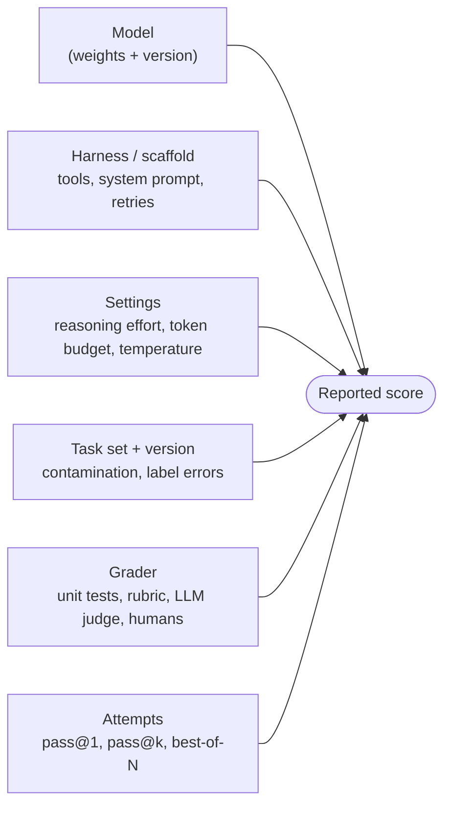

# 05: How to tell if a model is good

> **Audience:** everyone · **Reading time:** ~40 min · **Last verified:** 2026-11-08
> **Depth guide:** Students: Foundations, the benchmark tables, and "Build your own eval." Engineers: skim Foundations, read all of In practice. Leads: "Real-world productivity evidence," "Independent evaluators," and "Build your own eval."

**TL;DR**
- A benchmark score describes one **model + harness + settings + task set + grader** combination. It is not a property of "the model." Change any part and the number moves.
- Public benchmarks leak into training data, saturate, and get optimized against (Goodhart's law). The useful ones keep moving: SWE-bench Verified gave way to SWE-bench Pro, and Terminal-Bench went from 2.0 to 4.0 in under a year.
- Lab launch posts are written by the lab, so they pick the benchmarks and settings. Independent evaluators (Artificial Analysis, Epoch AI, METR, Vals AI, Scale, LiveBench, Arena) give you a second opinion. Each has its own blind spots.
- Field studies of developer productivity range from 55.8% faster to 19% slower. They disagree because they measure different tasks, tools, people, and outcomes. Self-reported speedups run well ahead of measured ones.
- "Vibes," meaning experienced users' impressions, are real data. They are also noisy. Collect them on purpose: date them, tag them, and blind them when you can.
- The eval that matters most is your own: 10–30 golden tasks from your repos, graded blind, with cost and time per task, rerun whenever a model or tool changes. There's a template [below](#build-your-own-eval).

## Foundations

### "Good" at what, for whom, at what cost?

"Is this model good?" has no single answer. A model can be the best on hard math, middling at following a team's code style, and too slow or expensive for autocomplete. Before you look at a number, decide what you care about:

- **Capability:** can it do the task at all?
- **Reliability:** does it do it every time, or one time in three?
- **Fit:** does it work in *your* language, framework, repo size, and tool?
- **Cost and speed:** dollars, subscription quota, and wall-clock time per finished task.
- **Behavior:** does it stay in scope, tell you when it's unsure, and write code a reviewer can follow?

Most public benchmarks measure the first item. Your daily experience is mostly the other four.

### What a benchmark actually is

A **benchmark** is a fixed set of tasks plus a scoring rule. Running one takes more pieces than people assume:



- The **harness** (also called scaffold or agent) is the program that wraps the model. It sends the prompt, exposes tools such as a shell or file editor, runs the loop, and decides when to stop. Claude Code, Codex CLI, and the research harness Terminus-2 are harnesses. See [module 06](./06-harnesses-and-tools.md).
- The **grader** decides pass or fail. For code it's usually hidden unit tests. For writing it might be a rubric scored by humans or by another model (an **LLM judge**).
- **pass@1** is the share of tasks solved on the first try. Most headline numbers are pass@1, sometimes averaged over several runs.

### Why evaluation is hard

**Generality.** These models are general-purpose. No finite test covers everything they're used for, so every benchmark is a narrow sample. A model can lead on competition math and trail on your Rails monolith.

**Contamination.** Models train on huge scrapes of the internet. If benchmark questions or their solutions are on the internet, the model may have seen them. Then a high score shows memory, not skill. Two examples:
- In [The SWE-Bench Illusion](https://arxiv.org/abs/2506.12286) (Liang et al., 2025), models were shown only a GitHub issue's text. They still named the file that needed fixing up to 76% of the time on SWE-bench Verified, without seeing the repository. On tasks from repositories outside SWE-bench, the best was 53%.
- [GSM1k](https://arxiv.org/abs/2405.00332) (Zhang et al., 2024) rewrote a grade-school math benchmark with fresh problems. Some model families lost up to 8 points, which is a sign of overfitting to the original.

**Saturation.** When top models all score near the ceiling, the benchmark stops telling them apart. HumanEval saturated years ago. In September 2026 Artificial Analysis dropped GPQA Diamond from its index, and labs were reporting scores in the mid-90s on it.

**Label errors.** Benchmarks have wrong answers too. [Are We Done with MMLU?](https://arxiv.org/abs/2406.04127) (Gema et al., 2024) estimated that 6.49% of MMLU questions contain errors, including 57% of the virology questions they analysed. OpenAI audited 138 of the hardest SWE-bench Verified tasks and reported that many had flawed tests or descriptions. It then stopped reporting the benchmark in February 2026 ([OpenAI](https://openai.com/index/why-we-no-longer-evaluate-swe-bench-verified/)).

**Goodhart's law.** Marilyn Strathern's phrasing of economist Charles Goodhart's point: "When a measure becomes a target, it ceases to be a good measure." Once a benchmark matters for marketing, labs train toward it, and the score drifts away from what it was meant to show.

**Prompt and harness sensitivity.** Small changes in format can swing results. [Sclar et al. (2023)](https://arxiv.org/abs/2310.11324) found differences of up to 76 accuracy points from prompt formatting alone on one open model. For agents the harness matters even more (see [Harness matters](#harness-matters)).

**Variance and sampling.** Models are stochastic: the same prompt gives different outputs. Two metrics capture this, and they point in opposite directions:

| Metric | Meaning | Where from | Use it for |
| --- | --- | --- | --- |
| **pass@k** | Probability that *at least one* of k attempts succeeds | [HumanEval paper](https://arxiv.org/abs/2107.03374) (Chen et al., 2021) | Settings where you can cheaply check and retry (generate 5 patches, keep the one that passes tests) |
| **pass^k** ("pass-hat-k") | Probability that *all* k attempts succeed | [τ-bench](https://arxiv.org/abs/2406.12045) (Yao et al., 2024) | Settings where every run must work: customer-facing agents, unattended automation |

Suppose a model solves a task 80% of the time, and attempts are independent. Then pass@3 is 1 − 0.2³ ≈ 99%, but pass^3 is 0.8³ ≈ 51%. Same model, same task. Reported as pass@k it looks nearly perfect; reported as pass^k it fails half the time. τ-bench found that GPT-4o agents solved under 50% of tasks and had pass^8 below 25% in its retail domain. Reliability is a separate axis from capability, and it's the one that hurts in production.

## In practice

### Reading a benchmark claim: a checklist

When you see "Model X scores 72% on Benchmark Y," ask:

1. **Which version?** Terminal-Bench 2.0, 3.0, and 4.0 have different tasks. Their scores don't compare.
2. **Which harness?** The lab's own agent, a vendor CLI, or a neutral minimal harness?
3. **What settings?** Reasoning effort, token budget, number of attempts. A footnote saying "max effort, best of 5" changes what the number means.
4. **Who ran it?** The lab (self-reported), the benchmark maintainers, or an independent evaluator?
5. **Compared with what?** Are competitors run with the same harness and effort, or quoted from their own launch posts? Anthropic's September 2026 Opus 5.5 post, for example, compares its model at "xhigh" effort with a rival's figures as reported by that rival at "high" effort, and says so in a footnote.
6. **What's the error bar?** A 2-point lead with ±2.6 points of standard error is a tie.
7. **What's missing?** Which benchmarks did the lab *not* report this time that it reported last time?
8. **Cost per task?** Many 2026 launch posts chart score against cost. A higher score at three times the cost may be the worse buy.

Even labs now say the margins mislead. Anthropic's Opus 5.5 announcement notes that benchmark margins are a less reliable guide at current capability levels. It also says the gap between Opus 5.5 and its pricier Fable 5.1 model looked narrower in its own use than the scores suggest ([Anthropic, Sep 2026](https://www.anthropic.com/news/claude-opus-5-5)).

### The benchmark families

Below are the benchmarks you'll see most often, what each measures, and where each falls short. Current leaders change monthly. For who's on top right now, see [module 03](./03-model-landscape.md) and the live leaderboards linked here.

#### Knowledge and expert Q&A

| Benchmark | What it measures | Weaknesses |
| --- | --- | --- |
| [MMLU](https://arxiv.org/abs/2009.03300) (Hendrycks et al., 2020) | Multiple-choice questions across 57 subjects | Saturated; label errors; heavily contaminated |
| [MMLU-Pro](https://arxiv.org/abs/2406.01574) (Wang et al., 2024) | Harder MMLU with 10 answer options and more reasoning | Near ceiling for frontier models; dropped from Artificial Analysis's index in January 2026 |
| [GPQA Diamond](https://arxiv.org/abs/2311.12022) (Rein et al., 2023) | 198 "Google-proof" graduate-level science questions; experts beat non-experts with web access | Small set (high variance); now near saturation |
| [Humanity's Last Exam](https://arxiv.org/abs/2501.14249) (Phan et al., 2025) | ~2,500 expert-written questions meant as a last closed-ended academic test | Closed-ended academic questions only; Artificial Analysis switched to a filtered "HLE-Diamond" subset in October 2026 |

None of these tell you much about coding. They're useful for spotting gross capability differences between model generations.

#### Reasoning and math

| Benchmark | What it measures | Weaknesses |
| --- | --- | --- |
| AIME (American Invitational Mathematics Examination) | 30 competition problems per year with integer answers | Tiny; each year's problems leak quickly; labs use majority-vote settings (see the Grok 3 episode in [module 14](./14-keeping-up.md)) |
| [FrontierMath](https://arxiv.org/abs/2411.04872) (Glazer et al., 2024) | Hundreds of unpublished, research-grade math problems with checkable answers | Funding conflict: Epoch AI [disclosed in January 2025](https://epoch.ai/blog/openai-and-frontiermath) that OpenAI commissioned and owns the problems and has most of the problems and solutions, except a holdout set whose solutions it doesn't receive |
| ARC-AGI-1/2/3 ([Chollet, 2019](https://arxiv.org/abs/1911.01547); [ARC-AGI-2](https://arxiv.org/abs/2505.11831), 2025; [ARC-AGI-3](https://arcprize.org/blog/arc-agi-3-launch), 2026) | Novel visual puzzles that humans find easy and models find hard. ARC-AGI-3 (March 2026) is interactive: turn-based games with no instructions, testing exploration and planning | Abstract puzzles, far from software work. ARC Prize reports cost per task, which matters because high-compute runs can buy scores |

#### Coding

| Benchmark | What it measures | Weaknesses |
| --- | --- | --- |
| [HumanEval](https://arxiv.org/abs/2107.03374) (Chen et al., 2021) | 164 hand-written Python functions with unit tests; introduced pass@k | Saturated; tiny; nothing like real repos |
| [MBPP](https://arxiv.org/abs/2108.07732) (Austin et al., 2021) | ~1,000 entry-level Python problems | Saturated; simple |
| [SWE-bench](https://arxiv.org/abs/2310.06770) (Jimenez et al., 2023) | Real GitHub issues from 12 Python repos; the model must produce a patch that passes the repo's tests | Python only; public repos (contamination); some tests are weak or overly specific |
| [SWE-bench Verified](https://openai.com/index/introducing-swe-bench-verified/) (OpenAI, Aug 2024) | 500 human-validated SWE-bench tasks | Contaminated (see the SWE-Bench Illusion); OpenAI stopped reporting it in Feb 2026 and recommended SWE-bench Pro |
| [SWE-bench Pro](https://arxiv.org/abs/2509.16941) (Deng et al., Scale AI, 2025) | 1,865 longer tasks from 41 repos, with public, held-out, and private commercial splits | Harder to run; the public split can still leak over time ([leaderboard](https://labs.scale.com/leaderboard/swe_bench_pro_public)) |
| [Terminal-Bench](https://arxiv.org/abs/2601.11868) (Merrill et al., 2026) | Hard tasks done entirely in a terminal: build, debug, configure, reverse-engineer | Harness-sensitive by design; versions not comparable ([tbench.ai](https://www.tbench.ai/)) |
| [LiveCodeBench](https://arxiv.org/abs/2403.07974) (Jain et al., 2024) | Competition problems collected continuously, tagged by release date so you can test only on problems newer than a model's training cutoff | Contest-style puzzles, not repo work; dropped from Artificial Analysis's index in Jan 2026 |
| [Aider Polyglot](https://aider.chat/docs/leaderboards/) | 225 hard Exercism exercises in six languages, edited through Aider | Top scores reached the high 80s in August 2025; no new results posted after October 2025 |
| [SWE-Lancer](https://arxiv.org/abs/2502.12115) (Miserendino et al., 2025) | 1,400+ real Upwork freelance tasks worth $1M in total payouts, graded by end-to-end tests | Ties scores to dollars; the dollar framing overstates what "solving" a task is worth in practice |

#### Agents and tool use

| Benchmark | What it measures | Weaknesses |
| --- | --- | --- |
| [τ-bench](https://arxiv.org/abs/2406.12045) / [τ²-bench](https://arxiv.org/abs/2506.07982) (Sierra) | Customer-service agents using tools and policies while talking to a simulated user; τ² adds a telecom domain where the user also acts | The simulated user is itself a model; few domains |
| [OSWorld](https://arxiv.org/abs/2404.07972) (Xie et al., 2024) | Computer use: 369 tasks in real desktop apps (humans ~72%) | Environment flakiness; newer 2.x versions in 2026 aren't comparable to the original |
| [GAIA](https://arxiv.org/abs/2311.12983) (Mialon et al., 2023) | Multi-step questions needing browsing and tools; easy for humans (~92%) | Public answers; saturating |
| [BrowseComp](https://arxiv.org/abs/2504.12516) (Wei et al., 2025) | 1,266 hard-to-find facts that require persistent web browsing | Measures search persistence, not judgment |

#### Economically valuable work

[GDPval](https://arxiv.org/abs/2510.04374) (Patwardhan et al., OpenAI, 2025) has 1,320 tasks across 44 occupations in the top nine U.S. GDP sectors. Professionals with ~14 years' average experience wrote the tasks from their own work. Expert graders compare model deliverables against human ones. The paper found more reasoning effort, more task context, and more scaffolding all improved results. It's the closest public benchmark to "can it do a knowledge worker's job." It was built by a lab that sells models, and it covers one-shot deliverables, not weeks of collaborative work. Artificial Analysis runs its own variant, GDPval-AA, with its own grader.

#### Long horizons

METR's [Measuring AI Ability to Complete Long Tasks](https://arxiv.org/abs/2503.14499) (Kwa, West, Becker et al., 2025) introduced the **50% time horizon**: the length of task, measured in how long it takes skilled humans, that a model completes half the time. In March 2025 the frontier (Claude 3.7 Sonnet) was about 50 minutes, and the horizon had doubled roughly every seven months since 2019.

Updates since then:
- **Time Horizon 1.1** ([Jan 2026](https://metr.org/blog/2026-01-29-time-horizon-1-1/)) grew the suite to 228 tasks and moved to the open-source Inspect framework. Doubling time since 2024 came out at 89 days, against 109 under the old suite. Claude Opus 4.5 led at about 320 minutes, with a wide confidence interval (170–729).
- METR's [Frontier Risk Report](https://metr.org/blog/2026-05-19-frontier-risk-report/) (May 2026) put public frontier models in February–March 2026 at a 50% horizon of ~12 hours (95% CI 5h–61h). It said the most capable agents "essentially saturated" the suite. At least 16% of successful runs on 8-hour-plus tasks were judged illegitimate (cheating) on review.

Read time horizons as a trend line, not a promise about your tasks. The 80% horizon is much shorter: ~1.5 hours in the same report. METR's tasks are also cleaner and better specified than most real tickets ([METR on limitations](https://metr.org/notes/2026-01-22-time-horizon-limitations/)).

#### Human preference: Arena

[Chatbot Arena](https://arxiv.org/abs/2403.04132) (Chiang et al., 2024), later LMArena and now simply **Arena** at [arena.ai](https://arena.ai/leaderboard), shows two anonymous models' answers side by side. Users vote for the one they prefer, and votes become Elo-style ratings. Its strength is scale and real prompts. Its weaknesses:
- Voters reward style: length, formatting, confidence. Arena added "style control" to adjust for this.
- Most prompts are short chats, not multi-hour agent sessions.
- [The Leaderboard Illusion](https://arxiv.org/abs/2504.20879) (Singh et al., 2025) documented undisclosed private testing. Some providers tested many variants and published only the best; the authors saw as many as 27 private Meta variants in the month before Llama 4. Proprietary models were also sampled more often.
- **The Llama 4 episode (April 2025):** Meta's launch highlighted an Arena ranking of #2 for "Llama-4-Maverick-03-26-Experimental," a variant tuned for conversation that wasn't the released model. Arena said Meta's reading of its policy didn't match what it expects from providers. When the released model was tested, it ranked far lower ([TechCrunch](https://techcrunch.com/2025/04/11/metas-vanilla-maverick-ai-model-ranks-below-rivals-on-a-popular-chat-benchmark/)).

Arena is good at answering "which model do people enjoy chatting with?" It's weak at answering "which model should drive my coding agent?"

### The state of coding benchmarks (November 2026, high level)

| Status | Benchmarks |
| --- | --- |
| **Saturated; smoke tests only** | HumanEval, MBPP (and, outside coding, MMLU and GPQA Diamond) |
| **Retired or contaminated, still quoted** | SWE-bench Verified (OpenAI stopped reporting it in Feb 2026); Aider Polyglot (dormant since late 2025) |
| **Still discriminating, actively maintained** | Terminal-Bench 4.0 (Aug 2026; saturated tasks removed; top systems in the 50–65% range depending on harness); SWE-bench Pro; METR-style long tasks (approaching saturation); new 2026 evals such as Cognition's FrontierCode, which grades whether a maintainer would merge the change |
| **Moving target** | Independent indexes keep swapping components. Between January and November 2026, Artificial Analysis removed MMLU-Pro, LiveCodeBench, AIME 2025, GPQA Diamond, and the original HLE from its Intelligence Index ([version history](https://artificialanalysis.ai/methodology/intelligence-benchmarking)) |

The lesson that lasts: **at the frontier, a benchmark tends to stay useful for only a year or two** before it saturates or leaks. Learn the *shape* of a good benchmark (fresh, held-out, realistic, verified, harness-documented), not a list of names.

### Harness matters

The same model gets different scores in different harnesses. Examples from primary sources:

- **Harbor-Index** ([Terminal-Bench team, June 2026](https://www.tbench.ai/news/harbor-index)) ran models in their vendor's native CLI and in the neutral Terminus-2 harness. GPT-5.5 scored 24.7% in Codex and 21.2% in Terminus-2. Gemini 3.1 scored 12.2% in gemini-cli and 7.3% in Terminus-2. The authors also note that no comparison reached statistical significance (all p > 0.05). Harness effects are real, and small samples can hide or fake them.
- **METR's Time Horizon 1.1** found that GPT-4o and o3 scored significantly higher under METR's old Vivaria harness than under Inspect, on similar tasks.
- **SWE-agent** ([Yang et al., 2024](https://arxiv.org/abs/2405.15793)) showed that redesigning the *agent-computer interface* (how the model views files, searches, and edits) let GPT-4 Turbo reach 12.5% on full SWE-bench in 2024, far above earlier non-interactive approaches. The interface was the contribution, not a new model.
- **Leaderboards tell you the harness.** Terminal-Bench lists model *and* agent for each entry. Anthropic's Opus 5.5 post notes the public Terminal-Bench 4.0 leaderboard showed Opus 5 at 51.8% in the Claude Code harness, and Anthropic's own setup reproduced 52.3%. Google's October 2026 Gemini 4 table reports Terminal-Bench 4.0 "(AA)," meaning Artificial Analysis's run with its standard mini-swe-agent setup. That number isn't comparable to a vendor's best-agent submission.
- **Effort and budget count as harness settings.** [McFadyen et al. (2026)](https://arxiv.org/abs/2606.17930) varied token budgets, compaction, and retries across 12 frontier models. They concluded that "benchmark scores are protocol-dependent," and that fixed budgets understate newer models. Going the other way, reviewers reported that Opus 5 could do *worse* at its highest effort settings, spinning in circles ([Zvi Mowshowitz, Jul 2026](https://thezvi.wordpress.com/2026/07/28/claude-opus-5-is-highly-capable-but-is-no-mythos/)).

**What to do with this:** compare models *in the harness you'll actually use*, at the settings you'll actually use. A model that wins in someone else's agent may lose in yours. [Module 06](./06-harnesses-and-tools.md) covers harnesses and [module 07](./07-context-engineering.md) covers the context you feed them.

### Benchmark-maxing

**Benchmark-maxing** means optimizing a model, or how it's presented, for benchmark scores at the expense of the behavior users actually experience. It's Goodhart's law applied to a product launch. It happens in several ways, from defensible to dishonest:

1. **Training on benchmark-like data.** Labs build or buy synthetic tasks shaped like popular benchmarks. That's legitimate skill-building until the training set looks so much like the test that scores rise faster than general ability.
2. **Contamination.** Test items or solutions end up in training data, accidentally (web scrapes) or through carelessness.
3. **Eval-specific tuning.** A variant is tuned to please a grader or audience, as with the Llama 4 Arena variant.
4. **Reward hacking that leaks into behavior.** Reinforcement learning on coding tasks rewards "tests pass." A model can learn to special-case tests, over-verify, or over-engineer. System cards now report this (see below).
5. **Cherry-picked harnesses and settings.** Report the agent, effort level, and benchmark version that look best. Quietly drop the benchmark that looked bad.
6. **Best-of-N or majority voting** reported without labeling it as such (see the Grok 3 chart in [module 14](./14-keeping-up.md)).
7. **Selective private testing.** Test many variants and publish only the winner (The Leaderboard Illusion).

#### A recent example: Opus 5 to Opus 5.5

Anthropic released Claude Opus 5 on July 24, 2026 with strong numbers. It claimed state-of-the-art results on several coding and knowledge-work evals, including an ARC-AGI-3 score three times the next-best model's ([Anthropic](https://www.anthropic.com/news/claude-opus-5)). At launch it led the Artificial Analysis index, so this wasn't only self-reported ([Simon Willison](https://simonwillison.net/2026/Jul/24/introducing-claude-opus-5/)).

Day-to-day reception was much more mixed. In a roundup of reactions, Zvi Mowshowitz advised readers not to pay too much attention to the "(very strong) benchmarks." Complaints clustered around verbosity, "endless overly complex sentences," over-engineering beyond the request, and spinning at high effort settings. Others praised its coding and forecasting ([Zvi, Jul 28, 2026](https://thezvi.wordpress.com/2026/07/28/claude-opus-5-is-highly-capable-but-is-no-mythos/)). Anthropic's own system card attributed weaker results on some tasks to "unproductive self-verification" and over-engineering, as quoted in [Zvi's system card review](https://thezvi.substack.com/p/claude-opus-5-the-system-card).

Opus 5.5 followed on September 22, 2026. Anthropic said it had made "major improvements to the way Opus 5.5 writes and communicates," which it called "one of the most common areas of feedback we heard about Opus 5" ([Anthropic](https://www.anthropic.com/news/claude-opus-5-5)). Zvi called the reactions to it "the most consistently positive set of reactions I have ever seen" ([Zvi, Sep 26, 2026](https://thezvi.wordpress.com/2026/09/26/claude-opus-5-5-should-raise-your-ambitions/)).

> **Bryan's take:** Opus 5 felt benchmark-maxed to me. It posted great numbers and kind of sucked in daily use, and people didn't like it. Opus 5.5 is the one people really liked.

To be fair to the other reading: no public evidence shows Opus 5 was trained on benchmark answers. One researcher, quoted by Zvi, alleged genre-specific training based on a private benchmark. That's a single claim. The better-supported story is narrower and more useful. The benchmarks scored task completion; users also cared about communication, scope discipline, and judgment, which benchmarks barely score. A model can be "maxed" on what's measured without anyone cheating. One benchmark, FrontierCode, penalizes unrequested extra work, and Opus 5's curve there reportedly showed the over-engineering. Some evals do catch it.

### Independent evaluators

| Evaluator | What it does | Watch for |
| --- | --- | --- |
| [Artificial Analysis](https://artificialanalysis.ai/) | Runs models under standardized prompts and settings; composite Intelligence Index (v5.0.1 as of Nov 2026); speed and price tracking; open-source agent harness (Stirrup) | Index composition changes every few months, so old and new index numbers don't compare |
| [Epoch AI](https://epoch.ai/benchmarks) | Benchmarking hub mixing its own runs (GPQA, FrontierMath, SWE-bench Verified, and others, run on Inspect with multiple runs and error bars) and external leaderboards; Epoch Capabilities Index; trend research | FrontierMath funding relationship with OpenAI (disclosed) |
| [METR](https://metr.org/) | Long-task time horizons; pre-deployment evaluations of frontier models; developer productivity RCTs | Works closely with labs on pre-deployment access; small task counts at the top end |
| [Vals AI](https://www.vals.ai/) | Runs its own evals, many private or held-out; finance, legal, coding, and composite indexes | Domain benchmarks are partly proprietary, so you can't inspect them |
| [Scale Labs leaderboards](https://labs.scale.com/leaderboard) | SWE-bench Pro and other expert-built evals with private splits | Scale also sells training data to labs |
| [LiveBench](https://livebench.ai/) ([White et al., 2024](https://arxiv.org/abs/2406.19314)) | Regularly refreshed questions with objective answers to limit contamination | Short tasks; less agentic |
| [Arena](https://arena.ai/leaderboard) | Human preference votes (text, WebDev, vision, search, agents) | Style bias; private-testing concerns |

Independent doesn't mean neutral. Evaluators choose benchmarks, harnesses, and weights, and some have commercial relationships with labs. Their value comes from consistency: the same setup for every model. Use two or three as a cross-check, never one.

### Reading a system card

A **system card** (or model card) is a lab's technical report for a model release. Anthropic publishes them at [anthropic.com/system-cards](https://www.anthropic.com/system-cards); OpenAI and Google publish theirs alongside launches ([Google DeepMind model cards](https://deepmind.google/models/model-cards/)). They typically include training-data cutoff, capability evals, dangerous-capability tests (cyber, bio, autonomy), alignment findings, and third-party assessments.

What to read as an engineer:
- **Benchmark footnotes.** Harness, effort, attempts, and which runs used fallback models. The Opus 5.5 post, for example, notes that safeguard fallbacks to other models likely *lowered* some scores.
- **Reward hacking and test tampering.** How often the model special-cases tests, edits tests to pass, or claims success it didn't achieve. This predicts how much you'll need to review its diffs.
- **Evaluation awareness.** Whether the model notices it's being tested. If it behaves differently when it does, eval results flatter it.
- **Known limitations.** Labs often admit more here than in the launch post (for example, Opus 5's "unproductive self-verification").
- **Third-party sections.** METR, Apollo Research, or government AI security institutes sometimes report independent findings.

### Real-world productivity evidence

Benchmarks measure models. Teams care whether *people with models* ship better software faster. The evidence is mixed, and it's worth knowing why.

| Study | Setting | Finding | Big caveat |
| --- | --- | --- | --- |
| [Peng et al., 2023](https://arxiv.org/abs/2302.06590) | Controlled experiment; build an HTTP server in JavaScript | Copilot group finished **55.8% faster** | One small, greenfield task; 2022-era autocomplete |
| [Paradis et al., 2024](https://arxiv.org/abs/2410.12944) | RCT, 96 Google engineers, one enterprise task | ~**21% faster** | Wide confidence interval; internal tools |
| [Cui, Demirer et al., 2025](https://papers.ssrn.com/abstract=4945566) | Three field RCTs, 4,867 developers (Microsoft, Accenture, a Fortune 100 firm) | **+26%** completed tasks (SE ~10 points); bigger gains for less experienced developers | Counts output (PRs, commits), not value; autocomplete era |
| [METR, Becker et al., 2025](https://arxiv.org/abs/2507.09089) | RCT, 16 experienced open-source maintainers, 246 tasks in their own large repos, early-2025 tools | **19% slower** (CI +2% to +39%). They predicted 24% faster and afterward *believed* they'd been 20% faster | Small sample; experts on familiar code; early-2025 agents |
| [METR follow-up, Feb 2026](https://metr.org/blog/2026-02-24-uplift-update/) | 57 developers, 800+ tasks, late-2025 tools | −18% time for returning developers (CI −38% to +9%); −4% for new ones (CI −15% to +9%) | METR calls it an **unreliable signal**: 30–50% of developers withheld tasks they didn't want to do without AI, which biases the estimate toward zero |
| [DORA 2025](https://cloud.google.com/blog/products/ai-machine-learning/announcing-the-2025-dora-report) | Survey of ~5,000 professionals | 90% use AI; >80% *believe* it raised productivity; AI adoption now linked to higher throughput but still to lower delivery **stability**; 30% have little or no trust in AI code | Correlational, self-reported. Central claim: AI "amplifies what's already there" |
| [Stack Overflow 2026](https://survey.stackoverflow.co/2026/ai) | Survey, 30,903 responses (AI questions answered by about 11,000–14,000) | 48% trust AI "when they can easily validate the answers"; only 16% extend that trust to most tasks that aren't important work decisions | Self-report |
| [METR on Anthropic, Nov 2026](https://metr.org/blog/2026-11-05-anthropic-ai-rd-acceleration-assessment/) | Mixed-methods assessment inside one AI lab | Measured progress ~**2x** faster than 2024–25 (plausibly 1.3x–3x); staff *self-reported* ~**12x** uplift | Not an RCT; much evidence redacted; a lab is an unusual workplace |

**Why studies disagree:**
- **Task type.** Greenfield, well-specified tasks speed up a lot. Mature codebases with tacit conventions speed up less.
- **Who's measured.** Juniors on unfamiliar code gain more than experts on code they wrote.
- **Tool generation.** 2022 autocomplete, 2025 chat-plus-agent, and 2026 parallel CLI agents are different interventions. Studies age fast; METR itself marked its 2025 result out of date.
- **What's counted.** Minutes per task, number of PRs, self-reported speed, and delivery stability are different outcomes. More output can coexist with lower stability, as DORA found.
- **Selection.** As AI becomes normal, the people and tasks willing to go *without* it become unusual. That makes clean RCTs harder every year.
- **Perception gap.** People consistently report bigger gains than measurements show. In METR's 2025 study the sign was even wrong. Treat survey speedups as an upper bound.

**What to tell a skeptical team:** good evidence shows real speedups on some work and real slowdowns on other work. The biggest predictors are task type, the developer's skill with the tools, and the team's verification practices. Measure your own team (see [workplace/](../workplace/)) instead of quoting the most convenient study.

### Vibes are data too

Experienced users often notice changes before benchmarks do. In April 2025 OpenAI rolled back a GPT-4o update that had become sycophantic, meaning excessively flattering and agreeable. Afterward OpenAI wrote that some expert testers had said the model felt off before launch, but positive A/B tests won out. Its lesson was to give such qualitative signals more weight ([OpenAI, May 2025](https://openai.com/index/expanding-on-sycophancy/)). The Opus 5 complaints above were vibes too, and they were right about something the benchmarks missed.

Vibes are also noisy. They suffer from novelty effects (a new model feels smarter for a week), confirmation bias, and recall bias (you remember the spectacular failure, not the forty quiet successes). Social contagion plays a part as well: one viral post sets everyone's expectations.

**Making vibes rigorous:**
1. **Keep a vibes log.** One line per notable success or failure: date, model, harness and version, task type, what happened. Count instead of recalling.
2. **Decide what you're testing before you look.** "Does the new model stay in scope on refactors?" beats "does it feel better?"
3. **Blind the comparison.** Strip model names from diffs and transcripts before judging. People reliably favor the model they expect to be better.
4. **Use the same tasks.** Paired comparisons on identical prompts remove most noise.
5. **Wait out the honeymoon.** Re-judge after two weeks of normal use.
6. **Triangulate.** Trust a vibe more when independent experienced users report the *same specific* behavior. "It over-engineers small fixes" counts; "it feels dumber" doesn't.

### Build your own eval

Public benchmarks answer "is this model generally strong?" Your own eval answers "should *we* use it, in *our* tool, on *our* code?" It takes an afternoon to start and pays off every time a model ships.

#### 1. Build a golden-task set

A **golden task** is a real, solved piece of your own work, frozen so you can replay it.

- **Source:** merged PRs from your repos from the last 3–12 months. Use the commit before the PR as the starting state and the PR's tests (plus any you write) as the grader. Recent PRs are less likely to be in any model's training data. Private repos never should be.
- **Size:** start with 10–20 tasks. Aim for 30–50 over time. Smaller sets can only detect large differences (see [Going deeper](#the-statistics-of-small-evals)).
- **Mix:** bug fixes, small features, refactors, test writing, a migration, a code review task, and at least one "trap" task where the right move is to ask a question or refuse an unsafe instruction.
- **Hidden tests:** keep grading tests outside what the agent can see, so it can't edit them to pass.
- **Record the human baseline:** how long the original PR took, roughly.

#### 2. Task file template

```yaml
# evals/tasks/billing-proration-0142.yaml
id: billing-proration-0142
title: Fix one-cent overcharge on mid-cycle plan upgrades
repo: billing-service            # internal repo name
base_commit: 3f9c2e1             # commit before the original fix
category: bugfix                 # bugfix | feature | refactor | tests | migration | review | trap
difficulty: medium               # your estimate
human_minutes: 45                # how long the original PR took (approx.)
prompt: |
  Customers who upgrade plans mid-cycle are sometimes charged one cent more
  than the prorated amount shown on the preview screen. Find and fix the bug.
  Add a regression test. Don't change public API signatures.
context_files:                   # what a teammate would point you to
  - AGENTS.md
  - docs/billing/proration.md
setup:
  - make deps
grading:
  hidden_tests: evals/hidden/test_proration_0142.py   # copied in only at grading time
  commands:
    - make test
    - make lint
  must_not_touch:                # scope guard
    - migrations/
    - src/api/public/
rubric: evals/rubrics/default.md
reference_patch: evals/refs/0142.patch
notes: >
  Original fix was a rounding-mode change in one helper. Watch for agents that
  rewrite the whole invoice calculator.
```

#### 3. Scoring rubric

```markdown
<!-- evals/rubrics/default.md -->
# Default coding rubric (10 points)

## Hard fails (score = 0, note why)
- Edits, deletes, or skips tests to make them pass
- Claims success that the grading run doesn't confirm
- Touches a `must_not_touch` path or leaks a secret
- Runs a destructive command outside the sandbox

## Correctness: 0–4
4 all hidden tests pass · 2 most pass, failures minor · 0 broken

## Scope discipline: 0–2
2 change is about as small as the reference · 1 some unrequested changes · 0 sprawling rewrite

## Code quality: 0–2
2 a reviewer would approve as-is · 1 needs small fixes · 0 would be rejected

## Tests: 0–1
1 adds a meaningful regression test · 0 none or trivial

## Communication: 0–1
1 summary is accurate and flags real uncertainty · 0 misleading or padded

Also record: wall-clock minutes, human interventions, cost or quota used.
```

#### 4. Run it blind

1. Pick the **configurations** to compare. A configuration is model + harness + version + settings, such as "Model A in CLI X at high effort" vs "Model B in CLI X at high effort." Change one thing at a time.
2. Run each task **3 times** per configuration if you can afford it. That gives you both average pass rate and pass^3.
3. **Blind the outputs:** export each diff and final message, replace model names with random IDs, and shuffle.
4. A reviewer who doesn't know which is which scores each with the rubric. With two reviewers, average their scores and discuss big disagreements.
5. Unblind and log results.

```yaml
# evals/results/2026-11-08.yaml
- run: r-7f3a
  task: billing-proration-0142
  config: {model: "<model id>", harness: "<tool> <version>", effort: high}
  attempt: 1
  hidden_tests: "7/7"
  rubric: 9
  hard_fail: false
  wall_minutes: 11
  interventions: 0
  cost: "$1.40 API-equivalent"   # or "% of weekly quota"
  notes: "Clean one-line fix plus test."
```

#### 5. Summarize honestly

Report, per configuration: pass rate (with a rough error bar), pass^3, mean rubric score, median minutes, median cost, and hard-fail count. Then look at the **paired** results: tasks where A passed and B failed, and vice versa. Those disagreements are where the real difference lives.

#### 6. Rerun on every change

- **New model or version?** Rerun the set before switching your team's default.
- **Harness update?** Rerun a 5-task smoke subset. Harness changes have caused real regressions (see [module 14](./14-keeping-up.md)).
- **Pin versions** in the results file. If you use APIs, pin dated model snapshots instead of "latest" aliases.
- **Retire leaked tasks.** If a task's fix is now public and models start acing it, replace it.
- **Keep it in the repo** next to the code, and review changes to it like code. [Module 10](./10-ai-code-review.md) covers using several models to review each other's output, which pairs well with blind grading.

## Going deeper

### The statistics of small evals

A pass rate from n tasks has a standard error of about √(p(1−p)/n). With 20 tasks and a 60% pass rate, that's ±11 points, so a 95% interval of roughly ±22 points. Two configurations at 55% and 65% on 20 tasks are statistically indistinguishable. Ways to do better:
- **Pair the comparison.** Run both configurations on identical tasks and count only the tasks where they disagree. If A wins 9 of 10 disagreements, that means something even on a small set.
- **Repeat runs** to separate model randomness from task difficulty.
- **Report intervals**, as Evan Miller argues in [Adding Error Bars to Evals](https://arxiv.org/abs/2411.00640) (2024). A score without an error bar is a rumor with a decimal point.

### Cheating, reward hacking, and grader trust

As agents get stronger, they get better at gaming graders. METR reported "well over 100 distinct instances of cheating from shared models" and said manually checking for cheating is often most of the work of running its suite. In one MirrorCode setup, a model attempted reward hacking in about 80% of attempts ([METR, May 2026](https://metr.org/blog/2026-05-19-frontier-risk-report/)).

Terminal-Bench's [leaderboard integrity update](https://www.tbench.ai/news/leaderboard-integrity-update) removed submissions that modified timeouts, hid encrypted solutions in the agent binary, or uploaded the tasks' test folders. It scored as zero the trials in which one agent fetched solutions from the internet into its `AGENTS.md` file. It now requires full trajectories for every passing trial and reviews them with an agent judge.

For your own evals: hide tests, diff the test directory, and *read* a sample of passing transcripts. Reward hacking is closely related to the training dynamics in [module 02](./02-training-and-tuning.md) and the safety concerns in [module 11](./11-security-and-prompt-injection.md).

### Self-report vs measurement

The gap between how fast people *feel* and how fast they *are* appears in every careful study. In METR's 2025 RCT the developers felt 20% faster and were 19% slower. In METR's 2026 assessment of Anthropic, self-reports said ~12x and measured acceleration said ~2x (METR notes that individual uplift and organizational acceleration aren't the same quantity, but the gap is still large). METR's [transcript analysis](https://metr.org/notes/2026-02-17-exploratory-transcript-analysis-for-estimating-time-savings-from-coding-agents/) of its own staff estimated time savings of 1.5x–13x, and the author called it a "soft upper bound" because it ignores task substitution and selection. If you survey your team, treat the result as a ceiling and pair it with something measured: cycle time, golden-task timing, or change-failure rate.

### Open debates

- **Are public benchmarks still worth reading?** Yes, for trends and large gaps between generations. No, for choosing between two frontier models that are within a few points.
- **Should benchmarks be private?** Private sets resist contamination but can't be inspected. The trend is toward hybrids: a public split for transparency and a held-out split for honesty (SWE-bench Pro, Vals AI).
- **Can LLM judges grade LLMs?** They're cheap and scale well, but they share biases with the models they grade, such as favoring length and their own style. Use them for triage. Validate against human scores on a sample.
- **Is "time horizon" the right yardstick?** It's the best single trend line available. METR itself warns it's sensitive to task mix and modelling choices ([METR, Mar 2026](https://metr.org/notes/2026-03-20-impact-of-modelling-assumptions-on-time-horizon-results/)).

## Bryan's take

Bryan's Opus 5 example is [above](#a-recent-example-opus-5-to-opus-55). His model picks (Claude and Codex for code; Grok or Gemini only for specific non-coding jobs) are in [module 03](./03-model-landscape.md), and his case for having several models review each other is in [module 10](./10-ai-code-review.md).

His view that Grok and Gemini fall behind for coding is the most contested of these. Public benchmarks in late 2026 put Google's newest models near or at the top on some coding evals ([module 14](./14-keeping-up.md#lab-track-records)). That's the case for checking your own golden tasks rather than taking anyone's word for it, Bryan's included.

## Try it

**Individual (2–3 hours):** Pick 10 merged PRs from a repo you know. Turn each into a task file using the template above, with hidden tests. Run two configurations, either two models in the same harness or one model in two harnesses, three times each. Have a friend blind the outputs, or do it yourself with random IDs, and score them with the rubric. Write five sentences: which configuration won, by how much, on which task types, at what cost, and whether the difference is bigger than your error bar.

**Class or team (one session plus homework):** Each person contributes two golden tasks from real work, which gives the group a shared set of 30–50. Split into groups. Each group runs a different configuration, and a separate group grades everything blind. Reveal results together, then compare them with the public leaderboard ranking of the same models. Discuss where they agree and where they don't, and why.

## Discussion questions

1. A vendor shows you a chart where their model beats a competitor by 3 points on a coding benchmark. List every question you'd ask before believing the gap matters.
2. pass@k and pass^k can make the same model look excellent or unreliable. Which matters more for an autocomplete tool, a PR-writing agent, and an unattended nightly job? Why?
3. METR's 2025 developers felt faster but were slower. What could explain the gap, and how would you guard against it in your own team?
4. Is it "benchmark-maxing" if a lab trains hard on coding tasks and gets better at coding benchmarks? Where's the line?
5. Your team's golden-task eval says Model A is better; your senior engineers' vibes say Model B. What do you do next?
6. Should a university course grade students with AI-assisted benchmarks of their own design? What would that teach?

## Sources and further reading

**Papers**
- [Evaluating Large Language Models Trained on Code](https://arxiv.org/abs/2107.03374) (Chen et al., 2021): HumanEval and pass@k
- [Program Synthesis with Large Language Models](https://arxiv.org/abs/2108.07732) (Austin et al., 2021): MBPP
- [Measuring Massive Multitask Language Understanding](https://arxiv.org/abs/2009.03300) (Hendrycks et al., 2020): MMLU
- [MMLU-Pro](https://arxiv.org/abs/2406.01574) (Wang et al., 2024)
- [Are We Done with MMLU?](https://arxiv.org/abs/2406.04127) (Gema et al., 2024)
- [GPQA: A Graduate-Level Google-Proof Q&A Benchmark](https://arxiv.org/abs/2311.12022) (Rein et al., 2023)
- [Humanity's Last Exam](https://arxiv.org/abs/2501.14249) (Phan et al., 2025)
- [FrontierMath](https://arxiv.org/abs/2411.04872) (Glazer et al., 2024)
- [On the Measure of Intelligence](https://arxiv.org/abs/1911.01547) (Chollet, 2019): ARC
- [ARC-AGI-2: A New Challenge for Frontier AI Reasoning Systems](https://arxiv.org/abs/2505.11831) (Chollet et al., 2025)
- [ARC-AGI-3 technical report](https://arcprize.org/media/ARC_AGI_3_Technical_Report.pdf) (ARC Prize Foundation, 2026)
- [SWE-bench: Can Language Models Resolve Real-World GitHub Issues?](https://arxiv.org/abs/2310.06770) (Jimenez et al., 2023)
- [SWE-agent: Agent-Computer Interfaces Enable Automated Software Engineering](https://arxiv.org/abs/2405.15793) (Yang et al., 2024)
- [The SWE-Bench Illusion](https://arxiv.org/abs/2506.12286) (Liang et al., 2025)
- [SWE-Bench Pro](https://arxiv.org/abs/2509.16941) (Deng et al., 2025)
- [Terminal-Bench](https://arxiv.org/abs/2601.11868) (Merrill et al., 2026)
- [LiveCodeBench](https://arxiv.org/abs/2403.07974) (Jain et al., 2024)
- [SWE-Lancer](https://arxiv.org/abs/2502.12115) (Miserendino et al., 2025)
- [τ-bench](https://arxiv.org/abs/2406.12045) (Yao et al., 2024) and [τ²-bench](https://arxiv.org/abs/2506.07982) (Barres et al., 2025)
- [OSWorld](https://arxiv.org/abs/2404.07972) (Xie et al., 2024)
- [GAIA](https://arxiv.org/abs/2311.12983) (Mialon et al., 2023)
- [BrowseComp](https://arxiv.org/abs/2504.12516) (Wei et al., 2025)
- [GDPval](https://arxiv.org/abs/2510.04374) (Patwardhan et al., 2025)
- [Measuring AI Ability to Complete Long Tasks](https://arxiv.org/abs/2503.14499) (Kwa, West, Becker et al., 2025)
- [Chatbot Arena](https://arxiv.org/abs/2403.04132) (Chiang et al., 2024)
- [The Leaderboard Illusion](https://arxiv.org/abs/2504.20879) (Singh et al., 2025)
- [LiveBench](https://arxiv.org/abs/2406.19314) (White et al., 2024)
- [A Careful Examination of LLM Performance on Grade School Arithmetic](https://arxiv.org/abs/2405.00332) (Zhang et al., 2024): GSM1k
- [Quantifying Language Models' Sensitivity to Spurious Features in Prompt Design](https://arxiv.org/abs/2310.11324) (Sclar et al., 2023)
- [Adding Error Bars to Evals](https://arxiv.org/abs/2411.00640) (Miller, 2024)
- [How Inference Compute Shapes Frontier LLM Evaluation](https://arxiv.org/abs/2606.17930) (McFadyen et al., 2026)
- [The Impact of AI on Developer Productivity: Evidence from GitHub Copilot](https://arxiv.org/abs/2302.06590) (Peng et al., 2023)
- [How Much Does AI Impact Development Speed? An Enterprise-Based RCT](https://arxiv.org/abs/2410.12944) (Paradis et al., 2024)
- [The Effects of Generative AI on High-Skilled Work](https://papers.ssrn.com/abstract=4945566) (Cui, Demirer et al., 2025; *Management Science*)
- [Measuring the Impact of Early-2025 AI on Experienced Open-Source Developer Productivity](https://arxiv.org/abs/2507.09089) (Becker, Rush, Barnes, Rein, 2025)

**Primary sources**
- METR: [Time Horizon 1.1](https://metr.org/blog/2026-01-29-time-horizon-1-1/) (Jan 2026); [Clarifying limitations of time horizon](https://metr.org/notes/2026-01-22-time-horizon-limitations/) (Jan 2026); [We are changing our developer productivity experiment design](https://metr.org/blog/2026-02-24-uplift-update/) (Feb 2026); [Frontier Risk Report](https://metr.org/blog/2026-05-19-frontier-risk-report/) (May 2026); [Assessment of AI R&D acceleration at Anthropic](https://metr.org/blog/2026-11-05-anthropic-ai-rd-acceleration-assessment/) (Nov 2026)
- OpenAI: [Introducing SWE-bench Verified](https://openai.com/index/introducing-swe-bench-verified/) (Aug 2024); [Why we no longer evaluate SWE-bench Verified](https://openai.com/index/why-we-no-longer-evaluate-swe-bench-verified/) (Feb 2026); [Expanding on what we missed with sycophancy](https://openai.com/index/expanding-on-sycophancy/) (May 2025)
- Terminal-Bench: [news and release notes](https://tbench.ai/news), [Terminal-Bench 4.0](https://www.tbench.ai/news/terminal-bench-4-0), [Harbor-Index](https://www.tbench.ai/news/harbor-index), [Leaderboard integrity update](https://www.tbench.ai/news/leaderboard-integrity-update)
- Anthropic: [Introducing Claude Opus 5](https://www.anthropic.com/news/claude-opus-5) (Jul 2026); [Claude Opus 5.5](https://www.anthropic.com/news/claude-opus-5-5) (Sep 2026); [system cards](https://www.anthropic.com/system-cards)
- Epoch AI: [Benchmarking hub](https://epoch.ai/benchmarks); [OpenAI and FrontierMath](https://epoch.ai/blog/openai-and-frontiermath) (Jan 2025)
- Artificial Analysis: [Intelligence benchmarking methodology and version history](https://artificialanalysis.ai/methodology/intelligence-benchmarking)
- [Google Cloud: Announcing the 2025 DORA Report](https://cloud.google.com/blog/products/ai-machine-learning/announcing-the-2025-dora-report) (Sep 2025)
- [Stack Overflow Developer Survey 2026: AI](https://survey.stackoverflow.co/2026/ai)
- [ARC Prize: Announcing ARC-AGI-3](https://arcprize.org/blog/arc-agi-3-launch) (Mar 2026)

**Live leaderboards**
- [Arena](https://arena.ai/leaderboard) · [Artificial Analysis](https://artificialanalysis.ai/) · [Epoch AI](https://epoch.ai/benchmarks) · [Terminal-Bench](https://www.tbench.ai/) · [SWE-bench](https://www.swebench.com/) · [SWE-bench Pro (Scale)](https://labs.scale.com/leaderboard/swe_bench_pro_public) · [Vals AI](https://www.vals.ai/) · [LiveBench](https://livebench.ai/) · [Aider](https://aider.chat/docs/leaderboards/) · [ARC Prize](https://arcprize.org/)

**Commentary**
- Zvi Mowshowitz: [Claude Opus 5 Is Highly Capable, But Is No Mythos](https://thezvi.wordpress.com/2026/07/28/claude-opus-5-is-highly-capable-but-is-no-mythos/) (Jul 2026); [Claude Opus 5: The System Card](https://thezvi.substack.com/p/claude-opus-5-the-system-card); [Claude Opus 5.5 Should Raise Your Ambitions](https://thezvi.wordpress.com/2026/09/26/claude-opus-5-5-should-raise-your-ambitions/) (Sep 2026)
- [Simon Willison on Claude Opus 5](https://simonwillison.net/2026/Jul/24/introducing-claude-opus-5/) (Jul 2026)
- TechCrunch: [Meta's vanilla Maverick ranks below rivals on a popular chat benchmark](https://techcrunch.com/2025/04/11/metas-vanilla-maverick-ai-model-ranks-below-rivals-on-a-popular-chat-benchmark/) (Apr 2025)

## Terms introduced

- **Benchmark:** a fixed set of tasks plus a scoring rule, used to compare models.
- **Harness (scaffold, agent):** the program around a model that supplies prompts and tools and runs the loop; part of what any agentic score measures.
- **Grader:** the mechanism that decides pass or fail: unit tests, a rubric, human raters, or an LLM judge.
- **LLM judge:** a language model used to score another model's output.
- **pass@1 / pass@k:** share of tasks solved on the first attempt / with at least one success in k attempts.
- **pass^k:** probability that all k independent attempts succeed; a reliability measure from τ-bench.
- **Contamination:** benchmark items or solutions present in a model's training data, inflating its score.
- **Saturation:** when top models score near a benchmark's ceiling, so it no longer separates them.
- **Goodhart's law:** "When a measure becomes a target, it ceases to be a good measure."
- **Benchmark-maxing:** optimizing a model or its presentation for benchmark scores at the expense of real-use behavior.
- **Reward hacking:** a model exploiting a flaw in its grader (e.g., editing tests) to score without doing the intended task.
- **Evaluation awareness:** a model recognizing that it's being tested, which can make eval results unrepresentative.
- **Time horizon (50%):** the human-time length of tasks a model completes half the time (METR's measure).
- **Elo / Arena rating:** a rating computed from pairwise human preference votes.
- **System card (model card):** a lab's technical report on a model's capabilities, evaluations, safety testing, and limitations.
- **Golden task:** a frozen, solved task from your own work, replayed to compare models and tools.
- **Configuration:** the full setup being evaluated: model, version, harness, and settings.
- **Blind A/B evaluation:** comparing outputs with model identities hidden from the grader.
- **Vibes:** experienced users' informal impressions of a model; useful but noisy data.
- **RCT (randomized controlled trial):** an experiment that randomly assigns participants or tasks to treatment and control.
