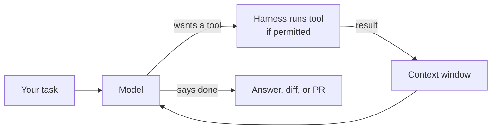
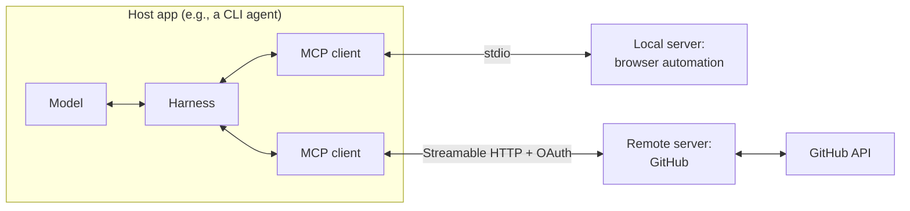

# 06: Harnesses, tools, and MCP

> **Audience:** everyone · **Reading time:** ~35 min · **Last verified:** 2026-11-08
> **Depth guide:** Students: Foundations + the decision table in In practice. Engineers: skim Foundations, read In practice and Going deeper. Leads: the history table, the closed-products table, and "How to choose a harness."

**TL;DR**
- A **harness** is everything around the model: the agent loop, the tools, the permission system, context management, and the user interface. Agent = model + harness. The same model can feel brilliant in one harness and clumsy in another.
- Coding tools went through five overlapping generations: autocomplete (2021), chat (2022), IDE agents (2023–2025), terminal (CLI) agents (2025), and cloud or background agents (2024–2025). Then came a sixth layer in 2026: desktop apps and orchestrators that drive several CLI agents at once.
- **MCP** (Model Context Protocol) is the open standard for plugging tools and data into any harness. Anthropic released it in November 2024. OpenAI, Google and Microsoft adopted it in 2025, and it moved to the Linux Foundation's Agentic AI Foundation in December 2025. Its main costs are context bloat and security risk.
- Modern harnesses share a common kit: instruction files, **skills**, **subagents**, **hooks**, slash commands, plugins, permission modes and sandboxes, git worktrees, and checkpoints. Learn the concepts once. They transfer across tools.
- Closed products such as Claude Design, Claude in Chrome, ChatGPT agent and Google Antigravity bundle a model, a harness and tools into one experience. They are convenient, and you can't easily see inside them or swap their parts.
- Choose a harness for model access, cost model, privacy, extensibility, and what your team already uses. Don't choose on demo videos.

## Foundations

### What a harness is

A large language model (LLM) on its own does one thing. It takes text in and predicts text out (see [module 01](./01-what-is-an-llm.md)). It cannot open a file, run a test, or remember yesterday's conversation. Everything that turns that text predictor into something that edits your codebase is the **harness**.

A useful working definition:

> **Harness** = agent loop + tools + permissions + context management + user interface.
> **Agent** = model + harness.

Each part, in plain terms:

| Part | What it does | Example |
| --- | --- | --- |
| **Agent loop** | Calls the model, runs any tool the model asks for, feeds the result back, and repeats until the model says it's done | "Read `auth.py`" → file contents → "Edit line 40" → diff → "Run tests" → output → ... |
| **Tools** | Functions the model may call, each described by a name, a description and an input schema | `read_file`, `edit_file`, `bash`, `web_fetch`, `search` |
| **Permissions** | Rules about which tool calls run automatically, which need your approval, and which are forbidden | "Allow `npm test`; ask before `git push`; never `rm -rf`" |
| **Context management** | Decides what goes into the model's limited context window and what gets summarized or dropped | Loading instruction files, compacting long sessions, giving subagents fresh windows |
| **User interface** | How you see and steer the work | Terminal UI, IDE panel, web dashboard, desktop app, Slack bot |

The loop itself is simple. Most agents today are a variant of the **ReAct** pattern (reason, then act, then observe), described by [Yao et al. (2022)](https://arxiv.org/abs/2210.03629):



Analogy: the model is an engine. The harness is the rest of the car: steering, brakes, dashboard, fuel system. A great engine in a badly built car is still a bad car.

### Why the same model behaves differently in different harnesses

People often say "model X is bad at Y" when the real cause is the harness. Several harness choices change results a lot:

- **Tool design.** The SWE-agent paper ([Yang et al., 2024](https://arxiv.org/abs/2405.15793)) showed that giving a model a purpose-built "agent-computer interface" (compact file viewers, a search tool, an editor that lints on save) made the same model much better at fixing real GitHub issues than giving it a raw shell.
- **System prompt and defaults.** In April 2026 Anthropic published a [postmortem](https://www.anthropic.com/engineering/april-23-postmortem) on user complaints that Claude Code had gotten worse. The cause wasn't the model weights. It was three harness-level changes: a lower default reasoning effort, a context-management bug that cleared earlier reasoning on every turn, and a system-prompt line that capped how much the model wrote between tool calls. All three were reverted or fixed.
- **Context management.** How a harness compacts history, loads instruction files, and returns tool output decides what the model can "see" at each step (see [module 07](./07-context-engineering.md)).
- **Permissions and interruptions.** A harness that asks for approval on every command trains you to click "yes" without reading. One that never asks can do damage. Both change outcomes.
- **Benchmarks.** Agentic benchmark scores depend on the scaffold used to run them. When two vendors report the same benchmark with different harnesses, the numbers aren't directly comparable (see [module 05](./05-judging-models.md)).

The practical lesson: when you evaluate a model for coding, evaluate it **in the harness you will actually use**.

### A short history: from autocomplete to orchestrators

The generations overlap. Every one of them is still in use.

| Generation | Arrived | Examples | What you do | What the tool does |
| --- | --- | --- | --- | --- |
| **1. Autocomplete** | 2021 | GitHub Copilot ([technical preview June 29, 2021](https://github.blog/news-insights/product-news/introducing-github-copilot-ai-pair-programmer/)), built on OpenAI Codex ([Chen et al., 2021](https://arxiv.org/abs/2107.03374)) | Type code | Suggests the next line or block |
| **2. Chat** | late 2022 | ChatGPT, Claude.ai, IDE chat panels | Paste code, ask questions, copy answers back | Explains, drafts, reviews snippets |
| **3. IDE agents** | 2023–2025 | Cursor, Windsurf, Copilot agent mode, Cline | Describe a change inside your editor | Edits many files, runs commands, shows diffs to accept |
| **4. CLI agents** | 2025 | Claude Code (research preview [Feb 24, 2025](https://www.anthropic.com/news/claude-3-7-sonnet)), Codex CLI (Apr 2025), Gemini CLI (Jun 2025), OpenCode, Amp, Factory Droid, Cursor CLI, Copilot CLI, Crush | Give a task in the terminal | Explores the repo, edits, runs tests, commits |
| **5. Cloud / background agents** | 2024–2025 | Devin (2024), Codex cloud (May 2025), [Copilot coding agent](https://github.blog/news-insights/product-news/github-copilot-meet-the-new-coding-agent/) (May 19, 2025), Jules (2025), [Claude Code on the web](https://claude.com/blog/claude-code-on-the-web) (Oct 20, 2025), Cursor cloud agents | Assign an issue or task, walk away | Works in a remote sandbox, opens a pull request |
| **6. Desktop GUIs and orchestrators** | 2025–2026 | Conductor, [T3 Code](https://github.com/pingdotgg/t3code), Codex app (Feb 2, 2026), Claude desktop app, Gas Town, OpenHands Agent Canvas | Supervise several agents at once | Runs many CLI agents in parallel, each in its own git worktree, and shows their diffs side by side |

A few points of detail worth knowing:

- **Why the terminal won in 2025.** The shell is the universal tool. An agent that can run any command can build, test, lint, query a database and call `gh` without anyone writing a special integration. CLI agents also run headless, so the same agent works in CI, in scripts, and in cloud sandboxes.
- **Generation 6 wraps generation 4.** Tools like Conductor and T3 Code are not agents themselves. They drive the CLI agents you already have installed and signed into, and they add a GUI, parallel sessions, and diff review. T3 Code describes itself as an "agent harness control surface." It is MIT-licensed, comes from Theo Browne's company (the `pingdotgg` GitHub organization), and supports Claude Code, Codex, Cursor, OpenCode, Antigravity and others. Its README calls it "very very early." Conductor (from Melty Labs) is a Mac app that runs parallel Claude Code, Codex and Cursor agents in isolated workspaces.
- **Gas Town** (Steve Yegge, January 2026) is an orchestrator for 20–30 agents with named roles: a "Mayor" coordinator, "polecat" workers, and a "Refinery" merge queue. It sits at the top of Yegge's eight-stage ladder of AI coding workflows (see [module 08](./08-agentic-workflows.md) and [module 13](./13-open-source-ecosystem.md)).

**Status changes worth knowing (as of November 2026).** This market consolidates fast. Check before you standardize on anything.

- **Gemini CLI** is now aimed at enterprise Gemini Code Assist on Google Cloud. On June 18, 2026, free individual access and the Google AI Pro/Ultra plans moved to Google's **Antigravity CLI** (`agy`), per the [Gemini CLI README](https://github.com/google-gemini/gemini-cli).
- **Cursor** was [acquired by SpaceX](https://cursor.com/blog/joining-spacex) on August 14, 2026.
- **Windsurf** split in July 2025. Google licensed its technology and hired its leaders, and the team went on to build Antigravity. Cognition (maker of Devin) acquired the rest of the company.
- **Roo Code**, a popular open-source IDE agent, [shut down its extension on May 15, 2026](https://github.com/RooCodeInc/Roo-Code). **Continue** is [archived and read-only](https://github.com/continuedev/continue). See [module 13](./13-open-source-ecosystem.md).
- **Amp** [spun out of Sourcegraph](https://ampcode.com/news/amp-inc) as its own company in late 2025.
- **Codex** started as a CLI (April 2025) and a cloud agent (May 2025). By late 2026, OpenAI's docs list Codex across the ChatGPT desktop, web and mobile apps plus the CLI, IDE extension and cloud ([learn.chatgpt.com](https://learn.chatgpt.com/docs)).

### Tools: how a model "does" things

A **tool** is a function the harness exposes to the model. The harness sends the model a list of tool definitions. Each definition has a name, a plain-English description, and a JSON Schema for the inputs. When the model wants to act, it outputs a structured **tool call**. The harness checks permissions, runs the function, and puts the result back into the context.

```json
{
  "name": "run_tests",
  "description": "Run the project's test suite. Use after editing code. Returns pass/fail and failing test output.",
  "input_schema": {
    "type": "object",
    "properties": {
      "path": { "type": "string", "description": "Optional test file or directory" }
    }
  }
}
```

Two things follow from this design:

1. **Tool descriptions are prompts.** The model chooses tools from their names and descriptions. Vague descriptions produce wrong tool choices. Anthropic's guide [Writing effective tools for agents](https://www.anthropic.com/engineering/writing-tools-for-agents) (September 2025) treats tool design as a core engineering task.
2. **Every tool definition costs context.** Definitions are sent on every model call. Fifty tools can eat a large share of the window before you type anything. This is the root of the "MCP bloat" problem below.

### MCP: the Model Context Protocol

Before MCP, every harness needed custom code for every integration. Ten harnesses times a hundred services meant a thousand integrations. MCP turns that into ten clients plus a hundred servers.

**What it is.** MCP is an open protocol that Anthropic [announced on November 25, 2024](https://www.anthropic.com/news/model-context-protocol). It standardizes how an AI application discovers and calls external tools and data. Anthropic's own analogy is a USB-C port for AI applications.

**The pieces:**

| Term | Meaning |
| --- | --- |
| **Host** | The AI application you use: Claude Code, Codex, Cursor, VS Code, ChatGPT |
| **Client** | The connector inside the host that talks to one server |
| **Server** | A program that exposes capabilities: a GitHub server, a Postgres server, a browser-automation server |
| **Tools** | Functions the model can call (`create_issue`, `query`, `click`) |
| **Resources** | Data the application can read (files, records, documents), addressed by URI |
| **Prompts** | Reusable prompt templates a server offers, often surfaced as slash commands |
| **Messages** | JSON-RPC 2.0 requests and responses |
| **Transports** | **stdio** (the host launches the server as a local subprocess and talks over standard input/output) or **Streamable HTTP** (the server runs remotely, usually with OAuth) |



**A minimal mental model.** An MCP server is a small adapter. It says "here are my tools and their schemas," then it executes calls and returns results. The harness turns those tools into entries in the model's tool list. From the model's point of view, an MCP tool looks like any other tool.

**A tiny config example.** Most harnesses configure servers in a JSON or TOML file. In Claude Code, a project-level `.mcp.json` might look like this. The first server runs locally over stdio. The second is GitHub's hosted server over HTTP, with the token read from an environment variable rather than written into the file:

```json
{
  "mcpServers": {
    "playwright": {
      "command": "npx",
      "args": ["@playwright/mcp@latest"]
    },
    "github": {
      "type": "http",
      "url": "https://api.githubcopilot.com/mcp/",
      "headers": { "Authorization": "Bearer ${GITHUB_PAT}" }
    }
  }
}
```

Codex CLI uses TOML in `~/.codex/config.toml` for the same idea:

```toml
[mcp_servers.playwright]
command = "npx"
args = ["@playwright/mcp@latest"]
```

Writing a server is also small. With the official Python SDK, a working server is about ten lines (check the [SDK docs](https://modelcontextprotocol.io/docs/getting-started/intro) for the current API):

```python
from mcp.server.fastmcp import FastMCP

mcp = FastMCP("tickets")

@mcp.tool()
def open_tickets(team: str) -> list[str]:
    """List open ticket titles for a team. Use before planning work."""
    return lookup_tickets(team)  # your code here

if __name__ == "__main__":
    mcp.run()  # stdio transport by default
```

**How it spread.** MCP went from one company's spec to industry plumbing in about a year:

| When | What happened |
| --- | --- |
| Nov 25, 2024 | Anthropic releases MCP with SDKs and reference servers |
| Mar 2025 | The spec adds the Streamable HTTP transport, replacing the older HTTP+SSE transport |
| Mar 26, 2025 | OpenAI adds MCP to its Agents SDK and says ChatGPT desktop and the Responses API will follow |
| Apr 2025 | Google DeepMind's CEO says Gemini models and SDK will support MCP. Gemini CLI ships with MCP support in June |
| May 2025 | Microsoft announces MCP support across GitHub, Copilot Studio, and Windows at its Build conference |
| Sep 8, 2025 | The official [MCP Registry](https://registry.modelcontextprotocol.io) launches in preview |
| Dec 9, 2025 | Anthropic [donates MCP](https://www.linuxfoundation.org/press/linux-foundation-announces-the-formation-of-the-agentic-ai-foundation) to the new **Agentic AI Foundation (AAIF)** under the Linux Foundation, alongside Block's goose and OpenAI's AGENTS.md |
| Jan 26, 2026 | **MCP Apps** ships as an official extension: tools can return interactive UI (forms, dashboards) that the host renders in a sandboxed iframe. It launched in Claude, goose and VS Code Insiders, with ChatGPT support rolling out the same week ([MCP blog](https://blog.modelcontextprotocol.io/posts/2026-01-26-mcp-apps/)) |
| Jul 28, 2026 | The [2026-07-28 specification](https://modelcontextprotocol.io/specification/2026-07-28/changelog) makes MCP **stateless**: no initialize handshake, no protocol sessions, version and capabilities sent with every request. Roots, Sampling and Logging are deprecated |

The stateless redesign matters to people who run servers. A stateless server can sit behind an ordinary load balancer, which makes hosted MCP much easier to scale. The three primitives you build with (tools, resources, prompts) are unchanged.

**Criticisms, and they are fair:**

- **Context bloat.** Every connected server's tool definitions load into context. Anthropic's [advanced tool use post](https://www.anthropic.com/engineering/advanced-tool-use) (November 2025) gives a typical five-server setup as "58 tools consuming approximately 55K tokens before the conversation even starts." It also reports seeing 134K tokens of tool definitions internally before optimization. Large tool lists also make tool selection less accurate.
- **Security.** An MCP server is code you run with your credentials. A malicious or compromised server can lie in its tool descriptions ("tool poisoning"), change behavior after you approve it, or exfiltrate data. Any server that reads untrusted content (web pages, issues, emails) is a prompt-injection channel. [Hou et al. (2025)](https://arxiv.org/abs/2503.23278) survey the threat landscape, and [module 11](./11-security-and-prompt-injection.md) covers defenses.
- **Quality varies.** Many community servers are thin API wrappers with poor descriptions and huge outputs. The official reference servers are labeled educational examples, "not production-ready solutions" ([modelcontextprotocol/servers](https://github.com/modelcontextprotocol/servers)).
- **"Just use the CLI."** Many engineers find that an agent with shell access does better with `gh`, `psql` or `kubectl` than with an MCP wrapper of the same service. The model already knows those CLIs from training, and their output can be filtered with `grep` or `jq` before it hits context.

**Code execution with MCP ("code mode").** Two posts in late 2025 proposed the same fix for bloat. Cloudflare's [Code Mode](https://blog.cloudflare.com/code-mode/) (September 26, 2025) converts MCP tools into a TypeScript API and has the model write code that calls it, in a sandbox. Its argument: "LLMs are better at writing code to call MCP, than at calling MCP directly." Anthropic's [Code execution with MCP](https://www.anthropic.com/engineering/code-execution-with-mcp) (November 4, 2025) presents servers as code files on a filesystem that the agent browses on demand. In its example, token use dropped "from 150,000 tokens to 2,000 tokens," a 98.7% saving, because intermediate data stayed in the sandbox instead of passing through the model. Related harness features include **tool search** (load a small search tool first and fetch definitions only when needed; Anthropic reported an 85% token reduction) and **programmatic tool calling**.

**A2A, for contrast.** Google announced the **Agent2Agent (A2A)** protocol in April 2025 and gave it to the Linux Foundation that June ([a2a-protocol.org](https://a2a-protocol.org/)). MCP connects an agent to tools and data. A2A connects one agent to another agent, possibly built by a different vendor, so they can delegate tasks and exchange results. In coding work you will meet MCP daily and A2A rarely.

### The rest of the harness toolkit

By 2026 the major harnesses had converged on a shared set of features. Names differ slightly between products, and the ideas are the same. Examples here use Claude Code's terms because its [docs](https://code.claude.com/docs/en/features-overview) are detailed. Codex, Cursor, OpenCode and others have close equivalents.

| Feature | What it is | Use it for | Watch out for |
| --- | --- | --- | --- |
| **Instruction files** (`CLAUDE.md`, `AGENTS.md`) | Markdown loaded into every session | Build commands, conventions, non-obvious gotchas | Bloat. Keep them short ([module 07](./07-context-engineering.md)) |
| **Skills** | A folder with a `SKILL.md` (name, description, instructions) plus optional scripts. Only the name and description load up front; the body loads when relevant | Repeatable procedures: "how we cut a release," "how to write a migration" | Skills can run code. Treat third-party skills like dependencies |
| **Subagents** | A separate agent with its own fresh context window, its own tools, and its own instructions, launched by the main agent | Exploring a big codebase, running a review, isolating noisy work | Extra tokens. Summaries can lose detail |
| **Hooks** | Your shell commands that the harness runs at fixed lifecycle events (before a tool call, after an edit, when the agent tries to stop) | Deterministic enforcement: format on save, block dangerous commands, refuse to finish while CI is red | A buggy hook can block all work. Keep them fast |
| **Slash commands** | Saved prompts you trigger by name (`/review`, `/deploy-check`) | Team workflows you run often | In Claude Code these have been folded into skills |
| **Plugins and marketplaces** | Bundles of skills, hooks, subagents and MCP servers, installed from a git-hosted "marketplace" | Sharing a team's setup in one install | Supply-chain risk, as with any package |
| **Permission modes** | Presets for how much the agent may do without asking: plan-only, ask-every-time, auto-accept edits, classifier-approved "auto," or bypass | Matching autonomy to risk | "Bypass all" mode on your real machine |
| **Sandboxing** | OS-level limits on which files and network hosts commands can reach; or a container, VM, or cloud sandbox | Letting agents run longer without approvals | Configuration effort. Leaky allowlists |
| **Git worktrees** | Several working directories on one repository, each on its own branch | Running parallel agents without collisions | Disk use. Clean up finished worktrees |
| **Checkpoints** | Automatic snapshots of file edits (and conversation) you can rewind | Undoing a bad turn quickly | Not a replacement for git commits |
| **Scheduling and loops** | Re-run a prompt on an interval (`/loop`), until a condition holds (`/goal`), or on a cloud schedule | Babysitting CI, nightly triage | Runaway token spend ([module 07](./07-context-engineering.md)) |

Three of these deserve more explanation.

**Skills.** Anthropic introduced [Agent Skills](https://www.anthropic.com/engineering/equipping-agents-for-the-real-world-with-agent-skills) on October 16, 2025 and published the format as an open standard at [agentskills.io](https://agentskills.io) on December 18, 2025. On October 22, 2026 it [donated the standard to the AAIF](https://www.anthropic.com/news/donating-agent-skills-to-the-agentic-ai-foundation), reporting that more than 70 agent platforms had integrated it, including ChatGPT, Cursor, GitHub Copilot and VS Code. The key idea is **progressive disclosure**. The agent sees a one-line description of every skill and reads the full instructions only when a task calls for them. That lets you keep dozens of procedures available without paying for them in every prompt.

**Hooks.** Hooks are the deterministic part of an otherwise probabilistic system. Prose in an instruction file is a request. A hook is a rule that runs every time. Claude Code's docs say so directly: instruction files are treated "as context, not enforced configuration," and to block an action regardless of what the model decides, you use a hook ([memory docs](https://code.claude.com/docs/en/memory)).

A formatter hook, from the [hooks guide](https://code.claude.com/docs/en/hooks-guide), runs Prettier after every file edit:

```json
{
  "hooks": {
    "PostToolUse": [
      {
        "matcher": "Edit|Write",
        "hooks": [
          { "type": "command", "command": "jq -r '.tool_input.file_path' | xargs npx prettier --write" }
        ]
      }
    ]
  }
}
```

A `Stop` hook runs when the agent tries to end its turn. If the hook returns `{"decision": "block", "reason": "..."}`, the agent keeps working and sees the reason. This script refuses to let the agent declare victory while CI is still running on the current branch:

```bash
#!/usr/bin/env bash
# .claude/hooks/ci-gate.sh: block "done" while CI is pending on this branch.
input=$(cat)
# If this hook already blocked once this turn, let the agent stop (avoids loops).
[ "$(echo "$input" | jq -r '.stop_hook_active')" = "true" ] && exit 0
branch=$(git branch --show-current)
pending=$(gh run list --branch "$branch" --limit 5 --json status \
  --jq '[.[] | select(.status != "completed")] | length')
if [ "${pending:-0}" -gt 0 ]; then
  echo '{"decision":"block","reason":"CI is still running. Watch it with gh run watch and report the result before finishing."}'
fi
exit 0
```

**Permission modes and auto mode.** Approval prompts sound safe, but people stop reading them. Anthropic [reported](https://www.anthropic.com/engineering/claude-code-auto-mode) in March 2026 that users approve 93% of permission prompts. Its "auto mode" hands routine approvals to a classifier model and keeps hard blocks for risky actions. Anthropic was candid about the limits: the full pipeline still missed 17% of "overeager" actions in its tests, and it is "not a drop-in replacement for careful human review on high-stakes infrastructure." The safer pattern for long unattended runs is a real sandbox (container, VM, or cloud environment) with limited credentials.

## In practice

### Closed products that bundle model, harness and tools

Some products hide the harness entirely. You get one experience in which the vendor picked the model, the loop, the tools and the UI. These are often the fastest way to get a specific job done. You can't swap the model, inspect the prompts, or move your workflow elsewhere easily. Model tiers behind each product change often; see [module 03](./03-model-landscape.md).

| Product | Maker, launch | What it is | Good for |
| --- | --- | --- | --- |
| **Claude Code** (CLI, desktop, web, IDE, Slack) | Anthropic, Feb 2025 | Anthropic's coding agent, with cloud sessions, scheduled tasks and code review | Day-to-day agentic coding |
| **Claude Design** | Anthropic Labs, [Apr 17, 2026](https://www.anthropic.com/news/claude-design-anthropic-labs) (research preview) | Chat-driven design canvas for prototypes, slides and one-pagers. It can apply a team's design system and export to Canva, PDF, PPTX or HTML. A finished design can be packaged as a handoff bundle for Claude Code | Turning an idea into a clickable prototype or deck before writing production code |
| **Claude Cowork** | Anthropic, Jan 2026 (research preview) | Claude Code's agent loop for non-coding knowledge work on folders and tools you choose. By late 2026 Anthropic had folded it into the main Claude app ([product page](https://claude.com/blog/cowork-research-preview)) | Document, spreadsheet and research chores |
| **Claude in Chrome** | Anthropic, [Aug 2025](https://claude.com/blog/claude-for-chrome) (preview), wider beta late 2025 | Browser extension that lets Claude click, type and navigate for you | Web workflows and testing web apps |
| **Artifacts** | Anthropic, 2024 | Claude renders code as live, shareable pages and apps in the chat | Quick internal tools, visual explanations |
| **Codex app and automations** | OpenAI, Feb 2, 2026 | Desktop command center for parallel Codex agents in worktrees, with scheduled "automations" whose results land in a review queue | Supervising several coding tasks; recurring triage |
| **ChatGPT agent** and **Atlas** | OpenAI, Jul 2025 and Oct 2025 | An agent mode in ChatGPT with its own browser and terminal, and a full web browser with an agent built in | Research and multi-step web tasks |
| **Cursor** with **Composer** | Anysphere, Composer [Oct 29, 2025](https://cursor.com/blog/composer) | IDE plus cloud agents. Composer is Cursor's own coding model, trained with reinforcement learning inside Cursor's tools for speed | Fast in-editor agent loops |
| **Google Antigravity** | Google, Nov 18, 2025 | An agent-first IDE built by the former Windsurf team, with editor, terminal and browser agents. Now paired with Antigravity CLI | Teams centered on Gemini models |
| **Devin**, **Jules**, **Copilot coding agent** | Cognition (2024), Google (2025), GitHub (2025) | Cloud agents you assign tasks to; they return pull requests | Well-scoped backlog tickets |

Two cautions apply to all of them:

- **Browser and computer-use agents are the riskiest category.** They read untrusted web content while holding your logged-in sessions. Anthropic's own Chrome launch post reported a 23.6% prompt-injection attack success rate without mitigations and 11.2% with them in its tests. Better, and still not zero. Read [module 11](./11-security-and-prompt-injection.md) before you point one at your email or bank.
- **Bundled products change underneath you.** The vendor can change the model, the prompts or the limits at any time. That is fine for prototypes. For a workflow your team depends on, prefer tools whose configuration you can see and version.

### How to choose a harness

No harness is best for everyone. Score the candidates against what your team needs:

| Question | Why it matters | What to look for |
| --- | --- | --- |
| **Model access** | Some harnesses lock you to one vendor's models | Single-vendor (Claude Code, Codex, Antigravity) vs. bring-any-model (OpenCode, Cline, Kilo Code, Aider, Cursor) |
| **Cost model** | Agentic work burns many tokens | Flat subscription vs. per-token API billing vs. seat pricing ([module 12](./12-costs-subscriptions-and-apis.md)) |
| **Team standardization** | Shared configuration only pays off if everyone uses the same tool, or the same standards | Does it read `AGENTS.md`? Support Agent Skills and MCP? Have managed settings for organizations? |
| **Privacy and data** | Code is sensitive | Data retention terms, zero-data-retention options, cloud vs. local execution, self-hosted runners, local models ([module 04](./04-open-vs-closed-weights.md)) |
| **Extensibility** | You will want to encode team knowledge | Hooks, skills, plugins, MCP, an SDK for custom agents |
| **Autonomy and safety** | Long runs need guardrails | Permission modes, sandboxing, worktree support, audit logs |
| **Where the work happens** | Fit with how people already work | Terminal, IDE, browser, GitHub issues, Slack |
| **Vendor durability** | Tools get acquired, pivot, or shut down | Open-source license, foundation governance, a portable configuration format |

Some starting recommendations by situation:

| If you are... | Start with... | Because... |
| --- | --- | --- |
| A student learning the craft | One CLI agent plus its IDE extension, with approvals on | You see every action and learn what the agent does |
| An engineer on a team already using an IDE | That IDE's agent mode, plus one CLI agent for bigger tasks | Lowest friction; the CLI handles multi-file work |
| A team that must keep code on-premises | An open-source, model-agnostic harness with a self-hosted or local model | You control where code and prompts go |
| A lead standardizing a team | Pick one primary harness; put shared knowledge in `AGENTS.md`, skills and hooks | Those formats work across most harnesses, so a later switch is cheap |
| Someone running many tasks at once | A CLI agent plus a worktree-based GUI or orchestrator | Parallelism without branch collisions ([module 08](./08-agentic-workflows.md)) |

### A sane baseline setup

A setup checklist that works in most harnesses:

1. **Pick one primary CLI agent** and learn its permission modes before you raise autonomy.
2. **Write a short `AGENTS.md`** (or `CLAUDE.md`) with build, test and lint commands and the few conventions an agent can't infer. Aim for well under 200 lines ([module 07](./07-context-engineering.md)).
3. **Add hooks for what must always happen:** a formatter after edits, a guard against destructive commands, a check that tests pass before the agent says "done."
4. **Connect one to three MCP servers you actually need.** Prefer an existing CLI when the agent already knows it. Check the context cost of each server with your harness's context view (in Claude Code, `/context`).
5. **Move repeated procedures into skills** instead of pasting them into the instruction file.
6. **Use worktrees** before running two agents on one repository.
7. **Turn on a sandbox** before you turn off approvals.
8. **Commit often.** Checkpoints are convenient. Git is the real safety net.

### Common failure modes

- **Too many MCP servers.** Context fills with tool definitions, tool choice gets worse, and costs rise. Disconnect what you don't use this week.
- **Trusting a server or skill because it is popular.** Popularity is not an audit. In early 2026, hundreds of malicious skills appeared on OpenClaw's public skill registry ([module 13](./13-open-source-ecosystem.md)).
- **Approval fatigue.** You click "yes" on the fortieth prompt without reading it. Use allowlists and sandboxes so the prompts that remain matter.
- **Blaming the model for a harness problem.** Before you switch models, check the harness version, the effort setting, recent instruction-file edits, and connected servers.
- **Harness lock-in by accident.** Team knowledge locked in one vendor's proprietary format is expensive to move. Prefer `AGENTS.md`, Agent Skills and MCP.
- **Leaving worktrees and sandboxes behind.** Parallel agents create many checkouts and build directories. Clean them up when a task is done.

## Going deeper

### The harness is now an engineering discipline

Two 2026 essays named the work of improving the harness. Mitchell Hashimoto's [My AI Adoption Journey](https://mitchellh.com/writing/my-ai-adoption-journey) (February 5, 2026) calls it "harness engineering": whenever an agent makes a mistake, engineer a fix so it never makes that mistake again. OpenAI's [Harness engineering](https://openai.com/index/harness-engineering/) post (February 11, 2026) describes a team that shipped an internal product of about a million lines with no hand-written code, by investing in docs, linters, structural tests and feedback loops for Codex. [Module 07](./07-context-engineering.md) places this on the larger buzzword ladder.

Anthropic's engineering posts show how much harness design matters for long tasks. [Effective harnesses for long-running agents](https://www.anthropic.com/engineering/effective-harnesses-for-long-running-agents) (November 2025) and [Harness design for long-running application development](https://www.anthropic.com/engineering/harness-design-long-running-apps) (March 2026) describe initializer agents, progress files, and separate evaluator agents. Cursor's [self-driving codebases](https://cursor.com/blog/self-driving-codebases) research (February 2026) ran a planner, sub-planner and worker hierarchy for about a week to build a web browser. Its finding: agents follow instructions closely, including bad ones, and infrastructure such as disk I/O became the bottleneck.

### Why harness features converge

Look at the feature table above and you will find nearly every item in every major harness by late 2026. Features are cheap to copy, and the good ideas are visible in open-source projects ([module 13](./13-open-source-ecosystem.md)). Aider's repository map, the Ralph loop, worktree-per-agent orchestration, and skills all spread within months. Two consequences follow. Your skills transfer between tools. And no harness keeps a feature lead for long, so durable advantages come from the model, the integration with where work already happens, and the price.

### MCP vs. CLIs vs. code: an open debate

There are three ways to give an agent a capability:

1. **An MCP tool.** Structured, discoverable, works in hosts with no shell (chat apps, IDEs), supports OAuth for remote services. Costs context; quality varies.
2. **A CLI the agent runs in a shell.** Uses knowledge from training, composes with pipes, costs nothing until used. Needs a shell and a sandbox, and has no standard auth story.
3. **Code against an API, in a sandbox ("code mode").** Most token-efficient for multi-step data work. Needs a secure execution environment.

The trend through 2026 has been toward hybrids. Harnesses load tool definitions lazily (tool search), present MCP servers as code APIs, and let skills bundle scripts. If you're building an integration for others, MCP is the portable choice. If you're giving your own agent a capability, try the CLI first.

### Permission systems are a security boundary, not a UX detail

The permission system is where the harness meets [module 11](./11-security-and-prompt-injection.md). An agent that can read untrusted input, access private data, and communicate externally has all three parts of Simon Willison's "lethal trifecta." Permission modes, network allowlists, credential scoping and sandboxes are how you break at least one leg. Anthropic's [How we contain Claude across products](https://www.anthropic.com/engineering/how-we-contain-claude) (May 2026) is a useful look at how a vendor layers these defenses.

## Bryan's take

> **Bryan's take:** My daily setup is several CLI agents running in parallel, each in its own worktree, which I manage by hand. I drive them through T3 Code, which lets me run Claude and Codex side by side, the two model families I think are best for code ([module 03](./03-model-landscape.md)). That puts me at roughly stage 6–7 on Yegge's eight-stage ladder ([module 08](./08-agentic-workflows.md)). I'm not running a fully autonomous orchestrator, because I haven't gotten reliable results from one.

A harness's cost model matters as much as its features. Bryan's view that subscriptions are what make heavy agentic use affordable is in [module 12](./12-costs-subscriptions-and-apis.md).

## Try it

**Individual exercise: build and measure a harness setup (60–90 minutes).**
1. Install one CLI agent. Open a small project you know, and ask the agent to explain the architecture. Note which tools it calls.
2. Check the context breakdown (in Claude Code, `/context`; other harnesses have similar views). Write down how many tokens the system prompt, tool definitions and instruction files use before you type anything.
3. Connect one MCP server (Playwright or GitHub). Check the context breakdown again. How many tokens did it add?
4. Add a `PostToolUse` formatter hook and confirm it runs after an edit.
5. Write a `Stop` hook that blocks "done" until the tests pass. Give the agent a task that breaks a test and watch the hook push it back.
6. Write one paragraph: what did the harness do that the model alone couldn't?

**Class or team exercise: same model, different harnesses (one session).**
Split into three groups. Give every group the same small, well-specified task, such as adding a feature with tests to a sample repository. Each group uses a different harness, and where possible the same model tier. Record time to a green test run, number of human interventions, tokens or cost, and diff quality as judged by another group. Then discuss which differences came from the harness and which came from the people.

## Discussion questions

1. If "agent = model + harness," which part matters more for your work today? What would change your answer?
2. MCP moved from one company to a Linux Foundation project in about a year. What does neutral governance buy users? What does it not buy?
3. When should a capability be an MCP server, a CLI the agent calls, or a skill with a script? Give an example of each from your own work.
4. Approval prompts get approved about 93% of the time. Is a prompt you always approve a safety feature? What would you replace it with?
5. Closed bundles such as Claude Design or Antigravity are convenient. What would make you trust one with production work?
6. Several popular tools were acquired, pivoted or shut down in 2026. How should a team protect itself from that churn?

## Sources and further reading

**Papers**
- [Evaluating Large Language Models Trained on Code](https://arxiv.org/abs/2107.03374) (Chen et al., 2021): the Codex model behind the original Copilot.
- [ReAct: Synergizing Reasoning and Acting in Language Models](https://arxiv.org/abs/2210.03629) (Yao et al., 2022): the reason–act–observe loop most agents use.
- [SWE-agent: Agent-Computer Interfaces Enable Automated Software Engineering](https://arxiv.org/abs/2405.15793) (Yang et al., 2024): evidence that interface and tool design change agent performance.
- [Model Context Protocol (MCP): Landscape, Security Threats, and Future Research Directions](https://arxiv.org/abs/2503.23278) (Hou et al., 2025).

**Primary sources: MCP and standards**
- Anthropic, [Introducing the Model Context Protocol](https://www.anthropic.com/news/model-context-protocol) (Nov 25, 2024).
- [MCP documentation](https://modelcontextprotocol.io/docs/getting-started/intro) and the [2026-07-28 specification changelog](https://modelcontextprotocol.io/specification/2026-07-28/changelog).
- MCP blog, [MCP Apps](https://blog.modelcontextprotocol.io/posts/2026-01-26-mcp-apps/) (Jan 26, 2026).
- Linux Foundation, [Formation of the Agentic AI Foundation](https://www.linuxfoundation.org/press/linux-foundation-announces-the-formation-of-the-agentic-ai-foundation) (Dec 9, 2025).
- [MCP reference servers](https://github.com/modelcontextprotocol/servers) and the [MCP Registry](https://registry.modelcontextprotocol.io).
- Cloudflare, [Code Mode: the better way to use MCP](https://blog.cloudflare.com/code-mode/) (Sep 26, 2025).
- Anthropic, [Code execution with MCP](https://www.anthropic.com/engineering/code-execution-with-mcp) (Nov 4, 2025) and [Introducing advanced tool use](https://www.anthropic.com/engineering/advanced-tool-use) (Nov 24, 2025).
- [A2A protocol](https://a2a-protocol.org/).
- [Agent Skills specification](https://agentskills.io); Anthropic, [Equipping agents for the real world with Agent Skills](https://www.anthropic.com/engineering/equipping-agents-for-the-real-world-with-agent-skills) (Oct 16, 2025) and [Donating Agent Skills to the Agentic AI Foundation](https://www.anthropic.com/news/donating-agent-skills-to-the-agentic-ai-foundation) (Oct 22, 2026).

**Primary sources: harnesses and products**
- Anthropic, [Claude 3.7 Sonnet and Claude Code](https://www.anthropic.com/news/claude-3-7-sonnet) (Feb 24, 2025); [Claude Code on the web](https://claude.com/blog/claude-code-on-the-web) (Oct 20, 2025); [Claude for Chrome](https://claude.com/blog/claude-for-chrome) (Aug 2025); [Claude Design](https://www.anthropic.com/news/claude-design-anthropic-labs) (Apr 17, 2026); [Cowork](https://claude.com/blog/cowork-research-preview).
- Claude Code docs: [features overview](https://code.claude.com/docs/en/features-overview), [hooks guide](https://code.claude.com/docs/en/hooks-guide), [skills](https://code.claude.com/docs/en/skills), [subagents](https://code.claude.com/docs/en/sub-agents), [permission modes](https://code.claude.com/docs/en/permission-modes), [sandboxing](https://code.claude.com/docs/en/sandboxing), [worktrees](https://code.claude.com/docs/en/worktrees), [checkpointing](https://code.claude.com/docs/en/checkpointing), [plugins](https://code.claude.com/docs/en/plugins/overview).
- Anthropic engineering: [Writing effective tools for agents](https://www.anthropic.com/engineering/writing-tools-for-agents) (Sep 2025); [Effective harnesses for long-running agents](https://www.anthropic.com/engineering/effective-harnesses-for-long-running-agents) (Nov 2025); [How we built Claude Code auto mode](https://www.anthropic.com/engineering/claude-code-auto-mode) (Mar 2026); [Harness design for long-running application development](https://www.anthropic.com/engineering/harness-design-long-running-apps) (Mar 2026); [April 23 postmortem](https://www.anthropic.com/engineering/april-23-postmortem) (Apr 2026); [How we contain Claude across products](https://www.anthropic.com/engineering/how-we-contain-claude) (May 2026).
- OpenAI, [Codex repository](https://github.com/openai/codex) and [ChatGPT and Codex docs](https://learn.chatgpt.com/docs); [Harness engineering](https://openai.com/index/harness-engineering/) (Feb 11, 2026).
- GitHub, [Introducing GitHub Copilot](https://github.blog/news-insights/product-news/introducing-github-copilot-ai-pair-programmer/) (2021) and [Meet the new coding agent](https://github.blog/news-insights/product-news/github-copilot-meet-the-new-coding-agent/) (May 19, 2025).
- Cursor, [Composer](https://cursor.com/blog/composer) (Oct 29, 2025), [Self-driving codebases](https://cursor.com/blog/self-driving-codebases) (Feb 2026), [Joining SpaceX](https://cursor.com/blog/joining-spacex) (Aug 14, 2026).
- [Gemini CLI repository](https://github.com/google-gemini/gemini-cli) (status notice); [Google Antigravity](https://antigravity.google).
- [T3 Code](https://github.com/pingdotgg/t3code); [Conductor](https://conductor.build); [Gas Town](https://github.com/steveyegge/gastown).

**Commentary**
- Mitchell Hashimoto, [My AI Adoption Journey](https://mitchellh.com/writing/my-ai-adoption-journey) (Feb 5, 2026).
- InfoQ, [OpenAI's harness engineering](https://www.infoq.com/news/2026/02/openai-harness-engineering-codex) (Feb 2026).

## Terms introduced

- **Harness:** the software around a model (agent loop, tools, permissions, context management, UI) that turns it into an agent.
- **Agent loop:** the cycle of calling the model, running the tools it requests, and feeding results back until it finishes.
- **Tool / tool call:** a function a harness exposes to the model with a name, description and input schema; a tool call is the model's structured request to run one.
- **CLI agent:** a coding agent that runs in the terminal and acts through shell commands and file edits.
- **Cloud (background) agent:** an agent that runs in a remote sandbox and returns its work, usually as a pull request.
- **Orchestrator:** software that runs and coordinates several agents at once, often one per git worktree.
- **MCP (Model Context Protocol):** an open JSON-RPC protocol for connecting AI applications to tools, resources and prompts provided by servers.
- **MCP host / client / server:** the AI app; the connector inside it for one server; the program exposing capabilities.
- **stdio / Streamable HTTP:** MCP's two transports, for local subprocess servers and remote servers.
- **MCP Apps:** an MCP extension that lets tools return interactive UI rendered by the host.
- **Code mode (code execution with MCP):** presenting tools as a code API the model calls from a sandbox, to save context.
- **Tool search:** loading tool definitions on demand instead of all at once.
- **A2A (Agent2Agent):** a protocol for agents to delegate to and communicate with other agents.
- **Agentic AI Foundation (AAIF):** the Linux Foundation body that hosts MCP, AGENTS.md, goose and Agent Skills.
- **Skill:** a folder with a `SKILL.md` and optional scripts that an agent loads only when relevant.
- **Progressive disclosure:** showing an agent short descriptions first and full details only when needed.
- **Subagent:** a separate agent with a fresh context window launched by the main agent for a focused task.
- **Hook:** a user-defined command the harness runs at a lifecycle event, giving deterministic control.
- **Plugin / marketplace:** a bundle of skills, hooks, subagents and MCP servers; a git-hosted catalog of them.
- **Permission mode:** a preset for how much an agent may do without asking.
- **Auto mode:** a permission mode in which a classifier model approves routine actions.
- **Sandbox:** an environment that limits what files, network hosts and credentials an agent can reach.
- **Git worktree:** an additional working directory on the same repository, used to run agents in parallel.
- **Checkpoint:** an automatic snapshot of an agent's edits that you can rewind to.
- **Approval fatigue:** approving permission prompts without reading them because there are too many.
