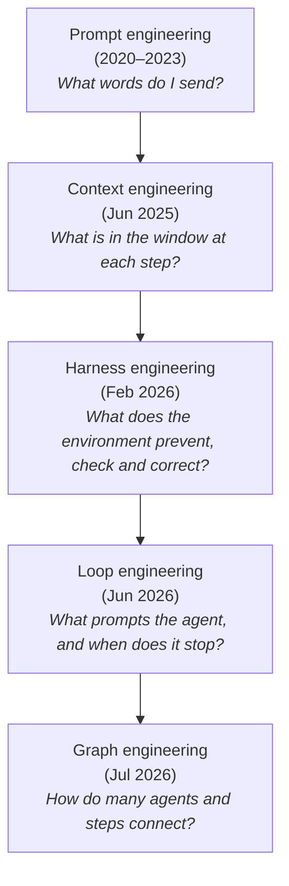
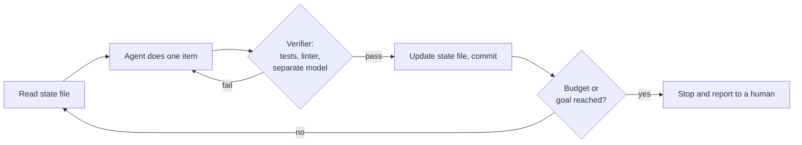

# 07: From prompt engineering to context, loop, and graph engineering

*About a 40-minute read. Last checked November 8, 2026.*

**TL;DR**
- From 2023 to 2026 the field went through a ladder of "___ engineering" buzzwords: prompt, context, harness, loop, graph. Each rung widens the scope, from the words to the whole context window, the agent's environment, the repetition, and finally how several agents connect.
- Some of it is real and some is rebranding. Context rot and harness effects are measurable, and loops with verifiers work when the end state is checkable. "Graph engineering" mostly renames workflow orchestration that existed in 2024.
- The prompting basics still matter. Be specific, give the reason, show examples, define "done," and give the agent a check it can run.
- A long context window doesn't mean the model uses all of it well. Performance drops as input grows, especially with distracting material ("Lost in the Middle," 2023; "Context Rot," 2025). Write state outside the window, select only what's needed, compress, and isolate work in subagents.
- Thousand-line `CLAUDE.md` and `AGENTS.md` files were common in 2025 and fell out of favor. Models follow instructions worse as the list grows, and a 2026 ETH Zurich study found that context files don't generally improve task success and raise cost by about 20%. Skills, path-scoped rules and hooks do the job better.
- What works now is a short file (well under 200 lines) with only what the agent can't learn from the code. Enforce the must-never rules with hooks and put procedures in skills.

## Foundations

### The buzzword ladder at a glance

Each term took off from a specific person or post, and each asks a broader question than the one before.



| Term | Popularized by | When | Honest definition | Substance or relabel? |
| --- | --- | --- | --- | --- |
| **Prompt engineering** | Practitioners after GPT-3's few-shot results ([Brown et al., 2020](https://arxiv.org/abs/2005.14165)) and chain-of-thought prompting ([Wei et al., 2022](https://arxiv.org/abs/2201.11903)) | 2020–2023 | Writing instructions and examples so a model gives the output you want | Substance. Still matters, now one piece of a larger whole |
| **Context engineering** | Tobi Lütke (Shopify), Jun 19, 2025; Andrej Karpathy, Jun 25, 2025; then LangChain (Jul 2025) and Anthropic (Sep 2025) | 2025 | Choosing everything that fills the context window at each step: instructions, tool definitions, retrieved files, history, memory | Mostly substance. It names a real problem (finite, degrading attention) with real techniques |
| **Harness engineering** | Mitchell Hashimoto, Feb 5, 2026; OpenAI's Codex team, Feb 11, 2026 | 2026 | Building the environment around the agent (tools, docs, linters, tests, hooks) so mistakes get prevented or caught automatically | Substance, with an old name underneath: it is developer-experience and CI work aimed at a new kind of user |
| **Loop engineering** | Precursor: Geoffrey Huntley's "Ralph" loop, Jul 2025. Popularized by Addy Osmani's essay, Jun 7, 2026, quoting Peter Steinberger | 2026 | Designing the system that prompts the agent repeatedly (schedules, goals, verifiers, state files) instead of prompting it by hand | Partly substance (verifiers, stopping rules, state) and partly packaging of cron plus a while-loop |
| **Graph engineering** | A Peter Steinberger post on X, Jul 18, 2026, and the discourse after it. An academic survey followed in Aug 2026 | 2026 | Designing the topology of multi-step or multi-agent systems: nodes, edges, shared state, checkpoints, routing | Mostly relabel. Anthropic described these patterns in Dec 2024; LangGraph shipped in 2024; workflow engines are decades old |
| **Spec-driven development** | GitHub Spec Kit (Sep 2025), AWS Kiro (Jul 2025) | 2025 | Writing a structured spec, plan and task list first, then having agents implement against it | Substance for larger features; heavy for small fixes |

### Prompt engineering

Prompt engineering is writing the instructions, examples and constraints you send to a model. It turned into a craft, and briefly a job title, once GPT-3 showed that a few examples in the prompt could steer a model without retraining ([Brown et al., 2020](https://arxiv.org/abs/2005.14165)). Chain-of-thought prompting showed that examples with the intermediate reasoning written out improved accuracy on reasoning tasks ([Wei et al., 2022](https://arxiv.org/abs/2201.11903)). [The Prompt Report](https://arxiv.org/abs/2406.06608) (Schulhoff et al., 2024) catalogs the many named techniques.

Then two things changed. Models got much better at guessing what you meant, so many tricks stopped mattering, and [reasoning models](./01-what-is-an-llm.md) now think before answering without being asked. And in agentic work, your typed prompt became a small fraction of what the model sees. The rest is tool definitions, files, command output and history. "Context engineering" covers that wider input.

### Context engineering

On June 19, 2025, Shopify CEO Tobi Lütke [wrote](https://simonwillison.net/2025/Jun/27/context-engineering/) that he preferred "context engineering" over "prompt engineering" because it "describes the core skill better: the art of providing all the context for the task to be plausibly solvable by the LLM." Six days later Andrej Karpathy added "+1," describing it as "the delicate art and science of filling the context window with just the right information for the next step." Simon Willison correctly predicted the term would stick.

The definitions that followed agree:

- LangChain's [Context Engineering for Agents](https://www.langchain.com/blog/context-engineering-for-agents) (July 2025) sorted the techniques into four buckets: **write** (save information outside the window), **select** (pull in only what's relevant), **compress** (keep only the tokens you need), and **isolate** (split context across subagents or sandboxes).
- Anthropic's [Effective context engineering for AI agents](https://www.anthropic.com/engineering/effective-context-engineering-for-ai-agents) (September 29, 2025) called context "a finite resource with diminishing marginal returns" and said the goal is "the smallest possible set of high-signal tokens" that makes the desired outcome likely.

A context window works more like a desk than a filing cabinet. Everything on the desk competes for attention, and a cluttered desk slows you down even when the right paper is somewhere in the pile.

### Harness engineering

On February 5, 2026, Mitchell Hashimoto (co-founder of HashiCorp, author of the Ghostty terminal) wrote up how he adopted AI in [My AI Adoption Journey](https://mitchellh.com/writing/my-ai-adoption-journey). Step 5 is "Engineer the Harness": "anytime you find an agent makes a mistake, you take the time to engineer a solution" so it never happens again. Sometimes the fix is a line in `AGENTS.md`; he writes that "each line in that file is based on a bad agent behavior." Sometimes it's a script, like a screenshot tool or a filtered test runner.

Six days later OpenAI published [Harness engineering: leveraging Codex in an agent-first world](https://openai.com/index/harness-engineering/) (Ryan Lopopolo, February 11, 2026). A small team, three engineers at first, built an internal product of about a million lines over roughly five months with no hand-written code. They reported that one big instruction file didn't work, so they replaced it with a short `AGENTS.md` (about 100 lines) that acts as a map into a `docs/` directory of design docs and execution plans. Linters and structural tests check that the docs and the architecture stay consistent.

Harness engineering asks what the environment should prevent, measure and correct, beyond choosing what the agent sees. [Module 06](./06-harnesses-and-tools.md) covers the harness itself.

### Loop engineering

The precursor was the Ralph technique (named after the Simpsons character Ralph Wiggum), which Geoffrey Huntley [described on July 14, 2025](https://ghuntley.com/ralph/). In its purest form it's one shell loop that feeds the same prompt file to a coding agent forever:

```bash
while :; do claude -p < PROMPT.md; done
```

That's the post's `claude-code` pseudocode adapted to the current `claude` binary in non-interactive print mode (`-p`). The prompt does the real work. It tells the agent to read a plan file, do the single most important remaining item, update the plan, and exit, so the next iteration starts with a fresh context window. Huntley was blunt about the limits: do one thing per loop, expect broken builds, use it for greenfield projects ("There's no way in heck would I use Ralph in an existing code base"), and keep senior engineers steering.

Addy Osmani's essay [Loop Engineering](https://addyosmani.com/blog/loop-engineering/) (June 7, 2026) popularized the name, though it doesn't say who coined it. He quotes Peter Steinberger: "You shouldn't be prompting coding agents anymore. You should be designing loops that prompt your agents." He also quotes Boris Cherny, who leads Claude Code at Anthropic: "I don't prompt Claude anymore. I have loops running that prompt Claude and figuring out what to do." He lists the parts: scheduled automations, worktrees, skills, plugins and connectors, verifier subagents, and state that lives outside the conversation, like a markdown file or an issue board. He also warns that "done" from a loop is "a claim and not a proof," and that loops invite "cognitive surrender."

The harnesses shipped features for it. Claude Code has [`/loop`](https://code.claude.com/docs/en/scheduled-tasks) (re-run a prompt on an interval, or let the agent pick one) and [`/goal`](https://code.claude.com/docs/en/goal) (keep going until a condition holds, judged after every turn by a separate small model), plus cloud scheduled tasks, which used to be called "routines." The Codex app has Automations and a `/goal` command.

### Graph engineering

On July 18, 2026, Peter Steinberger asked on X: "Are we still talking loops or did we shift to graphs yet?" Within hours, Hamel Husain posted an X article titled "Loop Engineering Is Dead. Enter Graph Engineering," and the term took off. Courses and roadmaps followed within days. [Turing Post](https://www.turingpost.com/p/is-graph-engineering-real-why-everyone-is-talking-about-it) traced where it came from and read Steinberger's post as a playful question, not a definition. It also checked a viral claim that Microsoft, Stanford and Anthropic had "discovered" graph engineering and found it false.

The underlying idea predates the name. A **graph** here is a set of steps (nodes) connected by transitions (edges) with shared state. A loop is just a graph whose path returns to an earlier node. Anthropic's [Building effective agents](https://www.anthropic.com/research/building-effective-agents) (Erik Schluntz and Barry Zhang, December 19, 2024) described the common shapes, separating **workflows** ("systems where LLMs and tools are orchestrated through predefined code paths") from **agents** that direct their own process:

- Prompt chaining: step A's output feeds step B, with checks between them.
- Routing: classify the input, then send it to a specialized path.
- Parallelization: run independent pieces at once (sectioning), or run the same task several times and vote.
- Orchestrator-workers: a lead model breaks the task down and delegates to workers.
- Evaluator-optimizer: one model generates and another critiques, in a loop.

LangChain's LangGraph library (2024) made these graphs explicit in code, with checkpoints and human-approval nodes. Then in August 2026 a 35-author survey, [Graph Engineering in the Era of LLM Agents](https://arxiv.org/abs/2608.21156) (Feng et al.), put graph engineering at the top of the same ladder.

### Spec-driven development

This one sits beside the ladder. You write a structured specification first, then a technical plan, then a task list, and the agent implements against those instead of working from a prompt.

- AWS Kiro (preview July 14, 2025) is an agentic IDE that generates requirements, a design document and tasks before coding.
- GitHub Spec Kit (September 2025, MIT-licensed, labeled an experiment) is a CLI and template set that adds the same spec → plan → tasks → implement phases to existing agents.

It works best for medium-to-large features with clear acceptance criteria. For a one-line bug fix it's just overhead. The usual failure is **spec drift**, where the code changes and nobody updates the spec. OpenAI's harness team handled the same problem by checking execution plans into `docs/` and linting them for consistency.

### A skeptical note: what is substance and what is relabeling?

Each term widened the scope and attracted hype. To assess the claims:

- The skill that lasts is systems engineering around a stochastic component. Each rung names one part of that: the input (prompt), the working memory (context), the environment (harness), the control flow (loop), the topology (graph).
- "X is dead" is always wrong. Prompts still matter inside context, context still matters inside a loop, and graphs contain loops.
- The measured claims have held up and the viral ones mostly haven't. Context degradation, the value of verifiers and harness effects all have evidence behind them. The viral claim that graph engineering had "replaced RAG" (retrieval-augmented generation, which fetches documents into the prompt) had none.
- A new name often marks a new product feature. Loop engineering arrived as harnesses shipped `/loop`, `/goal` and automations, and a name gives vendors and educators something to sell. That doesn't make it wrong, but ask what changed in practice.
- The terms age fast. Expect another rung within months. The questions in the diagram will outlast the names.

### Prompting basics that still matter

Anthropic's [prompt engineering guide](https://docs.claude.com/en/docs/build-with-claude/prompt-engineering/overview), OpenAI's [prompting guide](https://platform.openai.com/docs/guides/prompt-engineering) and its [GPT-5 prompting guide](https://cookbook.openai.com/examples/gpt-5/gpt-5_prompting_guide) agree on a short list, and it survives model upgrades:

1. Be specific about the outcome. Name the files, the behavior and the constraints.
2. Give the reason. "Users with `+` in their email can't log in" beats "fix login." The model makes better trade-offs when it knows why.
3. Define done, and give a check. "Done means `make test` passes and the new test fails before your fix." A check the agent can run is worth more than any adjective.
4. Show, don't describe. One example of the output format beats a paragraph about it.
5. Structure long inputs. Use headings or XML-style tags to separate instructions, context and data.
6. Say what to do, not only what not to do. "Use the helpers in `src/lib/errors.ts`" works better than "don't throw raw strings."
7. Treat prompts as code. Version them, test them on real cases, and change one thing at a time ([module 05](./05-judging-models.md)).

Here's a bad task prompt and a good one:

```text
fix the login bug
```

```text
Users whose email contains "+" can't log in (issue #482).
First reproduce it with a failing test in tests/auth/test_login.py.
Then fix the root cause. Don't change the public API of auth/session.py.
Done means: the new test passes, `make test` passes, and you explain
the root cause in two sentences. If you can't reproduce it, stop and tell me.
```

Some older advice doesn't help anymore. Claude Code's [best practices](https://code.claude.com/docs/en/best-practices) page now has a section called "What you can stop doing." It says piling ALL CAPS and "IMPORTANT" onto instructions "mostly makes Claude over-apply the rule." Phrases like "think harder" are ordinary text, not a control; use the harness's effort setting instead. And "loop until done, don't be lazy" is "more likely to cause over-work than fix a stall."

### What actually fills an agent's context window

In a chat app, the context is mostly your conversation. In a coding agent, your typed prompt is often the smallest part:

| Component | Typical size | Loaded when |
| --- | --- | --- |
| System prompt from the harness | Thousands of tokens | Every call |
| Tool definitions (built-in plus MCP) | A few thousand to 50K+ tokens | Every call, unless the harness loads them lazily |
| Instruction files (`CLAUDE.md`, `AGENTS.md`, rules) | Tens to thousands of lines | Session start, or when entering a directory |
| Skill descriptions | One line each | Every call; full skill body only when used |
| Your messages | Small | As you type |
| Tool results: file reads, test output, search results | Often the largest share | As the agent works |
| Compacted summaries of earlier work | Varies | After compaction |

Most harnesses will show you this breakdown; in Claude Code it's `/context`. Look at it once. Most people are surprised how much space tool definitions and instruction files take up before they've typed anything.

## In practice

### Context limits in practice

Context windows have grown from a few thousand tokens to a million or more ([module 03](./03-model-landscape.md)). A bigger window doesn't mean the model uses every token equally well. The research is consistent:

| Study | Finding |
| --- | --- |
| [Lost in the Middle](https://arxiv.org/abs/2307.03172) (Liu et al., 2023) | Performance "is often highest when relevant information occurs at the beginning or end of the input context, and significantly degrades" when it's in the middle. A U-shaped curve |
| [Needle in a haystack](https://github.com/gkamradt/LLMTest_NeedleInAHaystack) (Kamradt, 2023) | The popular test: hide one fact in long filler and ask for it. Frontier models now score near-perfectly, which says little about real use |
| [RULER](https://arxiv.org/abs/2404.06654) (Hsieh et al., 2024) | Harder variants (multiple needles, multi-hop tracing, aggregation). Of 17 models claiming 32K+ contexts, "only half" held up at 32K, despite near-perfect plain needle scores |
| [NoLiMa](https://arxiv.org/abs/2502.05167) (Modarressi et al., 2025) | When the question and the needle don't share keywords, 11 of 13 models fell below half their short-context score at 32K tokens |
| [Context Rot](https://www.trychroma.com/research/context-rot) (Chroma: Hong, Troynikov, Huber, Jul 14, 2025) | Across 18 models, performance dropped as input grew, even on simple tasks. Topically similar distractors hurt more. Oddly, models did better on shuffled haystacks than on coherent ones |

In 2026 the practical lesson changed. With million-token windows and automatic compaction, you rarely run out of space anymore. Claude Code's docs now list "manage the context window aggressively" as outdated advice, but they still recommend `/clear` between tasks "because a focused context gets you better answers and costs less." What limits you now is attention and cost. Irrelevant material still dilutes the model's focus, and you pay for every token on every call. Prompt caching lowers the price, not the distraction ([module 12](./12-costs-subscriptions-and-apis.md)).

### The four moves, mapped to features

LangChain's four buckets map onto features you can use today:

| Move | What it means | Concrete techniques |
| --- | --- | --- |
| **Write** | Save information outside the window so it survives | Progress files and plans in the repo; issue trackers; auto memory (Claude Code loads the first 200 lines or 25KB of its `MEMORY.md`); commit messages |
| **Select** | Bring in only what's relevant, when it's relevant | Just-in-time search with `grep`/`glob` instead of preloading; skills (load the body on demand); path-scoped rules; tool search; retrieval |
| **Compress** | Keep only the tokens you need | Compaction (summarize history near the limit); trimming tool output; filtering with `jq` or `head`; code mode for tool results |
| **Isolate** | Give separate work separate windows | Subagents with fresh context; separate sessions per task; parallel agents in worktrees; a fresh reviewer that didn't watch the code being written |

Two mistakes come up a lot. One is preloading "just in case": pasting the whole architecture doc, or connecting every MCP server you might need. The agent can search when it needs something. The other is running one marathon session. Twenty tasks in one conversation leave stale, contradictory context behind, so start fresh between unrelated tasks and keep state in files.

### The rise and fall of giant CLAUDE.md and AGENTS.md files

The shift in advice about instruction files took about two years.

#### The rise (2023–2025)

- `.cursorrules` (2023–2024). Cursor let you put a rules file in the repository root that was added to every request. Community collections followed. [awesome-cursorrules](https://github.com/PatrickJS/awesome-cursorrules) gathered rule files for every framework and has about 41,000 GitHub stars. Cursor later moved to scoped "Project Rules" in `.cursor/rules/`.
- Every tool had its own file. Aider used a conventions file. GitHub Copilot read `.github/copilot-instructions.md`. Windsurf had its own rules file. Gemini CLI read `GEMINI.md`. Teams that used several tools ended up with near-duplicate files, or a tangle of symlinks.
- `CLAUDE.md` (February 2025). Claude Code loaded `CLAUDE.md` into every session and offered `/init` to generate one from the codebase. Anthropic's April 2025 best-practices post advised tuning the file like any frequently used prompt, including adding emphasis such as "IMPORTANT" or "YOU MUST" to improve adherence. Its current docs call that advice outdated.
- `AGENTS.md` (August 2025). OpenAI (Codex), Sourcegraph (Amp), Google (Jules), Cursor and Factory agreed on one vendor-neutral file name. [AGENTS.md](https://agents.md/) is plain markdown with no required schema. More-specific instructions override conflicting parent instructions, and the rest of the parent guidance still applies. It reports use in more than 60,000 open-source projects, and it became a founding project of the Agentic AI Foundation in December 2025. Claude Code now reads `AGENTS.md` natively when no `CLAUDE.md` is present ([memory docs](https://code.claude.com/docs/en/memory)).

#### The thousand-line era (2025)

Once a file loaded into every session automatically, it became the place to put everything. A typical 2025 instruction file ended up with:

- A persona ("You are a world-class senior engineer with 30 years of experience").
- A full directory tree, annotated file by file.
- The company style guide, pasted in.
- Dozens of numbered "CRITICAL" and "NEVER" rules, in capital letters.
- Rules already enforced by the formatter or linter.
- Generic virtues ("write clean, maintainable code").
- Lessons from old incidents that no longer applied.

Each line felt free when you added it, and nobody deleted anything. Studies of real files back this up. An analysis of 253 `CLAUDE.md` files found they're dominated by operational commands, implementation notes and architecture overviews ([Chatlatanagulchai et al., 2025](https://arxiv.org/abs/2509.14744)). A larger study of 2,303 context files from 1,925 repositories found they "evolve like configuration code through frequent, small additions" and are often hard to read. Few covered security (14.8%) or performance (14.5%) ([Chatlatanagulchai et al., 2025](https://arxiv.org/abs/2511.12884)).

#### The fall (late 2025–2026)

**1. Every line costs attention, on every task.** An always-loaded file competes with the actual task for the model's focus, whether or not a given line is relevant. Claude Code's docs say every line "takes a little of Claude's attention on *every* task." Its memory guide says longer files "consume more context and reduce adherence."

**2. Instruction-following decays as instructions pile up.** [How Many Instructions Can LLMs Follow at Once?](https://arxiv.org/abs/2507.11538) (Jaroslawicz et al., July 2025) introduced IFScale, a benchmark that adds up to 500 simple instructions to one task. Across 20 models, accuracy fell as instruction count rose. Even the best frontier models reached only 68% at 500 instructions. The paper also found a bias toward earlier instructions. That's a reason to test long rules files, though the benchmark's task is synthetic, not a repository workflow.

**3. The evidence said the files often didn't help.** [Evaluating AGENTS.md: Are Repository-Level Context Files Helpful for Coding Agents?](https://arxiv.org/abs/2602.11988) (Gloaguen, Mündler, Müller, Raychev, Vechev; ETH Zurich and LogicStar.ai; first posted February 12, 2026, revised through September 2026) ran Claude Code, Codex and Qwen Code on SWE-bench Lite and on a new benchmark of 138 tasks from 12 repositories that already had developer-written context files. In the current version:
   - LLM-generated context files changed success rates by about −0.5% and −2% on the two benchmarks. Neither change was statistically significant. They raised inference cost by about 20–23% and added steps.
   - Developer-written files gained about 2.4%, also not significant, and cost up to 19% more.
   - Agents did follow the instructions. When a file mentioned the `uv` tool, agents used it about 1.6 times per task, versus almost never otherwise. But directory overviews didn't help agents find the relevant files any faster.
   - LLM-generated files mostly repeated what was already in the README and docs. They helped (about +2.7%) only in repositories with little other documentation.
   - The authors recommend leaving out LLM-generated context files for now, keeping human-written ones minimal (non-standard tooling and conventions only), and testing any context file before you rely on it.

   (Earlier versions of the paper reported somewhat different numbers, but the findings pointed the same way.)

**4. Progressive disclosure replaced always-on loading.** Agent Skills (October 2025) load only a name and description until needed. Path-scoped rules (`.claude/rules/` with path patterns, Cursor's scoped Project Rules, nested `AGENTS.md` files) load only when the agent touches matching files. A long release procedure no longer weighs on an unrelated bug fix.

**5. Hooks replaced shouting.** Capital letters don't enforce a rule. Claude Code's docs: "If you keep adding emphasis to a `CLAUDE.md` line and Claude still misses it, that's a sign the line belongs in a hook." Rules that must have zero exceptions (never read `.env`, always run the formatter, never edit `migrations/`) became hooks, deny rules or sandbox settings ([module 06](./06-harnesses-and-tools.md)).

**6. Models got better at exploring codebases.** Agents with good search tools find what they need. The ETH study found that architecture overviews didn't speed up file discovery. Claude Code's guidance now lists "describe your architecture and file layout in `CLAUDE.md`" under "what you can stop doing": "Claude reads the repo itself. Only write down what isn't in there."

**7. Vendors published size budgets.** Claude Code's memory guide says to "target under 200 lines per CLAUDE.md file." Cursor's rules docs say to keep rules under 500 lines and split large ones. OpenAI's harness team used about 100 lines as a map. Anthropic's [memory post](https://www.anthropic.com/engineering/components-of-agent-memory) (November 2026) argues that the always-injected layer must stay small, because it costs tokens and carries any errors into every session, and that it should work as an index.

#### Current best practice

Ask one question of every line: **"Could the agent figure this out by reading the repository?"** If yes, delete it. What remains usually fits on one screen:

- The exact commands to install, test (including a single test file), lint and typecheck.
- Places where the code misleads: a legacy pattern that is everywhere but must not be copied, a directory that looks dead but isn't.
- Decisions that aren't written in the code: which helper the team chose, how deploys work, what needs a migration review.
- Anything you've had to correct twice.
- Pointers to deeper docs and skills, rather than their contents.

Everything else has a better home:

| Kind of instruction | Example | Where it belongs |
| --- | --- | --- |
| Must always happen | "Run the formatter after every edit" | A hook |
| Must never happen | "Never read `.env`" | A deny rule, hook or sandbox |
| Style a tool can enforce | "Two-space indentation" | Formatter and linter config |
| Procedure needed sometimes | "How to cut a release" | A skill |
| Applies to one part of the repo | "API handlers use the v2 response helpers" | A path-scoped rule or nested `AGENTS.md` |
| Discoverable from the code | "We use React"; the directory tree | Delete it |
| Your personal preference | "Keep explanations short" | Your user-level file, or a gitignored local file |

Here's a good file, about 25 lines:

```markdown
# AGENTS.md

## Commands
- Install: `uv sync`
- Fast tests: `uv run pytest -q tests/unit`
- One test file: `uv run pytest -q path/to/test_file.py`
- All tests (needs Docker running): `make test-all`
- Lint and format: `uv run ruff check --fix . && uv run ruff format .`

## Things the code won't tell you
- Money is integer cents everywhere. Never use floats for currency.
- `app/legacy/` is still in production but frozen. Wrap it; don't edit it
  or copy its patterns.
- Create migrations with `make migration name=...`. Files in
  `migrations/versions/` are generated.
- Integration tests use a real Postgres in Docker. If Docker isn't
  running, say so instead of mocking the database.

## Where to look
- Architecture decisions: `docs/adr/`
- Before adding an endpoint: read `docs/api-conventions.md`
- Releases: use the `release` skill

## Done means
- Tests and lint pass, new behavior has a test, and the PR description
  lists anything you could not verify.
```

And an excerpt of a bloated 2025-style one (the real ones ran to hundreds of lines):

```markdown
# CLAUDE.md: READ THIS ENTIRE FILE BEFORE DOING ANYTHING!!!

You are a world-class principal engineer with 30 years of experience
who writes flawless, production-grade code.

## CRITICAL RULES (NEVER BREAK THESE!!!)
1. ALWAYS write clean, maintainable, well-documented code.
2. NEVER introduce bugs.
3. ALWAYS follow SOLID, DRY, KISS and YAGNI.
...
31. IMPORTANT: Use 2-space indentation.        <- the formatter already does this
32. Use 4-space indentation in all files.       <- contradicts rule 31
...
## Project structure
src/
  components/
    Button.tsx        # A button component     <- the agent can read this
    ... (300 more lines)

## Tech stack
- React 17                                      <- stale; the repo is on React 19

## Style guide (pasted from the wiki, 2023)
... (400 lines)
```

Everything wrong with that file came up earlier: persona fluff, generic virtues, emphasis inflation, contradictions, rules a tool already enforces, information the agent can discover, and stale facts. Claude Code's `/doctor prompt-audit` and similar tools can flag some of it automatically, and a human review every few months catches the rest.

### Loops in practice

A loop replaces you as the person who types "continue." It's only worth building when the task has a **checkable end state**. The common patterns, simplest first:

| Pattern | Mechanism | Good for |
| --- | --- | --- |
| **Ralph loop** | Shell `while` loop, fresh session each pass, a plan file as memory | Greenfield scaffolding; burning down a checklist |
| **Interval loop** | Claude Code `/loop 5m check the deploy`; cron | Polling CI, babysitting a pull request |
| **Goal loop** | `/goal all tests in test/auth pass and lint is clean`; a separate model checks after every turn | Migrations, test-fixing, work with a measurable finish |
| **Stop hook** | A script that blocks the agent from finishing until a check passes | Enforcing "tests pass before done" in every session |
| **Scheduled cloud task / automation** | Runs on a schedule without your machine | Nightly triage, dependency updates, recurring reports |



Any loop needs the following:

1. A verifiable end state. "All tests in `test/auth` pass" works. "The code is good" doesn't. Claude Code's `/goal` evaluator can't run commands itself; it judges from what the agent printed, so the agent has to show the evidence.
2. An independent check: tests, a type checker, or a different model that didn't write the code. A model grading its own work is optimistic.
3. A budget in turns, wall-clock time, or tokens. Claude Code suggests adding "or stop after 20 turns" to a goal, and its session loops expire after seven days.
4. State outside the conversation, like a plan file, a checklist, or issues that the next iteration reads.
5. Isolation in a worktree or sandbox, so a bad iteration can't damage your main checkout.
6. Escalation. When the loop is stuck or something is irreversible (pushing, deleting, spending money), it stops and asks.
7. A human who reads the output. A loop's "done" is a claim, so review the diff before it ships ([module 10](./10-ai-code-review.md)).

### Graphs in practice

Most coding work needs at most one or two of Anthropic's workflow patterns. Choose what fits the task:

| Pattern | Coding example | Use when | Skip when |
| --- | --- | --- | --- |
| Prompt chaining | Plan → implement → write tests → summarize | Steps are fixed and each can be checked | Steps depend on what you find |
| Routing | Triage incoming issues to "bug," "docs," or "feature" handlers | Inputs fall into distinct classes | Everything gets the same treatment anyway |
| Parallelization | Three reviewers (security, performance, correctness) on one pull request; or the same fix attempted three times | Work splits cleanly, or you want diverse attempts | Pieces depend on each other |
| Orchestrator-workers | A lead agent splits a migration across modules and hands each to a worker in its own worktree | The subtasks aren't known in advance | A single agent can hold the whole task |
| Evaluator-optimizer | Generate code, run a critic model and the tests, revise until both pass | You have a clear quality bar | You have no good evaluator |

Anthropic's 2024 advice still holds: find "the simplest solution possible," and add complexity only when it measurably helps. Each extra node is another place for errors to compound and more tokens to pay for. [Module 09](./09-multi-agent-systems.md) covers what the research says about multi-agent systems.

### Spec-driven development in practice

Specs and prototypes go well together. If you can't write the spec yet, build a throwaway draft first and pull the spec out of what you learn ([module 08](./08-agentic-workflows.md#prototype-first-draft-driven-development)).

A lightweight version works with any harness:

1. Write `specs/<feature>.md`: problem, users, acceptance criteria, non-goals.
2. Ask the agent for a technical plan in `specs/<feature>-plan.md`. Review and edit it yourself.
3. Ask for a numbered task list with a test for each task.
4. Run the tasks one at a time, or in a loop with a verifier.
5. Update the spec when reality changes. A stale spec misleads the next agent, exactly as a stale `AGENTS.md` does.

Use Spec Kit or Kiro if you want the scaffolding done for you. Either way, most of the value is in the plan a human reviewed.

## Going deeper

### Rich contexts vs. lean contexts: a real tension

Not all the research says shorter is better. [Agentic Context Engineering](https://arxiv.org/abs/2510.04618) (ACE; Zhang et al., October 2025) treats contexts as "evolving playbooks." It names two ways naive summarization fails: **brevity bias** (dropping domain detail to get a concise summary) and **context collapse** (repeated rewriting wears the detail away). Its structured, incremental playbooks improved agent benchmarks by about 10%.

The two views fit together once you separate **always-loaded** context from **retrievable** knowledge. The always-on layer should be small and work like an index. The knowledge behind it can be large, detailed and growing, as long as the agent fetches it only when it's relevant. Anthropic's [The components of agent memory](https://www.anthropic.com/engineering/components-of-agent-memory) (November 6, 2026) describes this layering: raw transcripts at the bottom, memory notes and linked wiki-like representations in the middle, and a small injected index on top. Offline "dreaming" passes check notes against transcripts and promote what's useful. It says to write down what the agent can't read from the current state, like strategies, plans and tested rules, and not to store state that's visible elsewhere, because that goes stale.

### Will context engineering matter less as models improve?

You can make a "bitter lesson" argument here. Much of the craft on every rung exists to make up for model weaknesses, and those weaknesses keep shrinking. The evidence partly backs that up. Emphasis tricks, architecture overviews and "think harder" phrases have all stopped helping, and agents now search codebases well enough that preloaded maps add little.

The counterargument is that the parts of context engineering that carry information the model can't get any other way don't go away. A model can't infer a decision your team made in a meeting, a deploy process that lives in someone's head, or which legacy directory is a trap. The ETH study's own conclusion points the same way: context files help most when they say something non-standard that isn't already in the repository. Expect the techniques to keep shrinking toward that core.

### Why long contexts degrade

Anthropic calls it an "attention budget." That's a useful analogy, but it isn't a literal fixed amount split evenly across tokens. Longer inputs can make relevant information harder to use, especially when they contain plausible distractors. NoLiMa's authors put much of the decline down to attention struggling when there's no literal keyword match to latch onto. [Module 01](./01-what-is-an-llm.md) covers attention itself. Whatever the window size, the advice doesn't change: put the most important instructions where they're easy to find, keep distractors out, and use fresh windows for fresh tasks.

### Context files are a security surface

Instruction files, skills and rules get loaded as trusted context. A malicious pull request that edits `AGENTS.md`, or a third-party skill with hidden instructions, is a prompt-injection channel into the agent's instructions. These files don't outrank the harness's system instructions, and Claude Code, for example, asks for approval before loading imported files from outside the project. Still, review changes to them as carefully as changes to CI configuration ([module 11](./11-security-and-prompt-injection.md)).

## Bryan's take

> **Bryan's take:** Big `CLAUDE.md` and `AGENTS.md` files were popular, and now they're not.

> **Bryan's take:** I like loop engineering and setting goals, but the goals can't be too ambitious or the agent goes off the rails. Loops with a hard, checkable goal and a human in the loop reading the result work for me. Open-ended loops that run unattended and ship to production don't, yet. (My broader skepticism about fully autonomous workflows is in [module 08](./08-agentic-workflows.md#bryans-take).)

> **Bryan's take:** Context management is important. Once context gets stale, that's bad. Don't keep the same thread around for a long time. Models get dumber the larger the context gets and the longer a session has been going. Start fresh sessions often.

Some reports support greater autonomy. OpenAI's harness team reports building a million-line product without hand-written code, with most review handled agent-to-agent. Cursor reports a week-long multi-agent run that built a working web browser. Boris Cherny and Peter Steinberger describe loop-first daily workflows. These results depend on heavy investment in harnesses, tests and verification, and come from companies selling the tools. [Module 08](./08-agentic-workflows.md) gets into how much autonomy works in practice.

## Try it

**Individual exercise: audit and measure an instruction file (60–90 minutes).**
1. Take a repository with a `CLAUDE.md` or `AGENTS.md` (yours, or an open-source project's). If none exists, have an agent generate one with `/init` or equivalent.
2. Count its lines and, using your harness's context view, its tokens.
3. Sort every line into the "where it belongs" table above. Delete what's discoverable. Move enforceable rules to hooks or linter config. Move procedures to a skill.
4. Pick three small tasks from the issue tracker. Run each twice, in fresh sessions, once with the original file and once with your trimmed one. Record success, number of steps, and tokens used.
5. Write a half-page note. Did the trimmed file do as well? What did you find that the ETH study did or didn't predict?

**Class or team exercise: build a loop with a verifier (one session).**
In small groups, pick a toy project with a failing test suite (the instructor can break 10 tests on purpose). Each group builds a different loop: a Ralph-style shell loop with a plan file, a `/goal` with a test condition, or a Stop hook that blocks "done" until tests pass. Give each a turn or time budget. Compare: did it finish? How many tokens? Did any "pass" by weakening a test? (Check the diffs.) Then discuss which verifier you'd trust in a real codebase.

## Discussion questions

1. Which rung of the ladder (prompt, context, harness, loop, graph) adds the most new substance? Which is mostly a new name? Defend your answer with evidence.
2. The ETH study found developer-written context files helped a little, LLM-generated ones didn't, and both raised costs. What should a team's policy be?
3. If agents follow instructions closely, including bad ones, who should be allowed to edit `AGENTS.md` in your repository? How should changes be reviewed?
4. A loop says "done." What would it take for you to merge its pull request without reading it? Is that ever acceptable?
5. As models improve, which parts of context engineering will disappear, and which will remain? Why?
6. Spec-driven development asks for documents before code. When is that worth it, and when is it ceremony?

## Sources and further reading

**Papers**
- [Language Models are Few-Shot Learners](https://arxiv.org/abs/2005.14165) (Brown et al., 2020).
- [Chain-of-Thought Prompting Elicits Reasoning in Large Language Models](https://arxiv.org/abs/2201.11903) (Wei et al., 2022).
- [Lost in the Middle: How Language Models Use Long Contexts](https://arxiv.org/abs/2307.03172) (Liu et al., 2023).
- [RULER: What's the Real Context Size of Your Long-Context Language Models?](https://arxiv.org/abs/2404.06654) (Hsieh et al., 2024).
- [The Prompt Report: A Systematic Survey of Prompt Engineering Techniques](https://arxiv.org/abs/2406.06608) (Schulhoff et al., 2024).
- [NoLiMa: Long-Context Evaluation Beyond Literal Matching](https://arxiv.org/abs/2502.05167) (Modarressi et al., 2025).
- [How Many Instructions Can LLMs Follow at Once?](https://arxiv.org/abs/2507.11538) (Jaroslawicz et al., 2025).
- [On the Use of Agentic Coding Manifests: An Empirical Study of Claude Code](https://arxiv.org/abs/2509.14744) (Chatlatanagulchai et al., 2025).
- [Agentic Context Engineering: Evolving Contexts for Self-Improving Language Models](https://arxiv.org/abs/2510.04618) (Zhang et al., 2025).
- [Agent READMEs: An Empirical Study of Context Files for Agentic Coding](https://arxiv.org/abs/2511.12884) (Chatlatanagulchai et al., 2025).
- [Evaluating AGENTS.md: Are Repository-Level Context Files Helpful for Coding Agents?](https://arxiv.org/abs/2602.11988) (Gloaguen et al., 2026).
- [Graph Engineering in the Era of LLM Agents: From Individual Intelligence to System Intelligence](https://arxiv.org/abs/2608.21156) (Feng et al., 2026).

**Primary sources**
- Anthropic, [Building effective agents](https://www.anthropic.com/research/building-effective-agents) (Dec 19, 2024).
- LangChain, [Context Engineering for Agents](https://www.langchain.com/blog/context-engineering-for-agents) (Jul 2025).
- Chroma, [Context Rot](https://www.trychroma.com/research/context-rot) (Jul 14, 2025).
- Anthropic, [Effective context engineering for AI agents](https://www.anthropic.com/engineering/effective-context-engineering-for-ai-agents) (Sep 29, 2025).
- Anthropic, [The components of agent memory](https://www.anthropic.com/engineering/components-of-agent-memory) (Nov 6, 2026).
- OpenAI, [Harness engineering: leveraging Codex in an agent-first world](https://openai.com/index/harness-engineering/) (Feb 11, 2026).
- Claude Code docs: [best practices](https://code.claude.com/docs/en/best-practices), [memory (CLAUDE.md and AGENTS.md)](https://code.claude.com/docs/en/memory), [/goal](https://code.claude.com/docs/en/goal), [/loop and scheduled tasks](https://code.claude.com/docs/en/scheduled-tasks).
- Cursor, [Rules](https://cursor.com/docs/context/rules).
- [AGENTS.md](https://agents.md/).
- Prompting guides: [Anthropic](https://docs.claude.com/en/docs/build-with-claude/prompt-engineering/overview), [OpenAI](https://platform.openai.com/docs/guides/prompt-engineering), [OpenAI GPT-5 prompting guide](https://cookbook.openai.com/examples/gpt-5/gpt-5_prompting_guide).
- [GitHub Spec Kit](https://github.com/github/spec-kit); [Kiro](https://kiro.dev).
- [Needle in a haystack test](https://github.com/gkamradt/LLMTest_NeedleInAHaystack) (Kamradt, 2023).

**Commentary**
- Simon Willison, [Context engineering](https://simonwillison.net/2025/Jun/27/context-engineering/) (Jun 27, 2025), quoting Lütke and Karpathy.
- Geoffrey Huntley, [Ralph Wiggum as a "software engineer"](https://ghuntley.com/ralph/) (Jul 14, 2025).
- Mitchell Hashimoto, [My AI Adoption Journey](https://mitchellh.com/writing/my-ai-adoption-journey) (Feb 5, 2026).
- Addy Osmani, [Loop Engineering](https://addyosmani.com/blog/loop-engineering/) (Jun 7, 2026).
- Turing Post, [Is graph engineering real?](https://www.turingpost.com/p/is-graph-engineering-real-why-everyone-is-talking-about-it) (Jul 2026).
- [awesome-cursorrules](https://github.com/PatrickJS/awesome-cursorrules), for a look at the 2024–2025 rules-file era.

## Terms introduced

- **Prompt engineering:** writing the instructions and examples sent to a model to get the output you want.
- **Few-shot prompting:** including a few worked examples in the prompt.
- **Chain-of-thought:** prompting a model to produce intermediate reasoning steps.
- **Context engineering:** choosing everything that fills the context window at each step of an agent's work.
- **Context window:** the maximum amount of text (in tokens) a model can take in at once.
- **Context rot:** the drop in model performance as input length grows, even on simple tasks.
- **Lost in the middle:** the tendency of models to use information at the start and end of a long context better than information in the middle.
- **Needle in a haystack (NIAH):** a test that hides one fact in long filler text and asks the model to retrieve it.
- **Write / select / compress / isolate:** LangChain's four categories of context-engineering technique.
- **Compaction:** summarizing a long conversation so work can continue in a fresh window.
- **Just-in-time retrieval:** loading files or data into context only when the agent needs them.
- **Harness engineering:** improving the agent's environment so mistakes are prevented, caught or corrected automatically.
- **Loop engineering:** designing systems that repeatedly prompt an agent, with schedules, goals, verifiers and stopping rules.
- **Ralph loop:** a shell loop that feeds the same prompt to a coding agent repeatedly, with a plan file as memory.
- **Verifier:** a test, tool or separate model that checks an agent's claimed result.
- **Graph engineering:** designing how multiple agents or steps connect: nodes, edges, shared state and routing.
- **Workflow (vs. agent):** an LLM system following predefined code paths, as opposed to one that directs its own process.
- **Prompt chaining, routing, parallelization, orchestrator-workers, evaluator-optimizer:** Anthropic's five common workflow patterns.
- **Spec-driven development:** writing a specification, plan and task list before an agent implements.
- **Spec drift:** a specification falling out of sync with the code it describes.
- **Instruction file (context file):** a markdown file such as `CLAUDE.md` or `AGENTS.md` loaded into every agent session.
- **AGENTS.md:** a vendor-neutral instruction-file name, now stewarded by the Agentic AI Foundation.
- **`.cursorrules`:** Cursor's original repository-wide rules file, later replaced by scoped Project Rules.
- **Path-scoped rule:** an instruction that loads only when the agent works on matching files.
- **IFScale:** a benchmark measuring how instruction-following degrades as the number of instructions grows.
- **Brevity bias / context collapse:** loss of useful detail when contexts are repeatedly summarized or rewritten.
- **Cognitive surrender:** letting automation do your thinking until you no longer understand the work.
