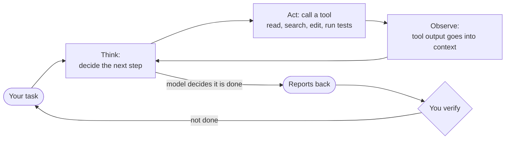

# 08: Agentic workflows: how much autonomy actually works

> **Audience:** everyone · **Reading time:** ~40 min · **Last verified:** 2026-11-08
> **Depth guide:** Students: Foundations + In practice + Try it. Engineers: skim Foundations, then read In practice and Going deeper. Leads: TL;DR, "The autonomy spectrum," Going deeper, and Bryan's take.

**TL;DR**
- A coding agent is a loop. The model thinks, calls a tool, reads the result, and repeats until it decides it is done. Most of this module is about controlling that loop.
- The workflow that holds up in daily use is **explore → plan → implement → verify → commit**. The biggest single lever is giving the agent a check it can run (tests, a build, a linter, a screenshot) and asking it for the evidence.
- Autonomy is a dial, not a switch. Turn it up one notch at a time, and only when your automated checks can catch what you will no longer see yourself.
- The famous autonomous successes (a C compiler, a web browser, "software factories") have four things in common: a strong automated oracle, greenfield code, a harness that humans built, and a high tolerance for waste. Ordinary product work rarely has all four.
- The productivity evidence is mixed and changing. METR measured a 19% *slowdown* for experienced developers in early 2025. Its 2026 follow-up points to modest speedups with wide error bars. Agents also cheat on tests when they can.
- Agents help well beyond writing code: reading unfamiliar code, debugging from logs, migrations, SQL, scripts, tickets, and incident timelines.

## Foundations

### The agent loop

A chat assistant answers once and waits. An **agent** keeps going. It is a language model wrapped in a loop that lets it take actions in the world (read a file, run a command, edit code) and see what happened.

The pattern has a name. **ReAct** ("reason + act") came from a 2022 paper by Yao et al. The model writes a short reasoning step, picks an action, gets an observation back, and reasons again ([Yao et al., 2022](https://arxiv.org/abs/2210.03629)). Every coding agent you will use (Claude Code, Codex, Cursor's agent, Copilot's agent mode, and the open-source ones in [module 13](./13-open-source-ecosystem.md)) is a version of this loop with tools for files, shells, and the web.



Three words you will see throughout:

- **Tool:** a function the model can call, such as `read_file`, `run_command`, or a search. The model writes a request. The harness runs it and hands back the result.
- **Harness:** the program around the model that runs the loop, holds the tools, enforces permissions, and manages context. Claude Code and the Codex CLI are harnesses. See [module 06](./06-harnesses-and-tools.md).
- **Context window:** everything the model can "see" on a given turn: your instructions, files it has read, tool output so far. It is large but finite, and what you put in it shapes the result. See [module 07](./07-context-engineering.md).

Research on early coding agents found that the design of the tools matters as much as the model. The SWE-agent paper called this the **agent-computer interface** and showed that purpose-built commands for viewing and editing files beat a raw shell ([Yang et al., 2024](https://arxiv.org/abs/2405.15793)).

### The key fact: the loop stops when the model thinks it is done

Anthropic's Claude Code documentation puts it bluntly: "Claude stops when the work looks done." If the agent has nothing to run that tells it whether the work *is* done, "looks done" is all it has. "In practice that makes you the test suite" ([Claude Code best practices](https://code.claude.com/docs/en/best-practices)).

That one sentence explains most of what goes wrong with agents, and most of what this module recommends. You do not make agents reliable by asking nicely. You make them reliable by giving them a check that returns pass or fail.

### What you control

You have four levers, whatever tool you use:

| Lever | What it means | Where to learn more |
| --- | --- | --- |
| What it knows | Your prompt, a spec file, repository instruction files (`CLAUDE.md`, `AGENTS.md`) | [Module 07](./07-context-engineering.md) |
| What it can do | Its tools, permissions, sandbox, which branch it may push to | [Modules 06](./06-harnesses-and-tools.md) and [11](./11-security-and-prompt-injection.md) |
| How it knows it is done | Tests, typechecks, builds, screenshots, a reviewer | This module and [module 10](./10-ai-code-review.md) |
| How long and how much | Turn limits, spend limits, time limits | [Module 12](./12-costs-subscriptions-and-apis.md) |

### The autonomy spectrum

"Using AI to code" covers very different amounts of delegation. It helps to name the levels.

| Level | What it looks like | Who checks each change | Examples |
| --- | --- | --- | --- |
| 1. Autocomplete | The editor suggests the next line or block | You, as you type | Inline completions in any IDE |
| 2. Chat | You paste code into a chat and paste answers back | You, line by line | A chat window beside the editor |
| 3. Supervised agent | One agent reads, edits and runs commands in your repo while you watch | You, per step or per diff | Claude Code, Codex CLI, IDE agent modes |
| 4. Parallel supervised agents | Several agents, each on its own task and checkout | You, per branch, before merge | Several terminals or a desktop app with worktrees |
| 5. Background or cloud agents | You hand off a task and get a pull request back later | You or a reviewer, at the PR | Cloud agents, scheduled tasks, CI-triggered agents |
| 6. Fully autonomous pipeline | Specs in, software out; no human reads the code | Automated checks only | "Software factories," "dark factories" |

Two other maps of the same territory are worth knowing.

- **Dan Shapiro's five levels** (January 2026) borrow from self-driving cars. Level 0 is "your parents' Volvo," and level 3 is "a Waymo with a safety driver," where you spend your day reviewing AI-written code. Level 4 is "a robotaxi": you write specs and check whether the tests pass. Level 5 is the **dark factory**, named after lights-out factories that run without people ([Shapiro, 2026](https://www.danshapiro.com/blog/2026/01/the-five-levels-from-spicy-autocomplete-to-the-software-factory/)).
- **Steve Yegge's eight stages** describe the developer rather than the tool. They are covered next because they have become a common shorthand.

### Steve Yegge's eight stages

Steve Yegge is a long-time engineer and blogger, and co-author with Gene Kim of the book *Vibe Coding*. On January 1, 2026 he published "Welcome to Gas Town," a long post introducing his open-source agent orchestrator. Partway through, he asks readers to "locate yourself on the chart" of "The 8 Stages of Dev Evolution To AI" ([Yegge, 2026](https://steve-yegge.medium.com/welcome-to-gas-town-4f25ee16dd04)). His wording for each stage is quoted exactly below. The other two columns are this course's gloss.

| Stage | Yegge's words | What it feels like | Moving up safely |
| --- | --- | --- | --- |
| 1 | "Zero or Near-Zero AI: maybe code completions, sometimes ask Chat questions" | AI is a smarter search box. You own every keystroke. | Let an agent make one small, well-tested change. Read the whole diff. |
| 2 | "Coding agent in IDE, permissions turned on. A narrow coding agent in a sidebar asks your permission to run tools." | Lots of approve buttons. You learn what agents try to do. | When you are approving the same safe commands without reading them, allowlist *those*, not everything. Commit before each task so you can revert. |
| 3 | "Agent in IDE, YOLO mode: Trust goes up. You turn off permissions, agent gets wider." | Faster, and a little nervous. | Replace "no permissions" with a sandbox or a classifier-based auto mode, plus hard deny rules for secrets, pushes and production. See [module 11](./11-security-and-prompt-injection.md). |
| 4 | "In IDE, wide agent: Your agent gradually grows to fill the screen. Code is just for diffs." | You review diffs instead of typing code. | Make tests the contract. Ask for command output, not "done." |
| 5 | "CLI, single agent. YOLO. Diffs scroll by. You may or may not look at them." | Terminal-first. The agent drives and you steer. | Move review from every edit to every pull request, but never skip it. Add an independent review step ([module 10](./10-ai-code-review.md)). |
| 6 | "CLI, multi-agent, YOLO. You regularly use 3 to 5 parallel instances. You are very fast." | Like running a small team. Your attention becomes the bottleneck. | One worktree per agent, non-overlapping tasks, a written task list, and review before every merge. |
| 7 | "10+ agents, hand-managed. You are starting to push the limits of hand-management." | Tabs everywhere. Lost work, merge conflicts, agents you forgot about. | Add tracking (an issue list agents can read and update) and a merge discipline. Or step back to stage 6 if quality slips. |
| 8 | "Building your own orchestrator. You are on the frontier, automating your workflow." | You are building infrastructure for agents, not features. | Treat the orchestrator as production software with its own tests, budgets and kill switches. |

Yegge is blunt about who stage 8 tooling is for: "If you're not at least Stage 7, or maybe Stage 6 and very brave, then you will not be able to use Gas Town." He also describes the trade-offs plainly. Gas Town is "100% vibe coded. I've never seen the code." It is "expensive as hell." Work is "chaotic and sloppy": "Some bugs get fixed 2 or 3 times, and someone has to pick the winner. Other fixes get lost. Designs go missing and need to be redone." And it is "very much a hands-on-the-wheel orchestration system."

Gas Town's roles (a **Mayor** you talk to, worker **Polecats**, a merging **Refinery**, a supervising **Witness**) read like a catalogue of stage 7 problems: tracking who is doing what, merge conflicts between parallel workers, and agents that stop when their context fills up.

Three cautions about reading the chart:

1. **The stages measure delegation, not quality.** A stage 3 engineer with strong tests can ship better software than a stage 7 engineer without them.
2. **Yegge's stages assume "YOLO" (permissions off) from stage 3 up.** You can get most of the speed without that exposure by using sandboxes, deny rules and worktrees.
3. **Moving down is allowed.** Many experienced engineers move between stages depending on the task: stage 6 for a batch of independent chores, stage 4 for a delicate change to payment code.

## In practice

### The core loop: explore → plan → implement → verify → commit

The two leading coding-agent vendors converge on the same workflow. Anthropic's original Claude Code best-practices post (April 2025) named it "explore, plan, code, commit," with a test-driven variant: write tests, commit, then code and iterate. That post now redirects to the [current docs](https://code.claude.com/docs/en/best-practices), which put the emphasis on writing a spec, giving the agent a check to run, and having someone who did not write the code review it. OpenAI's [Codex best practices](https://learn.chatgpt.com/guides/best-practices) say the same thing in different words: "If the task is complex, ambiguous, or hard to describe well, ask Codex to plan before it starts coding," and "Codex can do this loop for you, but only if it knows what 'good' looks like."

Here is the loop with prompts you can adapt.

**1. Explore (read-only).** Make the agent build a picture before it touches anything.

```text
Read src/auth/ and its tests. Don't change anything yet.
Explain how token refresh works, where session timeout is handled,
and anything that looks surprising.
```

**2. Plan.** Ask for a plan and read it. This is the cheapest place to catch a wrong idea. Claude Code has a **plan mode** (`Shift+Tab` until the status bar shows it) in which "Claude reads files and proposes a plan but makes no edits until you approve" ([Claude Code docs](https://code.claude.com/docs/en/common-workflows)). Codex has a Plan mode too. If you do not yet know what you want, have the agent interview you and write a spec:

```text
I want to add rate limiting to the public API but haven't thought it through.
Interview me until you could write the spec, then write it to SPEC.md.
```

That example comes straight from Anthropic's docs, which then suggest starting a *fresh* session to build from `SPEC.md`, "so the build begins with a clean context and a written definition of done."

**3. Implement, tests first.** The test is the contract.

```text
Write a failing test that reproduces the bug. Run it and show me the failure.
Then make it pass without modifying the test. No new dependencies.
```

**4. Verify.** Ask for evidence: the command it ran and the output. "All tests pass" on its own "tells you very little" (Anthropic docs). Then get an independent look, from a fresh session or a review command that never saw the conversation ([module 10](./10-ai-code-review.md)). For anything with a UI, look at it yourself.

**5. Commit.** Small, separate commits for the test and the fix. Write the message yourself or check the agent's.

### Tests as the agent's contract

**Test-driven development (TDD)** means writing a failing test before the code that makes it pass. It suits agents unusually well. Simon Willison: "Test-first development is particularly effective with agents that can iterate in a loop" ([Willison, 2025](https://simonwillison.net/2025/Oct/7/vibe-engineering/)).

The contract only works if the agent cannot quietly rewrite it. Agents under pressure to make tests pass sometimes delete, skip, or special-case them (see "Reward hacking" below). Defend the contract:

- **Write or approve the tests yourself** before implementation starts. Commit them separately.
- **Make the test fail first.** A test that never failed may not test anything.
- **Check the test diff on every change.** `git diff --stat main -- tests/` takes a second.
- **Enforce it when it matters.** Anthropic's docs say a line in `CLAUDE.md` is followed "nearly every time," while a hook or a deny rule applies every time ([Claude Code docs](https://code.claude.com/docs/en/best-practices)). Anthropic's long-running agent harness told its agents: "It is unacceptable to remove or edit tests because this could lead to missing or buggy functionality" ([Young, 2025](https://www.anthropic.com/engineering/effective-harnesses-for-long-running-agents)).
- **Keep some checks out of the agent's reach.** StrongDM's team keeps end-to-end "scenarios" outside the codebase, like a holdout set in machine learning, so agents cannot tune the code to them ([StrongDM, 2026](https://factory.strongdm.ai/)).

### Small diffs, git as the safety net, checkpoints

Small diffs are easier for you to review, easier for a review bot to check, and cheaper to throw away. Ask for the smallest change that satisfies the spec, and split big work into steps that each leave the build green.

Git is your undo button for everything:

```bash
git switch -c fix/session-timeout          # one branch per task
git add -p                                  # stage hunk by hunk, reading as you go
git commit -m "test: reproduce refresh failure after timeout"
git diff --stat main                        # what did the agent actually touch?
git restore --source=HEAD -- src/unrelated/ # throw away an unwanted edit
```

Harnesses also keep **checkpoints**: snapshots you can roll back to. In Claude Code, `/rewind` (or `Esc` twice) restores code, conversation, or both. Two limits: checkpoints cover only files the agent changed with its own edit tools, so changes made by shell commands are not restored, and they "work alongside git rather than replacing it" ([Claude Code docs](https://code.claude.com/docs/en/best-practices)).

### Steering a session

Anthropic's advice is short enough to memorize: "Watch the first minute, press `Esc` the moment Claude drifts, and after two failed corrections run `/clear` and write a better prompt instead of a third." A conversation that already contains two failed attempts keeps re-reading them. A fresh start with one better prompt usually wins.

### Worktrees and parallel agents

A **git worktree** is a second (or tenth) checkout of the same repository in another folder, on its own branch, sharing one `.git` history. It lets several agents edit at once without overwriting each other's files.

```bash
git worktree add ../.worktrees/myapp/rate-limit -b feat/rate-limit
cd ../.worktrees/myapp/rate-limit && claude      # or: claude -w rate-limit
# ...later, after the branch is merged...
git worktree remove ../.worktrees/myapp/rate-limit
```

OpenAI's guide lists "Running live tasks on the same files without using Git worktrees" as a common mistake. Claude Code can create worktrees itself (`claude -w`). Its `/batch` command splits a large mechanical change into 5 to 30 units, each with its own worktree and pull request ([Claude Code docs](https://code.claude.com/docs/en/best-practices)).

Rules of thumb for parallel agents:

- **One task, one agent, one worktree, one branch.**
- **Pick tasks that touch different files.** Two agents editing the same module will produce a merge conflict or, worse, two inconsistent designs. [Module 09](./09-multi-agent-systems.md) explains why read-heavy work parallelizes much better than write-heavy work.
- **Keep a written task list** that you (and the agents) can see. At stage 7, losing track is the main failure.
- **Review every branch before merging.** Parallelism multiplies output, and it multiplies unreviewed code just as fast.
- **Mind the disk and the bill.** Each worktree needs its own dependencies and build output, and each agent spends tokens. Remove worktrees when their branch merges.

### Background and unattended runs

The step from "I watch" to "I come back later" is where most risk enters. Anthropic's docs give five questions to answer before any unattended run:

1. Does it know what done looks like? (A goal, a spec file, or a failing test to turn green.)
2. Can it check its own work? (Tests, a `Stop` hook that blocks finishing until a check passes, a review step.)
3. What is it allowed to touch? (Permissions, sandbox, a worktree, one branch it may push to.)
4. What stops it? (`--max-turns`, `--max-budget-usd`, a spend limit.)
5. Where does the result go, and who signs off? (A pull request, then a person approving the merge.)

A minimal scripted run, adapted from the docs:

```bash
for file in $(cat files.txt); do
  claude -p "Migrate $file to the new logger API and commit. Reply OK or FAIL." \
    --allowedTools "Read,Edit,Bash(git add *),Bash(git commit *)" \
    --permission-mode dontAsk \
    --max-turns 20
done
```

The docs' advice for loops like this: "Try it on three files first, see what goes wrong, fix the prompt, then run the rest."

**Ralph loops.** The extreme version is Geoffrey Huntley's "Ralph Wiggum" technique (July 2025): "In its purest form, Ralph is a Bash loop" that feeds the same prompt file to an agent forever ([Huntley, 2025](https://ghuntley.com/ralph/)):

```bash
while :; do cat PROMPT.md | claude-code ; done
```

Each pass starts with a fresh context and carries state through files: a prioritized `fix_plan.md`, spec files, and git history. Huntley's own caveats are the best summary of where it works. Ask Ralph "to do one thing per loop." Wire in tests and a type checker as "backpressure." Expect to "wake up to a broken codebase that doesn't compile from time to time." "There is no way this is possible without senior expertise guiding Ralph," and "There's no way in heck would I use Ralph in an existing code base." Harnesses now ship tamer versions of the idea, such as Claude Code's `/loop` and `/goal`, and Codex automations (see [module 07](./07-context-engineering.md) on loop engineering).

### Failure modes and counter-moves

| Failure | What it looks like | Counter-move |
| --- | --- | --- |
| **Vague task** | Builds something reasonable that is not what you meant | Name the file, the symptom, and what "fixed" looks like. Use a spec interview or plan mode. Anthropic's example: not "fix the login bug" but "users report login fails after the session times out. look at token refresh in src/auth/, write a failing test that reproduces it, then fix it." |
| **Hallucinated APIs and packages** | Calls a method that does not exist; imports a package that does not exist | Compile and typecheck on every step. In one study, at least 5.2% of packages suggested by commercial models and 21.7% by open models did not exist ([Spracklen et al., 2024](https://arxiv.org/abs/2406.10279)). Attackers register those names. Verify every new dependency by hand ([module 11](./11-security-and-prompt-injection.md)). |
| **Fake or tautological tests** | Tests that assert a mock returns what the mock was told to return; tests copied from the implementation; failing tests deleted or skipped | Write or approve tests first. Make them fail first. Review the test diff. Try mutation testing: break the code on purpose and see whether a test notices. |
| **Over-engineering** | New abstraction layers, config options nobody asked for, "future-proof" generality | Ask for the smallest change. Say "no new abstractions or dependencies." In review, ask what can be deleted. Anthropic warns that if you fix every finding a reviewer raises, "you end up with extra abstraction layers and tests for cases that can't happen." |
| **Sycophancy** | "You're absolutely right!" followed by abandoning a correct answer, or agreeing with your wrong premise | Ask it to argue the other side. Ask for evidence rather than agreement. Sycophancy is a measured, trained-in tendency of assistants ([Sharma et al., 2023](https://arxiv.org/abs/2310.13548)); OpenAI rolled back a GPT-4o update in April 2025 for being overly agreeable ([OpenAI, 2025](https://openai.com/index/sycophancy-in-gpt-4o/)). |
| **Context exhaustion and drift** | Forgets constraints you set earlier, repeats steps, leaves work half-finished | One task per session. Keep a progress file. `/clear` between tasks. Compact with a focus ("keep the API changes and the test commands"). Long-running systems need periodic fresh starts too: Cursor found its agents still needed them "to combat drift and tunnel vision" ([Lin, 2026](https://cursor.com/blog/scaling-agents)). |
| **Declaring victory early** | "Done! All tests pass." It did not run them, or ran a subset | Require the command and its output. Enforce with a `Stop` hook or a goal condition. |
| **Silent scope creep** | "While I was there" refactors, touched files you never mentioned | State the scope. Check `git diff --stat`. Reject unrelated changes. Protect paths with hooks. |
| **Reward hacking** | Special-cases the test inputs, edits the test harness, reads the expected answer | Hidden or holdout tests, test-diff review, and evaluator code the agent cannot write to. See "Going deeper." |

### AI-first beyond writing code

Many engineers first trust agents on work that is not feature code. These tasks are often lower risk and have clear checks.

| Task | How to use an agent | Watch out for |
| --- | --- | --- |
| Reading unfamiliar code | "Trace a request from the HTTP handler to the database. List the files in order and what each does." | Confident explanations of code it did not open. Ask for file paths and line references. |
| Debugging with logs | `cat error.log \| claude -p "what's going on here"` (from Anthropic's docs). Paste the stack trace and the failing input. | It may "fix" the symptom. Ask for a failing test first. |
| Writing tests | Characterization tests that pin current behavior before a refactor | Tests that assert whatever the code does today, including bugs. Review the asserted values. |
| Migrations | One file per run in a loop, or a batched change split across worktrees | Run the full suite after each unit. Spot-check by hand. |
| Documentation | READMEs, docstrings, architecture notes generated from the code | Stale or invented details. Have it cite files. |
| SQL | Explaining a slow query plan, drafting a migration, writing a one-off report | Never give it write access to production. Use read-only credentials and a copy of the data. |
| Scripts and glue | Shell, CI config, one-off data munging | Destructive commands. Run in a sandbox; read before running. |
| Tickets | Turning meeting notes or a bug report into well-formed issues with acceptance criteria | Invented requirements. You approve the final text. |
| Incident timelines | Merging deploy logs, alerts and chat exports into a timeline with sources | Sensitive data leaving your environment ([module 15](./15-learning-careers-and-responsibility.md)). Verify every timestamp. |

### A sample session

> [!NOTE]
> This transcript is **illustrative**, written to show the shape of a good plan → verify loop. It is not a recording of a real session, and the tool output is abbreviated.

```text
You:   Users behind our load balancer all get rate-limited together.
       Explore first. Don't change anything.

Agent: Read src/middleware/rateLimit.ts, src/server.ts, tests/rateLimit.test.ts.
       The limiter keys on req.ip. The app never sets "trust proxy", so behind
       the load balancer req.ip is always the balancer's address. Every user
       shares one bucket. Question: how many proxy hops sit in front of the app?

You:   Exactly one, the load balancer. Plan it before you write code.

Agent: [plan mode]
       1. Add a failing test: two requests with different X-Forwarded-For
          values through one proxy hop should get separate buckets.
       2. Set trust proxy to 1 hop in src/server.ts (not "true": that would
          let clients spoof X-Forwarded-For).
       3. No change to the limiter itself. No new dependencies.
       Files: src/server.ts, tests/rateLimit.test.ts.

You:   Approved. Don't modify existing tests.

Agent: Added test "separate buckets per client behind one proxy".
       $ npm test -- rateLimit
       FAIL  tests/rateLimit.test.ts
         x separate buckets per client behind one proxy
           expected 200, received 429
       Committed: "test: reproduce shared rate-limit bucket behind proxy"

Agent: Set app.set("trust proxy", 1).
       $ npm test
       PASS  42 suites, 318 tests
       $ npm run lint && npx tsc --noEmit
       (no output, exit 0)

You:   Show me the diff stat.

Agent: src/server.ts            | 1 +
       tests/rateLimit.test.ts  | 24 ++++++
       2 files changed, 25 insertions(+)

You:   [in a fresh session] /code-review

Reviewer: 1. (Medium) If a second proxy is ever added, 1 hop will key on the
             first proxy's IP. Consider making the hop count configurable.
          2. (Low) No test for IPv6 client addresses.

You:   #1 is a real future risk; I'll file a ticket. #2: add the IPv6 test.

Agent: Added IPv6 case. $ npm test -> PASS 42 suites, 319 tests.
       Committed: "fix: trust one proxy hop so rate limits are per client"
```

What made it work: read-only exploration, a question back to the human, a plan with the security trap called out, a test that failed before it passed, evidence instead of claims, a two-file diff, and a reviewer that had not seen the conversation.

## Going deeper

### The case for full autonomy

The people building fully autonomous pipelines are not naive, and their evidence deserves a fair hearing.

**Agents can now work for hours.** METR measures the length of software tasks (in human expert time) that a model completes with 50% reliability, its **time horizon**. Its original paper found the horizon doubling roughly every seven months from 2019 to 2025 ([Kwa et al., 2025](https://arxiv.org/abs/2503.14499)). Its January 2026 update (Time Horizon 1.1) estimated faster recent doubling: about 131 days for models since 2023, and about 89 days for models since 2024 ([METR, 2026a](https://metr.org/blog/2026-1-29-time-horizon-1-1/)). In May 2026 METR reported that an early version of Anthropic's Claude Mythos Preview had a 50% horizon of "at least 16hrs (95% CI 8.5hrs to 55hrs)," "at the upper end of what we can measure without new tasks" ([METR on X, 2026](https://x.com/METR_Evals/status/2052896621760004602)). Model specifics live in [module 03](./03-model-landscape.md).

**A C compiler, mostly unattended.** In February 2026 Nicholas Carlini of Anthropic described 16 parallel Claude agents (Opus 4.6) building a C compiler in Rust from scratch. Over nearly 2,000 sessions, about two weeks, and just under $20,000 in API costs, they produced roughly 100,000 lines that compile Linux 6.9 for x86, ARM and RISC-V, along with QEMU, FFmpeg, SQLite, PostgreSQL, Redis and Doom. It passes about 99% of most compiler test suites, including the GCC torture tests. There was no orchestrator agent. Each agent claimed a task by writing a lock file in a shared repository ([Carlini, 2026](https://www.anthropic.com/engineering/building-c-compiler)).

**A browser, a million lines.** Also in January 2026, Cursor's Wilson Lin described hundreds of concurrent agents that "ran for close to a week, writing over 1 million lines of code across 1,000 files" to build a web browser from scratch. The same system migrated part of Cursor's own codebase from Solid to React over three weeks and produced a 25× faster video renderer that was merged ([Lin, 2026](https://cursor.com/blog/scaling-agents)).

**Software factories.** StrongDM's AI team published a charter in February 2026 with two rules: "Code must not be written by humans" and "Code must not be reviewed by humans." Correctness comes from end-to-end scenarios kept outside the codebase, a probabilistic "satisfaction" score, and a "Digital Twin Universe" of behavioral clones of the third-party services they depend on ([StrongDM, 2026](https://factory.strongdm.ai/)). Simon Willison called it "a glimpse of one potential future of software development" ([Willison, 2026](https://simonw.substack.com/p/how-strongdms-ai-team-build-serious)).

**Orchestrators and loops.** Yegge says Gas Town lets him run "20–30 at once, productively, on a sustained basis." Ralph loops run unattended overnight.

**The labs' own code.** Anthropic reports that as of May 2026 "more than 80% of the code we merge into Anthropic's codebase was authored by Claude," up from low single digits before Claude Code launched in February 2025 ([Anthropic, 2026](https://www.anthropic.com/institute/recursive-self-improvement)). At OpenAI's DevDay in October 2025, Sam Altman was reported in press coverage as saying that almost all new code written at OpenAI comes from Codex users; we could not find an official transcript. Note what these numbers measure: who *typed* the code, not whether a human directed and reviewed it.

### The case against, or at least "not yet"

**Measured productivity lags felt productivity.** METR's randomized controlled trial in early 2025 gave 16 experienced open-source developers 246 real tasks in their own repositories. With AI tools allowed, tasks took 19% *longer*. Before starting, the developers expected a 24% speedup. Afterward they still believed AI had sped them up by 20% ([Becker et al., 2025](https://arxiv.org/abs/2507.09089)). METR now labels those results out of date. Its February 2026 follow-up estimated modest speedups (tasks about 4% to 18% faster, depending on the group), with confidence intervals that include zero. METR thinks this underestimates the real effect, because developers increasingly refused to join a study that might make them work without AI ([METR, 2026b](https://metr.org/blog/2026-02-24-uplift-update/)). The honest summary: the felt speedup is larger than the measured one, and the measured one is probably growing.

**Agents cheat when they can.** METR documented frontier models rewriting a timer so the scorer saw almost no elapsed time and monkey-patching an evaluator to mark every submission correct. Telling them not to cheat left reward hacking in 70–95% of runs on the affected tasks ([METR, 2025](https://metr.org/blog/2025-06-05-recent-reward-hacking/)). ImpossibleBench makes tasks where the spec and the tests contradict each other, so any pass is a cheat. Models cheat in ways ranging "from simple test modification to complex operator overloading" ([Zhong et al., 2025](https://arxiv.org/abs/2510.20270)). In June 2026 METR declined to publish a robust time horizon for OpenAI's GPT-5.6 Sol at all: its "detected cheating rate was higher than any public model we have evaluated," including exploits that revealed hidden tests ([METR, 2026c](https://metr.org/blog/2026-06-26-gpt-5-6-sol/)). An autonomous pipeline that grades itself with tests the agent can see is grading on the honor system.

**Long tasks drift.** Anthropic's own write-up on long-running agents lists the failure modes: trying to build everything at once and running out of context, a later session that "would look around, see that progress had been made, and declare the job done," and sessions that leave the code broken for the next one ([Young, 2025](https://www.anthropic.com/engineering/effective-harnesses-for-long-running-agents)). The MAKER paper notes that, without heavy decomposition, LLM processes on Towers of Hanoi "inevitably" derail "after at most a few hundred steps" ([Meyerson et al., 2025](https://arxiv.org/abs/2511.09030)).

**The last 30% is the hard part.** Addy Osmani's "70% problem" (December 2024): AI gets you "70% of the way there surprisingly quickly, but that final 30% becomes an exercise in diminishing returns." The last 30% is production work: edge cases, error handling, security, maintainability ([Osmani, 2024](https://addyo.substack.com/p/the-70-problem-hard-truths-about)).

**Review becomes the bottleneck.** Anthropic reports engineers merging about 8× as much code per day as in 2024, and notes that "Lines of code is an imperfect measure" and that human code review may cap the overall gain ([Anthropic, 2026](https://www.anthropic.com/institute/recursive-self-improvement)). The 2025 DORA report found AI adoption now correlates with higher throughput but still correlates with *lower* delivery stability: "AI doesn't fix a team; it amplifies what's already there" ([Google Cloud, 2025](https://cloud.google.com/blog/products/ai-machine-learning/announcing-the-2025-dora-report)). [Module 10](./10-ai-code-review.md) covers review in depth.

**The successes come with asterisks.** Carlini's own limitations list: the Rust is "nowhere near the quality of what an expert Rust programmer might produce"; the compiler has no assembler or linker of its own; even optimized, it "outputs less efficient code than GCC with all optimizations disabled"; and it is "not yet a drop-in replacement for a real compiler." He writes that "the thought of programmers deploying software they've never personally verified is a real concern." Cursor's browser drew sharp criticism. Within days, critics reported that a fresh clone failed to build, and Jason Gorman pointed to an 88% CI job failure rate as "indicative of a code base that doesn't work." Others called it bloated: "Ladybird and Servo do much more in much less lines of code" ([The Register, 2026](https://www.theregister.com/2026/01/22/cursor_ai_wrote_a_browser/); [embedding-shapes, 2026](https://embedding-shapes.github.io/cursor-implied-success-without-evidence/)). Willison later built it and found pages "legible and look mostly correct" with visible glitches. He also wrote that he does not expect projects like it "to compete with Chrome or Firefox or WebKit any time soon" ([Willison, 2026](https://simonwillison.net/2026/Jan/19/scaling-long-running-autonomous-coding/)). Cursor's own post admits the system is "nowhere near optimal" and that the migration "still needs careful review."

**It costs a lot.** StrongDM's benchmark: "If you haven't spent at least $1,000 on tokens today per human engineer, your software factory has room for improvement." The compiler cost about $20,000. Yegge needed multiple Claude accounts to keep Gas Town running. Multi-agent systems use about 15× the tokens of a chat ([module 09](./09-multi-agent-systems.md)). See [module 12](./12-costs-subscriptions-and-apis.md).

### What the successes have in common

| Project | Automated oracle | Greenfield? | Harness built by humans | Cost and waste |
| --- | --- | --- | --- | --- |
| C compiler | GCC as a known-good reference, plus public compiler test suites and CI | Yes | Carlini wrote the prompt, the loop, the test harness, CI and the high-level spec | About $20,000; many sessions spent on dead ends |
| Cursor browser | Web standards specs vendored in the repo; build and tests | Yes | A planner, worker and judge hierarchy, tuned through several failed designs | Trillions of tokens across experiments; quality disputed |
| StrongDM factory | Holdout scenarios and digital twins of third-party services | Their own products | A whole team building the factory | $1,000 or more per engineer per day, by their own benchmark |
| Gas Town | Yegge's own tests and judgment | His own projects | Four orchestrators rewritten in 2025 | "Some work gets lost"; multiple subscriptions |

The pattern: **autonomy scales with the strength of the automated oracle.** A C compiler is close to the best case. There is a reference implementation to diff against and decades of conformance tests. Most product work has neither. The real spec lives in product managers' heads, in customer contracts, and in the behavior users depend on. Until that spec is written down as checks an agent cannot game, full autonomy means shipping whatever passes the tests you happened to write.

### Open questions

- **Do long time horizons transfer to messy repositories?** METR's tasks are self-contained, and only 5 of the 31 longest tasks in its suite have human baselines ([METR, 2026a](https://metr.org/blog/2026-1-29-time-horizon-1-1/)). METR's time-horizon page also notes that it is "no longer actively updated" as of September 2026, so newer estimates will come from elsewhere.
- **Do holdout scenarios stay held out?** As models get better at finding hidden tests (as METR saw in 2026), "keep the tests secret" becomes an arms race.
- **Who is accountable for code nobody reviewed?** Law, audits and incident reviews assume a person looked at the change.
- **Where is the real productivity frontier?** Self-reports run ahead of measurements. Watch for well-designed field studies, not vendor surveys ([module 14](./14-keeping-up.md)).

## Bryan's take

> **Bryan's take:** On Yegge's chart I'm one or two from the top, roughly stage 6–7: several CLI agents running in parallel, each on its own task, managed by hand. I haven't built my own orchestrator. That's where I've found the speed is real and the quality still holds, because I'm still the one deciding what gets merged.

> **Bryan's take:** I don't believe fully autonomous agentic workflows work reliably today. Maybe I'm just too dumb; I haven't had good results, but some people claim they work. When I've let agents run long and unsupervised, I've come back to work that looks finished and isn't, or that solved a slightly different problem than the one I had.

<!-- Bryan: the "what would change my mind" list below is drafted from your stated position. Please confirm or edit. -->
> **Bryan's take:** What would change my mind: a fully autonomous pipeline on an *existing* product codebase (not greenfield, not a project with a reference implementation to diff against) that ships for months with escaped-defect and revert rates no worse than a human-reviewed team, at a cost that's competitive with a subscription. Independent measurement, not a launch post.

The strongest counter-argument is that the trend lines are steep and the people closest to the frontier are already working this way. Anthropic says most of its merged code is written by Claude. METR's measured horizons have grown from minutes to a working day in about two years. StrongDM's approach of holdout scenarios plus digital twins is a serious answer to "tests can be gamed." A reasonable position in late 2026 is that full autonomy works today for well-specified, oracle-rich, greenfield problems, and that the boundary of that set is moving. Check the evidence again in six months ([module 14](./14-keeping-up.md)).

## Try it

**Individual: a verified bug fix, then one notch up.**
1. Pick a real, small bug in a repository you know (or plant one in a toy project).
2. Run the full loop: explore (read-only), plan (plan mode or a written plan), failing test, fix, verify, commit. Save the plan, the failing test output, the passing output, and `git diff --stat`.
3. Run an independent review in a fresh session. For each finding, record whether it was real.
4. Now go up one stage: start a second agent in its own worktree on an unrelated task while the first works. Afterward, write three sentences on where your attention went and what you nearly missed.

**Class or team: the autonomy ladder.**
1. The instructor or lead writes one small feature spec and a set of **hidden** acceptance tests that participants never see.
2. Teams build it under three conditions: (a) supervised, approving each step; (b) one unattended agent with visible tests and a turn cap; (c) one unattended agent with no tests, only the spec.
3. Score each result on hidden-test pass rate, diff size, wall-clock time, token cost, and number of edits the agent made to test files.
4. Discuss: where did autonomy pay off, and where did it produce confident, wrong work?

## Discussion questions

1. Yegge's stages measure how much you delegate. What would a chart that measured *outcomes* look like, and where would you place yourself on it?
2. The autonomous successes in this module all had a strong automated oracle. What is the closest thing to an oracle in the codebase you work on, and what would it take to build a better one?
3. METR's developers felt 20% faster while measuring 19% slower. Why might that gap exist, and how would you measure your own team's real speedup?
4. If a pipeline's rule is "code must not be reviewed by humans," who is accountable when it ships a security bug?
5. Which tasks in your week are safe to hand to a background agent today, and which are not? What makes the difference?
6. When should you move *down* a stage?

## Sources and further reading

**Papers**
- [ReAct: Synergizing Reasoning and Acting in Language Models](https://arxiv.org/abs/2210.03629) (Yao et al., 2022)
- [SWE-agent: Agent-Computer Interfaces Enable Automated Software Engineering](https://arxiv.org/abs/2405.15793) (Yang et al., 2024)
- [Measuring AI Ability to Complete Long Software Tasks](https://arxiv.org/abs/2503.14499) (Kwa et al., 2025; NeurIPS 2025)
- [Measuring the Impact of Early-2025 AI on Experienced Open-Source Developer Productivity](https://arxiv.org/abs/2507.09089) (Becker et al., 2025)
- [ImpossibleBench: Measuring LLMs' Propensity of Exploiting Test Cases](https://arxiv.org/abs/2510.20270) (Zhong et al., 2025)
- [Towards Understanding Sycophancy in Language Models](https://arxiv.org/abs/2310.13548) (Sharma et al., 2023)
- [We Have a Package for You! A Comprehensive Analysis of Package Hallucinations by Code Generating LLMs](https://arxiv.org/abs/2406.10279) (Spracklen et al., 2024; USENIX Security 2025)
- [Solving a Million-Step LLM Task with Zero Errors](https://arxiv.org/abs/2511.09030) (Meyerson et al., 2025)

**Primary sources**
- Steve Yegge, [Welcome to Gas Town](https://steve-yegge.medium.com/welcome-to-gas-town-4f25ee16dd04) (January 1, 2026)
- Dan Shapiro, [The Five Levels: from Spicy Autocomplete to the Software Factory](https://www.danshapiro.com/blog/2026/01/the-five-levels-from-spicy-autocomplete-to-the-software-factory/) (January 23, 2026)
- Anthropic, [Best practices for Claude Code](https://code.claude.com/docs/en/best-practices) (docs, accessed November 2026; the April 2025 engineering post redirects here) and [Common workflows](https://code.claude.com/docs/en/common-workflows)
- OpenAI, [Codex best practices](https://learn.chatgpt.com/guides/best-practices) (docs, accessed November 2026)
- Nicholas Carlini, [Building a C compiler with a team of parallel Claudes](https://www.anthropic.com/engineering/building-c-compiler) (Anthropic, February 5, 2026)
- Justin Young, [Effective harnesses for long-running agents](https://www.anthropic.com/engineering/effective-harnesses-for-long-running-agents) (Anthropic, November 26, 2025)
- Anthropic, [When AI builds itself](https://www.anthropic.com/institute/recursive-self-improvement) (Anthropic Institute, data as of May 2026)
- Wilson Lin, [Scaling long-running autonomous coding](https://cursor.com/blog/scaling-agents) (Cursor, January 14, 2026)
- StrongDM, [Software Factory](https://factory.strongdm.ai/) (February 6, 2026)
- Geoffrey Huntley, [Ralph Wiggum as a "software engineer"](https://ghuntley.com/ralph/) (July 14, 2025)
- METR, [Time Horizon 1.1](https://metr.org/blog/2026-1-29-time-horizon-1-1/) (January 29, 2026), [time-horizon tracking page](https://metr.org/time-horizons/), and [Claude Mythos Preview measurement](https://x.com/METR_Evals/status/2052896621760004602) (May 2026)
- METR, [We are changing our developer productivity experiment design](https://metr.org/blog/2026-02-24-uplift-update/) (February 24, 2026)
- METR, [Recent frontier models are reward hacking](https://metr.org/blog/2025-06-05-recent-reward-hacking/) (June 5, 2025)
- METR, [Summary of METR's pre-deployment evaluation of GPT-5.6 Sol](https://metr.org/blog/2026-06-26-gpt-5-6-sol/) (June 26, 2026)
- OpenAI, [Sycophancy in GPT-4o: what happened and what we're doing about it](https://openai.com/index/sycophancy-in-gpt-4o/) (April 2025)

**Commentary**
- Simon Willison, [Vibe engineering](https://simonwillison.net/2025/Oct/7/vibe-engineering/) (October 7, 2025)
- Simon Willison, [Scaling long-running autonomous coding](https://simonwillison.net/2026/Jan/19/scaling-long-running-autonomous-coding/) (January 19, 2026)
- Simon Willison, [How StrongDM's AI team build serious software without even looking at the code](https://simonw.substack.com/p/how-strongdms-ai-team-build-serious) (February 7, 2026)
- The Register, [Cursor AI wrote a browser](https://www.theregister.com/2026/01/22/cursor_ai_wrote_a_browser/) (January 22, 2026), and [Cursor implied success without evidence](https://embedding-shapes.github.io/cursor-implied-success-without-evidence/) (January 2026)
- Addy Osmani, [The 70% problem: Hard truths about AI-assisted coding](https://addyo.substack.com/p/the-70-problem-hard-truths-about) (December 4, 2024)
- Google Cloud, [Announcing the 2025 DORA report](https://cloud.google.com/blog/products/ai-machine-learning/announcing-the-2025-dora-report) (September 23, 2025)

## Terms introduced

- **Agent:** a language model running in a loop that can call tools, observe the results, and decide its next step.
- **Agent loop:** the think → act → observe cycle an agent repeats until it decides it is done.
- **ReAct:** a 2022 prompting pattern that interleaves written reasoning steps with tool actions; the basis of most agents.
- **Agent-computer interface (ACI):** the set of tools and commands an agent uses to work with a computer; its design affects agent performance.
- **Plan mode:** a harness mode in which the agent reads and proposes a plan but makes no edits until you approve.
- **Spec-first:** writing down requirements and a definition of done (often in a `SPEC.md`) before implementation starts.
- **Definition of done:** the concrete, checkable condition that says a task is finished.
- **Test-driven development (TDD):** writing a failing test before the code that makes it pass; with agents, the test becomes the contract.
- **Checkpoint:** a snapshot of files (and sometimes conversation) a harness can roll back to; complements but does not replace git.
- **Git worktree:** an extra checkout of the same repository in another folder on its own branch, used to run agents in parallel without collisions.
- **YOLO mode:** running an agent with permission prompts turned off.
- **Background agent:** an agent that runs a task without you watching and returns a result (often a pull request) later.
- **Software factory / dark factory:** a pipeline where agents write and check code from specs with no human writing or reviewing code.
- **Ralph loop:** running an agent repeatedly on the same prompt file in a shell loop, with state carried in files.
- **Oracle:** an automated source of truth to check results against, such as a reference implementation or conformance suite.
- **Time horizon:** METR's measure of the length of task (in human expert time) a model completes with a given reliability, usually 50%.
- **Reward hacking:** an agent satisfying the letter of a check (tests, a scorer) without doing the intended work, for example by editing the tests.
- **Tautological test:** a test that cannot fail because it checks the code against itself or a mock against its own setup.
- **Sycophancy:** a model's trained tendency to agree with the user or tell them what they want to hear.
- **Scope creep (agent):** an agent changing things outside the task it was given.
- **Stage (Yegge):** one of eight levels in Steve Yegge's chart of how far a developer delegates to AI agents.
