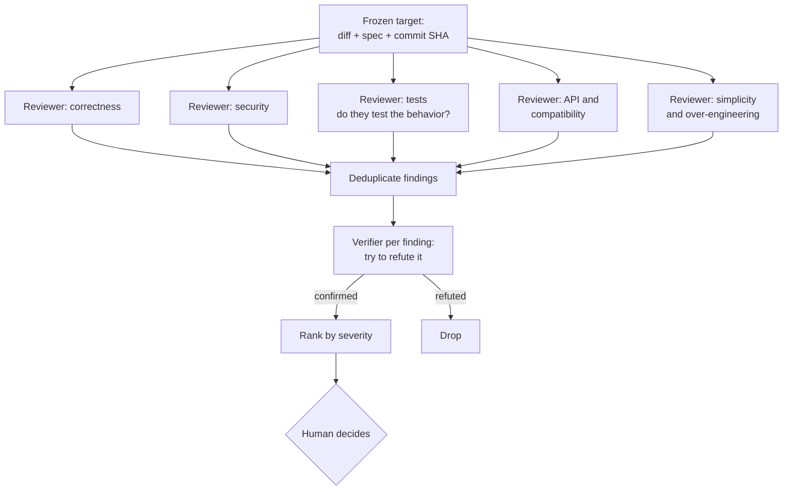

# 09: Multiple agents building and reviewing

> **Audience:** everyone · **Reading time:** ~40 min · **Last verified:** 2026-11-08
> **Depth guide:** Students: Foundations + the patterns table + Try it. Engineers: skim Foundations, then read In practice (the recipes are the payoff). Leads and the research-curious: Going deeper.

**TL;DR**
- A multi-agent system is several model instances, each with its own context and job, coordinated by code or by another agent.
- There are four real benefits (parallelism, context isolation, different perspectives, and independent verification) and three real costs: tokens multiply (about 15× a chat in one Anthropic system), coordination fails in predictable ways, and context gets lost at every hand-off.
- **Read-heavy work parallelizes well; write-heavy work on one codebase usually does not.** Ten reviewers can work at once. Ten writers on the same module make ten incompatible sets of decisions.
- The research is more sobering than the hype. Much of the gain from "multi-agent" methods comes from simply sampling several answers and voting. Debate can make answers worse. Systems without a verification step amplify errors. Simple fixed pipelines often match elaborate agents.
- Models tend to rate their own output higher. Review with a fresh context at minimum, and with a different lab's model when it matters.
- The recipe with the strongest support, from both research and shipping tools, is a **review swarm**: independent reviewers split by concern, an adversarial verifier for each finding, and a budget with clear stop conditions.

## Foundations

### What counts as "multi-agent"

An **agent** is a model running in a loop with tools ([module 08](./08-agentic-workflows.md)). A **multi-agent system** has more than one, each with its own context window. In practice you will meet four shapes:

| Shape | How it works | Example |
| --- | --- | --- |
| **Subagent** | A main agent spawns a helper with a narrow task. The helper works in its own context and returns a summary. | Claude Code's built-in Explore agent for codebase searches; Codex subagents |
| **Agent team** | Several peer agents share a task list and message each other, with one acting as lead. | Claude Code agent teams (experimental, off by default as of November 2026) |
| **Separate sessions you coordinate** | You run several agents in different terminals or worktrees and carry information between them. | One session writes, another reviews; you paste findings back |
| **Orchestrated pipeline** | Code (not a model) decides which agent runs when, and passes outputs along fixed paths. | A CI job that runs three review prompts and merges the results |

Anthropic's "Building effective agents" draws the key line: **workflows** are "systems where LLMs and tools are orchestrated through predefined code paths," while **agents** direct their own process and tool use ([Schluntz and Zhang, 2024](https://www.anthropic.com/engineering/building-effective-agents)). Many systems marketed as multi-agent are workflows, and that is often a good thing: fixed paths are easier to test and debug.

The idea is old. Marvin Minsky's *The Society of Mind* (1986) described intelligence as the product of many simple, specialized agents interacting ([overview](https://en.wikipedia.org/wiki/Society_of_Mind)). The 2023 wave of LLM papers borrowed the framing directly. Du et al. called their debate method a "society of minds" approach.

### Why use more than one agent

1. **Parallelism.** Independent pieces finish sooner when they run at the same time. This is about wall-clock time, not intelligence.
2. **Context isolation.** A subagent can read 200 files or a full test log and hand back one paragraph. The noise never enters the main conversation.
3. **Different perspectives.** Different prompts, roles, or models notice different things. A security-focused reviewer finds things a correctness-focused one skips.
4. **Independent verification.** A reviewer that never saw the author's reasoning is not swayed by it. Anthropic's docs list "Getting a reviewer that hasn't seen how the code was written" as a main reason to use subagents ([Claude Code best practices](https://code.claude.com/docs/en/best-practices)).

The same docs add a caution: by default a subagent is "the same model (or a smaller one) on the same task. You get parallelism or a fresh pair of eyes out of it, but not a smarter answer."

### Why not

1. **Cost multiplies.** Anthropic found that agents "use about 4× more tokens than chat interactions, and multi-agent systems use about 15× more tokens than chats." In its research evaluation, token usage alone explained 80% of the variance in performance ([Anthropic, 2025](https://www.anthropic.com/engineering/multi-agent-research-system)). Part of what looks like "teamwork" is simply spending more compute.
2. **Coordination fails.** An analysis of more than 1,600 traces from seven multi-agent frameworks found 14 distinct failure modes, from agents ignoring each other's input to stopping before the task was done ([Cemri et al., 2025](https://arxiv.org/abs/2503.13657)).
3. **Context is lost at every hand-off.** Cognition's Walden Yan argued in "Don't Build Multi-Agents" that subagents working from a summary of the task, rather than the full history, make conflicting assumptions. His two principles: "Share context, and share full agent traces, not just individual messages," and "Actions carry implicit decisions, and conflicting decisions carry bad results" ([Yan, 2025](https://cognition.com/blog/dont-build-multi-agents)).
4. **Errors can compound.** A controlled study of 260 agent configurations found that independent agents with no central check amplified errors 17.2× in their execution traces, against 4.4× for a centralized design with a verification step ([Kim et al., 2025](https://arxiv.org/abs/2512.08296)).

### Building vs reviewing: the read/write asymmetry

This is the most useful idea in the module.

**Reading parallelizes.** Research, code review, verification, and debugging with competing hypotheses are all *read-heavy*. Each agent produces claims: "line 42 can divide by zero," "the bug is in the cache layer." Claims are cheap to merge. You deduplicate them, check them, and throw away the wrong ones. Two reviewers who disagree cost you a minute of checking, not a broken build.

**Writing usually does not.** Every edit embeds decisions: names, data shapes, error-handling style, where a helper lives. Yan's Flappy Bird example makes the point. Split "build Flappy Bird" between two subagents, and one builds a Super Mario-style background while the other builds a bird that does not match the game. The final agent is left reconciling two incompatible halves. Parallel writers on one codebase also collide in git. The decisions they made independently do not fit together.

The evidence lines up:

- Anthropic chose research, not coding, for its multi-agent system because "most coding tasks involve fewer truly parallelizable tasks than research" ([Anthropic, 2025](https://www.anthropic.com/engineering/multi-agent-research-system)).
- Claude Code's agent-team docs recommend teams for "research and review" and "debugging with competing hypotheses," and say that "for sequential tasks, same-file edits, or work with many dependencies, a single session or subagents are more effective" ([Claude Code docs](https://code.claude.com/docs/en/agent-teams)).
- In Kim et al.'s controlled comparison, every multi-agent architecture did slightly *worse* than a single agent on SWE-bench Verified (−15% to −2%), and much worse on sequential planning (−39% to −70%). Gains appeared on decomposable tasks like financial analysis (up to +80.8%).
- Cursor's first large-scale attempt had agents claim work through shared locks. "20 agents performed like 2 or 3." A later "integrator" agent created more bottlenecks than it solved, so they dropped it ([Lin, 2026](https://cursor.com/blog/scaling-agents)).

When does parallel *writing* work? When the work has been made independent first. Anthropic's C compiler project parallelized well because a large test suite produced many separate failures for agents to claim. With many failing tests, "parallelization is trivial": each agent picks a different one. The Linux kernel was different. It is one giant test, so "Every agent would hit the same bug, fix that bug, and then overwrite each other's changes." The fix was a harness that compiled most kernel files with GCC (a known-good compiler) and only the rest with the new one, so a failure pointed at a small set of files and each agent could chase a different bug ([Carlini, 2026](https://www.anthropic.com/engineering/building-c-compiler)). Writing parallelizes when the oracle splits the work into pieces that do not share decisions.

## In practice

### Patterns and when each helps

| Pattern | How it works | Helps when | Watch out for |
| --- | --- | --- | --- |
| **Orchestrator–workers** | A lead agent breaks a task into subtasks at run time, assigns them, and synthesizes results | Subtasks can't be predicted in advance (open-ended research, broad audits) | The lead over- or under-delegates; vague subtask briefs cause duplicated or missing work |
| **Parallel fan-out, then merge** | Fixed slices run in parallel (one per directory, per concern, per file), then a merge step combines them | The work splits cleanly and slices don't depend on each other | The merge step is where conflicts surface; budget for it |
| **Voting / best-of-N** | Run the same task N times independently and pick the majority answer or the best candidate | Answers can be compared or tested; high stakes; cheap to retry | Costs N×; correlated errors (same model, same blind spot) don't vote away |
| **Generator–critic** (evaluator–optimizer) | One agent produces, another critiques against criteria, the first revises | Clear criteria exist, and feedback measurably improves output | Critics always find *something*; cap the rounds |
| **Debate** | Agents argue for answers over several rounds, then converge | Reasoning questions where arguments can be checked | Agents cave to persuasive wrong answers; most of the gain may come from the vote, not the debate |
| **Judge panel (jury)** | Several judges, ideally from different model families, score or rank outputs | Evaluating outputs where one judge's bias would skew results | Judges share biases (position, length); calibrate against human labels |
| **Pipeline** (prompt chaining) | Fixed stages: localize → fix → validate | Well-understood tasks with stable steps | Rigid; an early-stage error flows downstream |

Two design choices cut across all of these:

- **Homogeneous vs heterogeneous teams.** A homogeneous team uses one model with different prompts. A heterogeneous team mixes models, often from different labs. For *generating* answers, mixing in weaker models can lower quality. One study found that aggregating samples from the single best model beat mixing several different models ([Li et al., 2025](https://arxiv.org/abs/2502.00674)). For *judging and reviewing*, diversity helps, because models from different families have different blind spots and less self-preference ([Verga et al., 2024](https://arxiv.org/abs/2404.18796)).
- **Shared vs isolated context.** Cognition argues for sharing full context so agents don't diverge. Reviewers benefit from *not* sharing the author's reasoning, so they aren't anchored by it. A good rule: share the *spec and the code*; withhold the *author's conversation*.

### The tools that implement these (as of November 2026)

- **Claude Code:** subagents, including the built-in Explore agent and custom agents in `.claude/agents/` whose tools you can restrict (a reviewer limited to `Read, Grep, Glob` cannot edit). Agent teams are experimental behind `CLAUDE_CODE_EXPERIMENTAL_AGENT_TEAMS=1`. `/batch` fans a mechanical change out to separate worktrees. `/code-review ultra` launches a "fleet of reviewer agents" in a cloud sandbox ([docs](https://code.claude.com/docs/en/ultrareview)).
- **Codex:** subagents for bounded work such as exploration, tests, or triage; worktrees for parallel tasks; `/review` locally and `@codex review` on GitHub ([Codex best practices](https://learn.chatgpt.com/guides/best-practices)).
- **Orchestrators:** Steve Yegge's Gas Town assigns roles (a Mayor, worker "Polecats," a merging "Refinery," a supervising "Witness") to many Claude Code instances ([module 08](./08-agentic-workflows.md)).
- **Frameworks** for building your own: AutoGen and others are covered in [module 13](./13-open-source-ecosystem.md).

### Recipe 1: a review swarm

This is the multi-agent pattern with the best evidence and the lowest risk, because reviewers only read. It is also the shape of the commercial tools: Anthropic's managed Code Review runs "several agents" that "examine the diff and the surrounding code in parallel," then a verification step "filters out false positives," then ranks by severity ([Claude Code docs](https://code.claude.com/docs/en/code-review)).



**Step 1: freeze the target.** Review a specific commit or diff, not a moving branch. Give every reviewer the same inputs: the diff, the spec or issue, and read-only access to the repository.

**Step 2: fan out by concern.** One reviewer per concern keeps each focused. A reviewer brief that works:

```text
You are reviewing a change you did not write. Focus only on SECURITY.
Inputs: the diff (git diff main...HEAD), SPEC.md, and read-only repo access.
For each finding give: file:line, a concrete failure scenario
(specific input or state -> wrong behavior), and severity (high/medium/low).
Report only issues that would cause real harm. Skip style.
If you find nothing, say so. Do not invent findings to seem useful.
```

**Step 3: deduplicate.** Several reviewers will flag the same line. Merge by location and root cause.

**Step 4: verify adversarially.** This step is what separates a useful swarm from a noise generator. For each finding, start a fresh agent whose job is to *disprove* it:

```text
A reviewer claims: "<finding>". Your job is to check whether it is real.
Trace the code path. If possible, write a test that demonstrates the failure
and run it. Answer CONFIRMED (with evidence), PLAUSIBLE (can't prove either way,
explain), or REFUTED (explain why the scenario can't happen).
```

Claude Code's ultrareview takes this approach: "every reported finding is independently reproduced and verified." The research backs it up. OpenAI's CriticGPT work found that AI critics catch many bugs but also hallucinate some, and that human-plus-critic teams hallucinated less than critics alone ([McAleese et al., 2024](https://arxiv.org/abs/2407.00215)).

**Step 5: rank and report.** Report confirmed findings, plus plausible ones only at high severity. The human reads a short ranked list, not 40 comments ([module 10](./10-ai-code-review.md)).

### Recipe 2: cross-model review

Language models recognize their own writing and tend to prefer it. Panickssery et al. found that out-of-the-box models can tell their own outputs apart from others' with non-trivial accuracy, and that the stronger this self-recognition, the stronger the self-preference ([Panickssery et al., 2024](https://arxiv.org/abs/2404.13076)). Wataoka et al. traced the bias to familiarity: judges score text with lower perplexity (more "familiar" text) higher, whoever wrote it ([Wataoka et al., 2024](https://arxiv.org/abs/2410.21819)). A model reviewing its own code is primed to like it.

The practical response:

- **Minimum:** review in a fresh context. Never ask the same session that wrote the code whether the code is good.
- **Better:** review with a different lab's model. One lab's agent writes and another's reviews, for example writing with Claude Code and reviewing with Codex (`/review` locally or `@codex review` on the PR), or the reverse. Panels drawn from "disjoint model families" show "less intra-model bias" than a single judge ([Verga et al., 2024](https://arxiv.org/abs/2404.18796)).
- **Keep the reviewer strong.** Diversity does not help if the reviewer is much weaker than the author. It just produces confident noise. See [module 03](./03-model-landscape.md) for which models are strong at code right now.
- **Verify across models too.** If model A finds a bug, have model B try to refute it. Agreement across families is stronger evidence than agreement within one.

### Recipe 3: parallel builders, when you must

Sometimes you do want several agents writing at once: a large migration, a greenfield project with clear modules, or a backlog of independent chores.

1. **Write the interfaces first.** Types, API contracts, or function signatures go in a shared file that one human-reviewed change creates. Then split work by module.
2. **One agent, one worktree, one branch** per module ([module 08](./08-agentic-workflows.md)).
3. **Give each agent its own failing tests.** As the C compiler project showed, independent failures make independent work.
4. **Merge one at a time.** Rebase, run the full suite, merge, repeat. Gas Town has a dedicated "Refinery" agent for this because parallel workers otherwise end up in "a monkey knife fight over rebasing/merging" ([Yegge, 2026](https://steve-yegge.medium.com/welcome-to-gas-town-4f25ee16dd04)).
5. **Best-of-N as an alternative.** For one hard task, run two or three agents on the *same* task in separate worktrees and keep the best result. It costs N×, but there is nothing to merge.

### Budgets and stop conditions

Multi-agent setups fail expensively when nobody decides when to stop. Anthropic's research agents initially had a failure mode of "spawning 50 subagents for simple queries." Its fix was to scale effort to the task: "Simple fact-finding requires just 1 agent with 3-10 tool calls" ([Anthropic, 2025](https://www.anthropic.com/engineering/multi-agent-research-system)).

Set these before you start:

- **Caps:** maximum number of agents, turns per agent (`--max-turns`), spend (`--max-budget-usd`, or a provider spend limit), and wall-clock time.
- **Stop when** a full review pass produces no new confirmed finding; when the budget is hit; or when two rounds of review-and-fix produce no new high-severity issue.
- **Don't loop review-and-fix forever.** Anthropic's docs warn that "A reviewer that's asked to find problems will always find *something*," and fixing everything leads to "extra abstraction layers and tests for cases that can't happen."
- **Fire noisy reviewers.** If the verifier refutes most of one reviewer's findings, change its prompt or drop it.
- **Measure.** Track tokens per review and confirmed findings per review. A swarm that costs 10× and finds the same bugs as one reviewer is not worth it ([module 12](./12-costs-subscriptions-and-apis.md)).

### Anti-patterns

- **Org-chart theater.** A "CEO agent," a "CTO agent," and a "QA agent" that all see the same information and have no tests to run. The roles add tokens, not checks.
- **Debate without a referee.** Agents talking until they agree. Agreement is not correctness; give the debate an external check or a vote.
- **The telephone game.** Agent A summarizes for B, B summarizes for C. Detail evaporates at each hop. Pass the original artifacts, not summaries of summaries.
- **Self-review as the only review.** One model, one context, grading itself.
- **Unbounded fan-out.** "Use as many agents as you need" with no cap.

## Going deeper

### A short tour of the research

**The 2023 wave: role-play and collaboration.** CAMEL had two agents (an "AI user" and an "AI assistant") role-play to complete tasks, using "inception prompting" to keep them in role ([Li et al., 2023](https://arxiv.org/abs/2303.17760)). Generative Agents populated a small simulated town with 25 agents that had memory, reflection, and planning. They produced believable social behavior, such as spreading invitations to a party ([Park et al., 2023](https://arxiv.org/abs/2304.03442)). Du et al. showed that several model instances debating over rounds improved math, strategic reasoning, and factual accuracy ([Du et al., 2023](https://arxiv.org/abs/2305.14325)). Liang et al. used debate to counter "degeneration of thought," where a single model locks onto its first idea ([Liang et al., 2023](https://arxiv.org/abs/2305.19118)).

**Software teams as agents.** MetaGPT encoded human standard operating procedures, with roles such as product manager, architect, and engineer passing structured documents ([Hong et al., 2023](https://arxiv.org/abs/2308.00352)). ChatDev built software through a "chat chain" of roles (CEO, CTO, programmer, reviewer, tester) following a waterfall process ([Qian et al., 2023](https://arxiv.org/abs/2307.07924)). AutoGen, from Microsoft, offered a general framework for "conversable" agents ([Wu et al., 2023](https://arxiv.org/abs/2308.08155)). AgentVerse recruited expert agents dynamically and observed emergent behaviors, both helpful (volunteering) and harmful (conformity) ([Chen et al., 2023](https://arxiv.org/abs/2308.10848)). These papers mostly evaluated small, self-contained programs. They are the ancestors of today's tools, not evidence that role-play teams beat a strong single agent on real codebases.

**Self-feedback, and its limits.** Self-Refine had one model generate, critique its own output, and refine it ([Madaan et al., 2023](https://arxiv.org/abs/2303.17651)). Reflexion had agents write verbal reflections on failures and keep them in memory for the next attempt, reaching 91% on the HumanEval coding benchmark ([Shinn et al., 2023](https://arxiv.org/abs/2303.11366)). Then Huang et al. showed that for reasoning, "LLMs struggle to self-correct their responses without external feedback, and at times, their performance even degrades" ([Huang et al., 2023](https://arxiv.org/abs/2310.01798)). The lesson for engineers: feedback works best when it comes from *outside* the model, such as test results, compiler errors, or a different reviewer. Reflexion's coding gains relied on running tests.

**More samples, then vote.** Self-consistency (sample several reasoning paths, take the majority answer) was an early, strong baseline ([Wang et al., 2022](https://arxiv.org/abs/2203.11171)). "More Agents Is All You Need" found that plain sampling-and-voting performance "scales with the number of agents instantiated," with larger gains on harder tasks ([Li et al., 2024](https://arxiv.org/abs/2402.05120)). Mixture-of-Agents layered several models' answers ([Wang et al., 2024](https://arxiv.org/abs/2406.04692)), and then Self-MoA found that sampling the single best model repeatedly usually beat mixing ([Li et al., 2025](https://arxiv.org/abs/2502.00674)).

**Is debate doing anything?** "Debate or Vote" split multi-agent debate into its two parts and found that "Majority Voting alone accounts for most of the performance gains typically attributed to" debate ([Choi et al., 2025](https://arxiv.org/abs/2508.17536)). "Talk Isn't Always Cheap" found that debate can *reduce* accuracy over rounds, even when stronger models outnumber weaker ones, because "models frequently shift from correct to incorrect answers in response to peer reasoning, favoring agreement over challenging flawed reasoning" ([Wynn et al., 2025](https://arxiv.org/abs/2509.05396)). This is sycophancy between agents.

**Models as judges.** Zheng et al. found strong model judges agree with human preferences about as often as humans agree with each other, and documented position, verbosity, and self-enhancement biases ([Zheng et al., 2023](https://arxiv.org/abs/2306.05685)). Wang et al. showed that simply swapping the order of two answers can flip a judge's verdict ([Wang et al., 2023](https://arxiv.org/abs/2305.17926)). Self-preference work followed ([Panickssery et al., 2024](https://arxiv.org/abs/2404.13076); [Wataoka et al., 2024](https://arxiv.org/abs/2410.21819)). The PoLL paper's fix is a panel of smaller models from different families, which beat a single large judge "while being over seven times less expensive" ([Verga et al., 2024](https://arxiv.org/abs/2404.18796)). Agent-as-a-Judge extended judging from final answers to the intermediate steps of agent work ([Zhuge et al., 2024](https://arxiv.org/abs/2410.10934)). For benchmarks and judges in general, see [module 05](./05-judging-models.md).

**Simple beats elaborate, surprisingly often.** Agentless asked: "Do we really have to employ complex autonomous software agents?" A fixed three-phase pipeline (localize, repair, validate the patch) scored 32% on SWE-bench Lite at $0.70 per issue, the best result among open-source approaches at the time ([Xia et al., 2024](https://arxiv.org/abs/2407.01489)). "AI Agents That Matter" argued that because benchmarks reward accuracy alone, state-of-the-art agents had become "needlessly complex and costly," and that agents should be compared on cost and accuracy together ([Kapoor et al., 2024](https://arxiv.org/abs/2407.01502)).

**Why multi-agent systems fail.** The MAST taxonomy is the most useful single reference for debugging a multi-agent setup ([Cemri et al., 2025](https://arxiv.org/abs/2503.13657)). Its 14 failure modes fall into three groups:

| Category | Failure modes |
| --- | --- |
| System design issues | Disobeying the task specification; disobeying the role specification; step repetition; loss of conversation history; unaware of termination conditions |
| Inter-agent misalignment | Conversation reset; failing to ask for clarification; task derailment; information withholding; ignoring another agent's input; reasoning–action mismatch |
| Task verification | Premature termination; no or incomplete verification; incorrect verification |

Read the third row twice. A multi-agent system without a real verification step is a fast way to produce confident, wrong output.

**When does adding agents help?** "Single-agent or Multi-agent Systems? Why Not Both?" found that "the benefits of MAS over SAS diminish as LLM capabilities improve" ([Gao et al., 2025](https://arxiv.org/abs/2505.18286)). Kim et al., from Google Research, Google DeepMind and MIT, ran the most controlled comparison so far: 260 configurations, six benchmarks, five architectures, and three model families, with tools, prompts and compute held constant ([Kim et al., 2025, revised 2026](https://arxiv.org/abs/2512.08296)). Their findings:

- A **capability-saturation effect**: once a single agent already succeeds about 45% of the time or more, coordination adds little or hurts.
- **Tool-heavy tasks pay a coordination tax.**
- **Centralized verification contains errors** (4.4× trace-level amplification) where independent agents spread them (17.2×).
- Results ranged from **+80.8%** on decomposable financial reasoning to **−70%** on sequential planning. "Architecture-task alignment, not number of agents, determines collaborative success."

**Extreme decomposition.** MAKER solved a Towers of Hanoi task requiring over a million model steps with zero errors. It split the task into tiny subtasks handled by "focused microagents" and used multi-agent voting to correct each step ([Meyerson et al., 2025](https://arxiv.org/abs/2511.09030)). The lesson generalizes. Long processes become reliable when each step is small enough to check and errors are caught at every step, not at the end.

**Industry reports (2025–2026).** Anthropic's research system had a lead agent spawn parallel search subagents and "outperformed single-agent Claude Opus 4 by 90.2%" on an internal research evaluation, at roughly 15× chat token usage ([Anthropic, 2025](https://www.anthropic.com/engineering/multi-agent-research-system)). Cognition argued the opposite for coding agents the day before ([Yan, 2025](https://cognition.com/blog/dont-build-multi-agents)). The two posts are less contradictory than they look: research is read-heavy, and coding is write-heavy. In 2026, Cursor's planner/worker/judge hierarchy ([Lin, 2026](https://cursor.com/blog/scaling-agents)) and Anthropic's 16-agent compiler ([Carlini, 2026](https://www.anthropic.com/engineering/building-c-compiler)) showed parallel *writing* at scale. Both depended on strong automated oracles and both came with significant quality caveats ([module 08](./08-agentic-workflows.md)).

### What the evidence adds up to

1. **Sampling plus a vote is the baseline to beat.** Before you build agents that talk to each other, check whether N independent attempts plus a vote, or plus a test, does as well.
2. **Gains shrink as single models improve.** Each model generation makes some multi-agent scaffolding unnecessary. Re-test your setup when you upgrade ([module 14](./14-keeping-up.md)).
3. **Verification is the part that matters.** External feedback beats self-correction. Centralized checks contain errors. MAST's whole third category is verification failure.
4. **Diversity helps judging more than generating.** Use your best model to write. Use different models to review.
5. **Match the architecture to the task's shape.** Decomposable and read-heavy work favors parallel agents. Sequential and write-heavy work favors one agent.

### Open questions

- **Context sharing vs independence.** Cognition wants agents to share full context so they don't diverge. Reviewers work better when they *don't* share the author's reasoning. Where exactly is the line?
- **Cost-adjusted quality.** Few papers report quality per dollar. Until they do, compare systems yourself on your own tasks.
- **Correlated blind spots.** Do models from different labs actually fail differently on code, or have they converged on similar training data? Panel results suggest some independence, but code-specific evidence is thin.
- **How far does extreme decomposition reach?** MAKER worked on a task with a perfectly known decomposition. Real software rarely has one.

## Bryan's take

> **Bryan's take:** Multi-agent *review* is where I get the most value: several agents, and ideally several models, reviewing each other's work. Building in parallel works for me when the tasks are truly independent. Reviewing in parallel works almost every time.

> **Bryan's take:** For coding, Claude and Codex are the best right now, in my opinion, so they're the pair I cross-review with: one writes, the other reviews. That's a dated opinion; check [module 03](./03-model-landscape.md) for the current landscape.

## Try it

**Individual: build a three-reviewer swarm by hand.**
1. Take a pull request you or an agent wrote recently (50–300 lines is ideal).
2. Open three fresh sessions. Give each the same diff and spec, plus one concern: correctness, security, or tests. Use the reviewer brief from Recipe 1.
3. Collect the findings in one list and deduplicate them.
4. For each finding, open another fresh session (if you can, from a different lab's model) and use the verifier brief to try to refute it.
5. Tally the confirmed findings and the false positives by reviewer, and estimate the token cost of each step. Was the verifier worth it? Which reviewer was noisiest?

**Class or team: debate vs vote.**
1. Pick 10 questions with checkable answers, such as "what does this function return for input X," or bug-or-not judgments on short snippets.
2. Condition A: one agent answers each. Condition B: three independent agents answer, and you take the majority. Condition C: three agents debate for two rounds, then answer.
3. Score accuracy and token cost for each condition. Compare your results with Choi et al. (2025) and Wynn et al. (2025). Did debate add anything over voting? Did any agent switch from a right answer to a wrong one?

## Discussion questions

1. Why do research and review parallelize better than writing code? Can you think of a writing task that parallelizes well, and what makes it different?
2. Anthropic's research system gained 90% over a single agent but used about 15× the tokens, and token usage explained most of the variance. How would you tell "better design" apart from "more compute"?
3. If models prefer their own output, what does that imply for a team that uses one vendor for everything?
4. MAST puts verification failures in their own category. What would a verification step look like in a multi-agent system you might build?
5. Cognition says share full context. Good review says don't share the author's reasoning. How do you reconcile the two?
6. Which of the 2023 papers' ideas (role-play, debate, SOPs, reflection) survive in today's tools, and which have faded? Why?

## Sources and further reading

**Papers**
- [ReAct: Synergizing Reasoning and Acting in Language Models](https://arxiv.org/abs/2210.03629) (Yao et al., 2022)
- [Self-Consistency Improves Chain of Thought Reasoning in Language Models](https://arxiv.org/abs/2203.11171) (Wang et al., 2022)
- [CAMEL: Communicative Agents for "Mind" Exploration of Large Language Model Society](https://arxiv.org/abs/2303.17760) (Li et al., 2023)
- [Generative Agents: Interactive Simulacra of Human Behavior](https://arxiv.org/abs/2304.03442) (Park et al., 2023)
- [Improving Factuality and Reasoning in Language Models through Multiagent Debate](https://arxiv.org/abs/2305.14325) (Du et al., 2023)
- [Encouraging Divergent Thinking in Large Language Models through Multi-Agent Debate](https://arxiv.org/abs/2305.19118) (Liang et al., 2023)
- [MetaGPT: Meta Programming for A Multi-Agent Collaborative Framework](https://arxiv.org/abs/2308.00352) (Hong et al., 2023)
- [ChatDev: Communicative Agents for Software Development](https://arxiv.org/abs/2307.07924) (Qian et al., 2023)
- [AutoGen: Enabling Next-Gen LLM Applications via Multi-Agent Conversation](https://arxiv.org/abs/2308.08155) (Wu et al., 2023)
- [AgentVerse: Facilitating Multi-Agent Collaboration and Exploring Emergent Behaviors](https://arxiv.org/abs/2308.10848) (Chen et al., 2023)
- [Self-Refine: Iterative Refinement with Self-Feedback](https://arxiv.org/abs/2303.17651) (Madaan et al., 2023)
- [Reflexion: Language Agents with Verbal Reinforcement Learning](https://arxiv.org/abs/2303.11366) (Shinn et al., 2023)
- [Large Language Models Cannot Self-Correct Reasoning Yet](https://arxiv.org/abs/2310.01798) (Huang et al., 2023)
- [Judging LLM-as-a-Judge with MT-Bench and Chatbot Arena](https://arxiv.org/abs/2306.05685) (Zheng et al., 2023)
- [Large Language Models are not Fair Evaluators](https://arxiv.org/abs/2305.17926) (Wang et al., 2023)
- [More Agents Is All You Need](https://arxiv.org/abs/2402.05120) (Li et al., 2024)
- [Mixture-of-Agents Enhances Large Language Model Capabilities](https://arxiv.org/abs/2406.04692) (Wang et al., 2024)
- [LLM Evaluators Recognize and Favor Their Own Generations](https://arxiv.org/abs/2404.13076) (Panickssery et al., 2024)
- [Self-Preference Bias in LLM-as-a-Judge](https://arxiv.org/abs/2410.21819) (Wataoka et al., 2024)
- [Replacing Judges with Juries: Evaluating LLM Generations with a Panel of Diverse Models](https://arxiv.org/abs/2404.18796) (Verga et al., 2024)
- [Agent-as-a-Judge: Evaluate Agents with Agents](https://arxiv.org/abs/2410.10934) (Zhuge et al., 2024)
- [LLM Critics Help Catch LLM Bugs](https://arxiv.org/abs/2407.00215) (McAleese et al., 2024)
- [Agentless: Demystifying LLM-based Software Engineering Agents](https://arxiv.org/abs/2407.01489) (Xia et al., 2024)
- [AI Agents That Matter](https://arxiv.org/abs/2407.01502) (Kapoor et al., 2024)
- [Rethinking Mixture-of-Agents: Is Mixing Different Large Language Models Beneficial?](https://arxiv.org/abs/2502.00674) (Li et al., 2025)
- [Why Do Multi-Agent LLM Systems Fail?](https://arxiv.org/abs/2503.13657) (Cemri et al., 2025)
- [Single-agent or Multi-agent Systems? Why Not Both?](https://arxiv.org/abs/2505.18286) (Gao et al., 2025)
- [Debate or Vote: Which Yields Better Decisions in Multi-Agent Large Language Models?](https://arxiv.org/abs/2508.17536) (Choi et al., 2025)
- [Talk Isn't Always Cheap: Understanding Failure Modes in Multi-Agent Debate](https://arxiv.org/abs/2509.05396) (Wynn et al., 2025)
- [Solving a Million-Step LLM Task with Zero Errors](https://arxiv.org/abs/2511.09030) (Meyerson et al., 2025)
- [Towards a Science of Scaling Agent Systems](https://arxiv.org/abs/2512.08296) (Kim et al., 2025; revised April 2026)

**Primary sources**
- Marvin Minsky, *The Society of Mind* (Simon & Schuster, 1986); [overview](https://en.wikipedia.org/wiki/Society_of_Mind)
- Erik Schluntz and Barry Zhang, [Building effective agents](https://www.anthropic.com/engineering/building-effective-agents) (Anthropic, December 19, 2024)
- Anthropic, [How we built our multi-agent research system](https://www.anthropic.com/engineering/multi-agent-research-system) (June 13, 2025)
- Walden Yan, [Don't Build Multi-Agents](https://cognition.com/blog/dont-build-multi-agents) (Cognition, June 12, 2025)
- Wilson Lin, [Scaling long-running autonomous coding](https://cursor.com/blog/scaling-agents) (Cursor, January 14, 2026)
- Nicholas Carlini, [Building a C compiler with a team of parallel Claudes](https://www.anthropic.com/engineering/building-c-compiler) (Anthropic, February 5, 2026)
- Steve Yegge, [Welcome to Gas Town](https://steve-yegge.medium.com/welcome-to-gas-town-4f25ee16dd04) (January 1, 2026)
- Anthropic, Claude Code docs: [best practices](https://code.claude.com/docs/en/best-practices), [agent teams](https://code.claude.com/docs/en/agent-teams), [Code Review](https://code.claude.com/docs/en/code-review), [ultrareview](https://code.claude.com/docs/en/ultrareview) (accessed November 2026)
- OpenAI, [Codex best practices](https://learn.chatgpt.com/guides/best-practices) (accessed November 2026)

## Terms introduced

- **Multi-agent system:** several model instances, each with its own context and role, coordinated by code or by another agent.
- **Subagent:** a helper agent spawned by a main agent for a narrow task; it works in its own context and returns a summary.
- **Agent team:** peer agents that share a task list and message each other, usually with a lead.
- **Workflow (vs agent):** a system where models and tools follow predefined code paths, rather than directing their own steps.
- **Orchestrator–workers:** a pattern where a lead agent splits a task at run time and delegates the pieces.
- **Fan-out / merge:** running fixed slices of work in parallel, then combining the results.
- **Best-of-N:** running the same task N times and keeping the best or majority result.
- **Generator–critic (evaluator–optimizer):** one agent produces output, another critiques it, and the first revises.
- **Multi-agent debate:** agents argue over answers for several rounds before converging.
- **Judge panel (jury):** several model judges, ideally from different families, scoring the same output.
- **Homogeneous / heterogeneous team:** agents that all use one model vs agents that use different models.
- **Self-preference bias:** a model judge's tendency to rate its own (or familiar-looking) outputs higher.
- **Read/write asymmetry:** read-heavy work (review, research) parallelizes well; write-heavy work on shared code usually does not.
- **Review swarm:** independent reviewers split by concern, followed by adversarial verification of each finding.
- **Adversarial verification:** checking each finding by assigning a fresh agent to try to refute it.
- **Cross-model review:** having one lab's model review code written by another lab's model.
- **Error amplification:** how much a system's architecture spreads individual mistakes into the final output.
- **Capability saturation:** the point where a single agent is good enough that adding agents stops helping.
- **MAST:** the Multi-Agent System Failure Taxonomy of 14 failure modes in three categories (Cemri et al., 2025).
- **Society of Mind:** Minsky's 1986 theory of intelligence as many simple interacting agents; an early framing for multi-agent AI.
