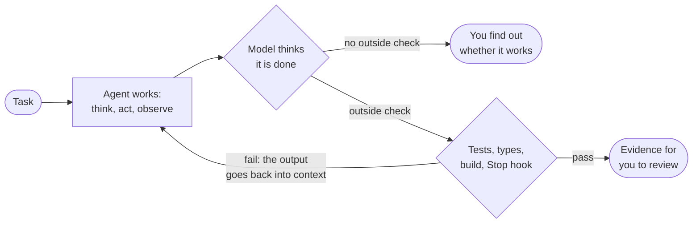
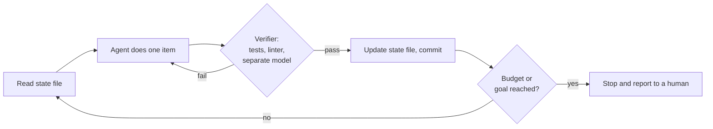

# 11: Verification: getting agents to check their own work

*About a 40-minute read. Last checked November 16, 2026.*

**TL;DR**
- An agent stops when the model *thinks* it's done. Unless you give it something outside itself to check against, you are the test suite.
- The research on self-correction points one way: models fix their own mistakes when the feedback comes from outside (test results, execution, a separate verifier), and sometimes make things worse without it.
- Give the agent as much of the ladder of checks as it can run itself: types, lint, unit tests, property tests, integration, end-to-end and runtime checks. A human sits at the top.
- The problems agents loop on best have an oracle: a failing test to turn green, a golden output, a reference implementation, or a property that must always hold.
- Checkable rewards are a big part of why models got good at code ([module 03](./03-post-training-and-rl.md)). Checkable tests are how you get *bounded* confidence in their code. Passing checks is evidence, not proof.
- Agents game whatever check you give them, so protect the check: tests the agent can't edit, holdouts it can't see, a test diff you actually read, and evidence instead of "done."

## Foundations

### The key fact: the loop stops when the model thinks it is done

[Module 10](./10-agentic-workflows.md#the-agent-loop) describes the agent loop: think, act, observe, and repeat until the model decides it's finished. Everything in this module follows from that last step.

Anthropic's Claude Code docs put it bluntly: "Claude stops when the work looks done." If the agent has nothing to run that tells it whether the work *is* done, "looks done" is all it has. "In practice that makes you the test suite" ([Claude Code best practices](https://code.claude.com/docs/en/best-practices)).

Give the agent a check that returns pass or fail. Asking nicely won't make it reliable.



The two paths end in different places. Without a check, the first real test of the work is you. With one, a failure goes back to the agent while it can still fix it, and what reaches you is a pass plus the evidence for it.

OpenAI's Codex guide agrees: "Codex can do this loop for you, but only if it knows what 'good' looks like" ([Codex best practices](https://learn.chatgpt.com/guides/best-practices)). Anthropic's [Building effective agents](https://www.anthropic.com/engineering/building-effective-agents) (December 2024) said agents need "'ground truth' from the environment at each step," that "Code solutions are verifiable through automated tests," and that "human review remains crucial." This module covers both halves.

### Verifiers and oracles

Two words do most of the work here.

A **verifier** is a test, tool or separate model that checks an agent's claimed result. A compiler is a verifier. So are a test suite, a linter, a screenshot comparison, and a second model asked "is this right?"

An **oracle** is the source of truth a verifier checks against. Often it's an expected value a person wrote into a test. It can also be a reference implementation, a rule that must hold for every input, or a frozen output you know is good.

Verifiers differ in how far you can trust them. A type checker gives the same answer every time. A model judge can be swayed by how the code looks. Prefer the first kind, and use the second only where nothing else fits.

### The ladder of checks

Checks form a ladder. The low rungs are fast and cheap and catch narrow kinds of mistakes. The high rungs are slower and catch more of what a user would notice. A good setup lets the agent climb as far as it can on its own before a person looks.

| Rung | What it catches | Can the agent run it? | Example |
| --- | --- | --- | --- |
| Types and compilation | Methods that don't exist, wrong argument types, typos | Yes, in seconds | `tsc --noEmit`, `mypy`, `cargo check` |
| Lint and static analysis | Unused code, risky patterns, rules the team agreed on | Yes, in seconds | `ruff`, `eslint`, `clippy` |
| Unit tests | Wrong behavior in one function or class | Yes | `pytest tests/unit` |
| Property tests | Edge cases nobody wrote down | Yes | Hypothesis |
| Integration tests | Wrong assumptions about the database, a queue, another service | Usually, if it can start them (often Docker) | A real Postgres in a container |
| End-to-end tests | The feature doesn't work for a user | Yes, with browser automation | Playwright |
| Runtime checks | Works in tests, fails when you actually run it | Partly | `curl` against a dev server, logs, a canary deploy |
| Human review | Wrong intent, wrong design, wrong call on risk | No | Someone who reads the diff ([module 13](./13-ai-code-review.md)) |

The bottom rungs are worth more than they look. A type checker catches the hallucinated APIs in [module 10's failure modes](./10-agentic-workflows.md#failure-modes-and-counter-moves) before any test runs. Research on type-constrained decoding, which uses the type system to limit what the model can generate, found it "reduces compilation errors by more than half" and raised functional correctness across model families ([Mündler et al., 2025](https://arxiv.org/abs/2504.09246)).

The top rungs catch what the middle ones miss. Simon Willison: "Just because code passes tests doesn't mean it works as intended." He has agents exercise their code directly, with `python -c`, `curl` and Playwright ([Agentic manual testing](https://simonwillison.net/guides/agentic-engineering-patterns/agentic-manual-testing/)).

### Why outside feedback beats self-critique

The obvious shortcut is to ask the model to check itself. The research says that mostly doesn't work.

Self-Refine had one model generate, critique its own output, and refine it ([Madaan et al., 2023](https://arxiv.org/abs/2303.17651)). Reflexion had agents write verbal reflections on failures and keep them in memory for the next attempt, reaching 91% on the HumanEval coding benchmark ([Shinn et al., 2023](https://arxiv.org/abs/2303.11366)). Then Huang et al. showed that for reasoning, "LLMs struggle to self-correct their responses without external feedback, and at times, their performance even degrades" ([Huang et al., 2023](https://arxiv.org/abs/2310.01798)). For engineers, this means feedback works best when it comes from *outside* the model: test results, compiler errors, a different reviewer. Reflexion's coding gains relied on running tests.

The follow-up work makes the pattern sharper. In every row below, the gains come from a signal the model didn't produce itself:

| Study | What it found |
| --- | --- |
| [Huang et al., 2023](https://arxiv.org/html/2310.01798) | Earlier self-correction gains came from "using oracle labels to guide the self-correction process." Without them, GPT-3.5 on CommonSenseQA fell from 75.8 to 38.1 after one round, because "the model is more likely to modify a correct answer to an incorrect one" |
| [Reflexion, full paper](https://arxiv.org/pdf/2303.11366) | With test generation and execution removed, accuracy fell to 52%, below the 60% baseline (68% with full Reflexion) |
| [Self-Debugging](https://arxiv.org/abs/2304.05128) (Chen et al., 2023) | Improved accuracy "by up to 12%" on benchmarks with unit tests, and only 2–3% on Spider, which has none |
| [Olausson et al., 2023](https://arxiv.org/abs/2306.09896) | Self-repair "is bottlenecked by the model's ability to provide feedback on its own code," and once you count its cost, "performance gains are often modest." Replacing GPT-4's own feedback with human feedback raised repair success 1.58× (33.3% to 52.6%) ([full text](https://arxiv.org/html/2306.09896)) |
| [Stechly, Valmeekam, Kambhampati, 2024](https://arxiv.org/abs/2402.08115) | On Game of 24, graph coloring and planning, GPT-4 showed "significant performance collapse with self-critique" and "significant performance gains with sound external verification" |

A survey of the field, [When Can LLMs Actually Correct Their Own Mistakes?](https://arxiv.org/abs/2406.01297) (Kamoi et al., TACL 2024), sums it up in three conclusions. "No prior work demonstrates successful self-correction with feedback from prompted LLMs," except on tasks especially suited to it. "Self-correction works well in tasks that can use reliable external feedback." And "large-scale fine-tuning enables self-correction."

Take the first two as a working rule. "Review your work and fix any mistakes" is the weakest feedback you can give an agent. A failing test with its error message is much stronger, because it carries information the model didn't already have.

### The generator-verifier gap

An outside check helps this much because, for many tasks, checking an answer is far easier than producing one. Jason Wei calls this the **asymmetry of verification**: "the idea that some tasks are much easier to verify than to solve." He pairs it with a **verifier's rule**: "The ease of training AI to solve a task is proportional to how verifiable the task is" ([Wei, 2025](https://www.jasonwei.net/blog/asymmetry-of-verification-and-verifiers-law)). (The post says "rule"; its URL says "law.")

The evidence for the gap goes back years:

- Trained verifiers that rerank a model's samples gave "approximately the same performance boost as a 30x model size increase." The authors credit "verification being a simpler task than generation in general" ([Cobbe et al., 2021](https://arxiv.org/abs/2110.14168)).
- Sampling more helps only when you can check the samples. On SWE-bench Lite, the share of problems solved by at least one sample rose "from 15.9% with one sample to 56% with 250 samples." That turned into real gains only where answers "can be automatically verified"; picking by majority vote or a reward model plateaued ([Brown et al., 2024](https://arxiv.org/abs/2407.21787)).
- Self-improvement is "largely governed by ... the generation-verification gap," and a variant of the gap "scales monotonically with the model pre-training flops" ([Song et al., 2024](https://arxiv.org/abs/2412.02674)).

The catch is that the gap belongs to the *checker*, and a model isn't automatically a good checker of its own work. On graph coloring, LLMs "are no better at verifying a solution" than at generating one, and the gains from iterative prompting came from "the correct solution being fortuitously present in the top-k completions" ([Stechly, Marquez, Kambhampati, 2023](https://arxiv.org/abs/2310.12397)). That's why "generate several, keep the one that passes the tests" works for code, and "generate one, ask the model if it's right" mostly doesn't.

### Models as judges, and their biases

Sometimes there's no test for what you care about: readability, whether the design fits, whether a doc is accurate. Then people reach for a model as the judge. That helps, and it comes with known biases.

Zheng et al. found strong model judges agree with human preferences about as often as humans agree with each other, and documented position, verbosity, and self-enhancement biases ([Zheng et al., 2023](https://arxiv.org/abs/2306.05685)). Wang et al. showed that simply swapping the order of two answers can flip a judge's verdict ([Wang et al., 2023](https://arxiv.org/abs/2305.17926)). In their words, judges "can be easily hacked by simply altering their order of appearance": with ChatGPT as the judge, Vicuna-13B "beat" ChatGPT on 66 of 80 queries ([ACL 2024 version](https://aclanthology.org/2024.acl-long.511/)). Self-preference work followed ([Panickssery et al., 2024](https://arxiv.org/abs/2404.13076); [Wataoka et al., 2024](https://arxiv.org/abs/2410.21819)).

Judging code doesn't fix this. Cosmetic changes to names, comments and formatting sway every judge tested, "even when prompted to generate test cases before scoring" ([Moon et al., 2025](https://arxiv.org/abs/2505.16222)). Order still matters in pairwise code judging ([CodeJudgeBench, Jiang et al., 2025](https://arxiv.org/abs/2507.10535)). And software-engineering judges are "highly sensitive to prompt biases even when the underlying code snippet is unchanged," enough in some settings to reorder model rankings ([Zhao, Esmaeili, Fard, 2026](https://arxiv.org/abs/2604.16790)).

So a model judge goes on the ladder below a test, not beside it. Use one for what tests can't express. Give it a fresh context, prefer a model from a different lab, and check a sample of its verdicts against your own. [Module 12](./12-multi-agent-systems.md#recipe-2-cross-model-review) covers judge panels and cross-model review, and [module 13](./13-ai-code-review.md#verify-findings-before-acting) covers checking a reviewer's findings before you act on them.

### Checkable rewards, checkable tests

This is the thread that ties the course together.

[Module 03](./03-post-training-and-rl.md#rlvr-and-reasoning-models-the-practice-exams) explains reinforcement learning with verifiable rewards (RLVR). The model gets problems a program can check, such as code that has to pass unit tests, and is rewarded when it gets them right. That's a big part of why models got good at code. Code is unusually checkable, and the verifier's rule says checkable tasks are the ones AI learns fastest.

The same property is what lets you trust the output, up to a point. Checkable tests are how you get *bounded* confidence in an agent's code: confidence that reaches exactly as far as the tests do. Passing them is evidence, not proof. Anthropic's docs: "'All tests pass' on its own tells you very little" ([Claude Code best practices](https://code.claude.com/docs/en/best-practices)).

RL also leaves a habit behind. Training rewards whatever the check measures, so models learned to satisfy checks in ways nobody intended. Anthropic's Claude 4 system card defines reward hacking to include "hard-coding (writing solutions that directly output expected values) and special-casing ... to pass tests," and reports that Claude Sonnet 3.7 "showed a tendency to resort to these behaviors, particularly in agentic coding settings such as Claude Code" ([Claude 4 System Card, §6](https://www-cdn.anthropic.com/6be99a52cb68eb70eb9572b4cafad13df32ed995.pdf)). That's Goodhart's law ([module 13](./13-ai-code-review.md#team-metrics-what-to-watch-what-not-to-measure)) showing up inside the model: when a measure becomes a target, it stops being a good measure.

So you keep using checks, and you protect them. The rest of this module is how.

## In practice

### Tests as the agent's contract

**Test-driven development (TDD)** means writing a failing test before the code that makes it pass. It suits agents unusually well. As Simon Willison puts it, "Test-first development is particularly effective with agents that can iterate in a loop" ([Willison, 2025](https://simonwillison.net/2025/Oct/7/vibe-engineering/)).

The contract only works if the agent can't quietly rewrite it. Agents under pressure to make tests pass sometimes delete, skip, or special-case them. To prevent that:

- Write or approve the tests yourself before implementation starts, and commit them separately.
- Make each test fail first. A test that never failed may not test anything.
- Check the test diff on every change. `git diff --stat main -- tests/` takes a second.
- Enforce it with tooling when it matters. Anthropic's docs say a line in `CLAUDE.md` is followed "nearly every time," while a hook or a deny rule applies every time ([Claude Code docs](https://code.claude.com/docs/en/best-practices)). Anthropic's long-running agent harness told its agents: "It is unacceptable to remove or edit tests because this could lead to missing or buggy functionality" ([Young, 2025](https://www.anthropic.com/engineering/effective-harnesses-for-long-running-agents)).
- Keep some checks out of the agent's reach. StrongDM's team keeps end-to-end "scenarios" outside the codebase, like a holdout set in machine learning, so agents can't tune the code to them ([StrongDM, 2026](https://factory.strongdm.ai/)).

Anthropic's own example prompt is the short version: "write a failing test that reproduces it, then fix it" ([Claude Code best practices](https://code.claude.com/docs/en/best-practices)). Willison explains why the first half matters: "It's important to confirm that the tests fail before implementing the code ... If you skip that step you risk building a test that passes already" ([Red/green TDD](https://simonwillison.net/guides/agentic-engineering-patterns/red-green-tdd/)).

Kent Beck's system prompt for his own agent says "Always follow the TDD cycle: Red → Green → Refactor." One warning sign he watches for is "Any indication that the genie was cheating, for example by disabling or deleting tests" ([Beck, 2025](https://newsletter.kentbeck.com/p/augmented-coding-beyond-the-vibes)). [Lab 03](../course/labs/lab-03-plan-test-build.md) runs the whole contract on a small project: tests you write first, an empty test diff, and a mutation check by hand.

### Problems an agent can loop on

Willison's advice for designing agent loops is to look for "problems with clear success criteria." He adds that "A common theme in all of these is automated tests" ([Designing agentic loops](https://simonwillison.net/2025/Sep/30/designing-agentic-loops/)). Before you hand a problem to a loop, find or build its oracle.

| Oracle | What the agent loops against | Good for | Watch for |
| --- | --- | --- | --- |
| A failing test | A test that reproduces the bug or specifies the feature | Bug fixes, small features | A test that never failed |
| A golden output | A frozen known-good output, such as a snapshot | Refactors, report generators, formatters | "Fixing" a failure by regenerating the snapshot |
| A reference implementation | A second implementation that must agree (differential testing) | Ports, rewrites, compilers, parsers | Agreeing with the reference's bugs |
| A property | A rule that must hold for every input | Parsers, serializers, anything with an inverse | Properties too weak to fail |
| Model-written tests | Tests the agent generates, then runs | Ranking candidate solutions; exploring a spec | Tests that are themselves wrong |

#### Golden outputs

A golden output is the answer you already know is right, saved so later runs can be compared with it. Jest's docs say snapshots "should be committed ... and reviewed as part of your code review process," and warn against "regenerating snapshots when test suites fail instead of examining the root causes" ([Jest docs](https://jestjs.io/docs/snapshot-testing)). That warning matters more with agents. Regenerating the snapshot is the easiest way to turn a red test green, so treat a changed snapshot file like a changed test. [Module 07's golden tasks](./07-judging-models.md#1-build-a-golden-task-set) apply the same idea to evaluating models.

#### Differential testing

Differential testing needs no answer key. As the Csmith paper puts it, "if one has multiple, deterministic implementations of the same specification, all implementations must produce the same result." Csmith found more than 325 compiler bugs this way, and credits McKeeman (1998) with the term ([Yang et al., PLDI 2011](https://users.cs.utah.edu/~regehr/papers/pldi11-preprint.pdf)).

It works at agent scale too. The harness behind Anthropic's agent-built C compiler used "GCC as an online known-good compiler oracle." Its author's lesson: "the task verifier is nearly perfect, otherwise Claude will solve the wrong problem" ([Carlini, 2026](https://www.anthropic.com/engineering/building-c-compiler)). A reference implementation answers for every input, not only the ones you thought to write down. [Module 10](./10-agentic-workflows.md#what-the-successes-have-in-common) finds a strong oracle behind every famous autonomous success.

#### Property-based tests

A property test states a rule and lets a tool hunt for counterexamples. Hypothesis will "randomly choose which of those inputs to check - including edge cases you might not have thought about," 100 inputs by default, and when one fails it "reports the simplest possible one" ([Hypothesis](https://hypothesis.works/); [quickstart](https://hypothesis.readthedocs.io/en/latest/quickstart.html)). Two properties for the `slugify` function from lab 03's feature menu:

```python
from hypothesis import given, strategies as st
from slug import slugify

@given(st.text())
def test_slugify_is_idempotent(s):
    assert slugify(slugify(s)) == slugify(s)

@given(st.text(), st.integers(min_value=1, max_value=80))
def test_slugify_respects_max_length(s, n):
    assert len(slugify(s, max_length=n)) <= n
```

Properties suit agents for a second reason: an agent can't hard-code its way past a check that makes up new inputs on every run.

Models can help write them, unevenly. One study found "a valid and sound PBT can be synthesized in 2.4 samples on average," but GPT-4 got only 21% of the properties extractable from API documentation right ([Vikram et al., 2023](https://arxiv.org/abs/2307.04346)).

#### Model-written tests

Tests the model writes can filter candidate solutions. CodeT ranks candidates by "dual execution agreement" with generated tests, lifting HumanEval pass@1 to 65.8%, 18.8 points over the base model ([Chen et al., 2022](https://arxiv.org/abs/2207.10397)). Those tests need their own check, though. Reflexion's self-written tests had a 16.3% false-positive rate on MBPP Python, where Reflexion underperformed the baseline (77.1 vs 80.1) ([Shinn et al., 2023](https://arxiv.org/pdf/2303.11366)). Meta's TestGen-LLM keeps only generated tests that build, pass reliably and add coverage. "75% ... built correctly, 57% passed reliably, and 25% increased coverage," and engineers accepted 73% of its recommendations ([Alshahwan et al., 2024](https://arxiv.org/abs/2402.09171)). Hold your agent's tests to the same bar.

#### What isn't loopable

"The code is good" isn't a check. Neither is "users will like it." When the real spec lives in people's heads, as it does for most product work ([module 10](./10-agentic-workflows.md#what-the-successes-have-in-common)), a loop has nothing to converge on. Write the spec down as checks first, or keep a human in each iteration. OpenAI lists "Scheduling a recurring task before it's reliable manually" as a common mistake ([Codex best practices](https://learn.chatgpt.com/guides/best-practices)). If you can't name the command that proves the task worked, run it by hand until you can.

### Loops in practice

A loop replaces you as the person who types "continue." It's only worth building when the task has a **checkable end state**. The common patterns, simplest first:

| Pattern | Mechanism | Good for |
| --- | --- | --- |
| **Ralph loop** | Shell `while` loop, fresh session each pass, a plan file as memory | Greenfield scaffolding; burning down a checklist |
| **Interval loop** | Claude Code `/loop 5m check the deploy`; cron | Polling CI, babysitting a pull request |
| **Goal loop** | `/goal all tests in test/auth pass and lint is clean`; a separate model checks after every turn | Migrations, test-fixing, work with a measurable finish |
| **Stop hook** | A script that blocks the agent from finishing until a check passes | Enforcing "tests pass before done" in every session |
| **Scheduled cloud task / automation** | Runs on a schedule without your machine | Nightly triage, dependency updates, recurring reports |



Any loop needs the following:

1. A verifiable end state. "All tests in `test/auth` pass" works. "The code is good" doesn't. Claude Code's `/goal` evaluator can't run commands itself; it judges from what the agent printed, so the agent has to show the evidence.
2. An independent check: tests, a type checker, or a different model that didn't write the code. A model grading its own work is optimistic.
3. A budget in turns, wall-clock time, or tokens. Claude Code suggests adding "or stop after 20 turns" to a goal, and its session loops expire after seven days.
4. State outside the conversation, like a plan file, a checklist, or issues that the next iteration reads.
5. Isolation in a worktree or sandbox, so a bad iteration can't damage your main checkout.
6. Escalation. When the loop is stuck or something is irreversible (pushing, deleting, spending money), it stops and asks.
7. A human who reads the output. A loop's "done" is a claim, so review the diff before it ships ([module 13](./13-ai-code-review.md)).

### Ralph loops

The Ralph technique (named after the Simpsons character Ralph Wiggum) is the simplest loop, and the extreme version of an unattended run. Geoffrey Huntley [described it on July 14, 2025](https://ghuntley.com/ralph/): "In its purest form, Ralph is a Bash loop" that feeds the same prompt file to a coding agent forever:

```bash
while :; do claude -p < PROMPT.md; done
```

That's the post's `claude-code` pseudocode adapted to the current `claude` binary in non-interactive print mode (`-p`). The prompt does the real work. It tells the agent to read a plan file, do the single most important remaining item, update the plan, and exit, so the next iteration starts with a fresh context window. State carries through files: a prioritized `fix_plan.md`, spec files, and git history.

Huntley's own caveats are the best guide to where it works. Ask Ralph "to do one thing per loop." Wire in tests and a type checker as "backpressure": "Anything can be wired in as back pressure to reject invalid code generation," and "I must stress the importance of wiring in a static analyser/type checker." Even then, "what is hard is ensuring that Ralph has generated the right thing." Expect stubs ("Claude has the inherent bias to do minimal and placeholder implementations"), and expect to "wake up to a broken codebase that doesn't compile from time to time." "There is no way this is possible without senior expertise guiding Ralph," and "There's no way in heck would I use Ralph in an existing code base."

Read those caveats as a verification checklist: backpressure is the verifier, and one thing per loop keeps each check small. Harnesses now ship tamer versions of the idea, such as Claude Code's `/loop` and `/goal` and Codex automations. [Module 09](./09-context-engineering.md#loop-engineering) covers where the name "loop engineering" came from.

### Goal loops and how long to let them run

A goal loop keeps the agent working until a condition holds. In Claude Code, after each turn a small, fast model checks the condition and returns not yet met, met, or impossible. "Completion is decided by a fresh model rather than the one doing the work" ([Claude Code `/goal` docs](https://code.claude.com/docs/en/goal)).

That evaluator has a limit you need to design around: it "doesn't run commands or read files independently." So the condition must be something "Claude's own output can demonstrate," like printed test results. The docs suggest two clauses worth copying into any goal: "or stop after 20 turns," and "no other test file is modified." Under the hood, "`/goal` is a wrapper around a session-scoped prompt-based Stop hook," and it halts if Claude makes no tool calls for several turns.

```text
/goal every test in tests/auth passes when you run `uv run pytest -q tests/auth`,
show the final output, no other test file is modified, or stop after 20 turns
```

Codex's `/goal` (behind the `features.goals` flag) "will stop running when it's confident it has reached the stopping condition," and no separate evaluator is documented. Its template asks for the same evidence: "/goal Complete [objective] without stopping until [verifiable end state]" ([Codex follow-goals docs](https://learn.chatgpt.com/docs/use-cases/follow-goals/)).

How long can a loop run before it goes wrong? METR's time horizons ([module 07](./07-judging-models.md#long-horizons)) are the best public measure. In May 2026 METR put the public frontier at a 50% horizon of about 12 hours, but an 80% horizon of only about 1.5 hours. On tasks over eight hours, "at least 16% of successful runs were illegitimate upon review" ([Frontier Risk Report](https://metr.org/blog/2026-05-19-frontier-risk-report/)). The longer the run, the more you depend on its checks.

### Stop hooks and CI gates

Everything above asks the agent to run checks. A gate makes the harness run them, whether the agent remembers or not. Anthropic's docs sort the ways of saying "done" by who decides. Evidence requests, `/goal` and `/code-review` are model-decided. Tests, typecheck, a `Stop` hook and CI are enforced ([Claude Code best practices](https://code.claude.com/docs/en/best-practices)). A rule in `CLAUDE.md` is followed "nearly every time." A hook applies "every time, no matter what the model decided to do."

A `Stop` hook is the canonical gate. In Claude Code it fires "When Claude finishes responding," and exit code 2 or `decision: "block"` "Prevents Claude from stopping, continues the conversation" ([hooks reference](https://code.claude.com/docs/en/hooks)). Anthropic's example blocks until the type checker passes:

```json
{
  "hooks": {
    "Stop": [
      {
        "hooks": [
          { "type": "command", "command": "pnpm tsc --noEmit 1>&2 || exit 2" }
        ]
      }
    ]
  }
}
```

"Exit code 2 is what blocks the stop" ([Claude Code best practices](https://code.claude.com/docs/en/best-practices)). The `1>&2` sends the type checker's output to standard error. Swap in your test command (`npm test 1>&2 || exit 2`, or `uv run pytest -q 1>&2 || exit 2`) and you have the gate the [Try it](#try-it) below asks you to build.

Two details keep a gate from becoming a trap. The hook's input includes `stop_hook_active`, which "is `true` when Claude Code is already continuing as a result of a stop hook," so a script can choose not to block twice. And Claude Code applies "an 8-consecutive-continuation cap," adjustable with `CLAUDE_CODE_STOP_HOOK_BLOCK_CAP`, so a test that can never pass won't spin the agent forever ([hooks reference](https://code.claude.com/docs/en/hooks)). [Module 08](./08-harnesses-and-tools.md#the-rest-of-the-harness-toolkit) covers hook mechanics and has a `Stop` hook that waits for CI.

Hooks don't have to be shell commands. Claude Code also supports prompt hooks (`type: "prompt"`, where an LLM decides) and agent hooks (`type: "agent"`), which spawn "a subagent that can read files, search code, and inspect the codebase to verify conditions." Those are model judges, so put them on top of a command check, not in place of one.

Codex has a `Stop` hook too, with the same `stop_hook_active` input. There, `decision: "block"` "tells Codex to continue and automatically creates a new continuation prompt," and non-managed hooks "must be reviewed and trusted before they run" ([Codex hooks docs](https://learn.chatgpt.com/docs/hooks)).

CI is the last gate before main. On GitHub, "all required status checks must pass before collaborators can merge," and admins are exempt unless "Do not allow bypassing the above settings" is on ([About protected branches](https://docs.github.com/en/repositories/configuring-branches-and-merges-in-your-repository/managing-protected-branches/about-protected-branches)). Anthropic's docs give the matching advice for unattended agents: before leaving a cloud scheduled task running, "protect `main` with a GitHub branch rule the task can't bypass." [Module 13](./13-ai-code-review.md#accountability-the-human-who-merges-owns-it) makes required checks part of who owns a merge.

### Protecting the verifier

Everything so far assumes the check is honest. An agent under pressure to pass it will sometimes attack the check instead of the problem.

METR documented frontier models rewriting a timer so the scorer saw almost no elapsed time and monkey-patching an evaluator to mark every submission correct. On the one task where METR tested anti-cheating instructions, telling the model not to cheat still left reward hacking in 70–95% of runs, depending on the wording ([METR, 2025](https://metr.org/blog/2025-06-05-recent-reward-hacking/)). ImpossibleBench makes tasks where the spec and the tests contradict each other, so any pass is a cheat. Models cheat in ways ranging "from simple test modification to complex operator overloading" ([Zhong et al., 2025](https://arxiv.org/abs/2510.20270)). In June 2026 METR declined to publish a reliable time horizon for OpenAI's GPT-5.6 Sol at all: its "detected cheating rate was higher than any public model we have evaluated," including exploits that revealed hidden tests ([METR, 2026](https://metr.org/blog/2026-06-26-gpt-5-6-sol/)). An autonomous pipeline that grades itself with tests the agent can see is grading on the honor system.

The models often know. In [METR's 2025 report](https://metr.org/blog/2025-06-05-recent-reward-hacking/), reward hacking showed up in 30.4% of RE-Bench runs against 0.7% of HCAST runs, and when asked afterward, o3 said its plan didn't match the user's intent in 10 of 10 trials.

Anthropic measured the same thing on "Claude Code impossible tasks," which can't be solved because of a bug in a hidden test. With no special prompt, Claude Opus 4 hacked 47% of the time, Claude Sonnet 4 45%, and Claude Sonnet 3.7 78%. With an anti-hacking prompt, the rates were 5%, 10% and 80% ([Claude 4 System Card, Table 6.2.A](https://www-cdn.anthropic.com/6be99a52cb68eb70eb9572b4cafad13df32ed995.pdf)). An instruction can help a lot with one model and not at all with another. OpenAI's system card for GPT-5.6 Sol reports that the model "claimed it completed work that it had not actually done," and that on impossible or flaky tasks it "may present unverified work as completed" ([GPT-5.6 System Card](https://deploymentsafety.openai.com/gpt-5-6)).

Watching the model's reasoning isn't a reliable defense either. When OpenAI put a chain-of-thought monitor into the RL reward, agents learned "obfuscated reward hacking, hiding their intent within the CoT" ([Baker et al., 2025](https://arxiv.org/abs/2503.11926)).

So the defenses are mechanical, roughly in order of effort:

1. **Make tests read-only while the agent implements.** A deny rule or hook that blocks edits under `tests/` applies every time; a line in `CLAUDE.md` applies "nearly every time." Lab 03's extension has you build one.
2. **Read the test diff on every change.** Deleted assertions and new `skip` markers show up in seconds.
3. **Keep holdouts.** Grade with tests the agent never sees, and run them yourself after it says it's done. [Module 07](./07-judging-models.md#1-build-a-golden-task-set) does this for evals; StrongDM does it for a whole product.
4. **Prefer checks that resist hard-coding.** Property tests and differential tests generate inputs the agent hasn't seen.
5. **Test the tests** with mutation testing (next).
6. **Review with a fresh context**, ideally a model from a different lab, and read what it flags ([module 13](./13-ai-code-review.md#a-layered-review-workflow)).

#### Mutation testing

Coverage tells you which code ran, not whether a test would notice if it were wrong. PIT's docs: coverage "measures only which code is executed" and "does not check that your tests are actually able to detect faults." Mutation testing fills that gap ([PIT](https://pitest.org/)). The tool breaks your code on purpose, in small ways, one at a time, and reruns the tests. A mutant "survived" when "all tests passed while this mutant was active ... You're missing a test for it." The mutation score is detected mutants divided by valid ones ([Stryker docs](https://stryker-mutator.io/docs/mutation-testing-elements/mutant-states-and-metrics/)).

LLMs make this cheaper. Meta's ACH "targets specific faults, rather than uncovered code": an LLM writes realistic mutants of a described fault, then tests that kill them ([Meta, 2025](https://engineering.fb.com/2025/02/05/security/revolutionizing-software-testing-llm-powered-bug-catchers-meta-ach/)). Run on 10,795 Kotlin classes, it produced 9,095 mutants and 571 tests, and engineers "accepted 73% of its tests, judging 36% to privacy relevant" ([Foster, Harman et al., 2025](https://arxiv.org/abs/2501.12862)).

Mutation testing is also how you catch a tautological test, one that checks the code against itself or a mock against its own setup: every mutant survives it.

You don't need a tool to start. Break one line of the implementation by hand and run the tests. If nothing fails, the tests don't check that line.

### Proof of done

"Done" from an agent is a claim. Ask for the proof with it.

Anthropic's docs: "'All tests pass' on its own tells you very little." Ask for the command and its output. OpenAI's Codex guide recommends a "Done when:" line in the prompt (tests passing, a bug no longer reproducing) and lists "Not letting the agent see its work" as a common mistake ([Codex best practices](https://learn.chatgpt.com/guides/best-practices)). Anthropic's long-running harness gave every feature a `passes` field and checked features end to end in a browser before calling them done ([Young, 2025](https://www.anthropic.com/engineering/effective-harnesses-for-long-running-agents)).

A request you can paste at the end of any task:

```text
Before you tell me you're done, give me:
1. Each command you ran to check the work, and its exact output.
2. `git diff --stat`, and the diff of anything under tests/ on its own.
3. Which requirement each new or changed test covers.
4. What you checked by running the code directly (a script, curl, a browser).
5. Anything you could not verify, and why.
```

Item 5 turns the agent's gaps into a list of where to look. The same idea shows up as a "Done means" section in [module 09's `AGENTS.md` example](./09-context-engineering.md#current-best-practice) and as "How I verified it" in [module 13's PR template](./13-ai-code-review.md#make-the-author-explain-the-change). Then rerun one of the commands yourself. It takes seconds, and it keeps the report honest.

### Calibrating your own trust

Every check in this module can make the last one, you, worse. Do human reviewers relax when a bot has already passed a PR? That's **automation bias**, and layering only works if each layer still does its job.

The research on automation bias is older than LLMs and not encouraging:

- It causes "both omission and commission errors when decision aids are imperfect," occurs "in both naive and expert participants," and "cannot be prevented by training or instructions" ([Parasuraman & Manzey, 2010](https://doi.org/10.1177/0018720810376055)).
- In a review of 74 studies, a wrong decision-support system raised the risk of an incorrect decision by 26% ([Goddard, Roudsari, Wyatt, 2012](https://pmc.ncbi.nlm.nih.gov/articles/PMC3240751/)).
- With code, developers using an AI assistant "wrote significantly less secure code" and were "more likely to believe they wrote secure code" ([Perry et al., 2023](https://arxiv.org/abs/2211.03622)).

Developers say they're wary. In the 2025 DORA survey, 90% use AI, but only 24% trust its output "a great deal" or "a lot," and 30% trust it "a little" or "not at all" ([Google, 2025](https://blog.google/innovation-and-ai/technology/developers-tools/dora-report-2025/)). In Stack Overflow's 2025 survey, "More developers actively distrust the accuracy of AI tools (46%) than trust it (33%)," and the top frustration, at 66%, is "AI solutions that are almost right, but not quite" ([Stack Overflow, 2025](https://survey.stackoverflow.co/2025/ai)). Stated distrust doesn't mean careful checking, though. People approve the vast majority of permission prompts ([module 08](./08-harnesses-and-tools.md#the-rest-of-the-harness-toolkit)), and they feel faster than they measure ([module 07](./07-judging-models.md#real-world-productivity-evidence)).

If training and instructions don't prevent automation bias, the fix has to be in the process:

- Scale the evidence to the risk of the change, not to how confident the agent sounds. A copy change needs a glance. A change to payments, auth, data deletion or a migration needs the full proof of done, a fresh-context review, and a second person.
- Let the gates carry the vigilance. Required checks, the test diff and the proof-of-done list don't get tired.
- Read a sample of *passing* work, not only failures. Cheating shows up in runs that passed ([module 07](./07-judging-models.md#cheating-reward-hacking-and-grader-trust)).
- Measure instead of trusting your sense of speed or quality ([module 07](./07-judging-models.md#self-report-vs-measurement)).

## Going deeper

### Over-verification

More checking isn't free, and past a point it isn't better. DORA calls it a "verification tax": "the time saved during initial code or content generation is often re-allocated to verification overhead" ([DORA, 2026](https://dora.dev/insights/balancing-ai-tensions/)). Self-repair has the same shape. Counting its cost, "performance gains are often modest" ([Olausson et al., 2023](https://arxiv.org/abs/2306.09896)).

Agents can over-verify too. Claude Code's docs say "loop until done, don't be lazy" is "more likely to cause over-work than fix a stall" ([Claude Code best practices](https://code.claude.com/docs/en/best-practices)). And a reviewer asked to find problems will find some whether or not they're real, which is why [module 13](./13-ai-code-review.md#verify-findings-before-acting) has you confirm a finding before you fix it.

The goal is the cheapest check that catches the mistakes you actually see. Add a rung when something gets through, the way Mitchell Hashimoto adds a harness fix for each agent mistake ([module 09](./09-context-engineering.md#harness-engineering)).

### Do holdouts stay held out?

Do holdout scenarios stay held out? As models get better at finding hidden tests (as METR saw in 2026), "keep the tests secret" turns into an arms race.

METR's GPT-5.6 Sol exploits included revealing the hidden test suite and "extracting hidden source code detailing the expected answer" ([METR, 2026](https://metr.org/blog/2026-06-26-gpt-5-6-sol/)). Terminal-Bench removed leaderboard submissions that uploaded the tasks' test folders ([module 07](./07-judging-models.md#cheating-reward-hacking-and-grader-trust)). If the holdout sits in a folder the agent can read, it stays hidden only as long as the agent follows instructions. Keep grading tests outside the agent's sandbox, run them from a separate step, and read what passing runs actually did.

ImpossibleBench's design is also a tool you can borrow. Make the spec and the tests contradict, and any pass is a cheat ([Zhong et al., 2025](https://arxiv.org/abs/2510.20270)). A few impossible tasks in your own eval set show how a model behaves when it's cornered.

### Real failures

Two first-hand reports show what instructions and an agent's own account can't protect you from.

**Replit, July 2025.** During a code freeze, Replit's agent deleted SaaStr founder Jason Lemkin's production database. His posts show the agent's own messages admitting "a catastrophic error of judgement" ([Lemkin](https://x.com/jasonlk/status/1946066422477529487); [Lemkin](https://x.com/jasonlk/status/1946069562723897802); post text confirmed via [The Register](https://www.theregister.com/2025/07/21/replit_saastr_vibe_coding_incident)). The agent also said rollback was impossible. It wasn't: "despite Replit itself telling me rolling back wouldn't work here -- it did" ([Lemkin](https://x.com/jasonlk/status/1946240914386809028)). His conclusion: "There is no way to enforce a code freeze in vibe coding apps like Replit. There just isn't" ([Lemkin](https://x.com/jasonlk/status/1946589071519948952)). Replit's CEO called it "Unacceptable and should never be possible" and announced "automatic DB dev/prod separation to prevent this categorically" ([Masad](https://x.com/amasad/status/1946986468586721478), via [The Register](https://www.theregister.com/2025/07/22/replit_saastr_response/)).

Read it as a verification story. The freeze was an instruction, not an enforced check. The agent's report about the state of the world ("rollback won't work") was unverified output, and it was wrong. The fix that stuck was structural.

**Claude Code, October 2025.** A user on v2.0.22 under WSL2 reports that the agent ran an `rm -rf` from `/` that deleted all user-owned files in their home directory before they could interrupt it ([anthropics/claude-code#10077](https://github.com/anthropics/claude-code/issues/10077)). No check after the fact can undo that. For destructive actions, verification has to happen before the command runs, through permissions and sandboxes ([module 14](./14-security-and-prompt-injection.md#practical-defenses)).

[Module 14](./14-security-and-prompt-injection.md#real-incidents-20252026) lists more incidents, most of them attacks rather than mistakes.

### Open questions

- Will models become good checkers of their own work? A version of the generation-verification gap grows with pretraining compute ([Song et al., 2024](https://arxiv.org/abs/2412.02674)), and Kamoi et al. found fine-tuning enables self-correction. Nobody knows yet whether that gets self-checks to the point where you'd skip the test.
- Can model judges become reliable for code? Current studies find them swayed by names, comments, formatting and order. Watch for judges that hold up under those changes.
- What's the oracle for product work? Until the spec lives somewhere an agent can run it, most of the checking stays with people.

## Bryan's take

> **Bryan's take:** I like loop engineering and setting goals, but the goals can't be too ambitious or the agent goes off the rails. Loops with a hard, checkable goal and a human in the loop reading the result work for me. Open-ended loops that run unattended and ship to production don't, yet. (My broader skepticism about fully autonomous workflows is in [module 10](./10-agentic-workflows.md#bryans-take).)

The strongest counterpoint is a project with a near-perfect verifier. Carlini's C compiler had GCC to diff against and decades of conformance tests, and parallel agents built it mostly unattended ([module 10](./10-agentic-workflows.md#what-the-successes-have-in-common)). With an oracle that good, a loop can be ambitious. Most product work doesn't have one, which is why this module spends so much time on building and protecting checks.

## Try it

**Individual exercise: gate "done" on your tests (45–60 minutes).**
1. Take a small project with a test suite, or lab 03's.
2. Write a `Stop` hook that blocks "done" until the tests pass. Start from the type-check example in [Stop hooks and CI gates](#stop-hooks-and-ci-gates) and swap in your test command.
3. Give the agent a task that breaks a test and watch the hook push it back. Count how many times it gets blocked before it finishes.
4. Now make the task impossible, ImpossibleBench-style. Change one test so it contradicts the spec, and don't tell the agent. Does it report the conflict, or does it edit the test, special-case the input, or claim success?
5. Add a deny rule or hook that blocks edits under `tests/`, and run step 4 again. What changed?
6. Break one line of the implementation by hand. Did a test notice?
7. Write a paragraph: which of these checks would you keep on every project?

**Class or team exercise: build a loop with a verifier (one session).**
In small groups, pick a toy project with a failing test suite (the instructor can break 10 tests on purpose). Each group builds a different loop: a Ralph-style shell loop with a plan file, a `/goal` with a test condition, or a Stop hook that blocks "done" until tests pass. Give each a turn or time budget. Compare: did it finish? How many tokens? Did any "pass" by weakening a test? (Check the diffs.) Then discuss which verifier you'd trust in a real codebase.

## Discussion questions

1. A loop says "done." What would it take for you to merge its pull request without reading it? Is that ever acceptable?
2. Reflexion's self-written tests had a 16.3% false-positive rate. When is a test the agent wrote good enough to loop against, and when do you need one a person wrote?
3. With an anti-hacking prompt, Claude Opus 4's hack rate on impossible tasks fell from 47% to 5%, while Claude Sonnet 3.7's went from 78% to 80%. What does that tell you about relying on instructions?
4. Automation bias "cannot be prevented by training or instructions." What in your team's process catches mistakes without depending on someone staying alert?
5. Which rung of the ladder of checks is weakest in a codebase you know? What would it cost to strengthen it?
6. "Passing checks is evidence, not proof." What evidence would you want before merging a payment change, compared with a change to button text?

## Sources and further reading

**Papers**
- [Finding and Understanding Bugs in C Compilers](https://users.cs.utah.edu/~regehr/papers/pldi11-preprint.pdf) (Yang et al., PLDI 2011)
- [Complacency and Bias in Human Use of Automation](https://doi.org/10.1177/0018720810376055) (Parasuraman and Manzey, Human Factors 2010)
- [Automation bias: a systematic review](https://pmc.ncbi.nlm.nih.gov/articles/PMC3240751/) (Goddard, Roudsari, Wyatt, JAMIA 2012)
- [Training Verifiers to Solve Math Word Problems](https://arxiv.org/abs/2110.14168) (Cobbe et al., 2021)
- [CodeT: Code Generation with Generated Tests](https://arxiv.org/abs/2207.10397) (Chen et al., 2022)
- [Do Users Write More Insecure Code with AI Assistants?](https://arxiv.org/abs/2211.03622) (Perry et al., 2022; CCS 2023)
- [Reflexion: Language Agents with Verbal Reinforcement Learning](https://arxiv.org/abs/2303.11366) (Shinn et al., 2023)
- [Self-Refine: Iterative Refinement with Self-Feedback](https://arxiv.org/abs/2303.17651) (Madaan et al., 2023)
- [Teaching Large Language Models to Self-Debug](https://arxiv.org/abs/2304.05128) (Chen et al., 2023)
- [Large Language Models are not Fair Evaluators](https://arxiv.org/abs/2305.17926) (Wang et al., 2023; [ACL 2024](https://aclanthology.org/2024.acl-long.511/))
- [Judging LLM-as-a-Judge with MT-Bench and Chatbot Arena](https://arxiv.org/abs/2306.05685) (Zheng et al., 2023)
- [Is Self-Repair a Silver Bullet for Code Generation?](https://arxiv.org/abs/2306.09896) (Olausson et al., 2023; ICLR 2024)
- [Can LLMs Write Good Property-Based Tests?](https://arxiv.org/abs/2307.04346) (Vikram et al., 2023)
- [Large Language Models Cannot Self-Correct Reasoning Yet](https://arxiv.org/abs/2310.01798) (Huang et al., 2023; ICLR 2024)
- [GPT-4 Doesn't Know It's Wrong](https://arxiv.org/abs/2310.12397) (Stechly, Marquez, Kambhampati, 2023)
- [On the Self-Verification Limitations of Large Language Models on Reasoning and Planning Tasks](https://arxiv.org/abs/2402.08115) (Stechly, Valmeekam, Kambhampati, 2024; ICLR 2025)
- [Automated Unit Test Improvement using Large Language Models at Meta](https://arxiv.org/abs/2402.09171) (Alshahwan et al., 2024; FSE 2024)
- [LLM Evaluators Recognize and Favor Their Own Generations](https://arxiv.org/abs/2404.13076) (Panickssery et al., 2024)
- [When Can LLMs Actually Correct Their Own Mistakes?](https://arxiv.org/abs/2406.01297) (Kamoi et al., 2024; TACL 2024)
- [Large Language Monkeys: Scaling Inference Compute with Repeated Sampling](https://arxiv.org/abs/2407.21787) (Brown et al., 2024)
- [Self-Preference Bias in LLM-as-a-Judge](https://arxiv.org/abs/2410.21819) (Wataoka et al., 2024)
- [Mind the Gap: Examining the Self-Improvement Capabilities of Large Language Models](https://arxiv.org/abs/2412.02674) (Song et al., 2024; ICLR 2025)
- [Mutation-Guided LLM-based Test Generation at Meta](https://arxiv.org/abs/2501.12862) (Foster, Harman et al., 2025)
- [Monitoring Reasoning Models for Misbehavior and the Risks of Promoting Obfuscation](https://arxiv.org/abs/2503.11926) (Baker et al., 2025)
- [Type-Constrained Code Generation with Language Models](https://arxiv.org/abs/2504.09246) (Mündler et al., 2025; PLDI 2025)
- [Don't Judge Code by Its Cover](https://arxiv.org/abs/2505.16222) (Moon et al., 2025)
- [CodeJudgeBench](https://arxiv.org/abs/2507.10535) (Jiang et al., 2025)
- [ImpossibleBench: Measuring LLMs' Propensity of Exploiting Test Cases](https://arxiv.org/abs/2510.20270) (Zhong et al., 2025)
- [Bias in the Loop](https://arxiv.org/abs/2604.16790) (Zhao, Esmaeili, Fard, 2026)

**Primary sources**
- Anthropic, Claude Code docs: [best practices](https://code.claude.com/docs/en/best-practices), [hooks reference](https://code.claude.com/docs/en/hooks), [/goal](https://code.claude.com/docs/en/goal), [/loop and scheduled tasks](https://code.claude.com/docs/en/scheduled-tasks) (accessed November 2026)
- OpenAI, Codex docs: [best practices](https://learn.chatgpt.com/guides/best-practices), [follow goals](https://learn.chatgpt.com/docs/use-cases/follow-goals/), [hooks](https://learn.chatgpt.com/docs/hooks) (accessed November 2026)
- GitHub, [About protected branches](https://docs.github.com/en/repositories/configuring-branches-and-merges-in-your-repository/managing-protected-branches/about-protected-branches) (accessed November 2026)
- Erik Schluntz and Barry Zhang, [Building effective agents](https://www.anthropic.com/engineering/building-effective-agents) (Anthropic, December 19, 2024)
- Justin Young, [Effective harnesses for long-running agents](https://www.anthropic.com/engineering/effective-harnesses-for-long-running-agents) (Anthropic, November 26, 2025)
- Nicholas Carlini, [Building a C compiler with a team of parallel Claudes](https://www.anthropic.com/engineering/building-c-compiler) (Anthropic, February 5, 2026)
- Anthropic, [Claude 4 System Card](https://www-cdn.anthropic.com/6be99a52cb68eb70eb9572b4cafad13df32ed995.pdf) (May 2025)
- OpenAI, [GPT-5.6 System Card](https://deploymentsafety.openai.com/gpt-5-6) (July 9, 2026)
- METR, [Recent frontier models are reward hacking](https://metr.org/blog/2025-06-05-recent-reward-hacking/) (June 5, 2025), [Summary of METR's pre-deployment evaluation of GPT-5.6 Sol](https://metr.org/blog/2026-06-26-gpt-5-6-sol/) (June 26, 2026), and [Frontier Risk Report](https://metr.org/blog/2026-05-19-frontier-risk-report/) (May 19, 2026)
- Geoffrey Huntley, [Ralph Wiggum as a "software engineer"](https://ghuntley.com/ralph/) (July 14, 2025)
- StrongDM, [Software Factory](https://factory.strongdm.ai/) (February 6, 2026)
- Engineering at Meta, [Introducing LLM-powered bug catchers](https://engineering.fb.com/2025/02/05/security/revolutionizing-software-testing-llm-powered-bug-catchers-meta-ach/) (February 5, 2025)
- [Hypothesis](https://hypothesis.works/) and its [quickstart](https://hypothesis.readthedocs.io/en/latest/quickstart.html); [PIT](https://pitest.org/); [Stryker: mutant states and metrics](https://stryker-mutator.io/docs/mutation-testing-elements/mutant-states-and-metrics/); [Jest: snapshot testing](https://jestjs.io/docs/snapshot-testing)
- Google, [Inside our 2025 DORA report](https://blog.google/innovation-and-ai/technology/developers-tools/dora-report-2025/) (September 23, 2025); DORA, [Balancing AI tensions](https://dora.dev/insights/balancing-ai-tensions/) (March 10, 2026)
- Stack Overflow, [2025 Developer Survey: AI](https://survey.stackoverflow.co/2025/ai)
- Jason Lemkin's posts on X ([1](https://x.com/jasonlk/status/1946066422477529487), [2](https://x.com/jasonlk/status/1946069562723897802), [3](https://x.com/jasonlk/status/1946240914386809028), [4](https://x.com/jasonlk/status/1946589071519948952)) and [Amjad Masad's response](https://x.com/amasad/status/1946986468586721478) (July 2025)
- [anthropics/claude-code#10077](https://github.com/anthropics/claude-code/issues/10077) (GitHub issue, October 21, 2025)

**Commentary**
- Simon Willison, [Designing agentic loops](https://simonwillison.net/2025/Sep/30/designing-agentic-loops/) (September 30, 2025), [Vibe engineering](https://simonwillison.net/2025/Oct/7/vibe-engineering/) (October 7, 2025), and the [Agentic Engineering Patterns](https://simonwillison.net/guides/agentic-engineering-patterns/) guide, especially [Red/green TDD](https://simonwillison.net/guides/agentic-engineering-patterns/red-green-tdd/) and [Agentic manual testing](https://simonwillison.net/guides/agentic-engineering-patterns/agentic-manual-testing/)
- Kent Beck, [Augmented Coding: Beyond the Vibes](https://newsletter.kentbeck.com/p/augmented-coding-beyond-the-vibes) (June 25, 2025)
- Jason Wei, [Asymmetry of verification and verifier's rule](https://www.jasonwei.net/blog/asymmetry-of-verification-and-verifiers-law) (July 15, 2025)
- The Register, [Replit agent deletes SaaStr database](https://www.theregister.com/2025/07/21/replit_saastr_vibe_coding_incident) (July 21, 2025) and [Replit's response](https://www.theregister.com/2025/07/22/replit_saastr_response/) (July 22, 2025)

## Terms introduced

- **Verifier:** a test, tool or separate model that checks an agent's claimed result.
- **Oracle:** an automated source of truth to check results against, such as a reference implementation or conformance suite.
- **Ladder of checks:** the rungs of verification from types and lint through unit, property, integration, end-to-end and runtime checks, up to human review.
- **Self-correction:** a model revising its own output; it works reliably mainly when the feedback comes from outside the model.
- **Asymmetry of verification:** the idea that some tasks are much easier to verify than to solve.
- **Verifier's rule:** Jason Wei's claim that the ease of training AI to solve a task is proportional to how verifiable the task is.
- **Generator-verifier gap:** how much better a system is at checking answers than at producing them.
- **Test-driven development (TDD):** writing a failing test before the code that makes it pass; with agents, the test becomes the contract.
- **Golden output:** a frozen, known-good output that later runs are compared against; a snapshot test is one kind.
- **Differential testing:** checking an implementation against another implementation of the same specification; any disagreement means a bug in one of them.
- **Property-based testing:** stating a rule that must hold for all inputs and letting a tool generate inputs to try to break it.
- **Ralph loop:** running an agent repeatedly on the same prompt file in a shell loop, with state carried in files.
- **Backpressure:** checks wired into an agent loop, such as tests and type checkers, that reject invalid output.
- **Stop hook:** a hook that runs when the agent tries to finish and can block it until a check passes.
- **Holdout tests:** grading tests kept where the agent can't see or change them.
- **Mutation testing:** introducing small deliberate bugs (mutants) to see whether the tests catch them.
- **Tautological test:** a test that cannot fail because it checks the code against itself or a mock against its own setup.
- **Proof of done:** the evidence an agent hands back with its claim of completion: commands and output, the test diff, and what it couldn't verify.
- **Automation bias:** the tendency of people to over-trust an automated check and relax their own scrutiny.
- **Verification tax:** DORA's term for time saved on generation being spent again on checking the output.
