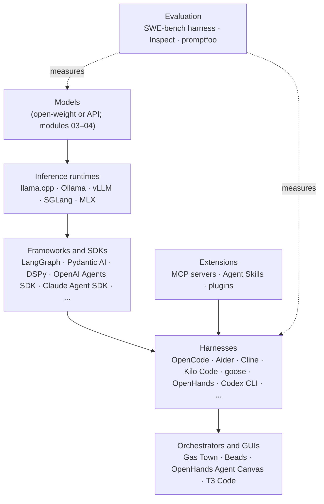

# 13: The open-source ecosystem

> **Audience:** everyone · **Reading time:** ~35 min · **Last verified:** 2026-11-08
> **Depth guide:** Students: Foundations, the harness table, and "How students can contribute responsibly." Engineers: all of In practice. Leads: the stack map, "Churn and capture," and the AI-contribution policies.

**TL;DR**
- "Open source" in AI tooling covers several layers: inference runtimes, agent frameworks, harnesses, MCP servers, skills, orchestrators and eval tools. An open-source harness can drive a closed model, and an open-weight model can run in a closed harness.
- Notable open-source coding harnesses include OpenCode, Aider, Cline, Kilo Code, goose, OpenHands, Crush, and the open-source CLIs from OpenAI (Codex CLI) and Google (Gemini CLI). The field churns: Roo Code shut down in May 2026 and Continue was archived.
- OpenClaw (formerly Clawdbot, then Moltbot) became one of GitHub's most-starred projects in early 2026. It showed real demand for personal agents that live in your messaging apps. It also showed what happens when such an agent ships with exposed defaults and an unvetted skill registry.
- You rarely need an agent framework to start. A working agent loop is about 30 lines. Reach for LangGraph, Pydantic AI, the OpenAI Agents SDK, the Claude Agent SDK and similar tools when you need durable state, tracing, many tools, or many agents.
- AI has added a heavy burden on maintainers. curl ended its bug bounty in January 2026 after confirmed reports fell below 1 in 20. Projects now publish AI policies ranging from outright bans (Gentoo, QEMU) to "disclose it and own it" (LLVM, Ghostty, the Linux kernel).
- Contribute with AI the way you'd want others to contribute to your project: understand every line, disclose AI use, keep pull requests small, write the description yourself, and follow the project's policy.

## Foundations

### What "open source" means here

Two kinds of openness get mixed up:

- **Open-weight models** publish the trained weights so you can run or fine-tune them yourself. [Module 04](./04-open-vs-closed-weights.md) covers them.
- **Open-source software** publishes the source code of a tool under a license that lets you read, modify and redistribute it. This module is about the software.

The two are independent. Codex CLI is open-source software that by default calls OpenAI's closed models. OpenCode or Aider can drive a closed frontier model or a local open-weight model. A closed IDE can run an open-weight model.

Licenses you'll meet:

| License | What it allows | Seen on |
| --- | --- | --- |
| **MIT** | Almost anything, with attribution | OpenCode, Kilo Code, OpenHands, T3 Code, Gas Town, Beads, Inspect |
| **Apache-2.0** | Almost anything, with attribution, plus an explicit patent grant | Codex CLI, Gemini CLI, Aider, Cline, goose |
| **FSL-1.1-MIT** (Functional Source License) | Source-available: use and modify, but no competing commercial product; each release converts to MIT after two years | Crush |

Some projects mix licenses. For example, Cline's JetBrains plugin is not open source even though the VS Code extension is ([Cline README](https://github.com/cline/cline)). Read the license file, not the marketing page.

**Why open source matters for this work:**

- **You can read the prompts and tool definitions.** The best way to understand what a harness does is to read its system prompt and tool code.
- **You can run it where your code lives,** including air-gapped or on-premises environments with local models.
- **It is the industry's research lab.** Ideas such as Aider's repository map, the Ralph loop, worktree-per-agent orchestration, and git-backed agent memory appeared in open projects first and were copied everywhere within months.
- **It protects against vendor churn,** up to a point. An archived open-source tool still runs. A shut-down service doesn't.

### A map of the stack



You don't need every layer. A typical engineer uses one harness, a few MCP servers and skills, and an API or subscription model. Someone running models locally adds a runtime. Someone building a product adds a framework or SDK and an eval tool.

## In practice

### Open-source coding harnesses

Statuses and star counts are as of November 2026. Stars measure attention, not quality.

| Project | Maintainer | Form | License | Notes |
| --- | --- | --- | --- | --- |
| [OpenCode](https://github.com/anomalyco/opencode) | The `anomalyco` org (the SST team) | Terminal UI; desktop app in beta | MIT | Model-agnostic and very popular (about 225K stars). Kilo Code's CLI is a fork of it |
| [Codex CLI](https://github.com/openai/codex) | OpenAI | CLI (written mostly in Rust), IDE extension | Apache-2.0 | Open-source client for OpenAI's closed models; same agent as the Codex app |
| [Gemini CLI](https://github.com/google-gemini/gemini-cli) | Google | CLI | Apache-2.0 | Since June 18, 2026, aimed at enterprise Gemini Code Assist. Individual users were moved to Antigravity CLI |
| [Aider](https://github.com/Aider-AI/aider) | Paul Gauthier and contributors | CLI | Apache-2.0 | One of the first terminal pair-programmers (2023). Pioneered the repository map and a git commit per change |
| [Cline](https://github.com/cline/cline) | Cline Bot Inc. | VS Code extension, CLI, SDK, desktop app; JetBrains plugin (closed) | Apache-2.0 | Began in 2024 as "Claude Dev." Shows diffs for approval; any provider |
| [Kilo Code](https://github.com/Kilo-Org/kilocode) | Kilo-Org | VS Code, JetBrains, CLI | MIT | Started in the Cline and Roo Code family of extensions; many models, no markup on provider prices |
| [goose](https://github.com/aaif-goose/goose) | Block, now part of the Agentic AI Foundation | Desktop app, CLI, API | Apache-2.0 | A general-purpose local agent, not only for code. Built around MCP extensions. A founding AAIF project |
| [OpenHands](https://github.com/OpenHands/OpenHands) | All Hands AI | Web UI ("Agent Canvas"), CLI, cloud, SDK | MIT | Formerly OpenDevin ([Wang et al., 2024](https://arxiv.org/abs/2407.16741)). Now also a control center that can run Claude Code, Codex, Gemini CLI and OpenCode |
| [Crush](https://github.com/charmbracelet/crush) | Charm | Terminal UI | FSL-1.1-MIT | LSP-aware, MCP support, switch models mid-session |
| [T3 Code](https://github.com/pingdotgg/t3code) | Ping (Theo Browne) | Desktop, web and mobile GUI over CLI agents | MIT | Not an agent itself; drives the agent CLIs you already have ([module 06](./06-harnesses-and-tools.md)) |
| [Roo Code](https://github.com/RooCodeInc/Roo-Code) | Roo Code Inc. | VS Code | Apache-2.0 | A fork of Cline. **Shut down May 15, 2026**; repository archived. The team pivoted to a cloud product and pointed users to Cline or the community fork ZooCode |
| [Continue](https://github.com/continuedev/continue) | Continue Dev | VS Code, JetBrains, CLI | Apache-2.0 | **Archived and read-only** in 2026 after a final 2.0 release |

Other labs ship open-source CLIs too. Alibaba's Qwen Code, for example, was one of the three agents in the ETH Zurich `AGENTS.md` study ([module 07](./07-context-engineering.md)).

**How to choose among them.** If you want one terminal agent that works with any model, start with OpenCode or Aider. If you live in VS Code and want approve-each-diff control, try Cline or Kilo Code. If you want a general desktop agent, try goose. If you want to run and compare several agents, try OpenHands or T3 Code. Whichever you pick, check its last release date and open-issue count first.

### Case study: OpenClaw and personal agents

OpenClaw is an open-source personal assistant agent by Peter Steinberger. It runs on your own machine, connects to a model of your choice, and talks to you through messaging apps such as Signal, Telegram, Discord and WhatsApp. It can act on your email, calendar, files and accounts, and it extends itself with skills (folders with a `SKILL.md`, the same format as Agent Skills).

Its naming history ([Wikipedia](https://en.wikipedia.org/wiki/OpenClaw)) is a story in itself:

| Date | Name |
| --- | --- |
| Nov 24, 2025 | First published as **Warelay** |
| Dec 3, 2025 | Renamed **CLAWDIS** |
| Jan 2, 2026 | Renamed **Clawdbot** |
| Jan 27, 2026 | Renamed **Moltbot** after trademark complaints from Anthropic |
| Jan 30, 2026 | Renamed **OpenClaw** |

It grew faster than almost any project before it, passing 247,000 GitHub stars by early March 2026. Moltbook, a social network for AI agents launched by Matt Schlicht, rode the same wave. On February 14, 2026, Steinberger announced he was joining OpenAI and that a non-profit OpenClaw Foundation would steward the project. OpenClaw 2.0 shipped on August 30, 2026.

**What it showed about personal agents:**

- **Demand is real.** People want an agent that lives where they already talk, keeps memory between sessions, and can act across their accounts. It is a different product from a coding agent.
- **It is the lethal trifecta in one package.** A personal agent reads untrusted content (emails, messages, web pages), holds private data, and can send messages and take actions. Those three together make prompt injection dangerous ([module 11](./11-security-and-prompt-injection.md)).
- **Defaults are security policy.** Security researchers reported tens of thousands of OpenClaw instances exposed to the internet in late January and early February 2026. The figures differ by researcher: Censys reported about 21,600 and Bitsight more than 30,000. Early versions bound the gateway to all network interfaces by default.
- **A skill registry is a software supply chain.** Koi Security reported auditing 2,857 skills on the public ClawHub registry and flagging 341 as malicious, attributed to one campaign that delivered password-stealing malware to macOS and Windows users ([BleepingComputer](https://www.bleepingcomputer.com/news/security/malicious-moltbot-skills-used-to-push-password-stealing-malware/)). The maintainers responded with reporting tools, malware scanning, and minimum account ages for uploaders.
- **Institutions noticed.** In March 2026 Chinese authorities reportedly restricted state agencies and state-owned firms from running OpenClaw on office computers. Reviewers of the 2.0 release still criticized it for not enabling its sandbox by default and not encrypting stored secrets.

The lesson for anyone building or running agents: an agent that can do everything on your behalf needs sandboxing, least-privilege credentials, vetted extensions, and confirmation before irreversible actions. Most early users had none of these.

### Inference runtimes (running models yourself)

These run open-weight models on your own hardware. [Module 04](./04-open-vs-closed-weights.md) covers which models to run and how much hardware you need.

| Runtime | What it is | Reach for it when |
| --- | --- | --- |
| [llama.cpp](https://github.com/ggml-org/llama.cpp) | C/C++ inference engine and the GGUF quantized-model format; runs on CPUs, GPUs and Apple Silicon | You want maximum portability, or you're on a laptop |
| [Ollama](https://github.com/ollama/ollama) | A friendly wrapper: `ollama run <model>` downloads and serves a model with a local OpenAI-compatible API | You want the easiest local setup |
| [vLLM](https://github.com/vllm-project/vllm) | High-throughput GPU serving, built around PagedAttention ([Kwon et al., 2023](https://arxiv.org/abs/2309.06180)) | You're serving a model to a team or a product |
| [SGLang](https://github.com/sgl-project/sglang) | Fast serving with prefix caching (RadixAttention) and structured generation ([Zheng et al., 2023](https://arxiv.org/abs/2312.07104)) | You're serving agent workloads with lots of shared prompt prefixes |
| [MLX](https://github.com/ml-explore/mlx) | Apple's array framework for Apple Silicon, with `mlx-lm` for running and fine-tuning models | You're on a Mac and want speed or local fine-tuning |

Most open-source harnesses can point at any of these through an OpenAI-compatible endpoint.

### Agent frameworks and SDKs

A **framework** gives you building blocks for agents: model clients, tool definitions, memory, state, tracing, multi-agent coordination. An **SDK** from a lab gives you that lab's agent harness as a library.

| Project | One line | Reach for it when |
| --- | --- | --- |
| [LangChain / LangGraph](https://github.com/langchain-ai/langgraph) | LangChain provides integrations and building blocks. LangGraph builds stateful graphs with checkpoints and human-approval steps | You need explicit, durable, resumable workflows ([module 07](./07-context-engineering.md)) |
| [LlamaIndex](https://github.com/run-llama/llama_index) | A data framework: ingest, index and query your documents, with agents on top | Your agent's main job is answering from your data |
| [DSPy](https://github.com/stanfordnlp/dspy) | Declarative modules plus optimizers that tune prompts (or weights) against a metric ([Khattab et al., 2023](https://arxiv.org/abs/2310.03714)) | You have an eval set and want to optimize prompts systematically instead of by hand |
| [Pydantic AI](https://github.com/pydantic/pydantic-ai) | Type-safe Python agents from the Pydantic team, with validated structured outputs | You want typed inputs and outputs in a Python service |
| [CrewAI](https://github.com/crewAIInc/crewAI) | Role-based multi-agent "crews" with tasks and processes | You want to prototype a multi-agent design quickly |
| [AutoGen](https://github.com/microsoft/autogen) / [Microsoft Agent Framework](https://github.com/microsoft/agent-framework) / [AG2](https://github.com/ag2ai/ag2) | AutoGen pioneered conversational multi-agent programming ([Wu et al., 2023](https://arxiv.org/abs/2308.08155)). Microsoft has archived it and names Agent Framework its successor. AG2 is a community fork | New Microsoft-stack projects: Agent Framework. Existing AutoGen code: migrate |
| [OpenAI Agents SDK](https://github.com/openai/openai-agents-python) | A lightweight SDK (March 2025) with agents, handoffs, guardrails and tracing | You're building on OpenAI models and want minimal abstraction |
| [Claude Agent SDK](https://github.com/anthropics/claude-agent-sdk-python) | The harness behind Claude Code, as a library (renamed from the Claude Code SDK in September 2025): tools, permissions, hooks, subagents, MCP, skills | You want Claude Code's loop inside your own product or automation |
| [Google ADK](https://github.com/google/adk-python) | Google's Agent Development Kit, designed to work with A2A | You're building on Gemini or Google Cloud |
| [smolagents](https://github.com/huggingface/smolagents) | A minimal library from Hugging Face whose "code agents" write Python as their actions | You want something small enough to read in an afternoon |
| [Mastra](https://github.com/mastra-ai/mastra) | A TypeScript framework for agents, workflows, retrieval and evals | Your team works in TypeScript |

#### Framework or just a loop?

Anthropic's [Building effective agents](https://www.anthropic.com/research/building-effective-agents) warns that frameworks "often create extra layers of abstraction that can obscure the underlying prompts," and suggests starting with direct API calls. Here is a complete agent loop with one tool, a permission check, a crude context limit and a turn budget, using the Anthropic Python SDK. Other providers' SDKs look very similar.

```python
import os, subprocess
import anthropic

client = anthropic.Anthropic()
MODEL = os.environ["AGENT_MODEL"]  # choose a current model; see module 03

TOOLS = [{
    "name": "bash",
    "description": "Run a shell command in the repository. Returns stdout and stderr.",
    "input_schema": {
        "type": "object",
        "properties": {"cmd": {"type": "string"}},
        "required": ["cmd"],
    },
}]

def run(cmd: str) -> str:
    if input(f"run `{cmd}`? [y/N] ").strip() != "y":  # the permission system
        return "The user declined to run this command."
    p = subprocess.run(cmd, shell=True, capture_output=True, text=True, timeout=120)
    return (p.stdout + p.stderr)[-10_000:]  # crude context management

messages = [{"role": "user", "content": "Make the failing test in tests/ pass."}]
for turn in range(30):  # a budget, so it can't run forever
    resp = client.messages.create(model=MODEL, max_tokens=4096,
                                  tools=TOOLS, messages=messages)
    messages.append({"role": "assistant", "content": resp.content})
    if resp.stop_reason != "tool_use":
        print("".join(b.text for b in resp.content if b.type == "text"))
        break
    messages.append({"role": "user", "content": [
        {"type": "tool_result", "tool_use_id": b.id, "content": run(b.input["cmd"])}
        for b in resp.content if b.type == "tool_use"
    ]})
```

Everything a harness adds (better tools, sandboxing, compaction, hooks, a UI) is an improvement on these 30 lines. Writing this once is the fastest way to understand [module 06](./06-harnesses-and-tools.md).

**Use a plain loop** when there is one agent, a handful of tools, and short sessions. **Use a framework or SDK** when you need state that survives restarts, tracing and observability in production, many tools or many agents, human approval steps in the middle of a workflow, or systematic prompt optimization (DSPy). **Use an existing harness** (Claude Agent SDK, Codex CLI in headless mode, OpenCode) when what you want is "a coding agent, but scripted."

### MCP servers worth knowing

[Module 06](./06-harnesses-and-tools.md) explains MCP. A short list of servers worth knowing:

- **The reference servers** in [modelcontextprotocol/servers](https://github.com/modelcontextprotocol/servers): Everything (a test server), Fetch, Filesystem, Git, Memory, Sequential Thinking and Time. Many earlier reference servers (GitHub, Slack, Postgres, Puppeteer and others) moved to an archive repository as vendors shipped official ones. The README calls the reference servers educational examples, "not production-ready solutions."
- **[GitHub's official MCP server](https://github.com/github/github-mcp-server):** issues, pull requests, code search and Actions, runnable locally or as a hosted server.
- **[Playwright MCP](https://github.com/microsoft/playwright-mcp)** (Microsoft): browser automation through the page's accessibility tree, so an agent can test the web app it just built.
- **[Chrome DevTools MCP](https://github.com/ChromeDevTools/chrome-devtools-mcp)** (Google): console logs, network requests and performance traces from a real Chrome instance.
- **The [MCP Registry](https://registry.modelcontextprotocol.io):** the official catalog for finding published servers.

Prefer servers maintained by the vendor of the service. Read the tool descriptions before connecting a server, since they go straight into your agent's context. Give each server the narrowest credentials that work.

### Skill collections

- **[anthropics/skills](https://github.com/anthropics/skills)** (about 190K stars): Anthropic's examples, including the document skills (Word, PDF, PowerPoint, Excel) behind Claude's file features, a skill template, and the specification. Install in Claude Code with `/plugin marketplace add anthropics/skills`. Check each skill's license.
- **[obra/superpowers](https://github.com/obra/superpowers)** (Jesse Vincent): a popular community library of workflow skills such as test-driven development, planning and systematic debugging.
- **The [Agent Skills specification](https://agentskills.io):** the open format, now governed by the Agentic AI Foundation, so a skill written for one harness works in others.

A skill is instructions plus, often, scripts that your agent will run. The ClawHub incident above shows what happens when people install skills like browser bookmarks. Read a skill before you install it, and pin versions for team use.

### Orchestration projects

- **[Gas Town](https://github.com/steveyegge/gastown)** (Steve Yegge, January 2026, MIT): a workspace manager for running 20–30 coding agents at once. Its vocabulary is deliberately colorful. A **Mayor** agent takes your request and assigns work. **Polecats** are worker agents. **Rigs** wrap repositories. A **Witness** watches for stuck agents. A **Refinery** batches and verifies finished work before merging. Claude Code is the default runtime, and it supports Codex, Gemini, Cursor, Amp, OpenCode and others. Yegge's eight-stage ladder of AI coding workflows, from the same launch essay, is covered in [module 08](./08-agentic-workflows.md).
- **[Beads](https://github.com/steveyegge/beads)** (Steve Yegge, MIT): a graph issue tracker for agents, backed by the version-controlled database Dolt. Agents create tasks, record dependencies, find unblocked work, claim it and close it. It replaces sprawling markdown plan files with structured memory that many agents can share, and Gas Town depends on it.
- **[OpenHands Agent Canvas](https://github.com/OpenHands/OpenHands)** and **[T3 Code](https://github.com/pingdotgg/t3code)** sit one level down: GUIs for running and supervising several agents, without Gas Town's autonomous coordination.

### Evaluation tooling

[Module 05](./05-judging-models.md) explains benchmarks and how to build your own evals. Open tools for doing it:

- **[SWE-bench](https://github.com/SWE-bench/SWE-bench) harness** ([Jimenez et al., 2023](https://arxiv.org/abs/2310.06770)): runs an agent's patch against a real repository's tests in Docker. Use it to reproduce published numbers or to test your own harness changes.
- **[Inspect](https://github.com/UKGovernmentBEIS/inspect_ai)** (UK AI Security Institute, MIT): a Python framework for evaluations including tool use, multi-turn dialogue and model-graded scoring, with more than 200 ready-made evaluations.
- **[promptfoo](https://github.com/promptfoo/promptfoo):** a CLI for testing prompts and models against test cases and for red-teaming. OpenAI announced it would acquire Promptfoo on March 9, 2026, and said the open-source project would continue.

### The other side: AI slop and maintainer burden

Open source runs on volunteer review time. AI tools made it nearly free to produce a plausible-looking pull request or bug report, and the cost moved to maintainers, who must read every one.

**curl.** Daniel Stenberg, curl's founder and lead developer, had complained about AI-generated security reports since early 2024. On January 26, 2026 he [announced the end of curl's bug bounty](https://daniel.haxx.se/blog/2026/01/26/the-end-of-the-curl-bug-bounty/), effective January 31. Over its life the program had confirmed 87 vulnerabilities and paid more than $100,000. But the share of reports that turned out to be real fell from above 15% in earlier years to below 5% from 2025 on: "Not even one in twenty was real." His reasoning was that the money drew in low-effort submissions, and that "the never-ending slop submissions take a serious mental toll to manage." curl now takes reports through GitHub's private vulnerability reporting and email, with no payouts. The problem wasn't AI as such. It was reports nobody had checked.

**How projects responded.** Policies fall on a spectrum:

| Project | Policy | Key rules |
| --- | --- | --- |
| **Gentoo** | [Ban](https://wiki.gentoo.org/wiki/Project:Council/AI_policy) (Council vote, April 14, 2024) | No content created with AI assistance. Reasons given: copyright, quality, and ethics |
| **QEMU** | [Decline](https://www.qemu.org/docs/master/devel/code-provenance.html) | Will "DECLINE any contributions which are believed to include or derive from AI generated content." AI for research, static analysis or debugging is fine if its output isn't submitted |
| **LLVM** | [Human in the loop](https://llvm.org/docs/AIToolPolicy.html) | You must read and review all generated code before asking others to. Label substantial AI help (for example with an `Assisted-by:` trailer). Write your own PR description. No autonomous agents in project spaces. No AI on "good first issue" tickets. Maintainers can label a contribution "extractive." The golden rule: "a contribution should be worth more to the project than the time it takes to review it" |
| **Linux kernel** | [Human accountability](https://docs.kernel.org/process/coding-assistants.html) | "AI agents MUST NOT add Signed-off-by tags." Only a human can certify the Developer Certificate of Origin, and the human submitter takes full responsibility |
| **Ghostty** | [Disclose and understand](https://github.com/ghostty-org/ghostty/blob/main/AI_POLICY.md) | "All AI usage in any form must be disclosed." You must fully understand your code. No AI-generated media. First-time contributors need a maintainer to "vouch" for them, or their PRs are closed automatically. "Bad AI drivers will be denounced" on a public list |

The trend through 2026 has been away from blanket bans and toward **disclosure, accountability and protecting maintainer time**. The common thread: a human must understand, stand behind, and be able to discuss every line they submit.

### Etiquette for contributing with AI

Before you open a pull request or issue on someone else's project:

1. **Read the project's `CONTRIBUTING.md` and AI policy.** If they ban AI-generated contributions, don't submit them. If they require disclosure, disclose.
2. **Understand every line.** If you can't explain the change and its edge cases without the AI open, you aren't ready to submit it.
3. **Reproduce the problem yourself.** For bug and security reports especially, show a real reproduction on a real build. Don't forward a model's speculation.
4. **Keep it small and focused.** One logical change per PR. Don't let an agent "also clean up" unrelated files.
5. **Run the project's tests and linters locally.** Never make maintainers' CI find what you could have found.
6. **Write the description and review replies yourself.** Explain what you changed, why, and what you didn't verify. Maintainers want to talk to you, not your agent.
7. **Disclose AI assistance,** even where it isn't required. Name the tool and say roughly how it was used.
8. **Respect the maintainers' time.** If a maintainer says no, accept it. Don't open the same PR again with a new prompt.
9. **Never let an agent post autonomously** to an issue tracker, pull request or mailing list on your behalf.

### How students can contribute to open source with AI, responsibly

Contributing to open source is one of the best ways for a student to learn real engineering. AI can make it easier, if you use it to learn, not to skip the learning.

1. **Pick a project you use.** You'll understand its users and you'll care about the result.
2. **Read the contributing guide and AI policy first.** Note what's banned, what must be disclosed, and how to claim an issue.
3. **Use AI to understand, not to submit.** Ask an agent to explain the architecture, trace a request through the code, or explain why a test is failing. This is the highest-value, lowest-risk use.
4. **Choose an issue and say you're working on it** before you write code. Some projects, LLVM for example, ask that newcomer "good first issues" be done without AI, because they exist to teach.
5. **Reproduce the bug by hand.** Write a failing test before you fix anything.
6. **Write or heavily revise the fix yourself.** If an agent drafts it, rework it until you could have written it, then delete what you can't defend.
7. **Get a second opinion before the maintainers' opinion.** Ask a different model, or a classmate, to review your diff ([module 10](./10-ai-code-review.md)).
8. **Write the PR description in your own words,** and disclose how you used AI.
9. **Handle review feedback yourself.** Answer questions from your own understanding. If you don't know, say so and go find out.
10. **Keep a log** of what you learned. For a course, that log, not the merged PR, is the evidence of learning ([module 15](./15-learning-careers-and-responsibility.md)).

## Going deeper

### Open source as the field's R&D lab

Many harness ideas that are now standard appeared first in open projects or public experiments. Aider's repository map (a compact summary of a codebase's symbols) showed that agents need a map rather than whole files. The Ralph loop showed that a dumb outer loop with fresh contexts can get surprising mileage. Beads and Gas Town pushed git-backed, structured memory for many agents. The skills format began in Anthropic's public repository and, within a year, was adopted by a growing list of other agent products ([client showcase](https://agentskills.io/clients)). Vendors watch these projects closely, and good ideas move into commercial products within months ([module 06](./06-harnesses-and-tools.md)).

### Churn and capture

2026 was hard on open-source AI tooling:

- **Roo Code** shut down its extension, cloud and router on May 15, 2026 and pivoted to a hosted product.
- **Continue** was archived.
- **Gemini CLI** stayed open source but stopped serving individual users, who moved to Google's Antigravity CLI.
- **AutoGen** was archived in favor of Microsoft Agent Framework.
- **Promptfoo** was bought by OpenAI, which said it would keep the project open.
- **OpenClaw's** creator joined OpenAI, and the project moved to a foundation.

The pattern is familiar from earlier open-source eras. Venture-funded companies build open tools to win adoption, then pivot, sell or shut down. Being open source means you can fork an abandoned project. It doesn't mean anyone will maintain the fork. Neutral foundations such as the Agentic AI Foundation, which now hosts MCP, AGENTS.md, goose and Agent Skills, are one response. When you choose a tool, weigh its governance (one company, or a foundation with several members) as well as its features.

### Open client, closed model

Several of the most-starred harnesses are open-source clients for closed models, such as Codex CLI and Gemini CLI. (Claude Code itself is not open source, although its SDK wrappers are published on GitHub.) With an open client you can read every prompt and tool, but the model remains a remote service with its own terms, rate limits and data policies. That still has real value: you can audit what's sent, fork the client, and swap in a different model where the harness allows it. It is not the same as a fully open stack. If you need one, combine a model-agnostic harness, an open-weight model and a local runtime ([module 04](./04-open-vs-closed-weights.md)).

### Extensions are dependencies

MCP servers, skills and plugins run with your agent's permissions. Treat them like any other dependency: check the maintainer, read the code, pin versions, prefer official vendor packages, and watch for updates that change behavior. The OpenClaw skill-registry malware and the MCP "tool poisoning" research are early examples of a supply-chain problem that will grow ([module 11](./11-security-and-prompt-injection.md)).

## Bryan's take

> **Bryan's take:** I don't believe fully autonomous agent workflows are reliable yet. OpenClaw's first months are a vivid example of the risk side of that: huge enthusiasm, real usefulness, and then exposed instances and malicious skills because people handed an autonomous agent their accounts with default settings.

> **Bryan's take:** Having several agents or models review each other's work is valuable. That applies before you open a pull request on someone else's project too. Run a second reviewer over your diff before a maintainer has to.

## Try it

**Individual exercise: read a harness, then write one (2–3 hours).**
1. Clone one open-source harness (OpenCode, Aider, Cline or Codex CLI). Find its system prompt and the definitions of its file-editing and shell tools. Write down three design choices that surprised you.
2. Run the 30-line loop from this module against a toy repository with a failing test. Add one improvement from the harness you read, such as a better edit tool, output truncation, or a deny list for dangerous commands. Measure whether it helps on three tasks.
3. Write a half-page comparison of your loop and the real harness.

**Class or team exercise: the maintainer's chair (one session).**
The instructor prepares ten pull requests against a small project the class knows. Some are careful human work, some are careful AI-assisted work with disclosure, and some are unreviewed AI output. Students act as maintainers. Time how long each review takes, decide accept, revise or reject, and guess which were unreviewed AI output. Then discuss: what made a PR cheap or expensive to review? Draft an AI-contribution policy for the project, and compare it with LLVM's and Ghostty's.

## Discussion questions

1. Is an open-source harness that only works well with one vendor's closed model really "open"? What would you need for a fully open stack?
2. Roo Code, Continue and others were archived or shut down in 2026. How should a team decide whether to depend on an open-source AI tool?
3. Gentoo bans AI-generated contributions, while LLVM allows them with human review and disclosure. Which policy would you choose for a project you maintain, and why?
4. curl's confirmed-report rate fell below 1 in 20. Who should bear the cost of filtering AI-generated reports: reporters, platforms, AI vendors, or maintainers?
5. OpenClaw showed huge demand for personal agents and serious security problems. What would a "safe by default" personal agent have to do differently?
6. When does a framework like LangGraph or DSPy earn its complexity over a 30-line loop?

## Sources and further reading

**Papers**
- [AutoGen: Enabling Next-Gen LLM Applications via Multi-Agent Conversation](https://arxiv.org/abs/2308.08155) (Wu et al., 2023).
- [Efficient Memory Management for Large Language Model Serving with PagedAttention](https://arxiv.org/abs/2309.06180) (Kwon et al., 2023): the paper behind vLLM.
- [DSPy: Compiling Declarative Language Model Calls into Self-Improving Pipelines](https://arxiv.org/abs/2310.03714) (Khattab et al., 2023).
- [SWE-bench: Can Language Models Resolve Real-World GitHub Issues?](https://arxiv.org/abs/2310.06770) (Jimenez et al., 2023).
- [SGLang: Efficient Execution of Structured Language Model Programs](https://arxiv.org/abs/2312.07104) (Zheng et al., 2023).
- [OpenHands: An Open Platform for AI Software Developers as Generalist Agents](https://arxiv.org/abs/2407.16741) (Wang et al., 2024).

**Primary sources: projects**
- Harnesses: [OpenCode](https://github.com/anomalyco/opencode), [Codex CLI](https://github.com/openai/codex), [Gemini CLI](https://github.com/google-gemini/gemini-cli), [Aider](https://github.com/Aider-AI/aider), [Cline](https://github.com/cline/cline), [Kilo Code](https://github.com/Kilo-Org/kilocode), [goose](https://github.com/aaif-goose/goose), [OpenHands](https://github.com/OpenHands/OpenHands), [Crush](https://github.com/charmbracelet/crush), [T3 Code](https://github.com/pingdotgg/t3code), [Roo Code (archived)](https://github.com/RooCodeInc/Roo-Code), [Continue (archived)](https://github.com/continuedev/continue), [OpenClaw](https://github.com/openclaw/openclaw).
- Runtimes: [llama.cpp](https://github.com/ggml-org/llama.cpp), [Ollama](https://github.com/ollama/ollama), [vLLM](https://github.com/vllm-project/vllm), [SGLang](https://github.com/sgl-project/sglang), [MLX](https://github.com/ml-explore/mlx).
- Frameworks: [LangGraph](https://github.com/langchain-ai/langgraph), [LlamaIndex](https://github.com/run-llama/llama_index), [DSPy](https://github.com/stanfordnlp/dspy), [Pydantic AI](https://github.com/pydantic/pydantic-ai), [CrewAI](https://github.com/crewAIInc/crewAI), [AutoGen](https://github.com/microsoft/autogen), [Microsoft Agent Framework](https://github.com/microsoft/agent-framework), [AG2](https://github.com/ag2ai/ag2), [OpenAI Agents SDK](https://github.com/openai/openai-agents-python), [Claude Agent SDK](https://github.com/anthropics/claude-agent-sdk-python), [Google ADK](https://github.com/google/adk-python), [smolagents](https://github.com/huggingface/smolagents), [Mastra](https://github.com/mastra-ai/mastra).
- MCP and skills: [MCP reference servers](https://github.com/modelcontextprotocol/servers), [MCP Registry](https://registry.modelcontextprotocol.io), [GitHub MCP server](https://github.com/github/github-mcp-server), [Playwright MCP](https://github.com/microsoft/playwright-mcp), [Chrome DevTools MCP](https://github.com/ChromeDevTools/chrome-devtools-mcp), [anthropics/skills](https://github.com/anthropics/skills), [obra/superpowers](https://github.com/obra/superpowers), [agentskills.io](https://agentskills.io).
- Orchestration and evals: [Gas Town](https://github.com/steveyegge/gastown), [Beads](https://github.com/steveyegge/beads), [SWE-bench](https://github.com/SWE-bench/SWE-bench), [Inspect](https://github.com/UKGovernmentBEIS/inspect_ai), [promptfoo](https://github.com/promptfoo/promptfoo).
- Anthropic, [Building effective agents](https://www.anthropic.com/research/building-effective-agents) (Dec 2024).

**Primary sources: policies and maintainers**
- Daniel Stenberg, [The end of the curl bug bounty](https://daniel.haxx.se/blog/2026/01/26/the-end-of-the-curl-bug-bounty/) (Jan 26, 2026).
- [Gentoo AI policy](https://wiki.gentoo.org/wiki/Project:Council/AI_policy); [QEMU code provenance policy](https://www.qemu.org/docs/master/devel/code-provenance.html); [LLVM AI tool use policy](https://llvm.org/docs/AIToolPolicy.html); [Linux kernel guidance for AI coding assistants](https://docs.kernel.org/process/coding-assistants.html); [Ghostty AI usage policy](https://github.com/ghostty-org/ghostty/blob/main/AI_POLICY.md).

**Commentary and reporting**
- [OpenClaw on Wikipedia](https://en.wikipedia.org/wiki/OpenClaw), for the naming timeline and later history.
- BleepingComputer, [Malicious Moltbot skills used to push password-stealing malware](https://www.bleepingcomputer.com/news/security/malicious-moltbot-skills-used-to-push-password-stealing-malware/) (2026).
- The Register, [Curl shutters bug bounty program to remove incentive for submitting AI slop](https://www.theregister.com/2026/01/21/curl_ends_bug_bounty/) (Jan 2026).

## Terms introduced

- **Open-source software:** software whose source code is published under a license allowing use, modification and redistribution.
- **Open-weight model:** a model whose trained weights are published (see module 04); distinct from open-source software.
- **MIT / Apache-2.0:** permissive open-source licenses; Apache-2.0 adds an explicit patent grant.
- **FSL (Functional Source License):** a source-available license that forbids competing commercial use and converts to a permissive license after two years.
- **Source-available:** code you can read but not freely reuse, unlike open source.
- **Inference runtime:** software that loads model weights and generates output (llama.cpp, Ollama, vLLM, SGLang, MLX).
- **GGUF:** the quantized model file format used by llama.cpp and tools built on it.
- **PagedAttention:** vLLM's technique for managing attention memory in pages to serve more requests at once.
- **Agent framework:** a library of building blocks (model clients, tools, state, tracing, multi-agent coordination) for building agents.
- **Agent SDK:** a vendor's agent harness packaged as a library, such as the Claude Agent SDK or OpenAI Agents SDK.
- **Repository map:** a compact summary of a codebase's files and symbols given to an agent, popularized by Aider.
- **Personal agent:** an agent that acts across a person's own accounts and devices, often through messaging apps.
- **Skill registry:** a public catalog of installable agent skills, which is a software supply chain.
- **Orchestrator:** software that coordinates many agents, such as Gas Town.
- **Beads:** a Dolt-backed graph issue tracker that agents use as shared, structured memory.
- **AI slop:** low-effort, unverified AI-generated content, such as fake bug reports or careless pull requests.
- **Extractive contribution:** in LLVM's policy, a contribution that costs maintainers more to review than it gives the project.
- **`Assisted-by:` trailer:** a commit-message line disclosing that a tool helped produce the change.
- **Signed-off-by / DCO:** a commit tag by which a human certifies the Developer Certificate of Origin; the Linux kernel forbids AI agents from adding it.
- **Vouching:** Ghostty's system in which a maintainer approves a first-time contributor before their PRs are accepted.
