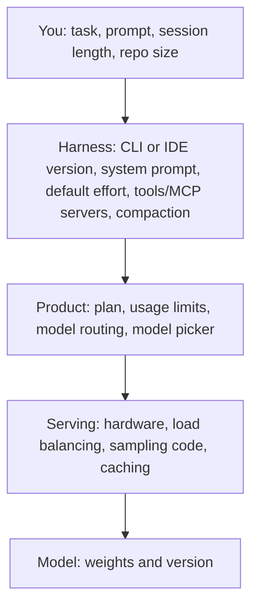
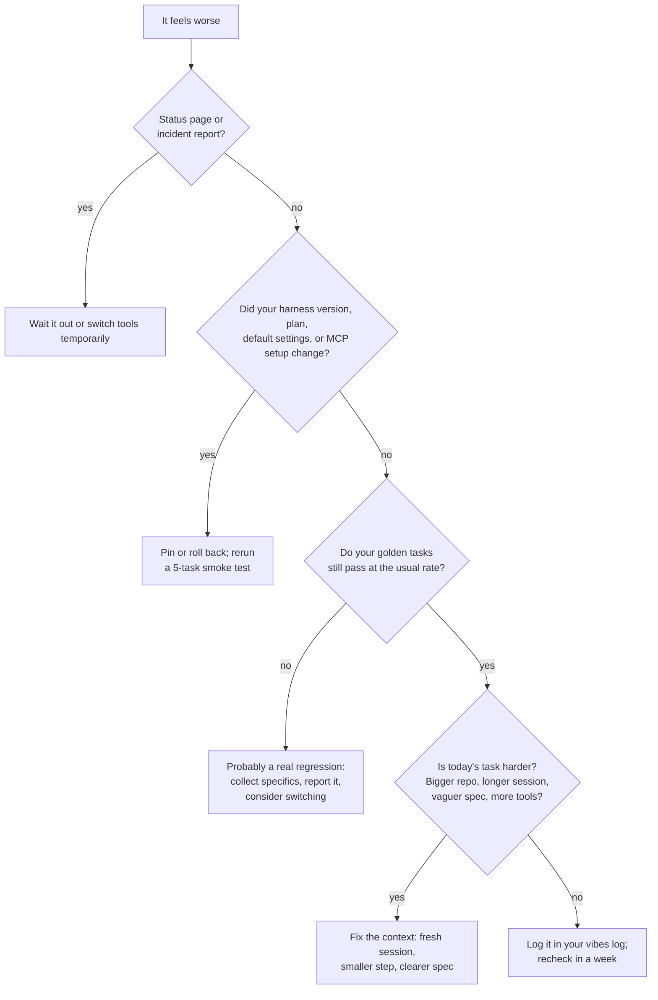

# 14: Keeping up without drowning

> **Audience:** everyone · **Reading time:** ~30 min · **Last verified:** 2026-11-08
> **Depth guide:** Students: Foundations, the information diet, and "A sustainable routine." Engineers: all of In practice, especially "Is it the model, the task, or the harness?" Leads: "Team AI radar" and "When to switch tools."

**TL;DR**
- The field ships a major model, tool version, or benchmark revision almost every week. You can't track all of it, and you don't need to. The fundamentals (context, verification, security, review) change slowly.
- Quality goes up *and down*. Every major vendor has had stretches where its model or tool got worse, usually because of infrastructure bugs, harness changes, or product decisions, not because "the model got dumber."
- When something feels worse, check in order: status page, your tool's changelog and settings, your golden tasks, then whether today's task is simply harder.
- Weigh launch claims by who made them, what they compared against, and how the lab's past claims held up. Every lab has a mixed record.
- A sustainable routine: 30 minutes a week of reading, a monthly run of your golden tasks against anything new, and a quarterly tool review. A team "AI radar" spreads the load.
- New release? Spend one afternoon testing it on your own tasks ([template in module 05](./05-judging-models.md#build-your-own-eval)), then decide: adopt, trial, or wait.

## Foundations

### How fast it moves

Take one three-month window in 2026 as an example (for the full record, see the [timeline](../reference/timeline.md)):

- **Jul 24:** Anthropic releases Claude Opus 5.
- **Jul 30:** Terminal-Bench 3.0 ships. **Aug 28:** Terminal-Bench 4.0 replaces it, recalibrating time and compute limits and dropping saturated and flawed tasks.
- **Sep 1:** Claude Fable 5.1. **Sep 3:** OpenAI's GPT-6 Astra.
- **Sep 22:** Claude Opus 5.5 and OpenAI's GPT-6 Sol and Luna, on the same day.
- **October:** Google's Gemini 4 models.

Meanwhile, the harnesses ship constantly. OpenAI's Codex CLI was at version 0.167 by November 6, 2026 ([changelog](https://learn.chatgpt.com/docs/changelog)). Claude Code's [changelog](https://github.com/anthropics/claude-code/blob/main/CHANGELOG.md) moves just as quickly. Even the yardsticks move: Artificial Analysis revised its Intelligence Index twelve times between August 2025 and November 2026, eight of them changing which evaluations it includes ([version history](https://artificialanalysis.ai/methodology/intelligence-benchmarking)).

For specific models and who leads where right now, see [module 03](./03-model-landscape.md). This module is about how to cope with that pace.

### What stays stable

Most of what makes you effective doesn't change with a release:

| Durable skill | Why it survives | Where it's covered |
| --- | --- | --- |
| Giving the model the right context | Every model is limited by what you show it | [Module 07](./07-context-engineering.md) |
| Verifying output (tests, review, running the code) | Models remain confidently wrong some of the time | [Module 10](./10-ai-code-review.md) |
| Security habits (sandboxing, least privilege, injection awareness) | Attacks target the agent pattern, not a specific model | [Module 11](./11-security-and-prompt-injection.md) |
| Breaking work into checkable steps | Reliability falls with task length for every model ([module 05](./05-judging-models.md#long-horizons)) | [Module 08](./08-agentic-workflows.md) |
| Your own eval set | Tells you what *any* new release means for *your* work | [Module 05](./05-judging-models.md#build-your-own-eval) |
| Cost awareness | Prices and limits change; the habit of measuring doesn't | [Module 12](./12-costs-subscriptions-and-apis.md) |

A useful test for any new technique: *will this still matter after the next model?* "Write a clear spec and a test first" passes. "Use this magic phrase to make Model X behave" usually doesn't.

### Ups and downs are normal

The quality you experience comes from a stack of layers. Any of them can change without notice:



People usually blame the bottom layer ("they nerfed the model"). In the documented incidents below, the cause was more often in the middle layers.

## In practice

### A field guide to recent ups and downs

| When | What users saw | Cause, per the company | Lesson |
| --- | --- | --- | --- |
| Apr 2025 | A GPT-4o update in ChatGPT became sycophantic: flattering, agreeing with bad ideas. OpenAI rolled it back within days ([OpenAI](https://openai.com/index/sycophancy-in-gpt-4o/)) | Training put too much weight on short-term user feedback | Expert testers' unease was a better signal than A/B metrics ([module 05](./05-judging-models.md#vibes-are-data-too)) |
| Jul–Aug 2025 | Anthropic announced weekly usage limits for Claude subscriptions, starting Aug 28 ([TechCrunch](https://techcrunch.com/2025/07/28/anthropic-unveils-new-rate-limits-to-curb-claude-code-power-users/)) | Round-the-clock heavy use of Claude Code | Plans and quotas are part of your tool, and they change ([module 12](./12-costs-subscriptions-and-apis.md)) |
| Aug 2025 | GPT-5 launched and older models vanished from ChatGPT's model picker. After a backlash, OpenAI restored GPT-4o for paid users within days; Sam Altman called suddenly deprecating old models a mistake ([The Register](https://www.theregister.com/2025/08/11/openai_tweaks_gpt5_after_user/)) | Product decision | Don't build workflows that depend on one model staying available in an app |
| Aug–Sep 2025 | Some Claude users got noticeably worse answers for weeks | Three infrastructure bugs: a context-window routing error, output corruption from a misconfiguration, and a TPU compiler miscompilation ([Anthropic postmortem, Sep 17, 2025](https://www.anthropic.com/engineering/a-postmortem-of-three-recent-issues)) | The lab's own evals missed it; user reports were right |
| Sep–Oct 2025 | Reports that Codex "got worse" after GPT-5-Codex launched | No single cause: some older hardware, long sessions degraded by repeated compaction, a sampling bug, and changing usage patterns such as more MCP tools ([OpenAI Codex team, Oct 31, 2025](https://docs.google.com/document/d/1fDJc1e0itJdh0MXMFJtkRiBcxGEFtye6Xc6Ui7eMX4o/mobilebasic)) | Long, cluttered sessions hurt; keep conversations short and focused |
| Mar–Apr 2026 | About six weeks of Claude Code quality complaints | Three product-layer changes: a lower default reasoning effort, a bug that wiped the model's reasoning history every turn, and a verbosity-limiting system prompt. API and weights were unaffected ([Anthropic, Apr 23, 2026](https://www.anthropic.com/engineering/april-23-postmortem)) | The harness can regress while the model doesn't |
| May 2026 | Reported degradation of GPT-5.5 in Codex. The Codex lead said on X that two issues were found and fixed, and reset usage limits | Reported; no detailed public postmortem found for this episode | Same pattern, different vendor |
| Jun–Jul 2026 | Claude Fable 5 was suspended for *all* users from June 12 to July 1 ([Anthropic](https://www.anthropic.com/news/redeploying-fable-5)) | US export controls applied immediately, and Anthropic had no real-time way to verify nationality | Access can disappear overnight for reasons that have nothing to do with quality |
| Jul–Sep 2026 | Opus 5 posted strong benchmarks but got mixed daily-use reviews. Opus 5.5, eight weeks later, was widely liked ([module 05](./05-judging-models.md#a-recent-example-opus-5-to-opus-55)) | Model behavior: verbosity, scope, communication | Newer isn't always better *for you*. Test before switching |

Two things stand out. First, the labs' own monitoring often missed what users noticed. Anthropic's 2025 postmortem said "the evaluations we ran simply didn't capture the degradation users were reporting." Its 2026 one said the issues "were challenging to distinguish from normal variation in user feedback at first." Second, the stated causes were rarely "we made the model worse on purpose." Anthropic wrote that it "never reduce[s] model quality due to demand, time of day, or server load." You can't independently verify a statement like that. You *can* verify your own golden tasks.

> **Bryan's take:** Claude and Codex have both had ups and downs.

The documented record above backs that up for both vendors. The practical response is in "When to switch tools" below: keep more than one tool usable.

### Is it the model, the task, or the harness?

When things feel worse, work through this before you post "it got dumber":



Specific checks:
- **Status pages:** [Claude](https://status.claude.com/), [OpenAI](https://status.openai.com/), and your IDE vendor's.
- **Did your tool auto-update?** Check its version and changelog. Did the default model, effort level, or context setting change?
- **Did you change something?** New MCP servers, a longer `AGENTS.md`, a bigger monorepo, a new plugin. OpenAI's Codex investigation found evals favored minimal setups and short, focused conversations.
- **Session length.** A two-hour session with several compactions is a different, harder task than a fresh one. Start over before you blame the model.
- **Is it you, or is it everyone?** Specific, reproducible reports from people you trust ("since version X it ignores my test command") mean more than a trending "it's nerfed" thread.
- **API vs app.** If you have API access, run a pinned, dated model snapshot on the same task. If the API version is fine and the app isn't, the problem is in the product layer.

### When to switch tools

Switching has a cost: new habits, new configuration, new failure modes. Switch when the evidence is strong:

**Good reasons**
- Your golden tasks show a consistent drop across two or more runs, a week apart.
- A competitor beats your current tool on your golden tasks by more than your error bar, at a cost you can afford.
- Pricing, limits, data policy, or security posture changed in a way that matters to you.
- The vendor is in a long, unacknowledged bad stretch, with no fix, no postmortem, and no communication.

**Bad reasons**
- One bad afternoon.
- A launch-day benchmark chart.
- A viral thread.
- Fear of missing out.

**Always:** keep a second tool "warm," meaning installed, configured, and used at least occasionally. The Fable 5 suspension and the 2025–2026 regressions all hit people who had only one option. Multi-vendor fluency is cheap insurance. It also makes multi-model review possible ([module 10](./10-ai-code-review.md)).

### Weighing launch claims

A launch post is marketing written by people who also do science. Read it the way you'd read any vendor's claims:

1. **Self-reported benchmarks.** Who ran them, with what harness and settings? Are competitors' numbers run the same way, or copied from *their* launch posts? (See the checklist in [module 05](./05-judging-models.md#reading-a-benchmark-claim-a-checklist).)
2. **Chosen comparisons.** Which benchmarks were reported last time but not this time? Which competitor model is missing from the chart?
3. **Demos.** A demo shows the best of many tries. Ask whether it was live, edited, or sped up.
4. **Availability.** "Available today" may mean a limited set of organizations, one tier, or the API only. OpenAI's GPT-6 Astra launch in September 2026 started with "a limited set of organizations" ([OpenAI](https://openai.com/index/gpt-6-astra/)).
5. **Customer quotes.** These are testimonials, usually from partners with early access, and launch posts rarely say whether anyone checked the figures in them. Treat lab-run numbers the same way: Anthropic's Opus 5 post labels its headline Frontier-Bench results as "an internal run."
6. **Wait for independent numbers.** Artificial Analysis, Epoch AI, Arena, and others usually post results within days ([module 05](./05-judging-models.md#independent-evaluators)).

### Lab track records

Every major lab has made claims that didn't hold up, and every major lab has also earned credit. Judge them on four things:
- How their launch numbers survive independent testing.
- How honestly they handle regressions.
- Whether demos match the shipped product.
- How stable their pricing and limits are.

Some documented episodes:

**Google.**

> **Bryan's take:** I don't trust Google's launch claims much. In my experience they overhype Gemini, and it underperforms what was promised, especially for coding. I'll use Gemini for some specific tasks, but not as my coding agent.

The record cuts both ways. Against Google:
- In December 2023 its "Hands-on with Gemini" video turned out to be staged. Google acknowledged it had fed the model still frames and text prompts rather than live video and voice ([TechCrunch](https://techcrunch.com/2023/12/07/googles-best-gemini-demo-was-faked/)).
- In a June 2026 independent comparison, Gemini 3.1 trailed GPT-5.5 on the Terminal-Bench team's Harbor-Index in both a native and a neutral harness, though the post notes that none of its pairwise comparisons reached statistical significance ([Terminal-Bench](https://www.tbench.ai/news/harbor-index)).

For Google:
- Its July 2025 International Mathematical Olympiad gold-medal result was "officially graded and certified by IMO coordinators" ([Google DeepMind](https://deepmind.google/discover/blog/advanced-version-of-gemini-with-deep-think-officially-achieves-gold-medal-standard-at-the-international-mathematical-olympiad/)). That's a higher bar of verification than many lab claims get.
- Gemini 3 Pro topped Arena at launch in November 2025 ([Google](https://blog.google/products-and-platforms/products/gemini/gemini-3/)).
- As of November 8, 2026, Gemini 4 Carbon is #1 on [Arena's text leaderboard](https://arena.ai/leaderboard/text) (its rating is still marked preliminary). Google also reports a leading Terminal-Bench 4.0 score for it, as run by Artificial Analysis ([Google DeepMind](https://deepmind.google/models/gemini/)).

Whether that shows up in *your* coding work is exactly what an afternoon with your golden tasks will tell you.

**Meta.** For the Llama 4 launch in April 2025, Meta promoted an Arena ranking earned by an experimental variant tuned for chat, not the released model. Arena said Meta's interpretation of its policy didn't match what it expects from providers ([TechCrunch](https://techcrunch.com/2025/04/11/metas-vanilla-maverick-ai-model-ranks-below-rivals-on-a-popular-chat-benchmark/); [module 05](./05-judging-models.md#human-preference-arena)).

**xAI.**
- In February 2025, xAI's Grok 3 launch chart compared its models with OpenAI's o3-mini-high but left out o3-mini-high's majority-vote ("cons@64") score. An OpenAI employee argued that omission made the comparison misleading, and xAI disputed it ([TechCrunch](https://techcrunch.com/2025/02/22/did-xai-lie-about-grok-3s-benchmarks/)).
- In May 2025, xAI reportedly attributed Grok's unprompted replies about a political conspiracy theory to an "unauthorized modification" of its system prompt, and promised more monitoring.
- In July 2025, after a code change, the `@grok` account posted antisemitic content for about 16 hours. xAI apologized and said it would publish the bot's system prompt on GitHub ([NBC News](https://www.nbcnewyork.com/news/national-international/ai-chatbot-grok-issues-apology-for-antisemitic-posts/)).

**OpenAI.**
- The GPT-4o sycophancy rollback and the GPT-5 model-picker reversal (both above).
- In the other column: OpenAI publicly retired SWE-bench Verified, a benchmark it had created, after an audit found many of its hardest tasks had flawed tests or descriptions, amid contamination concerns (February 2026, [module 05](./05-judging-models.md#the-state-of-coding-benchmarks-november-2026-high-level)).
- Its Codex team published a detailed degradation investigation, [Ghosts in the Codex Machine](https://docs.google.com/document/d/1fDJc1e0itJdh0MXMFJtkRiBcxGEFtye6Xc6Ui7eMX4o/mobilebasic) (October 2025). The May 2026 episode above got no comparable write-up.

**Anthropic.**
- Detailed public postmortems in September 2025 and April 2026, both after weeks in which users noticed problems before the company confirmed them.
- The Opus 5 launch, whose strong benchmarks didn't match a lot of users' daily experience.

A note on bias in this course: the author's opinions come from daily use, mostly of Claude and Codex, and reflect that lens. Read them as one experienced user's view.

### A curated information diet

You need a few good sources, not many. Pick two or three from this list, plus the changelogs of the tools you use.

| Source | What it's good for | Bias to keep in mind |
| --- | --- | --- |
| [Simon Willison's Weblog](https://simonwillison.net/) | Fast, hands-on notes on new models and tools; strong on prompt injection and security | Enthusiast who often gets early access (and says so) |
| [Latent Space](https://www.latent.space/) (swyx, Alessio Fanelli) | Podcast and newsletter for AI engineers; long interviews with builders | Industry insider; guests are often founders and lab staff |
| [Interconnects](https://www.interconnects.ai/) (Nathan Lambert) | Post-training, reinforcement learning, open models, explained by a researcher | Open-model advocate; research lens |
| [Import AI](https://importai.substack.com/) (Jack Clark) | Weekly research paper digest with policy context | Author co-founded Anthropic |
| [One Useful Thing](https://www.oneusefulthing.org/) (Ethan Mollick) | How AI changes knowledge work and education, with practical experiments | Optimistic about adoption; not engineering-specific |
| [The Pragmatic Engineer](https://newsletter.pragmaticengineer.com/) (Gergely Orosz) | How real engineering teams use AI tools; industry surveys | Industry and big-tech lens; deep dives are paywalled |
| [Zvi Mowshowitz](https://thezvi.substack.com/) | Exhaustive weekly roundups; per-model reaction compilations (good for vibes at scale) | Very long; AI-risk focus; strong opinions |
| [Epoch AI](https://epoch.ai/) | Data on compute, benchmarks, and trends; good charts | Quantitative trend focus; disclosed funding relationships |
| [METR](https://metr.org/) | Time horizons, productivity RCTs, pre-deployment evaluations | Risk-focused; works directly with labs |
| Lab changelogs and status pages: [Anthropic release notes](https://docs.anthropic.com/en/release-notes/claude-apps), [Claude Code changelog](https://github.com/anthropics/claude-code/blob/main/CHANGELOG.md), [ChatGPT & Codex changelog](https://learn.chatgpt.com/docs/changelog), [Gemini API changelog](https://ai.google.dev/gemini-api/docs/changelog), [Claude status](https://status.claude.com/), [OpenAI status](https://status.openai.com/) | What actually shipped, when; the first place to look when behavior changes | Silent about what got worse; changelogs can omit prompt or default changes |
| [Hacker News](https://news.ycombinator.com/) | Launch-day threads with technical skeptics and occasional insiders | Contrarian; loud minorities; startup lens |
| [r/LocalLLaMA](https://www.reddit.com/r/LocalLLaMA/) | Open-weight releases, quantization, running models locally ([module 04](./04-open-vs-closed-weights.md)) | Open-weight enthusiasm; anecdotal benchmarks; occasional astroturfing |
| [AI Engineer](https://www.ai.engineer/) conference talks ([YouTube](https://www.youtube.com/@aiDotEngineer)) | Practitioners showing real systems and failure modes | Vendor talks mixed in with practitioner talks |
| [Andrej Karpathy](https://karpathy.ai/) ([YouTube](https://www.youtube.com/@AndrejKarpathy)) | Clear explainers of how LLMs work; coined "vibe coding" (Feb 2025) | Infrequent; big-picture; his coinages spread faster than their caveats |

**Biases by source type:**
- **Labs** are authoritative on what they shipped and selective about how good it is.
- **Independent evaluators** are consistent but bound to benchmarks, and some have commercial ties.
- **Individual writers** curate well, have viewpoints, and sometimes get early access that shapes their tone.
- **Communities** (HN, Reddit, X) are fastest and noisiest. They amplify both "it's amazing" and "it's nerfed."
- **SEO and auto-generated "AI news" sites** are worst of all. While researching this module we found many that invented or garbled model details. Never cite one; go to the primary source.

### A sustainable routine

| Cadence | Time | What to do |
| --- | --- | --- |
| **Weekly** | 30 min | 10 min: changelogs for the two or three tools you use. 15 min: one or two newsletters from the list. 5 min: add at most one item to a "try list." |
| **Monthly** | 60–90 min | Pick the one or two releases from the try list most relevant to your work. Run your [golden tasks](./05-judging-models.md#build-your-own-eval) on them. Write down the result, even if it's "no change." Remove one tool, plugin, or MCP server you no longer use. |
| **Quarterly** | Half a day | Tool review: what you pay vs. what you get ([module 12](./12-costs-subscriptions-and-apis.md)). Refresh the golden tasks (retire leaked ones, add recent work). Review security settings ([module 11](./11-security-and-prompt-injection.md)). Update the team radar. |

**Rules that prevent churn:**
- **The two-week rule.** Unless a release solves a problem you have today, wait two weeks. Launch-week bugs get fixed, capacity improves, and the reaction settles. Opus 5's reputation looked very different at week two than on day one.
- **One change at a time.** Don't change model, harness, and configuration in the same week. You won't know what helped.
- **Evidence over excitement.** A release earns a place in your workflow by winning on your tasks.
- **Ignore small benchmark moves.** A few points on a public benchmark is usually noise for your purposes ([module 05](./05-judging-models.md#the-statistics-of-small-evals)).
- **Mute freely.** If a source mostly makes you anxious, drop it. You'll hear about anything big anyway.

**On FOMO (fear of missing out):** most releases don't change how you work. The few that do will still be there in two weeks, with better documentation and fewer bugs. Your ability to judge output is worth more than tracking every new product.

### Team AI radar

One person can't track everything; a team can share the load. Borrow the format of the [Thoughtworks Technology Radar](https://www.thoughtworks.com/radar):

- **Adopt:** proven on our golden tasks; recommended default.
- **Trial:** promising; a few people are using it on real work.
- **Assess:** worth an afternoon; someone is testing it.
- **Hold:** don't start new work with it (with a reason).

How to run it:
1. Keep a `docs/ai-radar.md` file in a shared repo.
2. Rotate a "scout" each month. The scout skims sources, proposes items, and runs the afternoon eval on anything promising.
3. Hold a 30-minute monthly review. Each item moves at most one ring per review, and only with evidence.
4. Every entry has an owner and a revisit date.

```markdown
# AI radar (updated 2026-11-08)

| Item | Ring | Since | Evidence | Owner | Revisit |
| --- | --- | --- | --- | --- | --- |
| Claude Code + current Opus, high effort | Adopt | 2026-10 | Golden set 26/30, median 9 min/task | Priya | 2027-01 |
| Codex CLI + current GPT | Adopt | 2026-10 | Golden set 25/30; best on migrations | Sam | 2027-01 |
| Gemini CLI + Gemini 4 | Assess | 2026-11 | Not yet run on golden set | Dana | 2026-12 |
| Auto-merge of agent PRs | Hold | 2026-06 | Two incidents; review stays mandatory | Lee | 2027-02 |
```

Leads: the radar doubles as the record of *why* the team uses what it uses. That's useful for budget conversations and for onboarding. See [workplace/](../workplace/) for the wider adoption playbook.

### Evaluating a brand-new release in an afternoon

A four-hour, time-boxed plan. You'll need the golden-task set from [module 05](./05-judging-models.md#build-your-own-eval).

| Time | Step |
| --- | --- |
| 0:00–0:20 | **Read the claims.** Launch post, pricing, limits, availability, and the system card's limitations and benchmark footnotes. Write down two or three specific claims to test ("better at long refactors," "40% cheaper"). |
| 0:20–0:40 | **Check independent signals.** Artificial Analysis, Arena, Epoch AI, and reactions from two or three people you trust. If nothing independent exists yet, note that and lower your confidence. |
| 0:40–2:30 | **Run your golden subset.** 10 tasks, in the harness you actually use, same settings as your current default. Run the current default on the same tasks if you don't have recent results. Blind the outputs and grade with the rubric. |
| 2:30–3:15 | **One real task.** Something from this week's backlog. Watch how it works: does it stay in scope, ask good questions, explain itself honestly? Add notes to your vibes log. |
| 3:15–3:45 | **Cost and limits.** Tokens or quota used per task, and speed. Compare with your current default ([module 12](./12-costs-subscriptions-and-apis.md)). |
| 3:45–4:00 | **Decide and record.** Adopt, Trial, Assess again in two weeks, or Hold. Write three sentences with the evidence and a revisit date. Update the radar. |

If the result is close, the answer is "not yet." Revisit in two weeks.

## Going deeper

### Why regressions are hard to detect, even for the labs

The two Anthropic postmortems and the Codex report name the same obstacles:
- **Privacy controls** limit how engineers can look at real user sessions.
- **Noisy evals** can't separate a 3% drop from normal variation. Anthropic's April 2026 postmortem found one ablation showing a 3% drop only after weeks of reports.
- **Overlapping changes** on different schedules hit different users. To each person it looks like random, inconsistent degradation.
- **Staged rollouts** mean you and a coworker may be running different versions on the same day.

Anthropic committed to running broader per-model evals for every system-prompt change, adding soak periods, and having more staff use the exact public builds. OpenAI moved all internal Codex use to the same setup as external users. Both responses admit that internal users had been seeing a different product.

### Silent changes and how to pin things

Apps and subscription tools change system prompts, default effort, routing, and context handling without changing the model's name. You can reduce surprise:
- **APIs** usually offer dated model snapshots. Use those for anything automated, and upgrade deliberately.
- **CLIs** let you pin a version and turn off auto-update. Upgrade on your schedule, after a smoke test.
- **System prompts:** Anthropic publishes [system prompt release notes](https://docs.anthropic.com/en/release-notes/system-prompts) for its apps. Read them when behavior shifts.
- **Your own configuration** (`AGENTS.md`, `CLAUDE.md`, MCP servers) belongs in version control, so you can tell what *you* changed. See [module 07](./07-context-engineering.md).

### The attention economy around AI

Launch days are built for attention: leaks, countdowns, charts, viral demos. Benchmark tables come out before independent tests. Creators are rewarded for "this changes everything" and "it's over for X." None of that is evidence about your work. Watch also for **rumor laundering**: an anonymous post becomes a blog post, the blog post becomes an "AI news" article with invented specifics, and the article becomes "reported." When a claim matters, trace it to a primary source or treat it as unverified.

### How durable is your knowledge?

Look back at 2023–2024 advice. "Prompt tricks" mostly aged badly. "Give the model examples, context, and a way to check its work" aged well. The specific tools on your radar will turn over every year or two. Your evaluation habits, verification discipline, and sense of where models fail will compound. See [module 15](./15-learning-careers-and-responsibility.md) for what this means for learning and careers.

## Bryan's take

> **Bryan's take:** The rapidly changing nature of all this is interesting too.

Bryan's takes on Claude's and Codex's ups and downs and on Google's launch claims appear above, next to the evidence. His Opus 5 example is in [module 05](./05-judging-models.md#a-recent-example-opus-5-to-opus-55).

What a reader can take from this without adopting the opinions: one bad release doesn't mean a lab has lost its way, and one great benchmark chart doesn't mean a model is better to work with. Both are reasons to test on your own tasks before switching.

## Try it

**Individual (about 1 hour, then ongoing):** Set up your information diet. Choose two newsletters or blogs from the table and subscribe. Bookmark the changelogs and status pages for the tools you use. Create a `vibes-log.md` with columns for date, model, harness and version, task type, and what happened. Log at least five entries over the next two weeks. Then pick the most recent release relevant to you and run the afternoon evaluation, even a shortened version with five golden tasks.

**Class or team (one session plus a month):** Start a team AI radar. In the first session, agree on the four rings, list current tools, and place each one with whatever evidence you have. Assign a scout for the month. At the end of the month, the scout presents one release they evaluated, with golden-task results, and the group decides whether anything moves. For a class: give each group a different 2025–2026 incident from the field guide. Each group reads the primary postmortem or report, then presents what users saw, what actually caused it, and what check would have caught it sooner.

## Discussion questions

1. In most of the documented incidents, the cause was in the harness, product, or serving layer, not the model weights. Why do people still blame the model first?
2. Anthropic says it never degrades model quality due to demand. How could an outside user test a claim like that?
3. What's the right amount of time for an engineer to spend keeping up each week? Should it be on company time?
4. Pick a lab and argue for and against trusting its next launch claims, using only documented episodes.
5. The Fable 5 suspension had nothing to do with model quality. What other non-technical events could take away a tool you rely on, and how would you prepare?
6. How would you tell the difference between healthy experimentation and tool churn on your team?

## Sources and further reading

**Papers**
- [Measuring the Impact of Early-2025 AI on Experienced Open-Source Developer Productivity](https://arxiv.org/abs/2507.09089) (Becker, Rush, Barnes, Rein, 2025): why feeling faster isn't evidence
- [Measuring AI Ability to Complete Long Tasks](https://arxiv.org/abs/2503.14499) (Kwa, West, Becker et al., 2025): the trend line behind "it moves fast"
- [The Leaderboard Illusion](https://arxiv.org/abs/2504.20879) (Singh et al., 2025): how leaderboard rankings can be shaped
- [Terminal-Bench](https://arxiv.org/abs/2601.11868) (Merrill et al., 2026)

**Primary sources: incidents and postmortems**
- OpenAI: [Sycophancy in GPT-4o: what happened and what we're doing about it](https://openai.com/index/sycophancy-in-gpt-4o/) (Apr 29, 2025); [Expanding on what we missed with sycophancy](https://openai.com/index/expanding-on-sycophancy/) (May 2025)
- Anthropic: [A postmortem of three recent issues](https://www.anthropic.com/engineering/a-postmortem-of-three-recent-issues) (Sep 17, 2025); [An update on recent Claude Code quality reports](https://www.anthropic.com/engineering/april-23-postmortem) (Apr 23, 2026); [Redeploying Claude Fable 5](https://www.anthropic.com/news/redeploying-fable-5) (Jul 2026)
- OpenAI Codex team: [Ghosts in the Codex Machine](https://docs.google.com/document/d/1fDJc1e0itJdh0MXMFJtkRiBcxGEFtye6Xc6Ui7eMX4o/mobilebasic) (Oct 31, 2025)
- Launch posts referenced: [Claude Opus 5](https://www.anthropic.com/news/claude-opus-5), [Claude Opus 5.5](https://www.anthropic.com/news/claude-opus-5-5), [GPT-6 Astra](https://openai.com/index/gpt-6-astra/), [Gemini 3](https://blog.google/products-and-platforms/products/gemini/gemini-3/), [Gemini models page](https://deepmind.google/models/gemini/), [Gemini Deep Think at the IMO](https://deepmind.google/discover/blog/advanced-version-of-gemini-with-deep-think-officially-achieves-gold-medal-standard-at-the-international-mathematical-olympiad/)
- Terminal-Bench: [news](https://tbench.ai/news), [Harbor-Index](https://www.tbench.ai/news/harbor-index)
- [Artificial Analysis methodology and version history](https://artificialanalysis.ai/methodology/intelligence-benchmarking)
- [Thoughtworks Technology Radar](https://www.thoughtworks.com/radar)

**Reporting**
- TechCrunch: [Did xAI lie about Grok 3's benchmarks?](https://techcrunch.com/2025/02/22/did-xai-lie-about-grok-3s-benchmarks/) (Feb 2025); [Meta's vanilla Maverick AI model ranks below rivals](https://techcrunch.com/2025/04/11/metas-vanilla-maverick-ai-model-ranks-below-rivals-on-a-popular-chat-benchmark/) (Apr 2025); [Anthropic unveils new rate limits](https://techcrunch.com/2025/07/28/anthropic-unveils-new-rate-limits-to-curb-claude-code-power-users/) (Jul 2025); [Google's best Gemini demo was faked](https://techcrunch.com/2023/12/07/googles-best-gemini-demo-was-faked/) (Dec 2023)
- The Register: [Altman admits suddenly deprecating old models was a mistake](https://www.theregister.com/2025/08/11/openai_tweaks_gpt5_after_user/) (Aug 2025)
- NBC News: [AI chatbot Grok issues apology for antisemitic posts](https://www.nbcnewyork.com/news/national-international/ai-chatbot-grok-issues-apology-for-antisemitic-posts/) (Jul 2025)

**Commentary**
- Zvi Mowshowitz on [Opus 5](https://thezvi.wordpress.com/2026/07/28/claude-opus-5-is-highly-capable-but-is-no-mythos/) and [Opus 5.5](https://thezvi.wordpress.com/2026/09/26/claude-opus-5-5-should-raise-your-ambitions/)
- The information-diet sources in the table above

## Terms introduced

- **Regression (model or tool):** a drop in quality after a change, whether in the model, harness, product settings, or serving infrastructure.
- **Postmortem:** a written analysis of an incident: what happened, why, and what will change.
- **Sycophancy:** a model's tendency to flatter or agree with the user instead of being accurate.
- **Model picker:** the UI control that lets users choose which model answers in a chat app.
- **Usage limits (quotas):** caps on how much a subscription plan can use in a time window (for example, five-hour and weekly limits).
- **Compaction:** summarizing earlier parts of a long agent session to fit the context window; repeated compaction can degrade quality.
- **Staged rollout:** releasing a change to a fraction of users first, so different users see different versions at once.
- **Model snapshot (pinned version):** a dated, fixed model version offered by an API, as opposed to an alias that moves.
- **Status page:** a vendor's public page reporting outages and incidents.
- **Information diet:** the deliberate, limited set of sources you follow to stay current.
- **Vibes log:** a dated record of notable model successes and failures, used to make informal impressions countable.
- **AI radar:** a team document placing AI tools and practices in Adopt / Trial / Assess / Hold rings, with evidence and owners.
- **Two-week rule:** waiting about two weeks after a release before adopting it, unless it solves a current problem.
- **Warm backup:** a second tool kept configured and in occasional use, so you can switch quickly.
- **Rumor laundering:** an unverified claim gaining false credibility as it's repeated by successively more official-looking sources.
