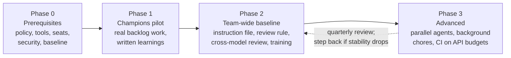

# The AI-first playbook for an engineering team

This playbook is for leads, managers, and AI champions, and takes about 45 minutes to read. Start with the [leads path](../paths/leads.md), and use it alongside the [objections guide](objections.md), the [session series](session-series.md), and the [policy template](policy-template.md).

*Last checked November 8, 2026.*

**TL;DR**
- AI-first means reaching for AI by default and knowing when not to. It doesn't mean AI-only or usage quotas, and a named human still owns every change.
- Roll out in four phases. Phase 0 sets the ground rules (data policy, approved tools, paid seats, security controls, a baseline). Phase 1 is a champions pilot on real backlog work that ends in written learnings. Phase 2 gives everyone the same short instruction file, review rule, cross-model review, and training. Phase 3 adds parallel agents, background agents for well-tested chores, and CI automation on API budgets.
- Each phase has entry criteria, exit criteria, and named risks. Move on when the exit criteria are met, not when the calendar says so.
- Measure outcomes you can count: review latency, PR size, escaped defects, change failure and revert rate, and cost. Don't target lines of code, PR counts, or "% written by AI." Check surveys against measurements. In one of the most careful studies, developers felt 20% faster and were 19% slower.
- The research is mixed. Good habits and strong verification predict the gains, so build those habits and then measure your own team.

## What "AI-first, not AI-only" means

On an **AI-first** team, the first question on any task is "how would an agent help here?" Engineers use agents to read unfamiliar code, plan, write tests, implement, review, debug from logs, and draft tickets. They know how the tool fails, and they check its work.

**AI-only** is what you get when nobody can work without the tool, nobody reads the diffs, and the team's skills quietly wear away. [Module 15](../modules/15-learning-careers-and-responsibility.md#the-human-side) puts it directly: "Being AI-first means reaching for the tool by default and knowing how to use it well. It doesn't mean never working without it."

| AI-first looks like | AI-first does **not** look like |
| --- | --- |
| Every engineer has access to an approved agent and knows when it helps | A mandate that "80% of code must be AI-written" |
| Agents explore, plan, write tests, and implement; humans specify, review, and decide | Merging diffs nobody read because the tests are green |
| A fresh context or a different model reviews every change before a human does | The same session that wrote the code grading itself |
| Juniors use AI as a tutor while they learn and as an accelerator once they can verify | Juniors delegating everything and learning nothing |
| Some work stays deliberately agent-free | Nobody can debug production when the tool is down |
| The team measures outcomes and shares failures openly | Ranking engineers by tokens used or PRs merged |

> **Bryan's take:** When I say vibe coding, I mean AI-accelerated coding, not really vibe coding: engineering with a human in charge, not blind acceptance of whatever the model produces.

This playbook assumes the [ground rules in module 00](../modules/00-orientation.md#ground-rules-we-assume-throughout), which make a decent starting team policy by themselves. The [policy template](policy-template.md) turns them into something you can get approved.

## The rollout at a glance



| Phase | Suggested length | Who | Main output |
| --- | --- | --- | --- |
| 0. Prerequisites | 2–4 weeks | Lead, security, procurement, one or two champions | Approved policy, tools, seats, controls, baseline metrics |
| 1. Champions pilot | 4–6 weeks | 3–6 champions on real work | A written learnings doc, a draft instruction file, a draft review rule, golden tasks |
| 2. Team-wide baseline | 6–10 weeks | Everyone | Shared practices in every main repo; training complete; metrics stable |
| 3. Advanced | Ongoing | Volunteers first, then anyone ready | Parallel and background workflows with budgets and guardrails |

The lengths are suggestions for a team of roughly 5–30 engineers. A bigger organization can run several pilots at once, but each team still goes through every phase.

Note the arrow back from Phase 3. If stability metrics get worse, step back. [Module 08's stages](../modules/08-agentic-workflows.md#steve-yegges-eight-stages) work the same way: "Moving down is allowed."

## Phase 0: Prerequisites

Phase 0 makes sure nobody's first serious experience with these tools is on a free tier, under an unclear data policy, on a laptop full of production credentials.

### Entry criteria

- A lead has sponsorship to spend money on seats and some time on training.
- Someone from security (and legal or privacy, if your organization has them) has agreed to review a policy.

### Activities

**1. Write the data policy first.** Decide what may go into which tool before anyone pastes anything, starting from the [policy template](policy-template.md). These questions matter most:
- Which data classes (public, internal, confidential source code, restricted data such as credentials and personal data) may go into which tools and plans?
- Is training on your content off, and is that written into the contract or only a setting? Anthropic's and OpenAI's business and API terms default to no training; consumer plans differ and change ([module 15](../modules/15-learning-careers-and-responsibility.md#data-privacy-what-not-to-paste)).
- What gets retained, and for how long? Do you need zero data retention for anything ([module 12](../modules/12-costs-subscriptions-and-apis.md#team-budgeting))?

**2. Pick the approved tools.** A good default is one primary agent plus a second from a different lab. Everyone learns the primary. The second keeps you off a single vendor and makes cross-model review possible ([module 06](../modules/06-harnesses-and-tools.md#how-to-choose-a-harness), [module 14](../modules/14-keeping-up.md#when-to-switch-tools)). Score candidates on model access, cost model, privacy terms, team standardization (does it read `AGENTS.md`, support skills, MCP, and managed settings?), and safety features (permission modes, sandboxing, audit logs).

> **Bryan's take:** For coding, Claude and Codex are the best in my opinion. For certain other tasks you might use Grok or Gemini for very specific cases, but not for coding. Different models are better for different use cases.

That opinion is contested and dated. Public benchmarks in late 2026 put some Google models near or at the top on some coding evals ([module 05](../modules/05-judging-models.md#bryans-take)). Decide with your own golden tasks, which you'll build in Phase 1.

**3. Buy paid seats.** Free tiers and personal accounts are a data risk and a bad first impression. Free plans have tight usage limits, and some run on a smaller model. Team or business plans add admin controls, no-training defaults, and spend limits ([module 12](../modules/12-costs-subscriptions-and-apis.md#price-snapshot-as-of-2026-11-08)).

**4. Put the minimum security controls in place.** You don't need the whole [module 11 team checklist](../modules/11-security-and-prompt-injection.md#team-checklist) on day one. You do need these before the pilot starts:
- Branch protection with required human approval on default branches.
- Secret scanning with push protection.
- No production credentials reachable from machines that run agents.
- Managed settings that disable skip-permissions ("YOLO") modes outside a sandbox. The Nx "s1ngularity" malware in August 2025 invoked developers' own AI CLIs with exactly those flags to hunt for secrets ([module 11](../modules/11-security-and-prompt-injection.md#real-incidents-20252026)).
- Secret files kept out of the agent's readable environment, with deny rules as a second layer; test both file-tool and shell reads.

**5. Record a baseline.** You can't show improvement without one. Pull the last three to six months of the [metrics worth watching](#how-to-measure): time to first review, time to merge, PR size distribution, change failure rate, revert rate, and escaped defects by severity.

**6. Choose champions.** Pick three to six people. Include enthusiasts, but get at least one respected skeptic too. A skeptic who comes back saying "it's useful for these three things" persuades more people than any enthusiast.

### Exit criteria

- [ ] A written, approved policy (version 1, explicitly provisional).
- [ ] Approved tools and plans, with seats for the champions.
- [ ] The minimum security controls above are live.
- [ ] Baseline metrics are recorded somewhere the team can see.
- [ ] Champions are named and have protected time (a few hours a week) for the pilot.

### Risks

| Risk | What it looks like | Counter-move |
| --- | --- | --- |
| **Policy paralysis** | Security review takes a quarter; engineers use personal accounts in the meantime | Ship a provisional v1 with a short approved-tools list and a review date. Tighten later |
| **Shadow AI** | People already use unapproved tools | Say so openly. Make the approved path easier than the unapproved one |
| **Choosing on demos** | The tool with the best launch video wins | Score on the harness checklist, then confirm on golden tasks in Phase 1 |
| **Skipping the baseline** | In three months, nobody can say whether anything changed | Pull the numbers now, even if they're rough |

## Phase 1: Champions pilot

The pilot finds out what works on your codebase, for your kind of work. Launch posts and this knowledge base can't tell you that. Your champions can.

### Entry criteria

- Phase 0 exit criteria are met.
- Each champion has picked real backlog items, not toy tasks.

### Activities

**1. Work real tickets, and write everything down.** Each champion keeps a pilot log with one row per task, and failures count as much as wins. The rows below are made-up examples.

```markdown
| Date | Task (ticket) | Type | Tool / model / effort | Outcome | Time vs. estimate | What went wrong | Again? |
| --- | --- | --- | --- | --- | --- | --- | --- |
| 11-12 | Fix timezone bug in report export (#1432) | bugfix | Primary CLI, high | Merged | ~40 min vs 2 h est. | First plan touched 6 files; I narrowed it to 1 | Yes |
| 11-13 | Add pagination to admin list (#1440) | feature | Primary CLI, high | Abandoned | 90 min, no PR | Invented a query-builder method that doesn't exist; kept retrying | Not without better docs in context |
| 11-14 | Characterization tests before refactor (#1398) | tests | Second tool, medium | Merged | ~1 h vs 3 h est. | Two tests asserted current buggy output; caught in review | Yes, review assertions |
```

Time-vs-estimate is self-reported, so it's a rough signal, not a measurement ([module 05](../modules/05-judging-models.md#self-report-vs-measurement)).

**2. Cover a spread of task types.** Try bug fixes, small features, refactors, test writing, a migration, a code review, and non-coding chores like reading unfamiliar code, debugging from logs, drafting tickets, and building an incident timeline ([module 08](../modules/08-agentic-workflows.md#ai-first-beyond-writing-code)). Many engineers first trust agents on that last group.

**3. Use the core loop.** Explore (read-only), plan, write a failing test, implement, verify with evidence, commit small ([module 08](../modules/08-agentic-workflows.md#the-core-loop-explore--plan--implement--verify--commit)). Champions who skip the loop produce pilot data about the wrong thing.

**4. Build a golden-task set.** Turn 10–20 merged PRs into replayable tasks with hidden tests, using the template in [module 05](../modules/05-judging-models.md#build-your-own-eval). It's how you'll compare tools now and judge new releases later.

**5. Draft the team artifacts.** By the end of the pilot, champions should have drafts of:
- A short shared [instruction file](#the-starter-team-instruction-file).
- A [review rule](#review-policy-for-ai-written-prs) for AI-written PRs.
- Any hooks or deny rules that turned out to matter.

**6. Try a review bot on one repository.** Write a three-rule review instruction file first. Label every bot comment as acted on, dismissed (wrong), or dismissed (not worth it) ([module 10](../modules/10-ai-code-review.md#try-it)).

**7. Track cost.** Champions check [ccusage](https://github.com/ryoppippi/ccusage) or the vendor's usage dashboard weekly and record API-equivalent cost next to their subscription price ([module 12](../modules/12-costs-subscriptions-and-apis.md#worked-example-one-hour-of-agentic-coding)).

**8. Meet weekly for 30 minutes.** Each champion shares one win, one failure, and one rule they'd adopt. Write down the objections and policy questions that come up.

### The written learnings

The pilot ends with a two-to-four-page document, not a slide deck:

```markdown
# AI pilot learnings: <team>, <dates>

## Summary (five sentences)

## What worked on our codebase
- Task types, with links to PRs and log rows.

## What didn't, and why
- Include the embarrassing ones. Note whether the cause was the model,
  the harness, the context we gave it, or the task.

## Tasks we'd hand to an agent now / not yet / never
## Rules we'd adopt (draft instruction file, review rule, hooks)
## Golden-task results (tool A vs tool B, with error bars)
## Cost observed (per person per week, API-equivalent vs. seat price)
## Security and policy questions we hit
## Recommendation for Phase 2
```

Share it with the whole team, then hold a demo. The [session series](session-series.md) opens with a demo-first session built for exactly that.

### Exit criteria

- [ ] The learnings document is written and shared.
- [ ] Draft instruction file, review rule, and any hooks are in a PR.
- [ ] A golden-task set of at least 10 tasks exists, with results for the candidate tools.
- [ ] Cost per champion per week is known.
- [ ] Policy questions from the pilot are answered or logged, and the policy is updated.
- [ ] A go, adjust, or stop decision for Phase 2, in writing.

### Risks

| Risk | What it looks like | Counter-move |
| --- | --- | --- |
| **Toy tasks** | The pilot "succeeds" on greenfield scripts nobody needed | Require real tickets from the current backlog |
| **Hero narratives** | One champion's spectacular story becomes the whole pitch | Report the log, not the anecdote. Count failures |
| **Selection bias** | Champions only try tasks they expect to go well | Assign some tasks. Include at least one task each person expects to fail |
| **Champions become gatekeepers** | Knowledge stays with the pilot group | The output is a shared document and shared configuration, not expertise held by a few people |
| **Unreviewed pilot code** | "It's just a pilot," so review gets skipped | The review rule applies from day one |

## Phase 2: Team-wide baseline

Phase 2 turns the pilot's learnings into shared practice: everyone gets the same tools, short instruction file, review rule, and training.

### Entry criteria

- Phase 1 exit criteria are met, and the decision was "go" or "adjust."
- Seats are available for everyone.
- The policy covers what the pilot found.

### Activities

**1. Give everyone a seat and a setup.** Standard installation, managed settings, the approved permission defaults, and a sandbox where your tools support one ([module 06](../modules/06-harnesses-and-tools.md#a-sane-baseline-setup)).

**2. Merge the shared instruction file** into each main repository. Keep it as short as [the starter file](#the-starter-team-instruction-file).

**3. Turn on the review rule.** Enforce [the review policy](#review-policy-for-ai-written-prs) through branch protection, the PR template, and `CODEOWNERS` where needed.

**4. Set up cross-model review.** At minimum, a fresh context reviews every change before a human looks at it. Better, a model from a different lab reviews it, because models tend to rate their own output higher ([module 09](../modules/09-multi-agent-systems.md#recipe-2-cross-model-review)). Licensing the second tool at least for review is usually cheap.

> **Bryan's take:** Multi-agent review is valuable: several agents, and ideally several models, reviewing each other's work.

**5. Run the training series.** The [session series](session-series.md) has eight sessions of 45–60 minutes each, from "what an LLM actually is" to parallel agents. Champions facilitate, and every hands-on exercise uses your own repository.

**6. Make help easy to get.** Run a weekly office hour with a champion and a team chat channel for "the agent did something weird." Pair each new user with a champion for their first real task.

**7. Share a small library.** Keep the prompts, skills, and hooks that worked in a repository, reviewed like code, and keep it small. Anything the whole team needs every time belongs in the instruction file or a hook. Anything needed sometimes belongs in a skill ([module 07](../modules/07-context-engineering.md#current-best-practice)).

**8. Review metrics monthly** against the Phase 0 baseline. Watch stability as closely as throughput. DORA's 2025 report found AI adoption linked to higher throughput but still to lower delivery stability ([module 05](../modules/05-judging-models.md#real-world-productivity-evidence)).

**9. Start the team AI radar** described in [Keeping it current](#keeping-it-current).

### Exit criteria

- [ ] Everyone has completed at least sessions 0–4 of the series, or the equivalent.
- [ ] The instruction file and review rule are live in every main repository.
- [ ] Cross-model or fresh-context review runs on every PR.
- [ ] Two consecutive months of metrics show no regression in change failure rate, revert rate, or escaped defects against the baseline.
- [ ] The objections the team raised have answers on record (see the [objections guide](objections.md)).
- [ ] The radar exists, with owners and revisit dates.

### Risks

| Risk | What it looks like | Counter-move |
| --- | --- | --- |
| **Review becomes the bottleneck** | PRs pile up waiting for humans; time to merge grows | Smaller PRs, a bot layer before humans, review blocks on the calendar ([module 10](../modules/10-ai-code-review.md#why-it-matters-now)) |
| **Rubber-stamping** | Approvals arrive seconds after the PR opens | Track the share of PRs with a substantive human review. Ask authors to explain changes in review |
| **PR size creep** | Agents make big diffs cheap to produce | A soft size limit; split work; stacked PRs |
| **Noisy review bot** | People stop reading its comments | Tune for precision; track the acted-on rate ([module 10](../modules/10-ai-code-review.md#false-positive-fatigue)) |
| **Quota pressure** | Someone starts reporting "% AI-written" upward | Refuse it as a target. It measures adoption, not quality |
| **Instruction file bloat** | Everyone adds a line; nobody deletes one | A line budget, an owner, and a quarterly prune |
| **Cost surprise** | A few heavy users hit caps or a bill spikes | Premium seats or pooled credits for heavy users; spend alerts ([module 12](../modules/12-costs-subscriptions-and-apis.md#team-budgeting)) |

## Phase 3: Advanced use

In Phase 3 the speed gains get bigger, and so does the risk. Not everyone has to get here. Some engineers will be happy with one supervised agent while others run several in parallel, and both are fine if review and stability hold.

### Entry criteria

- Phase 2 exit criteria are met.
- The test suite is reliable enough that a green run means something. Autonomy scales with the strength of your automated checks ([module 08](../modules/08-agentic-workflows.md#what-the-successes-have-in-common)).
- A standard sandboxed environment exists for agent work.

### Activities

**1. Parallel supervised agents.** Volunteers run two to five agents at once, each on its own task, in its own git worktree, on its own branch ([module 08](../modules/08-agentic-workflows.md#worktrees-and-parallel-agents)). These rules keep it sane:
- One task, one agent, one worktree, one branch.
- Pick tasks that touch different files. Reading parallelizes well; writing on one codebase usually doesn't ([module 09](../modules/09-multi-agent-systems.md#building-vs-reviewing-the-readwrite-asymmetry)).
- Keep a written task list.
- Review every branch before merging. Parallelism multiplies unreviewed code as fast as it multiplies output.
- Run only as many agents as you can actually review ([module 15](../modules/15-learning-careers-and-responsibility.md#the-human-side)).

> **Bryan's take:** On Yegge's chart I'm one or two from the top, roughly stage 6–7: several CLI agents running in parallel, managed by hand.

**2. Background agents for well-tested chores.** You hand off a task and get a PR back later. Good candidates have a strong automated check, a small and reversible diff, a low blast radius, and a normal human review at the PR. For example:
- Dependency updates with a full test run (plus your dependency policy for new packages).
- Lint and type-error cleanup.
- Mechanical migrations, one file or module per run, tried on three units before the rest ([module 08](../modules/08-agentic-workflows.md#background-and-unattended-runs)).
- Adding characterization tests before a planned refactor.
- Documentation updates generated from code, with file citations.

Before any unattended run, answer Anthropic's five questions: does it know what done looks like, can it check its own work, what may it touch, what stops it, and where does the result go and who signs off ([module 08](../modules/08-agentic-workflows.md#background-and-unattended-runs)).

**3. CI automation on API budgets.** Review bots, issue triage, and nightly test-fixing jobs run unattended and shared, so they need API keys rather than consumer subscriptions. Vendor terms require it, and the API gives you spend controls ([module 12](../modules/12-costs-subscriptions-and-apis.md#when-api-billing-is-the-right-choice)). Check each workflow's design against the Rule of Two before you build it ([module 11](../modules/11-security-and-prompt-injection.md#two-frameworks-that-make-this-tractable)):
- CI agents that read public or untrusted input run with read-only tokens, no secrets, isolated caches, and limited network.
- Never interpolate untrusted text (issue titles, PR bodies) into a privileged agent's prompt. "Clinejection" and "Comment and Control" both exploited exactly this ([module 11](../modules/11-security-and-prompt-injection.md#real-incidents-20252026)).
- Pin agent CLI versions and model snapshots. Upgrade deliberately, after a smoke test ([module 14](../modules/14-keeping-up.md#silent-changes-and-how-to-pin-things)).
- Set a spend limit per workflow and review cost weekly for the first month.

**4. Review swarms for high-risk changes.** Several reviewers split by concern (correctness, security, tests, API compatibility, simplicity), with a verifier that tries to refute each finding ([module 09](../modules/09-multi-agent-systems.md#recipe-1-a-review-swarm)). Use them where a missed bug is expensive.

### What stays on "Hold"

Keep these on hold until your own evidence says otherwise:
- Auto-merging agent PRs without human approval.
- Agents with production write access.
- Fully autonomous pipelines ("software factories") on your existing product codebase.

> **Bryan's take:** I don't believe fully autonomous agentic workflows work reliably today. Maybe I'm just too dumb; I haven't had good results, but some people claim they work.

The strongest counterpoint is in [module 08](../modules/08-agentic-workflows.md#bryans-take). The trend lines are steep, Anthropic reports that Claude writes more than 80% of the code it merges, and the reported case studies offer answers to "tests can be gamed." A fair position for late 2026 is that full autonomy works for well-specified, oracle-rich, greenfield problems, and that the boundary is moving. Recheck in six months.

### Exit criteria (per workflow, not per phase)

Phase 3 doesn't end. Each new workflow graduates from Trial to Adopt on your radar when:
- [ ] It has run for at least a month with a named owner.
- [ ] Its cost per week is known and within budget.
- [ ] Its output went through normal review, and the acted-on and revert rates are acceptable.
- [ ] Its Rule-of-Two design is written down.

### Risks

| Risk | What it looks like | Counter-move |
| --- | --- | --- |
| **Autonomy outruns checks** | Agents produce more than the tests can vouch for | Raise autonomy one notch at a time, only as fast as automated checks can catch what you stop looking at ([module 08](../modules/08-agentic-workflows.md#the-autonomy-spectrum)) |
| **Agents game the tests** | Deleted, skipped, or special-cased tests | Test-diff review on every PR; hidden or holdout checks for unattended work ([module 08](../modules/08-agentic-workflows.md#tests-as-the-agents-contract)) |
| **Supervision fatigue** | Approving diffs nobody read; no deep-focus time | Fewer agents; batched review blocks; agent-free time |
| **CI prompt injection** | A crafted issue or PR steers a CI agent | Rule of Two; read-only tokens; no secrets in untrusted workflows |
| **Runaway spend** | Loops or swarms with no stop condition | Caps on agents, turns, spend, and wall-clock time ([module 09](../modules/09-multi-agent-systems.md#budgets-and-stop-conditions)) |
| **Disk and worktree debris** | Dozens of abandoned checkouts and build directories | Remove worktrees when branches merge |

## The starter team instruction file

Every main repository gets one short, shared instruction file: `AGENTS.md` (read by most harnesses) or `CLAUDE.md` (current Claude Code can read `AGENTS.md` when no `CLAUDE.md` or `CLAUDE.local.md` exists on the project path; verify loading with `/memory`). The research on these files is sobering. In an ETH Zurich study, LLM-generated context files didn't improve success rates and raised costs by about 20–23%; developer-written files helped a little, not significantly ([module 07](../modules/07-context-engineering.md#the-fall-late-20252026)). So keep it short, human-written, and limited to what an agent can't learn from the repository.

### A good starter file

It's about 25 lines. Swap in your own commands and gotchas.

```markdown
# AGENTS.md

## Commands
- Install: `pnpm install`
- Fast unit tests: `pnpm test:unit`
- One test file: `pnpm vitest run path/to/file.test.ts`
- Integration tests (needs Docker running): `pnpm test:int`
- Lint and typecheck: `pnpm lint && pnpm typecheck`

## Things the code won't tell you
- `src/legacy/` still serves production traffic but is frozen. Call it
  through `src/adapters/legacy.ts`. Don't edit it or copy its patterns.
- Timestamps are UTC in storage and in APIs. Convert only in the UI layer.
- New behavior ships behind a flag in `config/flags.ts`.
- `src/generated/` comes from `pnpm codegen`. Edit the schema, not the output.
- Integration tests use a real database in Docker. If Docker isn't running,
  stop and say so. Don't mock the database to get a green run.

## Where to look
- Architecture decisions: `docs/adr/`
- API conventions: read `docs/api.md` before adding an endpoint
- Releases: use the `release` skill

## Done means
- Lint, typecheck, and unit tests pass, and you show the command output.
- New behavior has a test that failed before the change.
- The PR description lists anything you could not verify.
```

Commands come first, because an agent that can run the right check stops guessing. Each gotcha is something the code misleads about: a frozen directory that looks live, a convention you can't infer, a generated folder. Deeper docs are linked, not pasted, so they load only when needed. And "done" is defined in terms the agent can check and show you.

### Where everything else goes

| Kind of rule | Example | Put it in |
| --- | --- | --- |
| Must always happen | Run the formatter after every edit | A hook |
| Must never happen | Never read `.env`; never push to `main` | A deny rule, hook, sandbox, or branch protection |
| Style a tool enforces | Indentation, import order | Formatter and linter config |
| A procedure needed sometimes | Cutting a release, writing a migration | A skill |
| Applies to one part of the repo | API handlers use the v2 response helpers | A nested `AGENTS.md` or path-scoped rule |
| Discoverable from the code | "We use React"; the directory tree | Nowhere. Delete it |
| A personal preference | "Keep explanations short" | Each person's user-level file |

Claude Code's docs give the reason. A line in `CLAUDE.md` is followed "nearly every time," while a hook or deny rule applies every time ([module 08](../modules/08-agentic-workflows.md#tests-as-the-agents-contract)).

### The anti-pattern: the committee file

This is what a shared file turns into when everyone can add a line and nobody owns it:

```markdown
# AGENTS.md: MANDATORY. READ EVERY LINE BEFORE DOING ANYTHING!!!

You are an elite staff engineer who writes flawless, production-grade code.

## Team rules (add yours below!)
1. ALWAYS write clean, maintainable code.
2. NEVER introduce bugs.
3. IMPORTANT: use 2-space indentation.        <- the formatter does this
...
41. (backend) Prefer small, single-purpose functions.
42. (frontend) Prefer fewer, larger components.  <- conflicts with 41, no scope
...
## Full directory tree (generated last year)   <- stale; the agent can read the repo
...
## Our style guide (pasted from the wiki)       <- 400 lines on every task
```

The research has measured why this fails. Every line costs attention on every task, and instruction-following drops as instructions pile up. In one benchmark, even the best models reached only 68% accuracy with 500 instructions ([module 07](../modules/07-context-engineering.md#the-fall-late-20252026)). Shouting doesn't help either. Claude Code's docs say piling on capitals and "IMPORTANT" "mostly makes Claude over-apply the rule" ([module 07](../modules/07-context-engineering.md#prompting-basics-that-still-matter)).

### Keeping the file healthy

- Give each repository one owner and a line budget. Claude Code's guide says to stay under 200 lines; the starter above is about 25.
- Send changes through PRs and review them like CI configuration. Instruction files are trusted context, so a malicious edit is a prompt-injection channel ([module 07](../modules/07-context-engineering.md#context-files-are-a-security-surface)).
- Follow the "corrected twice" rule: add a line only after you've had to correct the agent on the same thing twice.
- Prune every quarter. For each line, ask "Could the agent figure this out by reading the repository?" If so, delete it.
- For a significant change, rerun a few golden tasks with and without it.

## Review policy for AI-written PRs

Your branch protection and PR template should enforce this rule, adapted from [module 10](../modules/10-ai-code-review.md). Copy it into your contributing guide and adjust the numbers.

1. **Same bar as any PR.** AI-written code gets no separate lane, with lower standards or higher ones.
2. **A named human author opens the PR and can explain every line.** "The agent did it that way" is not an answer to a review question. If the author can't explain a line, it doesn't merge ([module 10](../modules/10-ai-code-review.md#make-the-author-explain-the-change)).
3. **A named human approves the merge, and owns the result.** Bot reviews never count as approvals. Branch protection requires at least one human approval on default branches ([module 10](../modules/10-ai-code-review.md#accountability-the-human-who-merges-owns-it)).
4. **Independent review comes before human review.** At minimum, a fresh context that didn't see the conversation; preferably, a model from a different lab. The author verifies each finding (a failing test or a clear refutation) before acting on it ([module 10](../modules/10-ai-code-review.md#verify-findings-before-acting)).
5. **Keep PRs small.** The soft limit is `[a few hundred]` changed lines, excluding generated files and lockfiles. Split or stack anything larger. On Anthropic's own review tool, 84% of PRs over 1,000 lines got findings, against 31% of PRs under 50 lines ([module 10](../modules/10-ai-code-review.md#keep-prs-small)).
6. **Read the test diff first.** No deleted, skipped, or loosened tests without a stated reason. New behavior has a test that was seen failing.
7. **New dependencies are called out and verified.** Each one exists, is spelled right, is maintained, is needed, and has a compatible license. Models invent package names, and attackers register them ([module 11](../modules/11-security-and-prompt-injection.md#risks-specific-to-coding-agents)).
8. **Evidence, not claims.** The PR description includes the commands run and their results, and screenshots for UI changes.
9. **High-risk paths get an owner's review.** Authentication, authorization, data migrations, infrastructure, and anything listed in `CODEOWNERS` get a domain owner's review plus the security items of the checklist.
10. **Disclose how the work was made**, following your [policy](policy-template.md): a co-author trailer, a PR section, or both.
11. **Triage bot findings by severity.** High blocks the merge. Medium is fixed or ticketed with an owner. Low is the author's call. Noise means the bot needs tuning ([module 10](../modules/10-ai-code-review.md#severity-triage)).

A PR template that supports the rule:

```markdown
## What and why
<!-- One paragraph. Link the issue. -->

## How I verified it
<!-- Commands and results. Screenshots for UI. -->

## What the agent did vs. what I did
<!-- e.g. "Agent wrote the implementation and tests from my spec; I reviewed
     every line, rewrote the retry logic, and added the edge-case test." -->

## Independent review
<!-- Which reviewer (model or tool), what it found, what you fixed or refuted. -->

## Risks and rollback
```

Reviewers use the checklist in [module 10](../modules/10-ai-code-review.md#how-humans-should-review-ai-written-prs): intent, hallucinated APIs, new dependencies, tests that test nothing, swallowed errors, unnecessary abstraction, dead code, security, licensing, consistency, and operability.

## How to measure

### Start with honest expectations

The productivity evidence is mixed, partly because studies measure different tasks and outcomes. These are the studies your skeptics and your enthusiasts will cite, from [module 05](../modules/05-judging-models.md#real-world-productivity-evidence):

| Study | Finding | What to take from it |
| --- | --- | --- |
| Peng et al., 2023 | 55.8% faster on one small greenfield task | Controlled experiment on one task; limited generalization |
| Cui, Demirer et al., 2025 (4,867 developers) | +26% completed tasks; bigger gains for less experienced developers | Counts output, not value |
| METR RCT, 2025 (16 experienced maintainers, own repos, early-2025 tools) | **19% slower**. They expected 24% faster and afterward *believed* they were 20% faster | The perception gap is the durable lesson. METR now calls the result out of date |
| METR follow-up, Feb 2026 (late-2025 tools) | 18% and 4% faster for two groups, confidence intervals include zero | METR calls it an unreliable signal: 30–50% of developers withheld tasks they didn't want to do without AI, which biases the estimate toward zero |
| DORA 2025 (~5,000 professionals) | 90% use AI; more than 80% *believe* it raised productivity; adoption linked to higher throughput and lower stability | "AI amplifies what's already there" |
| METR on Anthropic, Nov 2026 | Measured progress ~2x faster than 2024–25 (plausibly 1.3x–3x); staff *self-reported* ~12x | Individual uplift and organizational acceleration are different quantities; do not divide these estimates |

For your team and your leadership, four sentences cover it. Careful studies show real speedups on some work and real slowdowns on other work. The biggest predictors are the type of task, the developer's skill with the tools, and the team's verification practices. Self-reported gains run well ahead of measured ones. So we will build the habits, then measure ourselves instead of quoting the most convenient study.

### What to watch

| Metric | Why | Source |
| --- | --- | --- |
| **Review latency** (time to first review, time to merge) | Shows whether review is the bottleneck, and whether a bot layer helps | Your git host |
| **PR size distribution** | Big PRs predict poor reviews; agents make big PRs cheap | Your git host |
| **Change failure rate and revert rate** | DORA's stability measures; AI adoption has been linked to lower stability | Deploy and incident records |
| **Escaped defects by severity** | The outcome review exists to prevent | Bug tracker |
| **Rework** (follow-up fixes to the same code within a few weeks) | Catches "almost right" code that passed review | Git history, bug tracker |
| **Share of PRs with a substantive human review** | Guards against rubber-stamping | Sample PRs monthly |
| **Bot comment acted-on rate** | A proxy for reviewer precision; falling rates mean growing noise. Industrial studies saw about 39% to 74% | Label a sample |
| **Golden-task results** | The only apples-to-apples comparison of tools and models on your code | Your eval set |
| **Spend vs. budget, per workflow** | Catches runaway loops and cap problems early | Vendor dashboards, ccusage |
| **Developer-reported friction** (short monthly pulse) | Finds problems metrics miss. Compare reported speedups with measured outcomes | A five-question survey |

### What not to measure (or never to target)

| Metric | Why not |
| --- | --- |
| **Lines of code** | Rewards bloat. Even Anthropic calls it "an imperfect measure, as it measures quantity over quality" |
| **Number of PRs merged** | Easy to inflate by splitting work |
| **Percentage of code written by AI** | Describes adoption, not quality. As a target, it rewards accepting more AI output |
| **Tokens used, sessions run, or prompts per day** as productivity | Measures spend and activity. A leaderboard of tokens is a leaderboard of cost |
| **Self-reported speedup on its own** | In METR's 2025 study the sign was wrong |
| **Number of bot comments** | More is not better |

Seat activation and weekly active users are fine as *adoption* numbers. Don't present them as outcomes.

Goodhart's law applies to all of this: when a measure becomes a target, it stops being a good measure. Use metrics to find problems, never to rank engineers ([module 10](../modules/10-ai-code-review.md#team-metrics-what-to-watch-what-not-to-measure)).

### A lightweight measurement plan

1. Record a baseline in Phase 0 from three to six months of the metrics above.
2. From Phase 1 on, pull the same metrics monthly, plus pilot logs and spend.
3. Run golden tasks whenever you change a default tool, model, or major setting, and monthly against anything on the radar's Trial ring.
4. Send a five-question pulse each month: What did an agent help with most? What wasted your time? Did you ship anything you didn't fully understand? Is review keeping up? What should we change?
5. Send leadership a quarterly write-up: what changed against the baseline, what it cost, and what you're changing next. Show your assumptions, especially in any ROI estimate.

## Budgeting

This is a lead's summary of [module 12](../modules/12-costs-subscriptions-and-apis.md).

There are three ways to pay: chat and agent subscriptions from the labs, tool subscriptions (Cursor, Copilot, and others), and the API, billed per token ([module 12](../modules/12-costs-subscriptions-and-apis.md#three-ways-to-pay)).

Agents are expensive on the API because every turn re-sends the whole conversation, so cost grows roughly with the square of session length. Prompt caching cuts most of that. In module 12's worked example, one hour of steady agentic coding on a frontier model cost about $24 uncached and about $3.73 cached at API prices; a full-time month of that is roughly $630 for one agent at a time (as of November 2026; [worked example](../modules/12-costs-subscriptions-and-apis.md#worked-example-one-hour-of-agentic-coding)). Parallel agents multiply it.

By default, split it like this:
- Business-plan seats for everyone who uses agents interactively: standard seats for most people, premium seats or pooled credits for the heaviest users.
- API keys with budgets for CI, automation, batch jobs, and anything shared or unattended. Use an automation offering the vendor's current terms permit; this playbook defaults to budgeted API access for CI and shared workloads ([module 12](../modules/12-costs-subscriptions-and-apis.md#the-subscription-subsidy-and-its-limits)).
- Pay-as-you-go for light users who run a few short tasks a week, since it may be cheaper.

> **Bryan's take:** API pricing is too expensive for heavy agentic use. Subscriptions are what make it affordable to work this way every day.

[Module 12](../modules/12-costs-subscriptions-and-apis.md#bryans-take) lists the counterpoints. Caps and throttling are the price of a subscription. Vendors have tightened caps and changed terms several times in a year. Not every plan permits shared automation. And for a team with uneven usage, pooled API credits plus good caching and routing can beat buying top-tier seats for everyone.

For ROI, module 12 assumes a loaded cost of about $100 per engineer-hour, so a $200-a-month seat costs about two engineer-hours a month, and a 10-person team on $200 seats is about $24,000 a year, roughly 13% of one loaded engineer ([team budgeting](../modules/12-costs-subscriptions-and-apis.md#team-budgeting)). The weak link is always the assumed productivity gain, so show your assumptions and replace them with measured numbers after Phase 2.

Judge cost per finished task, not price per token. A cheaper model that takes three times as many turns can cost more in tokens and much more in your engineers' attention ([module 12](../modules/12-costs-subscriptions-and-apis.md#cost-per-task-not-cost-per-token)).

Set these controls on day one: spend limits and alerts per workspace and key; separate keys per app, environment, and team; caching on; small models for easy work; turn and effort caps on automated runs; and a weekly cost review for the first month of any new workflow ([module 12](../modules/12-costs-subscriptions-and-apis.md#when-api-billing-is-the-right-choice)).

A budget worksheet to fill in:

```markdown
| Line | Count | Unit price (as of <date>) | Monthly | Notes |
| --- | --- | --- | --- | --- |
| Standard seats, primary tool | <n> | <$> | <$> | Everyone |
| Premium seats or pooled credits | <n> | <$> | <$> | Heaviest users, from pilot ccusage data |
| Second tool for cross-review | <n> | <$> | <$> | Review-only use may fit a cheaper tier |
| API: review bot | <PRs/month> | <$ per PR, measured> | <$> | Spend limit set at <$> |
| API: other automation | <runs/month> | <$ per run, measured> | <$> | Spend limit set at <$> |
| Contingency for caps and price changes | | | <$> | Vendors change limits; plan for it |
```

## Security controls

This is the short version of [module 11](../modules/11-security-and-prompt-injection.md). A coding agent on a laptop reads untrusted content (web pages, issues, dependency code), can reach private data (your repository and secrets), and can change state (a shell, `git push`). By default, that's all three legs of Meta's "Agents Rule of Two." Prompt injection is not solved; adaptive attacks bypassed most published defenses at success rates above 90% in one 2025 study ([module 11](../modules/11-security-and-prompt-injection.md#why-it-is-still-unsolved)). The defenses have to be architectural.

Controls by phase:

| Phase | Controls |
| --- | --- |
| **0** | Business plans with no-training terms; branch protection with human approval; secret scanning with push protection; no production credentials on agent machines; managed settings that disable skip-permissions modes outside sandboxes; remove secret files from agent environments and test read restrictions |
| **1** | Pilot champions use sandboxes where available; an incident path for "an agent may have read a secret"; review new MCP servers, skills, and plugins before installing |
| **2** | A standard sandboxed environment (dev container or cloud agent); an approved, pinned list of MCP servers, skills, and plugins with owners; a dependency policy (lockfiles, review new packages, delay brand-new releases); the security items in the review checklist; agent tool updates on a cadence |
| **3** | A written Rule-of-Two design per automated workflow; read-only tokens, no secrets, and isolated caches for CI agents that read untrusted input; egress allowlists; fine-grained, short-lived, per-agent tokens; usage telemetry retained for audit |

Three incidents worth retelling to the team, all documented in [module 11](../modules/11-security-and-prompt-injection.md#real-incidents-20252026):
- In the Nx "s1ngularity" attack (August 2025), a compromised build tool's install script drove developers' installed AI CLIs with skip-permissions flags to search for secrets. Those flags are a gift to malware.
- In July 2025, an agent deleted a production database during a code freeze, with no attacker involved. Separate dev from prod, and require approval for destructive actions.
- In "Clinejection" (December 2025 to February 2026), an AI triage bot put issue titles straight into its prompt, and an attacker used that to reach release secrets. Never put untrusted text into a privileged agent's prompt in CI.

Generated code needs the same security review you'd give a stranger's PR. In one user study, people with an AI assistant wrote less secure code and were *more* confident in it ([module 11](../modules/11-security-and-prompt-injection.md#insecure-generated-code)).

## Juniors and learning

This is the problem leads ask about most, and the evidence is clearer than you might expect.

[Module 15](../modules/15-learning-careers-and-responsibility.md#what-the-evidence-says) summarizes the evidence:
- In a 2026 randomized trial with 52 mostly junior engineers learning a new library, the AI group scored 50% on a follow-up quiz against 67% for hand-coders, and wasn't significantly faster. The biggest gap was in debugging.
- *How* they used the AI mattered. People who asked conceptual questions, or generated code and then asked follow-up questions to understand it, scored 65% or higher. People who delegated scored below 40%. The subgroups were small, so this is suggestive, not proof.
- In a high-school field experiment, an AI that gave answers hurt later exam scores; an AI prompted to tutor with hints didn't.
- Higher confidence in the AI was associated with less critical thinking in a survey of knowledge workers.

So the risk is real, and it's about how people use the tool. There's also a supervision paradox. Supervising agents well takes judgment you build by doing the work, and the skill most at risk, debugging, is the one supervision needs most ([module 15](../modules/15-learning-careers-and-responsibility.md#deskilling-real-risk-or-old-panic)).

What the team can do about it:

1. Label work by learning value with module 15's three tiers: *AI-free* for a small set of fundamentals reps and some onboarding tasks, *AI-as-tutor* while someone learns a new codebase, language, or domain (explanations, hints, and review, but they write the code), and *AI-accelerated* once they can verify what the agent produces.
2. Turn on the learning modes. Claude Code's Learning output style (`/output-style learning`) explains its choices and leaves small pieces of real work marked `TODO(human)`. ChatGPT has a study mode ([module 15](../modules/15-learning-careers-and-responsibility.md#how-to-learn-with-ai-instead-of-outsourcing-learning)).
3. Debug first, then ask. Juniors form a hypothesis before asking the agent, since debugging showed the largest gap in the trial.
4. Pair on supervision. A senior and a junior run an agent session together, and the senior says out loud what they reject and why. Supervision is a skill you can watch someone do.
5. Use explain-back in review. Ask every author, juniors especially, "why this approach?" and "what happens when this input is empty?" Rule 2 of the review policy already requires it.
6. Keep a "didn't understand" log: one line each time someone accepts something they don't fully understand, reviewed in 1:1s.
7. Protect onboarding tasks. Some open-source projects ask that newcomer "good first issues" be done without AI, because they exist to teach ([module 13](../modules/13-open-source-ecosystem.md#the-other-side-ai-slop-and-maintainer-burden)). Do the same with your starter tickets.
8. Evaluate juniors on judgment rather than volume: their specs, review findings, tests, debugging write-ups, and the times they overrode the agent.

These habits apply to senior engineers moving into an unfamiliar codebase too. The trial's participants were professionals.

On hiring, payroll data show employment of 22–25-year-olds in AI-exposed occupations about 19% below trend by mid-2026, mostly through fewer hires ([module 15](../modules/15-learning-careers-and-responsibility.md#what-the-evidence-says-about-early-career-jobs)). The cause is debated. The long-run problem, as module 15 puts it, is that companies that stop hiring juniors eventually run out of seniors. That decision is above most leads' pay grade, but it's worth raising.

## The human side

- Don't mandate usage; quotas produce theater and resentment. Make the tools good, the training real, and the results visible.
- Watch for overload. Research summarized in Harvard Business Review argued that AI tools tend to intensify work rather than reduce it, and running several agents means constant context switches ([module 15](../modules/15-learning-careers-and-responsibility.md#the-human-side)). Warning signs include approving diffs nobody read, losing track of agents, and no deep-focus time.
- Don't send workslop: anything you haven't read, whether a 2,000-line PR or a design doc that sounds right and says nothing.
- Make failure safe to share. The pilot log and the team channel should be full of "the agent did something dumb," because that's how the instruction file and hooks get better.
- Respect skeptics, because many of their objections are partly right. The [objections guide](objections.md) starts each one with what's true.

## A 30/60/90-day checklist for a lead

### Days 1–30: foundations (Phase 0, start Phase 1)

- [ ] Read the [leads path](../paths/leads.md) and this playbook.
- [ ] Draft the policy from the [template](policy-template.md); send it to security and legal for review with a requested turnaround date.
- [ ] Choose a primary tool and a second tool for cross-review; start procurement with the data-terms questions from [module 12](../modules/12-costs-subscriptions-and-apis.md#team-budgeting).
- [ ] Turn on branch protection, secret scanning with push protection, and managed settings that disable skip-permissions modes.
- [ ] Confirm no production credentials are reachable from developer machines that will run agents.
- [ ] Pull baseline metrics for the last three to six months.
- [ ] Name three to six champions, including at least one skeptic, and protect a few hours a week for them.
- [ ] Run [Session 0](session-series.md#session-0-watch-it-work-on-our-code) of the training series as a demo for the whole team.
- [ ] Start the pilot on real backlog tickets, with pilot logs.

### Days 31–60: learn (Phase 1)

- [ ] Hold weekly 30-minute champion syncs; collect wins, failures, rules, and objections.
- [ ] Build a golden-task set of 10–20 tasks and run it on both candidate tools.
- [ ] Trial one review bot on one repository with a three-rule configuration; label its comments.
- [ ] Record cost per champion per week.
- [ ] Write and share the learnings document.
- [ ] Merge drafts of the instruction file and review rule as PRs for team comment.
- [ ] Update the policy with what the pilot found; get v1 approved.
- [ ] Make the written go, adjust, or stop decision for Phase 2.

### Days 61–90: spread (Phase 2)

- [ ] Give everyone a seat and a standard setup.
- [ ] Merge the instruction file and turn on the review rule in every main repository.
- [ ] Turn on fresh-context or cross-model review for every PR.
- [ ] Run sessions 1–4 of the training series; schedule 5–7.
- [ ] Start office hours and a team channel for agent questions.
- [ ] Start the AI radar with a first scout and a monthly review.
- [ ] Review metrics against the baseline; write a short update for leadership.
- [ ] Pick one or two Phase 3 candidates (a background chore, a CI review bot) and write their Rule-of-Two designs, but don't launch until Phase 2's exit criteria are met.

## Keeping it current

The tools change monthly and the practices change slowly. Keep the practices stable, and judge new tools on evidence ([module 14](../modules/14-keeping-up.md)).

Run a team AI radar in the Thoughtworks format that [module 14](../modules/14-keeping-up.md#team-ai-radar) describes:
- **Adopt:** proven on our golden tasks; the recommended default.
- **Trial:** promising; a few people use it on real work.
- **Assess:** worth an afternoon; someone is testing it.
- **Hold:** don't start new work with it, with a reason.

Keep it in a shared repository as `docs/ai-radar.md`. Rotate a monthly scout who skims sources, proposes items, and runs the [afternoon evaluation](../modules/14-keeping-up.md#evaluating-a-brand-new-release-in-an-afternoon) on anything promising. Each item moves at most one ring per monthly review, only with evidence, and every entry has an owner and a revisit date.

```markdown
# AI radar (updated <date>)

| Item | Ring | Since | Evidence | Owner | Revisit |
| --- | --- | --- | --- | --- | --- |
| Primary CLI agent + current frontier model | Adopt | <month> | Golden set <x>/<n>; pilot learnings | <name> | <date> |
| Second-lab agent for cross-review | Adopt | <month> | Acted-on rate <x>% over <n> PRs | <name> | <date> |
| Review bot on PRs (API budget) | Trial | <month> | One repo, <n> weeks, spend within limit | <name> | <date> |
| Background agent: dependency updates | Assess | <month> | Not yet run | <name> | <date> |
| Auto-merge of agent PRs | Hold | <month> | Review stays mandatory | <name> | <date> |
```

A cadence that doesn't take over anyone's week:

| Cadence | Who | What |
| --- | --- | --- |
| Weekly, 30 min | The scout | Changelogs for the tools in use; one or two newsletters; at most one item onto the try list |
| Monthly, 30 min | Team | Radar review; golden tasks on anything in Trial; one tool, plugin, or MCP server removed if unused |
| Quarterly, half a day | Lead and champions | Tool and cost review; refresh golden tasks; prune instruction files; review security settings and the policy |

A few rules keep churn down:
- Use the two-week rule. Unless a release solves a problem you have today, wait two weeks. Opus 5's reputation looked very different at week two than on launch day ([module 14](../modules/14-keeping-up.md#a-sustainable-routine)).
- Change one thing at a time. Don't switch model, harness, and configuration in the same week.
- Keep a second tool warm. When Anthropic suspended Claude Fable 5 for all users for nearly three weeks in 2026 over export controls, people with a configured second tool kept working ([module 14](../modules/14-keeping-up.md#when-to-switch-tools)).
- Diagnose before you switch. When the tool feels worse, check the status page, then your harness version and settings, then your golden tasks, then whether today's task is just harder ([module 14](../modules/14-keeping-up.md#is-it-the-model-the-task-or-the-harness)).

> **Bryan's take:** Claude and Codex have both had ups and downs.

The documented record in [module 14](../modules/14-keeping-up.md#a-field-guide-to-recent-ups-and-downs) backs that up for both vendors. It's the practical case for the warm backup and for golden tasks you can rerun in an afternoon.

## Common rollout failures

| Failure | Why it happens | What to do instead |
| --- | --- | --- |
| Mandating usage or setting AI-percentage targets | Leadership wants a number | Report outcomes against the baseline |
| Rolling out on free tiers or personal accounts | Procurement is slow | Run a small paid pilot while procurement finishes |
| Big-bang autonomy | A demo of a "software factory" | Raise autonomy one notch at a time, behind checks |
| A thousand-line shared instruction file | Everyone adds, nobody deletes | Line budget, owner, quarterly prune |
| Tool churn | Every launch looks like the new best | The radar, the two-week rule, golden tasks |
| Measuring lines of code or PR counts | They're easy to pull | Review latency, stability, escaped defects |
| Security as an afterthought | It slows the pilot | The Phase 0 minimum controls are small; do them first |
| Ignoring juniors | Seniors get the visible wins | Tiered work, pairing on supervision, explain-back |
| Champions who stop sharing | Knowledge becomes status | Written learnings and shared configuration |

## Sources and further reading

This playbook draws on the modules; each claim links to the section that sources it. The key primary sources behind those sections:

- METR, [Measuring the Impact of Early-2025 AI on Experienced Open-Source Developer Productivity](https://arxiv.org/abs/2507.09089) (Becker, Rush, Barnes, Rein, 2025), [We are changing our developer productivity experiment design](https://metr.org/blog/2026-02-24-uplift-update/) (Feb 2026), and [Assessment of AI R&D acceleration at Anthropic](https://metr.org/blog/2026-11-05-anthropic-ai-rd-acceleration-assessment/) (Nov 2026)
- Google Cloud, [Announcing the 2025 DORA Report](https://cloud.google.com/blog/products/ai-machine-learning/announcing-the-2025-dora-report) (Sep 2025)
- [The Effects of Generative AI on High-Skilled Work](https://papers.ssrn.com/abstract=4945566) (Cui, Demirer et al., 2025)
- [How AI Impacts Skill Formation](https://arxiv.org/abs/2601.20245) (Shen, Tamkin, 2026)
- [Evaluating AGENTS.md: Are Repository-Level Context Files Helpful for Coding Agents?](https://arxiv.org/abs/2602.11988) (Gloaguen et al., 2026)
- [How Many Instructions Can LLMs Follow at Once?](https://arxiv.org/abs/2507.11538) (Jaroslawicz et al., 2025)
- Anthropic, [Best practices for Claude Code](https://code.claude.com/docs/en/best-practices); OpenAI, [Codex best practices](https://learn.chatgpt.com/guides/best-practices)
- Meta, [Agents Rule of Two](https://ai.meta.com/blog/practical-ai-agent-security/) (2025); Simon Willison, [The lethal trifecta for AI agents](https://simonwillison.net/2025/Jun/16/the-lethal-trifecta/) (2025)
- Steve Yegge, [Welcome to Gas Town](https://steve-yegge.medium.com/welcome-to-gas-town-4f25ee16dd04) (Jan 2026)
- [Thoughtworks Technology Radar](https://www.thoughtworks.com/radar)

## Terms introduced

- **AI-first (not AI-only):** Reaching for AI by default on each task, while keeping the skills and judgment to work without it and to verify its output.
- **Champion:** An engineer given time to pilot AI tools on real work and share what they learn.
- **Pilot log:** A per-task record of what a champion tried, with which tool, and what happened, including failures.
- **Review rule:** A team's written requirements for reviewing and merging AI-assisted changes, enforced through branch protection and PR templates.
- **Committee file:** A shared agent instruction file that grew by accretion until it hurt more than it helped.
- **Corrected-twice rule:** Add a line to the instruction file only after correcting the agent on the same thing twice.
- **Phase exit criteria:** The conditions that must hold before a rollout moves to its next phase.
